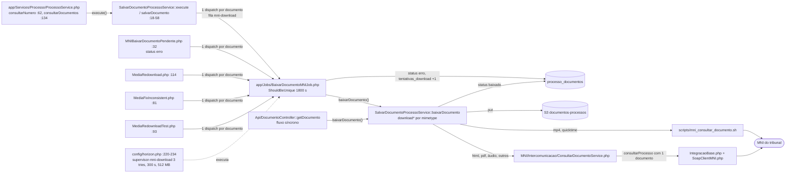
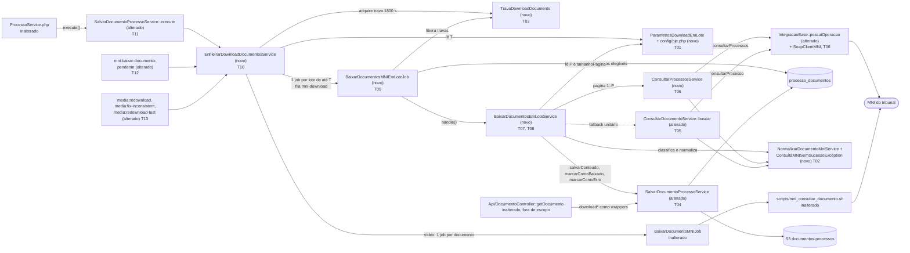

# Implementation Plan

## Request Summary
- Objective: substituir o download de binários não-vídeo "1 job + 1 `consultarProcesso` por documento" por jobs de lote com até T documentos do mesmo processo (padrão 20). Cada lote faz uma chamada MNI `consultarProcessos` por página e nenhuma chamada por documento no caminho feliz. Há fallback unitário (`consultarProcesso`) quando a operação não existe no WSDL ou quando uma página volta com `sucesso = false`, além de falha total, falha definitiva e trava por documento. Fonte: `.spec/features/baixar-documentos-mni-em-lote/SPEC.md` v1.3 (13 RF, 3 RNF, 3 CT, 0 marcadores).
- Scope:
  - In: RF-01..RF-13, RNF-01..RNF-03, CT-01..CT-03. Inclui nova operação SOAP, serviço de lote, job de lote, trava por documento, parâmetros T/P em `config/pje.php` e migração dos 5 pontos de despacho, com vídeos fora do lote.
  - Out (SPEC `## Scope`): fluxo síncrono `GET /documento/visualizar` e sua auto-correção de HTML; API REST e `docs/api/openapi.yaml`; schema do banco; vídeos (`video/mp4`, `video/quicktime`), que continuam com `BaixarDocumentoMNIJob` + `scripts/mni_consultar_documento.sh`; limites do `supervisor-mni-download`; trânsito das credenciais no payload; timeout SOAP; agendamento de `mni:baixar-documento-pendente`.
- Tier: complete
- Architecture references: `AGENTS.md`, `docs/agents/architecture.md`, `docs/agents/domain_rules.md`, `docs/agents/coding_guidelines.md`, `docs/agents/data_model.md`
- Regras de camada preservadas em todas as tasks:
  - `architecture.md` (Layer responsibilities): `Services/MNI` + `IntegracaoBase` têm uma classe por operação SOAP e não persistem. `Services/Processo` persiste o payload MNI e enfileira downloads. Jobs cuidam de fila, `$tries`, `$timeout` e marcação de falha. Comandos de console só despacham.
  - `AGENTS.md` §2: chamadas SOAP passam por `IntegracaoBase` + `SoapClientMNI`, e erros MNI viram `MNIException`.
  - `coding_guidelines.md`: §6 (todo dispatch nomeia a fila; jobs recebem ids e recarregam os models), §8 (parâmetros ajustáveis em `config/pje.php`, lidos via `config()`), §9 (`MNIException` padroniza a mensagem), §10 (prefixo de log `[Entidade:{id}]`), §13 (Pest `it('<frase pt-BR>')`, `DatabaseTransactions`, `Queue::fake`, `Storage::fake('s3')`, `mock()`).
  - `domain_rules.md` (Document binary download): roteamento por `mimetype`, chaves S3 e ciclo `pendente` → `baixado` | `erro`.
  - `data_model.md`: `processo_documentos.id_documento` é `varchar` com cast `integer` no model; `tentativas_download` é "incrementado por tentativa"; a coluna `erro_mni` não existe.
- Contratos: **skipped**, nenhum artefato emitido. CT-01 e CT-03 são operações SOAP de saída consumidas do MNI, e CT-02 é a interface CLI inalterada. A feature não expõe nenhuma superfície nova: o SPEC deixa explicitamente fora de escopo a API REST e o `docs/api/openapi.yaml`, e os jobs de fila são internos. O CT-01 é validado por teste de unidade (T06).
- Comando de teste (AGENTS.md §1): `docker compose exec -T php php artisan test --compact` (o mesmo usado pelo gate 2 do `./ralph.sh`). Cada fase deixa a suíte inteira verde.

## AS IS — Componentes impactados

Hoje os cinco pontos de despacho enfileiram um `BaixarDocumentoMNIJob` por documento na fila `mni-download`. Cada job faz uma chamada `consultarProcesso` com um único documento, pelo `ConsultarDocumentoService` ou, para vídeos, pelo script bash, e grava o status documento a documento. Todos os nós foram verificados nos arquivos e linhas indicados.

## TO BE — Componentes propostos

Os pontos de despacho (T11, T12, T13) passam a chamar `EnfileirarDownloadDocumentosService` (T10). Esse serviço separa os vídeos, que continuam no job atual, adquire a trava por documento (T03) e despacha `BaixarDocumentosMNIEmLoteJob` (T09) com lotes de até T (T01). O job delega a `BaixarDocumentosEmLoteService` (T07, T08), que pagina `consultarProcessos` (T06) ou recorre a `ConsultarDocumentoService::buscar` (T05), classifica o conteúdo com o normalizador (T02) e grava pelo `SalvarDocumentoProcessoService` refatorado (T04). O `failed()` do job aplica o RF-13 e libera as travas.

## Tasks

> Convenção de testes para todas as tasks: Pest `it('<frase pt-BR>')` com `uses(DatabaseTransactions::class)` (coding_guidelines §13). As funções auxiliares de arquivos Pest são globais, então cada arquivo usa nomes únicos e os helpers compartilhados ficam só em `tests/Pest.php` (editado apenas por T07). Credenciais aparecem só como placeholders `{LOGIN}`/`{SENHA}`. Como `TribunalFactory` gera `password` em texto puro, testes que dependem das credenciais do tribunal usam `Crypt::encrypt('{SENHA}')`. O banco de teste é o de desenvolvimento dentro de transação (AGENTS.md §1), então as asserções são sempre por id.

### T01 — Parâmetros T e P do download em lote
- **Files**: `config/pje.php`, `app/Services/Processo/ParametrosDownloadEmLote.php` (novo), `.env.example`, `tests/Unit/ConfigPjeTest.php`, `tests/Unit/Services/Processo/ParametrosDownloadEmLoteTest.php` (novo)
- **Change**:
  - Em `config/pje.php`, adicionar o bloco `'download_documentos' => ['tamanho_lote' => env('PJE_DOWNLOAD_TAMANHO_LOTE', 20), 'max_paginas' => env('PJE_DOWNLOAD_MAX_PAGINAS')]`, com um comentário pt-BR explicando o porquê (coding_guidelines §8 e §11).
  - Criar a classe sem estado `ParametrosDownloadEmLote`, que lê `config()` a cada chamada para respeitar overrides em teste:
    - `tamanhoLote(): int`: valor ausente, não numérico ou < 1 vira 20.
    - `tamanhoPagina(): int`: igual a `tamanhoLote()`, pela premissa Q-02 (ver Assumptions A1).
    - `maxPaginas(): int`: valor ausente ou < 1 vira `(int) ceil(T / tamanhoPagina()) + 1`.
  - Adicionar as duas variáveis comentadas ao `.env.example`, no padrão de `PJE_MONITORAMENTO_MAX_ATIVOS_POR_TOKEN` (`.env.example:83`).
- **Covers**: RF-05
- **Acceptance criteria**:
  - `config('pje.download_documentos')` tem as chaves `tamanho_lote` e `max_paginas`.
  - Sem configuração, `ParametrosDownloadEmLote` retorna T = 20, `tamanhoPagina` = 20 e P = 2.
  - Com `tamanho_lote` = 10, retorna T = 10. Com `tamanho_lote` 0, negativo ou não numérico, retorna T = 20.
  - Com `max_paginas` = 3, retorna P = 3. Com `max_paginas` 0, retorna o padrão da fórmula.
  - `.env.example` contém `PJE_DOWNLOAD_TAMANHO_LOTE` e `PJE_DOWNLOAD_MAX_PAGINAS`.
- **Tests**:
  - `tests/Unit/ConfigPjeTest.php`: as chaves existem e mapeiam para as variáveis de ambiente.
  - `tests/Unit/Services/Processo/ParametrosDownloadEmLoteTest.php`: padrões, overrides válidos e inválidos de T e P, e a fórmula de P.
- **Risk**: Low — configuração aditiva.
- **Dependencies**: none

### T02 — Exceção `ConsultaMNISemSucessoException` e `NormalizarDocumentoMniService`
- **Files**: `app/Exceptions/ConsultaMNISemSucessoException.php` (novo), `app/Services/MNI/NormalizarDocumentoMniService.php` (novo), `tests/Unit/Exceptions/ConsultaMNISemSucessoExceptionTest.php` (novo), `tests/Unit/Services/MNI/NormalizarDocumentoMniServiceTest.php` (novo)
- **Change**:
  - **Exceção**: `ConsultaMNISemSucessoException extends MNIException`, com o mesmo construtor `($error, $code)`. Mantém a padronização via `PadronizarMensagemMniService` (coding_guidelines §9; AGENTS.md §2). Ela sinaliza `sucesso = false` de `consultarProcessos`/`consultarProcesso` e se distingue, por `instanceof`, de exceção de transporte, SOAP fault ou timeout (RF-08 a × b).
  - **Normalizador**: helper puro, sem SOAP e sem persistência, ao lado de `app/Services/MNI/PadronizarMensagemMniService.php`. Métodos:
    - `extrairDocumentos(mixed $container): array`: aceita `documento` como objeto único ou array, `processos->documento` (amostra do CT-01), `processos->processo->documento` e `documentoVinculado` aninhado, como em `ConsultarDocumentoService.php:43-60`.
    - `indexarPorId(array $documentos): array`: chave = `(string) idDocumento`. A última ocorrência vence, em paridade com `:47-60`.
    - `classificar(object $documento): string`: retorna `vazio` (conteúdo ausente ou ''), `bloqueado` (igualdade exata com a constante `MENSAGEM_BLOQUEIO`, que é o texto de `ConsultarDocumentoService.php:63`) ou `ok`. Opera sobre o conteúdo cru, antes da normalização.
    - `normalizarConteudo(object $documento): object`: aplica a regra base64 idêntica a `ConsultarDocumentoService.php:67-83`. `application/pdf` é sempre codificado. `video/mp4`, `video/quicktime`, `audio/mpeg` e `audio/mp3` só são codificados quando o conteúdo não é base64 válido. Os demais são sempre codificados.
- **Covers**: RF-06 (casamento por `idDocumento`, inclusive `documentoVinculado`), RF-07 (vazio e bloqueado), CT-01, CT-03
- **Acceptance criteria**:
  - `new ConsultaMNISemSucessoException('loginFailed', 500)` é `instanceof MNIException`, e `getError()` devolve a mensagem padronizada.
  - `extrairDocumentos` + `indexarPorId` retornam um mapa com chaves string para objeto único, array e `documentoVinculado`.
  - `classificar` distingue `vazio`, `bloqueado` e `ok`.
  - `normalizarConteudo` produz o mesmo resultado da lógica de `ConsultarDocumentoService.php:67-83` para PDF, `audio/mpeg` já em base64, `audio/mpeg` cru e `text/html`.
- **Tests**:
  - `tests/Unit/Exceptions/ConsultaMNISemSucessoExceptionTest.php`: herança e mensagem padronizada.
  - `tests/Unit/Services/MNI/NormalizarDocumentoMniServiceTest.php`: as três formas de resposta, o vinculado, a chave string, `vazio`, `bloqueado`, `ok` e a tabela base64 por mimetype.
- **Risk**: Low — só arquivos novos.
- **Dependencies**: none

### T03 — Trava por documento `TravaDownloadDocumento`
- **Files**: `app/Services/Processo/TravaDownloadDocumento.php` (novo), `tests/Unit/Services/Processo/TravaDownloadDocumentoTest.php` (novo)
- **Change**: encapsular `Cache::lock("mni-download:documento:{id}", 1800, $dono)` com os métodos:
  - `adquirir(int $processoDocumentoId, string $dono): bool`: usa `->get()`, que é atômico. A própria aquisição é a verificação de trava ativa.
  - `liberar(int $processoDocumentoId, string $dono): void`: usa `Cache::restoreLock(...)->release()` e só libera quando o dono confere. Assim, uma trava readquirida por outro lote depois de expirar não é derrubada.
  - `liberarTodas(array $processoDocumentoIds, string $dono): void`.
  - Constante TTL = 1800, em paridade com `BaixarDocumentoMNIJob.php:17`. Usa o cache store padrão, a mesma dependência do `ShouldBeUnique` atual (`data_model.md`, Cache).
- **Covers**: RF-12
- **Acceptance criteria**:
  - Uma segunda `adquirir` do mesmo id com outro dono retorna false.
  - `liberar` com o dono certo permite readquirir. `liberar` com dono errado não libera.
  - Depois de 1801 s (`$this->travel(1801)->seconds()`), `adquirir` retorna true.
- **Tests**: `tests/Unit/Services/Processo/TravaDownloadDocumentoTest.php`: os quatro cenários acima, no store `array` (`phpunit.xml`).
- **Risk**: Medium — depende de um cache store compartilhado entre web, CLI e worker (Assumption A5).
- **Dependencies**: none

### T04 — Desacoplar a gravação por mimetype e a marcação de erro em `SalvarDocumentoProcessoService`
- **Files**: `app/Services/Processo/SalvarDocumentoProcessoService.php`, `tests/Unit/Services/SalvarDocumentoProcessoServiceTest.php`
- **Change**:
  - **`salvarConteudo(ProcessoDocumento $documento, object $documentoMni): string`**:
    - Roteia pelo `mimetype` persistido (`:108-120`) para `text/html`, `application/pdf`, `audio/*` e demais. Lança `InvalidArgumentException` para `video/mp4`/`video/quicktime`, porque vídeo nunca entra em lote (RF-10).
    - Extrai o trecho pós-consulta de `downloadHTML` (`:156-176`), `downloadPDF` (`:240-256`), `downloadAudio` (`:628-696`) e `downloadOutros` (`:267-284`) para `salvarConteudoHtml/Pdf/Audio/Outros`, que recebem o objeto MNI já normalizado.
    - Mantém as mesmas chaves S3 (`:166-168`, `:250`, `:277-278`, `:681-682`), o `path_html` para HTML e o `putComRetry`.
  - **Wrappers**: `downloadHTML/PDF/Audio/Outros` passam a chamar `consultarDocumento()` + `salvarConteudo*()`, com os mesmos prefixos de mensagem de exceção. Isso preserva o fluxo síncrono `GET /documento/visualizar` (fora de escopo) e os mocks existentes de `consultarDocumento`.
  - **`marcarComoErro(ProcessoDocumento $documento, string $motivo, bool $incrementarTentativa = true): void`**: define `status = erro`, incrementa `tentativas_download` em 1 quando pedido, faz `save()` e emite exatamente 1 `Log::error("[ProcessoDocumento:{id}] ...", ['id_documento' => ..., 'motivo' => ...])` (RNF-03; coding_guidelines §10). Não registra credenciais.
  - Os métodos `salvarConteudo*` não emitem `Log::error`, porque o caminho em lote depende de exatamente 1 log por erro.
  - Camada: `Services/Processo` persiste (`architecture.md`). Nada de SOAP novo nesta task.
- **Covers**: RF-06, RF-07 (falha de gravação vira exceção para o chamador), RNF-03
- **Acceptance criteria**:
  - Com `Storage::fake('s3')`, `salvarConteudo` grava, para cada linha da tabela do RF-06:
    - HTML: `{id}.pdf` + `{id}.html` e `path_html`.
    - PDF: `{id}.pdf`.
    - `audio/mpeg`: `{id}.mp3`.
    - `application/msword`: `{id}.doc`.
    - Mimetype desconhecido: `{id}.dat`.
  - `video/mp4` lança `InvalidArgumentException`.
  - `marcarComoErro` deixa `status = erro` e `tentativas_download` + 1 (ou inalterado com `false`), e emite exatamente 1 `Log::error` com o `id_documento`.
  - Os testes existentes de `DocumentoControllerTest`, `SalvarDocumentoDownloadedAtTest` e `SalvarDocumentoProcessoServiceTest` continuam verdes.
- **Tests**:
  - `tests/Unit/Services/SalvarDocumentoProcessoServiceTest.php`: novos casos por mimetype e de `marcarComoErro` com `Log::spy()`.
  - Regressão: `tests/Feature/Api/DocumentoControllerTest.php` (auto-correção HTML com `consultarDocumento` mockado) e `tests/Feature/SalvarDocumentoDownloadedAtTest.php`.
- **Risk**: Medium — refatora o caminho usado pelo fluxo síncrono. Mitigado por wrappers e pelos testes existentes.
- **Dependencies**: none

### T05 — `ConsultarDocumentoService::buscar` para o fallback unitário (CT-03)
- **Files**: `app/Services/MNI/Intercomunicacao/ConsultarDocumentoService.php`, `tests/Unit/Services/MNI/ConsultarDocumentoServiceTest.php` (novo)
- **Change**:
  - **Novo `buscar(Tribunal $tribunal, string $numeroProcesso, string $idDocumento, ?string $login = null, ?string $senha = null): ?object`**:
    - Faz a mesma requisição de `:22-35`: `url_webservice_mni`, `incluirCabecalho`, `incluirMovimentos` e `incluirDocumentos` = false, exatamente 1 `documento`, e `idConsultante`/`senhaConsultante` = `login ?? tribunal->login` / `senha ?? Crypt::decrypt(tribunal->password)` (RF-11).
    - Com `sucesso = false`, lança `ConsultaMNISemSucessoException($retorno->mensagem, 500)` e a propaga sem re-embrulhar.
    - Com `sucesso = true`, devolve o documento casado por `idDocumento` via `NormalizarDocumentoMniService` (inclui `documentoVinculado`), cru, sem normalização. Devolve `null` se o documento estiver ausente.
    - Demais falhas viram `MNIException` padronizada.
  - **`execute()`**: mantém o contrato, as mensagens e os códigos atuais do fluxo síncrono. Só troca `:67-83` por `NormalizarDocumentoMniService::normalizarConteudo()`.
  - **Instanciação**: ambos os métodos criam `IntegracaoBase` via `app()->makeWith(IntegracaoBase::class, ['url' => ...])`, testável por binding.
  - Camada: uma classe por operação SOAP, sem persistência (`architecture.md`).
- **Covers**: CT-03, RF-08 (a), RF-11
- **Acceptance criteria**:
  - `buscar` invoca `makeSoapRequest('consultarProcesso', ...)` com 1 `documento`, na URL `url_webservice_mni`, e com `idConsultante` = login informado ou `tribunal->login`.
  - `sucesso = false` lança `ConsultaMNISemSucessoException`.
  - Um `SoapFault` lança `MNIException` que não é `ConsultaMNISemSucessoException`.
  - Um documento presente só em `documentoVinculado` é devolvido. Um documento ausente devolve `null`.
  - `execute()` mantém o comportamento atual: PDF cru vira base64; `audio/mpeg` já em base64 fica inalterado; conteúdo bloqueado e `sucesso = false` lançam `MNIException` com o texto de origem.
- **Tests**: `tests/Unit/Services/MNI/ConsultarDocumentoServiceTest.php`, com `IntegracaoBase` mockado via `$this->app->bind(IntegracaoBase::class, fn ($app, $params) => ...)` capturando `$params['url']`. Cobre os casos acima e a caracterização de `execute()`.
- **Risk**: Medium — toca um serviço do fluxo síncrono. Mitigado por testes de caracterização escritos antes da troca de `:67-83`.
- **Dependencies**: T02

### T06 — `IntegracaoBase::possuiOperacao` e a operação `ConsultarProcessosService` (CT-01)
- **Files**: `app/Services/IntegracaoBase.php`, `app/Services/MNI/Intercomunicacao/ConsultarProcessosService.php` (novo), `tests/Fixtures/mni/intercomunicacao-com-consultarProcessos.wsdl` (novo), `tests/Fixtures/mni/intercomunicacao-sem-consultarProcessos.wsdl` (novo), `tests/Unit/Services/IntegracaoBaseTest.php` (novo), `tests/Unit/Services/MNI/ConsultarProcessosServiceTest.php` (novo)
- **Change**:
  - **`IntegracaoBase`**: método aditivo `possuiOperacao(string $operacao): bool`, com `initiateSoap()` + `__getFunctions()` e casamento exato do nome (`/\sNOME\(/`), para que `consultarProcesso` não case com `consultarProcessos` e vice-versa. Falha ao carregar o WSDL propaga a exceção, e o chamador trata como falha total. `makeSoapRequest` não muda.
  - **`ConsultarProcessosService`**: uma classe por operação, sem persistência; erros viram `MNIException` (AGENTS.md §2).
    - `operacaoDisponivel(Tribunal $tribunal): bool`: verifica a operação em `url_webservice_mni`.
    - `consultarPagina(Tribunal $tribunal, string $numeroProcesso, array $idsDocumentos, int $pagina, int $tamanhoPagina, ?string $login = null, ?string $senha = null): array`.
  - **Parâmetros de `consultarPagina`, exatamente os do CT-01**: `idConsultante`, `senhaConsultante` (`login ?? tribunal->login`, `senha ?? Crypt::decrypt(...)`), `numeroProcesso`, `movimentos` = false, `incluirCabecalho` = false, `incluirDocumentos` = false, `documento` = lista de ids como string, `pagina` e `tamanhoPagina`. A chamada é `makeSoapRequest('consultarProcessos', ...)` sobre `IntegracaoBase` criada via `app()->makeWith(...)`.
  - **Respostas e erros de `consultarPagina`**:
    - `sucesso = false` lança `ConsultaMNISemSucessoException` sem re-embrulhar.
    - `sucesso = true` devolve `indexarPorId(extrairDocumentos($retorno->processos ?? null))`, com os documentos crus.
    - `DecryptException` vira `MNIException('Credenciais MNI/PJ-e tribunal inválidas.', 422)`, como em `ConsultarProcessoService.php:49-50`.
    - Demais falhas viram `MNIException` padronizada.
    - Nunca registra em log `senhaConsultante` nem `lastRequest`.
- **Covers**: CT-01, RF-01 (item 1), RF-08 (a, operação ausente), RF-11
- **Acceptance criteria**:
  - `possuiOperacao('consultarProcessos')` retorna true com o WSDL fixture que a declara e false com o WSDL que só tem `consultarProcesso`.
  - `consultarPagina` envia os 9 campos do CT-01 com os valores do lote, na URL `url_webservice_mni` (não em `url_webservice_mni_consultar_processo`).
  - `idConsultante` é `{LOGIN}` quando informado e `tribunal->login` quando null.
  - A resposta vira um mapa com chaves string (objeto único, array e vinculado). `processos` sem `documento` vira `[]`.
  - `sucesso = false` lança `ConsultaMNISemSucessoException`. `SoapFault` lança `MNIException` não específica.
- **Tests**:
  - `tests/Unit/Services/IntegracaoBaseTest.php`: WSDLs fixture locais com true e false.
  - `tests/Unit/Services/MNI/ConsultarProcessosServiceTest.php`: binding de `IntegracaoBase` com Mockery. Cobre os parâmetros (20 ids, `pagina` = 2, `tamanhoPagina` = 20), a URL, as credenciais (informadas e do tribunal), as formas de resposta, `sucesso = false`, `SoapFault` e `operacaoDisponivel` delegando a `possuiOperacao('consultarProcessos')`.
- **Risk**: Medium — `IntegracaoBase` é compartilhada (a mudança é só aditiva). A serialização do array `documento` pelo `SoapClient` é [UNVERIFIED] (A2).
- **Dependencies**: T02

### T07 — `BaixarDocumentosEmLoteService::executar`: elegibilidade, paginação, gravação e falhas parciais
- **Files**: `app/Services/Processo/BaixarDocumentosEmLoteService.php` (novo), `tests/Unit/Services/Processo/BaixarDocumentosEmLoteServiceTest.php` (novo), `tests/Pest.php`
- **Change**: implementar `executar(int $processoId, array $processoDocumentoIds, ?string $login = null, ?string $senha = null): void` em `Services/Processo`. O serviço orquestra e persiste; SOAP só passa pelas classes de operação, resolvidas por `app()` (`architecture.md`).
  1. **Carga**: recarrega o `Processo` (com `tribunal`) e os `ProcessoDocumento` do lote, filtrando por `processo_id` + `id`. Processo ausente: `Log::warning` e return. Tribunal ausente: lança `MNIException('Processo não possui tribunal associado', 500)`.
  2. **Elegibilidade (RF-03)**:
     - Fica fora todo documento `baixado` com `path` não vazio e objeto presente em `Storage::disk('s3')`. Ele não sofre nenhuma escrita.
     - Sem elegíveis, retorna sem SOAP e sem exceção.
     - Elegíveis em `erro` voltam a `pendente` no início, em paridade com `SalvarDocumentoProcessoService.php:101-104`.
  3. **Paginação (RF-01)**:
     - `pagina` vai de 1 até P (`ParametrosDownloadEmLote::maxPaginas()`), com `tamanhoPagina = ParametrosDownloadEmLote::tamanhoPagina()`.
     - Toda página leva a mesma lista de ids elegíveis, como `(string) $doc->id_documento`, e as credenciais do lote (RF-11).
     - A paginação para no primeiro destes eventos: todos os ids elegíveis já vistos, página com 0 documentos, ou P páginas lidas. `totalRegistros` é ignorado.
     - Um id já visto ou já marcado é ignorado nas páginas seguintes. Documentos não pedidos que vierem na resposta são ignorados (Out).
  4. **Tratamento por documento retornado**:
     - `classificar` retorna `vazio` ou `bloqueado`: `marcarComoErro` com +1 (RF-07).
     - `ok`: `normalizarConteudo`, `salvarConteudo`, confirmação do objeto no S3 e `marcarComoBaixado` com `tentativas_download` + 1 (RF-06).
     - Exceção ou objeto ausente após a gravação: `marcarComoErro` (RF-07).
     - Cada documento é marcado no máximo uma vez por execução, controlado por um conjunto em memória.
  5. **Fim da paginação**: elegíveis não vistos recebem `marcarComoErro('Documento não retornado pelo MNI na consulta em lote')` (RF-07). O método termina sem exceção.
  6. **Memória**: processar e liberar (`unset`) os documentos de cada página antes de ler a próxima (FLEXIBLE "Memória"; risco do áudio).
  - **Logs**: o prefixo `[Processo:{numero_processo}] lote` aparece só em `info`/`warning`. `error` sai apenas via `marcarComoErro` (RNF-03).
  - Não chamar `SalvarDocumentoProcessoService::consultarDocumento`, que emite um `Log::error` próprio (`:346-358`).
  - **`tests/Pest.php`**: adicionar os helpers compartilhados `criarDocumentosLote(...)` e `documentoMniFake(...)`, reaproveitados por T08, T09 e T14.
- **Covers**: RF-01, RF-03, RF-05 (P), RF-06, RF-07, RF-11, RNF-01 (b), RNF-03
- **Acceptance criteria**:
  - RF-01 AC (a) a (d) passam: 1 ou 2 páginas conforme a resposta; os 5 ausentes ficam `erro`; o teto de P = 3 leva a exatamente 3 invocações; `tentativas_download` + 1.
  - RF-03 AC (a) a (c) passam. Num lote todo `baixado` com objeto no S3, há 0 invocações SOAP.
  - RF-05 AC (b) e (c) passam: no máximo 2 invocações com P = 2 configurado e também sem P configurado.
  - RF-06: 1 documento de cada mimetype da tabela fica `baixado`, com `path`, `downloaded_at` e + 1.
  - RF-07 AC passa: [A PDF, B ausente, C bloqueado, D vazio] dá A `baixado` e B, C e D `erro` + 1, em duas ordens diferentes da resposta.
  - No caminho feliz, `ConsultarDocumentoService::buscar` não é invocado.
  - Cada `erro` gera exatamente 1 `Log::error` com o `id_documento`.
  - `consultarPagina` recebe `{LOGIN}` em todas as páginas.
- **Tests**: `tests/Unit/Services/Processo/BaixarDocumentosEmLoteServiceTest.php`, com:
  - `$this->mock(ConsultarProcessosService::class)`, configurando `operacaoDisponivel` → true sem `once()` para continuar válido depois de T08, e `consultarPagina` com respostas por página.
  - `$this->mock(ConsultarDocumentoService::class)` com `shouldNotReceive('buscar')`.
  - `Storage::fake('s3')` e `Log::spy()`.
- **Risk**: High — núcleo da feature; muda o padrão de chamadas ao MNI.
- **Dependencies**: T01, T02, T04, T06

### T08 — Fallback unitário (RF-08 a) e falha total (RF-08 b)
- **Files**: `app/Services/Processo/BaixarDocumentosEmLoteService.php`, `tests/Unit/Services/Processo/BaixarDocumentosEmLoteFallbackTest.php` (novo)
- **Change**: sem alterar a assinatura de `executar()`, da qual T09 depende, e sem editar `tests/Pest.php`.
  - **Operação ausente**: antes da 1ª página, se `operacaoDisponivel($tribunal)` for false, aplica o fallback a todos os elegíveis, com 0 invocações de `consultarPagina`.
  - **`sucesso = false` numa página**: `ConsultaMNISemSucessoException` aciona o fallback só para os elegíveis ainda não marcados (`baixado` ou `erro`) nesta execução e encerra a paginação.
  - **Fallback**:
    - Em ordem estável do lote, chama `ConsultarDocumentoService::buscar()` (CT-03, `url_webservice_mni`, credenciais do lote, RF-11) para cada documento ainda não marcado.
    - `ConsultaMNISemSucessoException` → `marcarComoErro` (RF-07) e segue para o próximo.
    - `null` → erro de documento ausente.
    - Documento retornado → mesmo tratamento do item 4 de T07.
  - **Falha total**:
    - Gatilho: qualquer outra exceção em `operacaoDisponivel`, numa página ou numa chamada unitária, inclusive tribunal ausente.
    - Efeito: `marcarComoErro` com `MNIException::getError()` em todos os elegíveis ainda não marcados, inclusive os ainda não pedidos no fallback. Não há novas chamadas, e o método relança `MNIException`.
    - Documentos já `erro` pelo RF-07 nesta execução não recebem + 1 nem log extra (M9).
    - Não há `Log::error` agregado do lote, só `warning`, para manter exatamente 1 log por documento.
- **Covers**: RF-08 (a, b), CT-03, RF-07, RF-11, RNF-03
- **Acceptance criteria**:
  - RF-08 AC (a1) a (a5) passam, com as contagens exatas de invocações de `consultarPagina` e `buscar`. Em (a5), D não é pedido no fallback e recebe exatamente 1 log.
  - RF-08 AC (b1) a (b5) passam, com `handle` lançando exceção. Em (b4), são exatamente 3 logs, e A fica com + 1 (não + 2). Em (b5), D tem + 1 e 1 log, e os 8 restantes têm + 1 e 1 log cada.
  - `buscar` recebe `{LOGIN}` quando o lote tem credenciais.
- **Tests**: `tests/Unit/Services/Processo/BaixarDocumentosEmLoteFallbackTest.php`: os 10 cenários do RF-08 e o RF-11 no fallback, com mocks das duas operações, `Storage::fake('s3')` e `Log::spy()`.
- **Risk**: High — define quando o job falha e o que fica `erro`.
- **Dependencies**: T05, T07

### T09 — Job `BaixarDocumentosMNIEmLoteJob`: fila, travas e falha definitiva
- **Files**: `app/Jobs/BaixarDocumentosMNIEmLoteJob.php` (novo), `tests/Feature/Jobs/BaixarDocumentosMNIEmLoteJobTest.php` (novo)
- **Change**:
  - **Classe**: `implements ShouldQueue`, `use Queueable`, `public int $tries = 3` e `public int $timeout = 300`, alinhados a `config/horizon.php:220-234`. Sem `ShouldBeUnique`, substituído pela trava de T03.
  - **Construtor**: recebe ids, não models (coding_guidelines §6):
    - `int $processoId`;
    - `array $processoDocumentoIds`;
    - `array $tentativasNoDespacho` (`id => tentativas_download` no despacho; ver M8 e A4);
    - `string $donoTrava`;
    - credenciais privadas, como em `BaixarDocumentoMNIJob.php:19-21` (o trânsito das credenciais não muda; Out).
  - **`handle()`**: delega a `app(BaixarDocumentosEmLoteService::class)->executar(...)`. Se terminar sem exceção, chama `TravaDownloadDocumento::liberarTodas`. Se houver exceção, relança sem liberar (RF-12 item 3).
  - **`failed(?Throwable $e)`** aplica o RF-13. A marcação de falha fica no job (`architecture.md`).
    - Recarrega os documentos do lote. Documento `baixado` com objeto no S3 não muda.
    - Os demais são marcados, inclusive `baixado` sem objeto. Erro na verificação do S3 conta como objeto ausente.
    - Cada marcado recebe `marcarComoErro($doc, $motivo, incrementarTentativa: tentativas_download atual <= tentativasNoDespacho[id])` e exatamente 1 `Log::error`.
    - Libera todas as travas num `finally`.
- **Covers**: RF-12 (itens 2 e 3), RF-13, RNF-02 (limites declarados), RNF-03
- **Acceptance criteria**:
  - `handle()` sem exceção libera as travas: outro dono consegue `adquirir`.
  - `handle()` com exceção relança e mantém as travas.
  - Processo inexistente gera `Log::warning`, libera as travas e termina sem exceção.
  - RF-13 AC (a) passa: 2 viram `erro`, há exatamente 2 `Log::error` e o `baixado` com objeto não muda.
  - RF-13 AC (b) passa: com o snapshot de A, B e C = n e A atual = n + 1, A não muda e B e C ficam com + 1.
  - RF-13 AC (c) passa: `pendente` e `baixado` sem objeto viram `erro` com + 1, há 2 logs e as travas são liberadas.
  - `$tries` = 3 e `$timeout` = 300.
- **Tests**: `tests/Feature/Jobs/BaixarDocumentosMNIEmLoteJobTest.php`: `BaixarDocumentosEmLoteService` mockado para `handle()`; `failed()` chamado diretamente; `Storage::fake('s3')`; `Log::spy()`; travas verificadas com `TravaDownloadDocumento`.
- **Risk**: High — semântica de retry e de falha definitiva.
- **Dependencies**: T03, T04, T07

### T10 — Despacho em lote `EnfileirarDownloadDocumentosService`
- **Files**: `app/Services/Processo/EnfileirarDownloadDocumentosService.php` (novo), `tests/Unit/Services/Processo/EnfileirarDownloadDocumentosServiceTest.php` (novo)
- **Change**: implementar `enfileirar(iterable $documentos, ?string $login = null, ?string $senha = null): array` em `Services/Processo`, que enfileira downloads (`architecture.md`). O retorno tem as chaves `lotes`, `documentos_em_lote`, `videos` e `ignorados_trava`.
  1. **Seleção**: deduplica por `id` e mantém só `status` `pendente` ou `erro` (RF-02). `status` null conta como `pendente`, porque o default da coluna não é hidratado após `updateOrCreate` (A7).
  2. **Vídeos** (`video/mp4`, `video/quicktime`): `BaixarDocumentoMNIJob::dispatch($doc, $login, $senha)->onQueue('mni-download')`, 1 por documento, sem trava nova (RF-10, inalterado).
  3. **Não-vídeo**:
     - Agrupa por `processo_id`, na ordem de entrada.
     - Para cada documento, tenta `TravaDownloadDocumento::adquirir($doc->id, $dono)`, com `$dono` = um UUID por chamada. Se falhar, o documento fica fora e não conta em N (RF-12 item 1).
     - Divide em blocos com `chunk(T)` e despacha `BaixarDocumentosMNIEmLoteJob::dispatch(...)->onQueue('mni-download')` (coding_guidelines §6; fila existente em `config/horizon.php:222`), com `tentativasNoDespacho = (int) ($doc->tentativas_download ?? 0)`.
     - Se o despacho de um lote falhar, libera as travas desse lote e relança.
- **Covers**: RF-02, RF-04 (a, b), RF-05 (a), RF-10, RF-12 (a, c)
- **Acceptance criteria**:
  - RF-02 AC passa: 3 `pendente`, 2 `erro` e 4 `baixado` geram lotes com exatamente os 5 ids.
  - RF-04 AC (a) passa: com N = 45 saem 20, 20 e 5; N = 20 e N = 1 geram 1 lote cada; 2 processos nunca se misturam; a união dos lotes é igual aos N ids e a interseção é vazia.
  - RF-04 AC (b) passa: 3 PDF + 2 mp4 geram 1 lote com os 3 PDF e 2 `BaixarDocumentoMNIJob`.
  - RF-05 AC (a) passa: T = 10 com N = 45 gera 5 lotes.
  - RF-12 AC (a) e (c) passam.
  - Todo job vai para a fila `mni-download`, e as credenciais são repassadas.
- **Tests**: `tests/Unit/Services/Processo/EnfileirarDownloadDocumentosServiceTest.php` com `Queue::fake()`: os cenários acima, mais `status` null tratado como `pendente`.
- **Risk**: Medium — define o tamanho dos lotes e o controle de concorrência.
- **Dependencies**: T01, T03, T09

### T11 — Migrar `SalvarDocumentoProcessoService::execute` para o despacho em lote
- **Files**: `app/Services/Processo/SalvarDocumentoProcessoService.php`, `tests/Feature/Jobs/SalvarDocumentoSemBinarioTest.php`, `tests/Unit/Services/SalvarDocumentoProcessoServiceTest.php`
- **Change**:
  - `salvarDocumento()` (`:34-58`) passa a retornar o `ProcessoDocumento` e não despacha mais: o trecho de `:55-56` sai, e a assinatura é mantida.
  - `execute()` (`:18-32`), quando `$baixar_binarios` for true, coleta os documentos com `status != baixado` (seleção atual, incluindo `documentoVinculado`). Depois do loop, chama uma única vez `app(EnfileirarDownloadDocumentosService::class)->enfileirar($coletados, $login_pje, $senha_pje)`.
  - `ProcessoService.php:62` e `:134` não mudam.
- **Covers**: RF-10 (persistência), RF-11, RF-04
- **Acceptance criteria**:
  - Com `baixar_binarios = false`, nenhum job é enfileirado.
  - O padrão com um PDF enfileira `BaixarDocumentosMNIEmLoteJob` na fila `mni-download` e 0 `BaixarDocumentoMNIJob` para ele.
  - Um `video/mp4` gera exatamente 1 `BaixarDocumentoMNIJob`.
  - Documento + vinculado com `{LOGIN}`/`{SENHA}` geram exatamente 1 lote com os 2 ids e as credenciais.
  - Um documento `baixado` não entra.
- **Tests**:
  - `tests/Feature/Jobs/SalvarDocumentoSemBinarioTest.php`: atualizar `:42-46` (lote em vez de job por documento); adicionar o caso de vídeo; manter `:35-40` e `:48-56`.
  - `tests/Unit/Services/SalvarDocumentoProcessoServiceTest.php`: reescrever `:28-67` para o job de lote com as credenciais.
- **Risk**: Medium — é o ponto de despacho de maior volume, e o despacho passa a ocorrer no fim do loop (exceção no meio do loop não despacha nada; a próxima consulta reenfileira).
- **Dependencies**: T10

### T12 — Migrar `mni:baixar-documento-pendente`
- **Files**: `app/Console/Commands/MNIBaixarDocumentoPendente.php`, `tests/Feature/Console/MNIBaixarDocumentoPendenteTest.php` (novo)
- **Change**:
  - A seleção não muda (`:30`, status `erro`).
  - O loop de `:31-33` vira `app(EnfileirarDownloadDocumentosService::class)->enfileirar($documentos)`, sem credenciais, o que leva às credenciais do tribunal (RF-11).
  - O comando imprime o resumo retornado. A assinatura não muda (CT-02), e o comando só despacha (`architecture.md`).
- **Covers**: RF-09, RF-10, RF-11, CT-02
- **Acceptance criteria**:
  - RF-09 AC passa: 20 documentos `erro` não-vídeo de um processo e 5 de outro geram 2 lotes (20 e 5) e 0 jobs por documento para eles.
  - Com 1 `video/mp4` em `erro` a mais, sai exatamente 1 `BaixarDocumentoMNIJob` para ele.
  - Os lotes não carregam credenciais (login null no job).
  - A assinatura `mni:baixar-documento-pendente` não muda.
- **Tests**: `tests/Feature/Console/MNIBaixarDocumentoPendenteTest.php` com `Queue::fake()`. As asserções são por id, porque o comando é global sobre o banco de dev (padrão de `tests/Feature/Console/MonitoramentosDespacharTest.php`).
- **Risk**: Low — ferramenta operacional.
- **Dependencies**: T10

### T13 — Migrar `media:redownload`, `media:fix-inconsistent` e `media:redownload-test`
- **Files**: `app/Console/Commands/MediaRedownload.php`, `app/Console/Commands/MediaFixInconsistent.php`, `app/Console/Commands/MediaRedownloadTest.php`, `app/Console/Commands/MediaHelp.php`, `tests/Feature/Console/MediaComandosDownloadEmLoteTest.php` (novo)
- **Change**: seleções e confirmações não mudam.
  - **`media:redownload`**: em cada página de `--batch` (`:79-122`), coleta os documentos atualizados para `pendente` e chama `enfileirar()` uma vez por página, porque cada página é uma seleção (RF-04). Uma falha em `enfileirar` conta como erro da página e é logada.
  - **`media:fix-inconsistent` e `media:redownload-test`**: coletam os documentos e chamam `enfileirar()` uma vez depois do loop.
  - Os contadores de "enfileirados" passam a vir do resumo.
  - **`MediaHelp.php:64`**: o texto passa a dizer que áudio vai por lote e que `BaixarDocumentoMNIJob` fica só para vídeo.
  - As assinaturas não mudam (CT-02).
- **Covers**: RF-04 (c), RF-10, CT-02
- **Acceptance criteria**:
  - RF-04 AC (c) passa: `--batch=2` com 3 `audio/mpeg` do mesmo processo gera 2 lotes, com 2 e 1 documentos.
  - Nos 3 comandos, áudio vai para lote, cada mp4/quicktime gera 1 `BaixarDocumentoMNIJob` e nenhum áudio gera job por documento.
  - `--batch` continua com padrão 50 e `limit` com padrão 5.
- **Tests**: `tests/Feature/Console/MediaComandosDownloadEmLoteTest.php`, com:
  - `Queue::fake()`, `Storage::fake('s3')` e `expectsConfirmation(..., 'yes')`.
  - Seleção isolada: no `beforeEach`, as linhas de dev que casam com o filtro global são neutralizadas dentro da transação, e o `DatabaseTransactions` reverte tudo.
- **Risk**: Low — ferramentas operacionais.
- **Dependencies**: T10

### T14 — Testes de fluxo ponta a ponta (RNF-01, RF-12 b, RF-13 a, RF-11)
- **Files**: `tests/Feature/DownloadDocumentosEmLoteFluxoTest.php` (novo)
- **Change**: só testes. `Queue::fake()` captura os lotes despachados pelos pontos reais (`execute()` e `mni:baixar-documento-pendente`). Em seguida, o `handle()`/`failed()` de cada job capturado é executado com `ConsultarProcessosService`/`ConsultarDocumentoService` mockados e `Storage::fake('s3')`.
- **Covers**: RNF-01 (a, b), RF-12 (b), RF-13 (a, travas), RF-11, RF-10
- **Acceptance criteria**:
  - Com N = 45 não-vídeo, T = 20 e todos os ids na página 1, saem 3 jobs e a soma é exatamente 3 invocações de `consultarPagina` e 0 de `buscar`.
  - Depois de um `handle()` sem exceção, um novo despacho de um documento ainda elegível (que ficou `erro`) o inclui num lote.
  - Depois de `failed()`, os documentos em `erro` entram num novo lote.
  - `execute(..., '{LOGIN}', '{SENHA}')` leva `consultarPagina` com `{LOGIN}` em todas as páginas. Pelo comando, o login é null (credenciais do tribunal).
- **Tests**: `tests/Feature/DownloadDocumentosEmLoteFluxoTest.php`, cobrindo os cenários acima com os helpers de `tests/Pest.php` criados em T07.
- **Risk**: Low
- **Dependencies**: T11, T12, T13

## Execution Phases
| Phase | Tasks | Parallel-safe? |
|-------|-------|----------------|
| 1 — Fundamentos: parâmetros, normalizador, trava e gravação desacoplada | T01, T02, T03, T04 | Sim — arquivos disjuntos, sem dependências entre si |
| 2 — Operações SOAP: fallback unitário e `consultarProcessos` | T05, T06 | Sim — arquivos disjuntos; ambas dependem só de T02 |
| 3 — Núcleo do download em lote | T07 | Não se aplica (task única) |
| 4 — Fallback e falha total no serviço + job de lote | T08, T09 | Sim — T08 edita só o serviço e o seu teste, sem mudar a assinatura de `executar()`; T09 cria o job e o seu teste |
| 5 — Despacho em lote | T10 | Não se aplica (task única) |
| 6 — Migração dos pontos de despacho | T11, T12, T13 | Sim — arquivos disjuntos; todas consomem só a API de T10 |
| 7 — Fluxo ponta a ponta | T14 | Não se aplica (task única) |

Sequência obrigatória: T04 e T11 editam `SalvarDocumentoProcessoService.php` e `tests/Unit/Services/SalvarDocumentoProcessoServiceTest.php` (fases 1 e 6). T07 e T08 editam `BaixarDocumentosEmLoteService.php` (fases 3 e 4). `tests/Pest.php` é editado só em T07.

## Risks
| Risk | Blast radius | Mitigation | Rollback |
|------|-------------|------------|----------|
| Risco aceito (RNF-02, M4): lote com `audio/*` passar de 512 MB ou de 300 s, já que o timeout SOAP não é limitado (Q-05 parte 2). | Jobs de lote com áudio em `mni-download`. O RF-13 marca `erro` nos elegíveis e libera as travas, e a recuperação fica com `mni:baixar-documento-pendente`. | Gravar e liberar os documentos página a página (T07, item 6). Medir em homologação. Monitorar falhas no Horizon e a contagem de `erro`. | Reduzir `PJE_DOWNLOAD_TAMANHO_LOTE` (ex.: 5) sem deploy de código. |
| Premissa `tamanhoPagina = T` e semântica de paginação desconhecidas (A1). Na amostra, `totalRegistros = 1` sugere paginação por processo. | Páginas 2..P podem repetir documentos ou vir vazias, gerando chamadas extras e `erro` em documentos não devolvidos. | O critério de parada do RF-01 (todos os ids vistos ou página vazia) e o teto P = 2 limitam a 2 chamadas por lote. Validar em homologação. | `PJE_DOWNLOAD_MAX_PAGINAS=1`. |
| Tribunal sem `consultarProcessos` no WSDL. | Todos os lotes desse tribunal vão para o fallback unitário, sem reduzir carga. Há 1 GET de WSDL extra por tentativa (A9). | Fallback do RF-08 (a). Registrar em `warning` o uso do fallback por tribunal para medir a cobertura. | Comportamento equivalente ao atual, sem ação. |
| `retry_after` da conexão redis (padrão 90 s, `config/queue.php:70`) menor que o `timeout` de 300 s [UNVERIFIED em produção]. Ver Open Question Q1. | Um lote com mais de 90 s pode ser reentregue enquanto ainda roda, duplicando chamadas SOAP e o + 1, o que contraria RNF-01 e M8. Risco já existente, agravado por jobs mais longos. | Conferir `REDIS_QUEUE_RETRY_AFTER` antes do rollout. | Ajustar a variável de ambiente; não exige código. |
| Transição de deploy: `BaixarDocumentoMNIJob` não-vídeo já enfileirados continuam rodando, e a trava do lote não enxerga o unique-lock legado. | Possível download duplicado do mesmo documento durante a drenagem da fila. O efeito é idempotente (mesma chave S3), mas pode haver + 1 extra. | Deploy em janela de baixo volume, ou esperar `mni-download` esvaziar antes de liberar novos despachos. | Não se aplica (efeito transitório). |
| Refatoração de `download*()` (T04) e de `ConsultarDocumentoService::execute` (T05) afetar o fluxo síncrono `GET /documento/visualizar`, que está fora de escopo. | Visualização de documentos pela API. | Wrappers com as mesmas mensagens; testes de caracterização antes da troca; `DocumentoControllerTest` precisa continuar verde. | Reverter os commits de T04/T05 (não há mudança de schema). |
| Exceção numa chamada unitária encerra o fallback (consequência aceita de M6). | Documentos ainda não pedidos daquele lote ficam `erro` naquela tentativa. | Retries da fila (3 tentativas) e o RF-13. A recuperação fica com `mni:baixar-documento-pendente`. | Não se aplica (comportamento especificado). |
| Cache store não compartilhado entre os processos web, CLI e worker (A5). | A trava do RF-12 deixaria de funcionar, permitindo o mesmo documento em 2 lotes. | O `ShouldBeUnique` atual já depende do mesmo store. Conferir `CACHE_STORE` (`database` ou `redis`) em produção. | Não se aplica (pré-condição de ambiente). |
| Contagem exata de logs do RNF-03 quebrada por outro `Log::error` no caminho do lote. | ACs (a5), (b4), (b5) e RF-13 (a, c) falham. | `error` só via `marcarComoErro`; não usar `SalvarDocumentoProcessoService::consultarDocumento` no lote; testes com `Log::spy()`. | Não se aplica. |
| Testes de comandos globais rodando sobre o banco de dev (AGENTS.md §1). | Testes instáveis e lentos se houver muitos documentos `erro`/mídia no banco local. | Asserções por id e seleção isolada dentro da transação (T12, T13). | Não se aplica. |

## Rollout
1. **Pré-deploy**:
   - Conferir em produção `REDIS_QUEUE_RETRY_AFTER` (Q1) e `CACHE_STORE` (A5).
   - Decidir `PJE_DOWNLOAD_TAMANHO_LOTE` (padrão 20) e manter `PJE_DOWNLOAD_MAX_PAGINAS` vazio (P = 2).
   - Não há migração de banco.
2. **Homologação, com tribunal real** (ver Validation criteria):
   - Validar a forma da requisição (`documento` repetido), `tamanhoPagina = T` e a resposta `processos/documento`.
   - Medir o RNF-02 com 20 PDF/HTML.
   - Exercitar um tribunal sem `consultarProcessos` (fallback).
3. **Deploy** (push em `main` → webhook do Coolify): os jobs `BaixarDocumentoMNIJob` já enfileirados continuam sendo processados, e os vídeos seguem pelo caminho atual.
4. **Pós-deploy, primeiras 24 h**:
   - Acompanhar no Horizon a duração e a memória dos jobs `BaixarDocumentosMNIEmLoteJob` e os failed jobs.
   - Acompanhar a contagem de `processo_documentos` em `erro` e os logs `[Processo:...] lote`.
   - Comparar o volume de chamadas ao MNI antes e depois.
5. **Ajustes sem código**: `PJE_DOWNLOAD_TAMANHO_LOTE` menor para memória/timeout; `PJE_DOWNLOAD_MAX_PAGINAS=1` se a paginação se mostrar inútil.
6. **Rollback de código**:
   - Pausar ou esvaziar `mni-download` antes do revert, porque payloads de `BaixarDocumentosMNIEmLoteJob` não desserializam sem a classe.
   - Depois do revert, rodar `mni:baixar-documento-pendente`. Os documentos `pendente` voltam na próxima consulta, e as travas expiram em 1800 s.
7. **Documentação**:
   - `docs/agents/*.md` e `AGENTS.md` são gerados por `/ai-context` ("Manual edits are overwritten") e por isso não são editados neste plano (ver Q3).
   - Depois do merge, regenerar para refletir o novo job na Queue topology, o fluxo de download em `domain_rules.md` e a trava em `data_model.md`.

## Validation criteria
- **Automatizada (cada fase, gate 2 do ralph)**: `docker compose exec -T php php artisan test --compact` precisa passar inteira. Para rodar por task: `docker compose exec -T php php artisan test --compact --filter=<NomeDoArquivoOuTeste>`.
- **Rastreabilidade RIGID → testes**:
  - RF-01, RF-03, RF-06, RF-07 → T07; RF-08 → T08; RF-13 → T09; RF-02, RF-04 (a, b), RF-05 (a), RF-12 (a, c) → T10.
  - RF-09 → T12; RF-04 (c) → T13; RF-05 (b, c) → T07; RF-10 → T10 a T13; RF-11 → T05 a T08, T11, T14; RF-12 (b) → T09, T14.
  - RNF-01 → T07 (b) e T14 (a); RNF-03 → T04, T07, T08, T09.
  - CT-01 → T06; CT-02 → T12, T13; CT-03 → T05, T08.
- **Homologação (manual, fora do ralph)**:
  - RNF-02 AC: um lote de 20 PDF/HTML com todos os ids na página 1 registra no Horizon duração < 300 s e pico de memória < 512 MB.
  - A1: com 20 ids e `tamanhoPagina` = 20, a página 1 devolve todos os ids e há exatamente 1 chamada. Registrar o comportamento da página 2 num lote com ids ausentes.
  - A2: o XML enviado contém um elemento `documento` por id. Inspecionar via proxy ou `trace` local, nunca registrando a senha.
  - A3: a forma da resposta em pelo menos 2 tribunais cadastrados.
  - RF-08 (a): um tribunal sem `consultarProcessos` usa o fallback sem SOAP fault.
  - RNF-01: o volume de chamadas `consultarProcesso` não-vídeo cai para perto de zero no caminho feliz.

## Open Questions
- **Q1 — `retry_after` × `timeout` (não bloqueante)**:
  - `config/queue.php:70` define `retry_after` = `REDIS_QUEUE_RETRY_AFTER`, com padrão 90 s. O `supervisor-mni-download` usa `timeout` 300 s (`config/horizon.php:233`).
  - Se produção usar o padrão, um job de lote com mais de 90 s é reentregue enquanto ainda roda. Isso duplica chamadas SOAP e o + 1 de `tentativas_download`, o que contraria RNF-01 e M8.
  - O SPEC não trata esse ponto, e o plano não altera a conexão (os limites do supervisor estão em Out).
  - Confirmar o valor em produção (recomendado ≥ 330 s) antes do rollout.
- **Q2 — `backoff()` do novo job (não bloqueante)**:
  - `coding_guidelines.md` §6 descreve jobs declarando `$tries`, `$timeout` e `backoff()`. `BaixarDocumentoMNIJob` não declara `backoff()`, e o SPEC é silente (o FLEXIBLE só pede `$tries`/`$timeout`).
  - O plano declara `$tries` = 3 e `$timeout` = 300, sem backoff, em paridade com o comportamento atual (retry imediato).
  - Impacto: sem backoff, a tentativa seguinte a uma exceção de transporte bate no MNI de imediato. Com backoff, parte do TTL de 1800 s da trava é consumida entre as tentativas.
  - Precisa de decisão do desenvolvedor.
- **Q3 — Documentação de arquitetura gerada (não bloqueante)**:
  - `docs/agents/architecture.md` (Queue topology, macro flow de download), `docs/agents/domain_rules.md` (Document binary download) e `docs/agents/data_model.md` (Cache, Unique-job locks) vão ficar desatualizados.
  - Esses arquivos são gerados por `/ai-context` e sobrescritos a cada execução, então o plano não os edita.
  - Confirmar se basta rodar `/ai-context` depois do merge.

## Assumptions
- **A1 — `tamanhoPagina` = T (premissa Q-02)**:
  - Não há evidência contrária no código: não existe uso de `consultarProcessos` no repositório.
  - Valor adotado: `tamanhoPagina` = T (padrão 20), logo P padrão = ⌈T / T⌉ + 1 = 2.
  - Observação registrada: na amostra sanitizada (`.handoff/input.md:46-47` e `:90-92`), `pagina = 3` com `tamanhoPagina = 3` devolveu os 2 documentos pedidos com `totalRegistros = 1`. Isso sugere que a paginação conta processos, e não documentos.
  - Essa observação não contraria T. O critério de parada "todos os ids vistos" encerra na página 1 nesse cenário.
  - [UNVERIFIED] em tribunal real; validar em homologação.
- **A2**: o `SoapClient` (document/literal) serializa o array `documento` como elementos repetidos, como na amostra do CT-01. [UNVERIFIED]; validar em homologação.
- **A3**: a resposta traz `processos->documento`, como na amostra. A forma `processos->processo->documento` também é aceita por robustez. Ela é [UNVERIFIED] nos outros tribunais.
- **A4 — M8**:
  - "Recebeu + 1 em alguma tentativa deste job" é detectado comparando `tentativas_download` atual com o snapshot gravado no payload no despacho (`tentativasNoDespacho`).
  - Premissa: enquanto a trava estiver ativa, só esse job incrementa o contador. Os vídeos não entram em lote, e o fluxo síncrono de visualizar não incrementa (`DocumentoController::getDocumento`).
  - Exceção conhecida: `BaixarDocumentoMNIJob` legado ainda na fila durante o deploy (ver Risks).
- **A5**: o cache store padrão é compartilhado entre web, CLI e worker. `.env.example` usa `CACHE_STORE=database` (`cache_locks`), e o `ShouldBeUnique` atual já depende disso. [UNVERIFIED] em produção.
- **A6**: o Laravel chama `failed()` depois de esgotar as tentativas, inclusive quando o worker morre por timeout ou falta de memória (MaxAttemptsExceeded na reentrega). Os testes chamam `failed()` diretamente, como previsto no SPEC.
- **A7**: um `ProcessoDocumento` criado por `updateOrCreate` tem `status` null em memória (o default `pendente` da coluna não é hidratado). Por isso o despacho trata null como `pendente`. Evidência: o código atual compara `!= baixado` (`SalvarDocumentoProcessoService.php:55`) e `data_model.md` documenta o default `pendente`.
- **A8**: o `Log::error` que o handler do worker emite ao relançar a exceção fica fora da contagem do RNF-03. Os ACs são medidos com `Log::spy()` sobre `handle()`/`failed()`.
- **A9**: a verificação da operação no WSDL (`__getFunctions()`) custa 1 GET extra do WSDL por tentativa, porque `IntegracaoBase` usa `WSDL_CACHE_NONE`. Não é invocação de operação SOAP, então não entra na contagem do RNF-01.
- **A10**: o id enviado e casado é `(string) $documento->id_documento`, em paridade com o fluxo atual, que envia o valor já com o cast `integer` do model (`data_model.md`). O casamento é feito por string (FLEXIBLE).
- **A11**: a extensão `soap` do PHP está disponível no container `php`, porque `SoapClient` já é usado. Os WSDLs fixture locais de T06 dependem dela.
- **A12**: o roteamento de gravação usa o `mimetype` persistido (RF-06). A normalização base64 usa o `mimetype` da resposta, em paridade com `ConsultarDocumentoService.php:67-83`.
- **A13**: as referências de arquitetura foram fornecidas e lidas, e o plano segue as regras de camada citadas em Request Summary. Nenhuma contradição foi encontrada entre o SPEC e a arquitetura.
