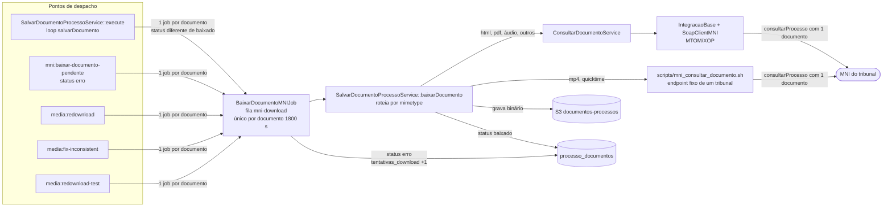
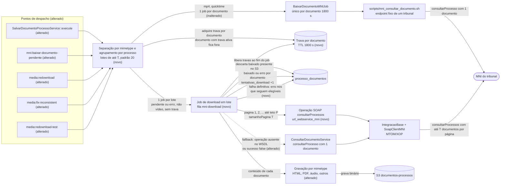

# SPEC: baixar-documentos-mni-em-lote

## Metadata
- Source: developer description via /plan
- Service: ms-mni (SIM-MNI)
- Tier: complete (reclassificado de standard pelo desenvolvedor; 13 RF)
- Version: 1.3 (ver `## Changelog`)
- Architecture references: `AGENTS.md`, `docs/agents/architecture.md`, `docs/agents/domain_rules.md`, `docs/agents/coding_guidelines.md`, `docs/agents/data_model.md`

## Context

Hoje cada documento de processo com binário pendente gera um job `BaixarDocumentoMNIJob` próprio, e cada job faz pelo menos uma chamada SOAP ao MNI do tribunal só para obter o conteúdo daquele documento. Com isso, o número de chamadas cresce na mesma proporção dos documentos e sobrecarrega o MNI. O desenvolvedor confirmou que a operação MNI `consultarProcessos` (plural) devolve vários documentos **com conteúdo** numa única chamada. O objetivo é baixar até T (padrão 20) documentos pendentes do mesmo processo por job, com uma chamada `consultarProcessos` por página da resposta e nenhuma chamada por documento no caminho feliz. Vídeos (`video/mp4`, `video/quicktime`) ficam fora do lote e seguem o caminho atual (decisão do desenvolvedor, v1.1).

Fatos do código (slice afetado):
- Despacho por documento em 5 pontos: `SalvarDocumentoProcessoService::salvarDocumento` (`app/Services/Processo/SalvarDocumentoProcessoService.php:55-56`, chamado só pelo loop de `execute()` em `:24` e `:28`, que por sua vez é chamado por `ProcessoService.php:62` e `:134`), `mni:baixar-documento-pendente` (`app/Console/Commands/MNIBaixarDocumentoPendente.php:32`), `media:redownload` (`MediaRedownload.php:114`), `media:fix-inconsistent` (`MediaFixInconsistent.php:81`), `media:redownload-test` (`MediaRedownloadTest.php:93`). Todos usam a fila `mni-download`.
- O job é `ShouldBeUnique` por id do documento com `uniqueFor = 1800` (`app/Jobs/BaixarDocumentoMNIJob.php:13`, `:17`, `:33-36`). Ele incrementa `tentativas_download` tanto no sucesso (`:46`) quanto na falha (`:64`) e relança a exceção quando falha.
- HTML, PDF, áudio e outros obtêm o conteúdo por `ConsultarDocumentoService`, com `consultarProcesso` (singular) e um único `documento` (`app/Services/MNI/Intercomunicacao/ConsultarDocumentoService.php:22-35`), usando `url_webservice_mni`. Se o login/senha não forem informados, usa as credenciais do tribunal (`:24-25`).
- MP4 e QuickTime **não** passam pelo cliente SOAP: usam `scripts/mni_consultar_documento.sh` (`SalvarDocumentoProcessoService.php:388`, `:525`). O script tem endpoint e cabeçalhos fixos de um único tribunal, faz `consultarProcesso` unitário e aplica limite de 5 GB (`:431`).
- `SoapClientMNI` já substitui **todos** os `xop:Include` de uma resposta MTOM (`app/Services/SoapClientMNI.php:82-87`, loop em `:98-167`). Isso é compatível com vários documentos na mesma resposta.
- O supervisor `supervisor-mni-download` define `timeout 300`, `memory 512`, `tries 3` (`config/horizon.php:220-234`), com `maxProcesses` 8 em produção (`:295-297`).
- `media:redownload --batch` é o tamanho do lote de **leitura no banco** do comando. Ele é distinto do tamanho do lote MNI desta feature.
- Hoje, um documento `baixado` cujo objeto não existe no S3 é baixado de novo: o atalho de "já baixado" só vale com o objeto presente (`SalvarDocumentoProcessoService.php:92`).
- Hoje, `ConsultarDocumentoService` (unitário) usa `url_webservice_mni` (`ConsultarDocumentoService.php:22`); `url_webservice_mni_consultar_processo` é opcional no cadastro do tribunal (`app/Http/Requests/TribunalRequest.php:26`).

Regras de arquitetura aplicáveis (fonte → regra):
- `AGENTS.md` §2 e `docs/agents/architecture.md` (Layer responsibilities): chamadas SOAP ao MNI passam por `IntegracaoBase` + `SoapClientMNI`. Há **uma classe por operação SOAP** em `app/Services/MNI/Intercomunicacao/`, e essa camada **não** cuida de persistência.
- `docs/agents/architecture.md`: `Services/Processo` persiste o payload MNI e enfileira downloads de binários. Jobs cuidam de fila, `$tries`, `$timeout`, `backoff()` e marcação de falha. Comandos de console apenas despacham ferramentas operacionais.
- `docs/agents/coding_guidelines.md` §6: todo dispatch nomeia a fila, e a fila precisa existir num supervisor de `config/horizon.php`. Jobs recebem ids e recarregam o model em `handle()`.
- `docs/agents/coding_guidelines.md` §8: parâmetros ajustáveis ficam em `config/pje.php` e são lidos via `config()`.
- `docs/agents/coding_guidelines.md` §9 e `AGENTS.md` §2: falhas MNI/PJe são encapsuladas em `MNIException`, que padroniza a mensagem.
- `docs/agents/domain_rules.md` (Document binary download): roteamento por `mimetype`, chaves S3 e ciclo `pendente` → `baixado` | `erro`.

## AS IS — Estado atual

Hoje cada documento pendente gera um job na fila `mni-download`, e cada job faz uma chamada `consultarProcesso` com um único documento (pelo cliente SOAP ou, no caso de MP4/QuickTime, pelo script bash). O status é gravado documento a documento em `processo_documentos`.

## TO BE — Estado proposto

Os pontos de despacho (alterados) separam os vídeos (`video/mp4`, `video/quicktime`), que continuam com 1 job por documento pelo caminho atual, e agrupam os demais documentos elegíveis e sem trava ativa por processo em lotes de até T, padrão 20 (RF-02, RF-04, RF-05, RF-09, RF-10, RF-12, CT-02). Cada job de lote (novo) descarta os documentos já baixados e pagina `consultarProcessos` em `url_webservice_mni` até todos os ids pedidos voltarem, até uma página vir sem documentos ou até o teto de páginas (RF-01, RF-03, RF-11, CT-01). Se a operação não existir no WSDL do tribunal ou uma página vier com `sucesso = false`, o job recorre a `consultarProcesso` unitário para os documentos ainda não marcados nesta execução (RF-08, CT-03). Exceção numa chamada SOAP, em lote ou unitária, é falha total do job (RF-08 b), que marca `erro` só nos documentos ainda não marcados nesta execução. A gravação por mimetype (alterada) marca o status documento a documento, no máximo uma vez por execução (RF-01, RF-06, RF-07, RF-08). Na falha definitiva do job, os documentos que seguem elegíveis, inclusive os `baixado` sem objeto no S3, ficam `erro` e as travas são liberadas (RF-12, RF-13).

## Scope
- **In**:
  - Download de binários não-vídeo em lote: até T documentos do mesmo processo por job, com uma chamada `consultarProcessos` por página e paginação até o critério de parada (RF-01).
  - Fallback para `consultarProcesso` unitário quando a operação não existe no WSDL do tribunal ou o lote retorna `sucesso = false` (RF-08).
  - Divisão em lotes de no máximo T (configurável, padrão 20), elegibilidade por status e trava por documento no despacho (RF-12).
  - Gravação por mimetype igual à de hoje e marcação de `baixado`/`erro` por documento, incluindo falha parcial, falha total e falha definitiva do job (RF-13).
  - Migração dos 5 pontos de despacho atuais para o fluxo em lote, exceto vídeos.
- **Out**:
  - Fluxo síncrono de `GET /documento/visualizar` (`routes/api.php:22` → `Api\DocumentoController::getDocumento` → `baixarDocumento`), incluindo a auto-correção de HTML. Ele continua com `consultarProcesso` unitário.
  - Auto-correção de HTML (`path_html` ausente) para documento `baixado` dentro do job (`SalvarDocumentoProcessoService.php:93-95`): o AC-2 proíbe reenviar ao MNI um documento `baixado` com arquivo no S3.
  - Persistir ou atualizar documentos que voltem na resposta sem terem sido pedidos no lote.
  - Lotes com documentos de processos diferentes.
  - Alterações na API REST, em `docs/api/openapi.yaml` ou no schema do banco (por exemplo, a coluna `erro_mni`, inexistente segundo `data_model.md`).
  - Agendar `mni:baixar-documento-pendente` ou mudar a seleção do comando (continua só `erro`).
  - Mudar como as credenciais trafegam no payload do job.
  - Alterar os limites do `supervisor-mni-download`.
  - Alterar o download de `video/mp4` e `video/quicktime`: continua com 1 job por documento e `scripts/mni_consultar_documento.sh` (decisão do desenvolvedor, M4).
  - Limitar o timeout SOAP da chamada do lote (decisão do desenvolvedor, Q-05 parte 2).

## RIGID (Non-Negotiable)

Notação:
- **T** = tamanho máximo do lote (RF-05).
- **P** = teto de páginas de `consultarProcessos` por execução do job (RF-05).
- **Vídeo** = documento com `mimetype` persistido `video/mp4` ou `video/quicktime`. Vídeos nunca entram em lote (RF-10).
- **Documento elegível** = documento do lote que, no momento da execução, tem status `pendente` ou `erro`, ou tem status `baixado` sem o objeto do seu `path` no S3 (como hoje, `SalvarDocumentoProcessoService.php:92`). Ou seja, todo documento do lote que não está na condição do RF-03.
- **Caminho feliz** = a operação `consultarProcessos` existe no WSDL do tribunal e todas as páginas lidas retornam `sucesso = true`.

### Functional Requirements

- RF-01 [Event-Driven] (AC-1, alterado em v1.1): Quando um job de lote for executado com ao menos 1 documento elegível, o sistema deve obter o conteúdo dos documentos elegíveis chamando a operação MNI `consultarProcessos` (CT-01) em `url_webservice_mni` do tribunal do processo, com uma chamada por página:
  1. cada chamada envia o `numero_processo` do processo e um elemento `documento` por `id_documento` elegível, com a mesma lista em todas as páginas. `pagina` começa em 1 e aumenta 1 a cada chamada; `tamanhoPagina` = T;
  2. o sistema deve parar de paginar no primeiro destes eventos: (i) todos os ids elegíveis já voltaram em alguma página lida; (ii) uma página com `sucesso = true` vem com 0 elementos `documento`; (iii) P páginas foram lidas. `totalRegistros` não entra no critério de parada;
  3. um id que já voltou numa página anterior é ignorado nas páginas seguintes, de modo que cada documento é gravado e contado no máximo uma vez por execução. A mesma regra vale para o fallback e para a falha total do RF-08: documento já marcado `baixado` (RF-06) ou `erro` (RF-07) nesta execução não é pedido de novo nem marcado de novo (resolução de M9);
  4. no caminho feliz, o sistema não deve fazer nenhuma chamada `consultarProcesso` por documento. Fora do caminho feliz, aplica-se o RF-08.
  - AC (a): Com a operação SOAP simulada devolvendo os 20 ids na página 1, num lote de 20 documentos elegíveis não-vídeo, ocorre exatamente 1 invocação de `consultarProcessos` (`pagina` = 1, `tamanhoPagina` = 20) e 0 de `consultarProcesso`. Os valores de `documento` enviados são exatamente os 20 `id_documento` do lote.
  - AC (b): Com resposta simulada que traz 12 dos 20 ids na página 1 e os 8 restantes na página 2, ocorrem exatamente 2 invocações de `consultarProcessos` (`pagina` = 1 e `pagina` = 2, ambas com os mesmos 20 `documento`) e 0 de `consultarProcesso`, e os 20 documentos ficam `baixado`.
  - AC (c): Com resposta simulada que traz 15 dos 20 ids na página 1 e 0 documentos na página 2, ocorrem exatamente 2 invocações de `consultarProcessos`, os 15 ficam `baixado` e os 5 ausentes ficam `erro` (RF-07).
  - AC (d): Com P = 3 e resposta simulada que repete os mesmos 15 dos 20 ids em toda página, ocorrem exatamente 3 invocações de `consultarProcessos`. Os 15 ficam `baixado` com `tentativas_download` = valor anterior + 1, e os 5 ausentes ficam `erro`.
  - Resolução de M2 (decisão do desenvolvedor, v1.1): endpoint = `url_webservice_mni`. Operação ausente no WSDL ou `sucesso = false` → fallback unitário (RF-08 a). Exceção de transporte, SOAP fault ou timeout → falha total (RF-08 b).
  - Resolução de M1 (decisão do desenvolvedor, v1.1): paginar até o critério do item 2, sem depender de `totalRegistros`.
  - Premissa a verificar no planejamento (decisão Q-02): `tamanhoPagina` = T vale salvo evidência em contrário. Se o planejamento encontrar essa evidência, deve registrá-la junto com o valor adotado.

- RF-02 [Conditional] (AC-2): Se uma origem de despacho (RF-10) selecionar documentos para download, então o sistema deve incluir em lotes apenas documentos com status `pendente` ou `erro` no momento do enfileiramento (status verificados em `app/Models/ProcessoDocumento.php:10-12`). Documentos `baixado` não entram em nenhum lote.
  - AC: Numa seleção de um processo com 3 documentos `pendente`, 2 `erro` e 4 `baixado`, todos não-vídeo e sem trava ativa (RF-12), os lotes enfileirados contêm exatamente os 5 `id_documento` em `pendente`/`erro`.

- RF-03 [State-Driven] (AC-2): Enquanto, no momento da execução do job, um documento do lote estiver `baixado` e o objeto do seu `path` existir no disco S3, o sistema deve deixá-lo fora de qualquer chamada ao MNI (`consultarProcessos` ou fallback do RF-08) e não deve alterar `status`, `path` nem `tentativas_download` desse documento. Um documento `baixado` sem o objeto no S3 continua elegível e é baixado de novo, como hoje (`SalvarDocumentoProcessoService.php:92`). Se nenhum documento do lote continuar elegível, o job deve terminar sem chamar o MNI e sem lançar exceção, liberando as travas (RF-12).
  - AC (a): Num lote de 3 documentos em que 1 passou a `baixado` com objeto presente no S3 simulado antes da execução, `documento` contém só os 2 restantes, e o documento `baixado` mantém `status`, `path` e `tentativas_download`.
  - AC (b): Num lote em que todos os documentos estão `baixado` com objeto no S3, ocorrem 0 invocações SOAP e `handle()` retorna sem exceção.
  - AC (c): Num lote de 2 documentos em que 1 está `pendente` e 1 está `baixado` sem objeto no S3 simulado, `documento` contém os 2 ids e, com conteúdo na resposta, ambos terminam `baixado` com o objeto gravado.

- RF-04 [Event-Driven] (AC-3, AC-1): Quando uma origem de despacho selecionar N ≥ 1 documentos de um mesmo processo que sejam elegíveis no despacho (RF-02), não-vídeo (RF-10) e sem trava ativa (RF-12), o sistema deve enfileirar exatamente ⌈N/T⌉ jobs de lote na fila `mni-download` (verified at `config/horizon.php:222`). Cada job tem no máximo T documentos, todos do mesmo processo, e nenhum documento se repete entre os lotes dessa seleção. No `media:redownload`, cada página de `--batch` é uma seleção (decisão Q-04 parte 2; CT-02). Por isso, um processo cujos documentos caiam em k páginas pode gerar mais de ⌈N/T⌉ jobs no total do comando.
  - AC (a): Com T = 20: N = 45 gera 3 jobs, com 20, 20 e 5 documentos; N = 20 gera 1 job; N = 1 gera 1 job. Numa seleção com documentos de 2 processos, nenhum job mistura processos. A união dos lotes é igual aos N ids, e a interseção entre quaisquer dois lotes é vazia.
  - AC (b): Numa seleção de um processo com 3 documentos PDF e 2 `video/mp4` elegíveis, é enfileirado 1 job de lote com os 3 PDF, e nenhum vídeo entra em lote (os vídeos seguem o RF-10).
  - AC (c): `media:redownload --batch=2` com 3 documentos `audio/mpeg` de um mesmo processo, lidos em 2 páginas (2 + 1), enfileira 2 jobs de lote, com 2 e 1 documentos.

- RF-05 [Optional] (AC-3, alterado em v1.1 e v1.2): Quando T estiver definido na configuração da aplicação, o sistema deve usar esse valor; quando não estiver, T = 20. Quando P estiver definido na configuração da aplicação, o sistema deve usar esse valor; quando não estiver, P = ⌈T / `tamanhoPagina`⌉ + 1. Com `tamanhoPagina` = T (premissa Q-02, RF-01), o padrão é P = 2.
  - AC (a): Sem configuração, N = 45 gera 3 jobs. Com T configurado em 10, N = 45 gera 5 jobs.
  - AC (b): Com P configurado em 2 e uma resposta simulada em que nunca voltam todos os ids e nenhuma página vem vazia, ocorrem exatamente 2 invocações de `consultarProcessos` por execução do job.
  - AC (c): Sem P configurado, com T = 20 e `tamanhoPagina` = 20, e uma resposta simulada em que nunca voltam todos os ids e nenhuma página vem vazia, ocorrem exatamente 2 invocações de `consultarProcessos` por execução do job (`pagina` = 1 e `pagina` = 2).
  - Resolução de M7 (decisão do desenvolvedor, v1.2): P padrão = ⌈T / `tamanhoPagina`⌉ + 1, configurável. Se o planejamento adotar outro `tamanhoPagina` (premissa Q-02), o padrão de P segue a mesma fórmula com o valor adotado.

- RF-06 [Event-Driven] (AC-4): Quando uma página lida de `consultarProcessos` (RF-01) ou a resposta de uma chamada unitária do fallback (RF-08 a) trouxer, para um documento elegível, um `documento` com o mesmo `idDocumento` (no nível de `processos`/`processo` ou como `documentoVinculado` aninhado, como hoje em `ConsultarDocumentoService.php:47-60`), com conteúdo não vazio e não bloqueado (RF-07), o sistema deve:
  1. gravar o conteúdo no S3 com o mesmo tratamento por `mimetype` de hoje (tabela abaixo; o roteamento usa o `mimetype` persistido em `processo_documentos`, como em `SalvarDocumentoProcessoService.php:108-120`);
  2. marcar o documento `baixado`, com `path` e `downloaded_at` preenchidos;
  3. incrementar `tentativas_download` em 1, mantendo a semântica atual de "incrementado por tentativa" (`data_model.md`; `BaixarDocumentoMNIJob.php:46`).

  Prefixo das chaves: `documentos-processos/{numero_processo}/` (verified at `SalvarDocumentoProcessoService.php:166-168`).

  | mimetype | Objeto(s) S3 e campos | Comportamento atual verificado |
  |---|---|---|
  | `text/html` | `{id_documento}.pdf` (HTML renderizado em PDF) + `{id_documento}.html`; `path_html` = chave `.html` | `SalvarDocumentoProcessoService.php:165-173` |
  | `application/pdf` | `{id_documento}.pdf` | `:250` |
  | `audio/*` | `{id_documento}.{ext}` pela tabela de extensões | `:681-682` |
  | demais (não-vídeo) | `{id_documento}.{ext}`; mimetype desconhecido usa `dat` | `:277-278`, `:323` |

  Vídeos não entram em lote (RF-10). `video/mp4` (`{id_documento}.mp4`, `:466`, `:473`) e `video/quicktime` (`{id_documento}.mov`, `:589`, `:596`) continuam gravados pelo caminho atual, sem alteração.

  - AC: Para cada linha da tabela, um lote com 1 documento daquele mimetype e resposta simulada com conteúdo produz o(s) objeto(s) no S3 simulado nas chaves indicadas, com `status = baixado`, `path` = chave principal, `downloaded_at` preenchido e `tentativas_download` = valor anterior + 1. Para `text/html`, `path_html` = chave `.html`.
  - Resolução de M4 (decisão do desenvolvedor, v1.1): opção (c), "vídeo fora do lote". `video/mp4` e `video/quicktime` mantêm 1 job por documento e `scripts/mni_consultar_documento.sh`. `audio/*` entra no lote comum com T, e o risco de memória e timeout fica aceito (RNF-02).

- RF-07 [Unwanted] (AC-5, alterado em v1.1 e v1.2): Se, para um documento elegível do lote, nenhuma página lida até a parada da paginação (RF-01) trouxer o `idDocumento` pedido, ou se a resposta (com `sucesso = true`) trouxer conteúdo vazio, trouxer o texto `Visualização do documento bloqueada enquanto não houver ciência de seus destinatários` (verified at `ConsultarDocumentoService.php:63`), ou se a chamada `consultarProcesso` unitária desse documento no fallback (RF-08 a) retornar `sucesso = false`, ou se a conversão/gravação desse documento falhar, então o sistema deve marcar **apenas esse** documento como `erro`, incrementar seu `tentativas_download` em 1 e continuar com os demais documentos do lote. A falha de gravação individual e o `sucesso = false` unitário entram aqui porque o AC-6 limita a falha total a exceção numa chamada SOAP, em lote ou unitária (RF-08 b; resolução de M6). Falhas deste RF, isoladas ou somadas, não fazem o job lançar exceção: `handle()` termina normalmente, e a recuperação fica com `mni:baixar-documento-pendente` ou com a próxima consulta do processo (resolução de M5, decisão do desenvolvedor, v1.1).
  - AC: Num lote [A com conteúdo PDF, B ausente de todas as páginas lidas, C bloqueado, D com conteúdo vazio], A fica `baixado` com objeto no S3, B, C e D ficam `erro` com `tentativas_download` +1, e `handle()` retorna sem exceção. O resultado é o mesmo em qualquer ordem dos documentos na resposta.

- RF-08 [Unwanted] (AC-6, alterado em v1.1, v1.2 e v1.3): Se a obtenção em lote falhar, então o sistema deve agir conforme o tipo de falha. Nos itens abaixo, "documento ainda não marcado nesta execução" é o documento elegível que, nesta execução do job, não foi marcado `baixado` (RF-06) nem `erro` (RF-07):
  - (a) **Fallback unitário**: se o WSDL do tribunal não expuser a operação `consultarProcessos`, ou se qualquer página de `consultarProcessos` retornar `sucesso = false`, o sistema deve, no mesmo job, obter cada documento ainda não marcado nesta execução com uma chamada `consultarProcesso` unitária (CT-03), em `url_webservice_mni` e com as credenciais do RF-11. Cada resultado é tratado individualmente: conteúdo válido pelo RF-06; ausente, vazio, bloqueado, `sucesso = false` na chamada unitária ou falha de gravação pelo RF-07. Se uma chamada unitária lançar exceção, aplica-se o item (b). Documentos já marcados `baixado` ou `erro` em páginas anteriores não são pedidos de novo (AC-2; RF-01 item 3). Quando a operação não existe no WSDL, o sistema não deve invocar `consultarProcessos`.
  - (b) **Falha total**: se uma chamada `consultarProcessos` ou uma chamada `consultarProcesso` unitária do fallback (item a) lançar exceção (SOAP fault, erro de transporte ou timeout, erro de recibo como em `app/Services/IntegracaoBase.php:53-57`), o sistema deve:
    1. marcar como `erro` todos os documentos ainda não marcados nesta execução, inclusive os que ainda não foram pedidos no fallback;
    2. incrementar `tentativas_download` de cada um deles em 1;
    3. registrar a mensagem de erro MNI padronizada;
    4. terminar o job com exceção, sem outras chamadas ao MNI nesta execução, para que o worker registre a tentativa como falha. Esgotadas as `tries` do supervisor, aplica-se o RF-13.

    Documento já marcado `erro` pelo RF-07 nesta execução (por exemplo, `sucesso = false` na sua chamada unitária ou conteúdo vazio numa página anterior) fica fora dos itens 1 e 2: mantém o `erro`, o +1 e o log do RNF-03 que já recebeu, sem outro +1 e sem outro log (resolução de M9).
  - AC (a1): Com o WSDL simulado sem `consultarProcessos` e um lote de 3 documentos elegíveis com conteúdo nas respostas unitárias, ocorrem 0 invocações de `consultarProcessos` e exatamente 3 de `consultarProcesso`, cada uma com 1 `documento`, e os 3 ficam `baixado` com `tentativas_download` +1.
  - AC (a2): Com a página 1 simulada retornando `sucesso = false` num lote de 3 documentos elegíveis, ocorre 1 invocação de `consultarProcessos` e exatamente 3 de `consultarProcesso`.
  - AC (a3): Num lote de 20, com a página 1 trazendo 12 ids e a página 2 retornando `sucesso = false`, ocorrem 2 invocações de `consultarProcessos` e exatamente 8 de `consultarProcesso`, só para os 8 ids que não voltaram.
  - AC (a4): No fallback de um lote de 3 documentos elegíveis [A, B, C], com as chamadas unitárias de A e C trazendo conteúdo e a de B retornando `sucesso = false`, ocorrem exatamente 3 invocações de `consultarProcesso`. A e C ficam `baixado`, B fica `erro` com `tentativas_download` +1, e `handle()` retorna sem exceção.
  - AC (a5): Num lote de 20, com a página 1 trazendo 12 ids (11 com conteúdo e D com conteúdo vazio) e a página 2 retornando `sucesso = false`, ocorrem 2 invocações de `consultarProcessos` e exatamente 8 de `consultarProcesso`, só para os 8 ids que não voltaram. D não é pedido no fallback e termina `erro` com `tentativas_download` = valor anterior + 1 e exatamente 1 log `error` com o seu `id_documento`.
  - AC (b1): Com o SOAP simulado lançando exceção na página 1, os 20 documentos do lote ficam `erro` com `tentativas_download` +1, e `handle()` lança exceção.
  - AC (b2): Com a página 1 trazendo 12 ids e a página 2 lançando exceção, os 12 continuam `baixado` e só os 8 restantes ficam `erro` com `tentativas_download` +1; `handle()` lança exceção.
  - AC (b3): No fallback de um lote de 3 documentos elegíveis [A, B, C], com a chamada unitária de B lançando exceção e as de A e C trazendo conteúdo: nenhuma invocação de `consultarProcesso` ocorre depois da de B; cada documento cuja chamada unitária ocorreu antes da de B fica `baixado`; B e os documentos ainda não pedidos ficam `erro` com `tentativas_download` +1; `handle()` lança exceção.
  - AC (b4): No fallback de um lote de 3 documentos elegíveis [A, B, C], com a chamada unitária de A retornando `sucesso = false` e a de B lançando exceção: A fica `erro` com `tentativas_download` = valor anterior + 1 (não + 2); B e C ficam `erro` com `tentativas_download` = valor anterior + 1; são emitidos exatamente 3 logs `error`, 1 por `id_documento`; `handle()` lança exceção.
  - AC (b5): Num lote de 20, com a página 1 trazendo 12 ids (11 com conteúdo e D com conteúdo vazio) e a página 2 lançando exceção: os 11 ficam `baixado`; D fica `erro` com `tentativas_download` = valor anterior + 1 (não + 2) e exatamente 1 log `error`; os 8 ids que não voltaram ficam `erro` com `tentativas_download` = valor anterior + 1 e 1 log cada; `handle()` lança exceção.
  - Resolução de M6 (decisão do desenvolvedor, v1.2): no fallback, `sucesso = false` numa chamada unitária é falha só daquele documento (RF-07: `erro`, +1, segue com os demais, job sem exceção); exceção numa chamada unitária (transporte, SOAP fault, timeout) é falha total, pela mesma regra do lote (item b). Consequência da decisão: uma exceção na chamada unitária de um documento encerra o fallback dos demais nessa execução.
  - Resolução de M9 (decisão do desenvolvedor, v1.3): na falha total, documento já marcado `erro` pelo RF-07 nesta execução não recebe outro +1 nem outro log; mantém o `erro` e o +1 que já recebeu, em consistência com o RF-01 item 3 e com a resolução de M8. A falha total só afeta documentos ainda não marcados nesta execução. Pela mesma regra (RF-01 item 3), o fallback do item (a) também não pede de novo documento já marcado `erro` nesta execução (AC (a5)).

- RF-09 [Event-Driven] (AC-6): Quando `mni:baixar-documento-pendente` for executado (verified at `MNIBaixarDocumentoPendente.php:16`), o sistema deve enfileirar todos os documentos não-vídeo com status `erro` (seleção atual, `:30`) em jobs de lote, conforme RF-04. Os vídeos em `erro` seguem o RF-10.
  - AC: Com 20 documentos `erro` não-vídeo de um processo e 5 de outro, a execução do comando enfileira 2 jobs de lote (20 e 5 documentos) e 0 jobs por documento. Com 1 documento `video/mp4` em `erro` a mais, enfileira também exatamente 1 job por documento para ele.

- RF-10 [Event-Driven] (AC-7, alterado em v1.1): Quando qualquer ponto de despacho abaixo enfileirar download de binários, o sistema deve usar o fluxo em lote (RF-02, RF-04) para os documentos não-vídeo e não deve enfileirar job de download por documento para eles. Vídeos (`video/mp4`, `video/quicktime`) continuam com 1 job por documento pelo caminho atual, sem alteração: job por documento único por 1800 s (verified at `BaixarDocumentoMNIJob.php:13`, `:17`) e `scripts/mni_consultar_documento.sh` (`SalvarDocumentoProcessoService.php:388`, `:525`). Decisão do desenvolvedor sobre M4. A seleção de cada ponto continua igual à de hoje.

  | Ponto de despacho | Seleção atual (inalterada) | Destino | Despacho atual verificado |
  |---|---|---|---|
  | Persistência dos documentos de um processo com `baixar_binarios = true` (`SalvarDocumentoProcessoService::execute`/`salvarDocumento`, incluindo `documentoVinculado`) | status ≠ `baixado` | Não-vídeo → lote; vídeo → job por documento | `SalvarDocumentoProcessoService.php:55-56` |
  | `mni:baixar-documento-pendente` | status `erro` | Não-vídeo → lote; vídeo → job por documento | `MNIBaixarDocumentoPendente.php:30-32` |
  | `media:redownload` | mídia (`video/mp4`, `video/quicktime`, `audio/mpeg`) `baixado` com `path`, após remoção no S3 e volta para `pendente` | `audio/mpeg` → lote, por página de `--batch` (RF-04); vídeo → job por documento | `MediaRedownload.php:114` |
  | `media:fix-inconsistent` | mídia `baixado` sem `path`, após volta para `pendente` | `audio/mpeg` → lote; vídeo → job por documento | `MediaFixInconsistent.php:81` |
  | `media:redownload-test` | igual a `media:redownload`, limitado por `limit` | `audio/mpeg` → lote; vídeo → job por documento | `MediaRedownloadTest.php:93` |

  - AC: Para cada ponto, com `Queue::fake()`: os documentos não-vídeo selecionados geram 0 jobs de download por documento e ≥ 1 job de lote na fila `mni-download`, agrupados conforme RF-04; cada vídeo selecionado gera exatamente 1 job por documento na fila `mni-download` e não aparece em nenhum lote. Persistência com `baixar_binarios = false` enfileira 0 jobs (comportamento atual coberto por `tests/Feature/Jobs/SalvarDocumentoSemBinarioTest.php`).

- RF-11 [State-Driven] (AC-1, sem regressão): Enquanto um lote vier de uma persistência com `login_pje`/`senha_pje` informados, o sistema deve enviar esse par em `idConsultante`/`senhaConsultante` em todas as chamadas do job (páginas de `consultarProcessos` e chamadas unitárias do fallback do RF-08 a). Enquanto o lote não tiver credenciais (origem nos comandos), o sistema deve usar as credenciais cadastradas no tribunal do processo, como hoje (verified at `ConsultarDocumentoService.php:24-25`).
  - AC: `execute($processo, $documentos, '{LOGIN}', '{SENHA}')` leva a chamadas `consultarProcessos` com `idConsultante = {LOGIN}` em todas as páginas. Num lote enfileirado por `mni:baixar-documento-pendente`, `idConsultante` é o login do tribunal.

- RF-12 [Unwanted] (sem regressão, alterado em v1.1): Se um documento já estiver num lote enfileirado e ainda não concluído, então nenhuma origem de despacho deve incluí-lo em outro lote. O sistema deve garantir isso com uma trava por documento adquirida no despacho, com validade de 1800 s, equivalente à unicidade atual por documento (verified at `BaixarDocumentoMNIJob.php:13`, `:17`, `:33-36`):
  1. documentos com trava ativa no despacho ficam fora do novo lote e não contam em N (RF-04);
  2. a trava é liberada quando o job do lote termina: quando `handle()` retorna sem exceção (incluindo o RF-03 sem elegíveis e as falhas do RF-07) ou na falha definitiva (RF-13). Também deixa de valer ao expirar;
  3. entre as tentativas da fila após o RF-08 (b), a trava permanece.
  - AC (a): Com o mesmo documento despachado duas vezes em menos de 1800 s, sem que o primeiro lote tenha terminado, o documento aparece em exatamente 1 lote enfileirado.
  - AC (b): Depois que o job do primeiro lote termina (sem exceção ou com falha definitiva), um novo despacho do mesmo documento, ainda elegível, o inclui num lote.
  - AC (c): Com T = 20 e uma seleção de 25 documentos elegíveis de um processo, dos quais 5 têm trava ativa, é enfileirado exatamente 1 job de lote, com os 20 sem trava.
  - Resolução de M3 (decisão do desenvolvedor, v1.1): opção (b), trava por documento.

- RF-13 [Unwanted] (novo em v1.1, alterado em v1.2 e v1.3; decisão Q-05 parte 2): Se o job de lote falhar de forma definitiva (tentativas da fila esgotadas, inclusive por timeout do worker, falta de memória ou término forçado do processo), então o sistema deve:
  1. marcar `erro` em todo documento do lote que, no momento do tratamento da falha definitiva, não esteja `baixado` com o objeto do seu `path` presente no S3. Isso inclui o documento `baixado` sem objeto no S3, que segue elegível (Notação; RF-03), em alinhamento com o RF-08 (b). Documento `baixado` com objeto no S3 não é alterado;
  2. incrementar `tentativas_download` em 1 apenas nos documentos marcados no item 1 que não receberam +1 em nenhuma tentativa deste job (por exemplo, quando todas as tentativas terminaram por timeout do worker ou falta de memória antes de chegar a eles). Os documentos que já receberam +1 em alguma tentativa deste job mantêm o valor, sem contagem dupla;
  3. emitir o log do RNF-03 para cada documento marcado;
  4. liberar a trava de todos os documentos do lote (RF-12).
  - AC (a): Num lote de 3 documentos em que 1 já ficou `baixado` com objeto no S3 simulado, ao acionar o tratamento de falha definitiva do job, os 2 não baixados ficam `erro`, são emitidos exatamente 2 logs `error` com os respectivos `id_documento`, o documento `baixado` não muda e um novo despacho inclui os 2 em `erro` num lote (travas liberadas).
  - AC (b): Num lote de 3 documentos não baixados [A, B, C], em que A recebeu +1 numa tentativa anterior deste job (RF-08 b) e B e C não receberam +1 em nenhuma tentativa deste job (tentativas encerradas por timeout do worker), ao acionar o tratamento de falha definitiva, os 3 ficam `erro`; o `tentativas_download` de A não muda nesse tratamento, e o de B e o de C aumentam exatamente 1.
  - AC (c): Num lote de 2 documentos [A `pendente`, B `baixado` sem objeto no S3 simulado], em que nenhuma tentativa deste job chegou a A nem a B (tentativas encerradas por timeout do worker), ao acionar o tratamento de falha definitiva, A e B ficam `erro`, o `tentativas_download` de cada um aumenta exatamente 1, são emitidos exatamente 2 logs `error` com os respectivos `id_documento` e as travas dos 2 são liberadas.
  - Resolução de M8 (decisão do desenvolvedor, v1.2): +1 só para documentos que não receberam +1 em nenhuma tentativa deste job; os demais ficam como estão.
  - Lacuna RF-13 × `baixado` sem objeto no S3 (decisão do desenvolvedor, v1.3): na falha definitiva, documento do lote `baixado` sem objeto no S3 também fica `erro`, como no RF-08 (b), com o contador pela regra de M8 (item 2).

### Contracts

- CT-01 (SOAP de saída, operação nova; fonte: AC-1 confirmado + amostra SOAP sanitizada em `.handoff/input.md:33-96`; inexistente no código atual): `consultarProcessos`.

  Endpoint: `url_webservice_mni` do tribunal do processo (resolução de M2). Uma chamada por página (RF-01).

  Request (os namespaces seguem o WSDL do tribunal; a amostra usa `servico-intercomunicacao-2.2.3` / `tipos-servico-intercomunicacao-2.2.3`):

  | Campo | Valor no lote | Observação |
  |---|---|---|
  | `idConsultante` | login do lote (RF-11) | Mesmo nome usado em `consultarProcesso` (`ConsultarDocumentoService.php:24`) |
  | `senhaConsultante` | senha do lote (RF-11) | Vai no body, não no header WS-Security (nota da amostra) |
  | `numeroProcesso` | `numero_processo` do processo do lote | Um único processo por chamada |
  | `movimentos` | `false` | Na amostra o nome é `movimentos`, diferente de `incluirMovimentos` de `consultarProcesso` (`ConsultarDocumentoService.php:28`) |
  | `incluirCabecalho` | `false` | |
  | `incluirDocumentos` | `false` | Na amostra, os documentos filtrados por `documento` vieram com conteúdo mesmo com `false` |
  | `documento` | 1..T ocorrências, uma por `id_documento` elegível | Mesma lista em todas as páginas da execução (RF-01) |
  | `pagina` | 1 na primeira chamada; +1 a cada chamada seguinte, até a parada do RF-01 (no máximo P) | Resolução de M1 |
  | `tamanhoPagina` | T | Premissa Q-02: vale salvo evidência em contrário no planejamento |

  Response (`consultarProcessosResposta`):

  | Campo | Uso |
  |---|---|
  | `sucesso` | `false` em qualquer página → fallback unitário (RF-08 a) |
  | `mensagem` | Texto do erro quando `sucesso = false` |
  | `processos` / `documento` (0..n, filhos diretos de `processos` na amostra) | Atributos `idDocumento` (casamento com o lote, acumulado entre páginas), `mimetype`, `tipoDocumento`, `dataHora`, `hash`, `nivelSigilo`, `movimento`, `descricao`; filho `conteudo` em MTOM/XOP (`xop:Include href="cid:..."`); `documentoVinculado` aninhado é aceito no casamento (RF-06). Página com `sucesso = true` e 0 `documento` encerra a paginação (RF-01) |
  | `pagina`, `tamanhoPagina`, `totalRegistros` | Não usados no critério de parada (RF-01) |

  Operação ausente no WSDL do tribunal → fallback unitário (RF-08 a), sem invocar `consultarProcessos`. Exceção na chamada → falha total (RF-08 b).

- CT-02 (interface operacional, inalterada): as assinaturas dos comandos artisan continuam as mesmas. Muda apenas o despacho interno (RF-10).
  - `mni:baixar-documento-pendente` (verified at `MNIBaixarDocumentoPendente.php:16`)
  - `media:redownload {--batch=50}` (verified at `MediaRedownload.php:16`); `--batch` continua sendo o tamanho do lote de leitura no banco, sem relação com T. Cada página de `--batch` é uma seleção para o RF-04 (decisão Q-04 parte 2)
  - `media:fix-inconsistent` (verified at `MediaFixInconsistent.php:15`)
  - `media:redownload-test {limit=5}` (verified at `MediaRedownloadTest.php:16`)

- CT-03 (SOAP de saída existente, contrato inalterado; usado só no fallback do RF-08 a): `consultarProcesso` unitário, como hoje (verified at `ConsultarDocumentoService.php:22-35`).
  - Endpoint: `url_webservice_mni` do tribunal do processo.
  - Request: `idConsultante`/`senhaConsultante` (RF-11), `numeroProcesso`, `incluirCabecalho = false`, `incluirMovimentos = false`, `incluirDocumentos = false` e exatamente 1 `documento` com o `id_documento`.
  - Response: `sucesso`, `mensagem`, `processo/documento` (com `documentoVinculado` aninhado), casada por `idDocumento` (RF-06, RF-07).
  - `sucesso = false` numa chamada unitária → falha só daquele documento (RF-07). Exceção na chamada unitária → falha total (RF-08 b). Resolução de M6.

### Non-Functional Requirements

- RNF-01 (carga no MNI, alterado em v1.1): No caminho feliz, cada job de lote faz 1 chamada `consultarProcessos` por página lida (no máximo P, RF-01) e nenhuma chamada por documento. Quando todos os ids voltam na página 1, uma seleção de N documentos elegíveis não-vídeo de um processo gera ⌈N/T⌉ chamadas SOAP ao MNI para obter os conteúdos. Hoje são N, uma por job (`ConsultarDocumentoService.php:35`). Chamadas por documento só ocorrem no fallback (RF-08 a). Vídeos continuam com 1 chamada por documento (RF-10).
  - AC (a): Com N = 45 documentos não-vídeo, T = 20 e resposta simulada que devolve todos os ids pedidos na página 1, a execução dos 3 jobs soma exatamente 3 invocações SOAP, todas `consultarProcessos`.
  - AC (b): No caminho feliz, nenhuma execução de job de lote invoca `consultarProcesso`, e nenhuma faz mais de P invocações de `consultarProcessos`.
- RNF-02 (limites de execução): O job de lote roda na fila `mni-download` dentro dos limites atuais do `supervisor-mni-download`: timeout 300 s, memória 512 MB e 3 tries (verified at `config/horizon.php:220-234`). Um lote de T = 20 documentos PDF/HTML deve terminar em menos de 300 s e com pico de memória do worker abaixo de 512 MB.
  - AC: Em homologação, com tribunal real, um lote de 20 documentos PDF/HTML cujos ids voltam todos na página 1 registra duração < 300 s no Horizon e pico de memória < 512 MB.
  - Risco aceito (decisão do desenvolvedor, M4): documentos `audio/*` entram no lote com o mesmo T e podem levar o job a passar de 512 MB ou de 300 s. O timeout SOAP não é limitado (Q-05 parte 2). Se o limite estourar, o RF-13 marca `erro` nos documentos que seguem elegíveis (inclusive `baixado` sem objeto no S3) e libera as travas. Não há AC de limite para lotes com áudio.
- RNF-03 (observabilidade): Cada vez que um documento for marcado `erro` (RF-07, RF-08, RF-13), o sistema deve emitir exatamente 1 registro de log de nível `error` com o `id_documento` e o motivo (comportamento atual: `BaixarDocumentoMNIJob.php:68`). Documento já marcado `erro` nesta execução não é marcado de novo pela falha total do RF-08 (b) e, por isso, não gera outro log (resolução de M9).
  - AC: Com o log simulado, uma execução de job que marca 3 documentos como `erro` gera 3 entradas `error`, cada uma com o respectivo `id_documento`.

## FLEXIBLE (Implementation Suggestions)

- **Operação SOAP**: criar `App\Services\MNI\Intercomunicacao\ConsultarProcessosService` (uma classe por operação, conforme `architecture.md`). Ela recebe tribunal, número do processo, lista de ids e credenciais, chama `IntegracaoBase::makeSoapRequest('consultarProcessos', ...)` para uma página e devolve um mapa `idDocumento → documento` já normalizado (objeto único ou array, como em `ConsultarDocumentoService.php:43`, incluindo `documentoVinculado`). Em `sucesso=false`, sinaliza ao job de forma distinguível de exceção de transporte (por exemplo, com uma exceção própria), para acionar o fallback do RF-08 (a) e não a falha total. Não persiste nada.
- **Operação ausente no WSDL**: chamar uma operação inexistente no `SoapClient` gera `SoapFault`, que cairia no RF-08 (b). Verificar a operação antes de chamar (por exemplo, com `__getFunctions()`) e, se ela faltar, seguir direto para o fallback.
- **Fallback**: reutilizar `ConsultarDocumentoService` (CT-03) por documento ainda não marcado nesta execução (RF-08).
- **Normalização de conteúdo**: extrair para um helper compartilhado a normalização base64 por mimetype de `ConsultarDocumentoService.php:67-83`, para que o fluxo unitário (visualizar) e o fluxo em lote usem a mesma regra.
- **Gravação desacoplada da consulta**: refatorar os `download*()` de `SalvarDocumentoProcessoService` para separar "obter conteúdo" de "gravar por mimetype", por exemplo com `salvarConteudo(ProcessoDocumento $doc, object $documentoMni): string`. Os `download*()` atuais continuariam como wrappers que chamam `consultarDocumento()` e depois `salvarConteudo()`, preservando o fluxo síncrono fora de escopo.
- **Agrupamento**: criar um método único, por exemplo `SalvarDocumentoProcessoService::enfileirarDownloadsEmLote(iterable $documentos, ?string $login, ?string $senha)`, que separa os vídeos (despachados como hoje, 1 `BaixarDocumentoMNIJob` por documento), descarta os documentos com trava ativa, adquire a trava dos demais (por exemplo, `Cache::lock("mni-download:documento:{id}", 1800)`), agrupa por `processo_id`, aplica `chunk(T)` e despacha `->onQueue('mni-download')`. `execute()` coleta os documentos elegíveis no loop (em vez de despachar dentro de `salvarDocumento`) e chama esse método uma vez no fim. Os 4 comandos também o reutilizam. Em `media:redownload`, agrupar dentro de cada iteração de `--batch`.
- **Job**: criar um job novo, por exemplo `App\Jobs\BaixarDocumentosMNIEmLoteJob`, que recebe `processo_id` + array de `processo_documentos.id` + credenciais e recarrega os models em `handle()` (coding_guidelines §6). Declarar `$tries`/`$timeout` explicitamente e alinhá-los ao supervisor. Marcar `erro` → `pendente` no início da tentativa, como `baixarDocumento` faz hoje (`:101-104`). Implementar `failed(Throwable $e)` para o RF-13 e liberar as travas no fim de `handle()` sem exceção (por exemplo, em `finally` condicionado a não haver relançamento).
- **Deploy**: `BaixarDocumentoMNIJob` continua em uso para vídeos (RF-10). Payloads não-vídeo já serializados antes do deploy continuam sendo processados por ela até a fila `mni-download` esvaziar.
- **Configuração**: em `config/pje.php`, adicionar `'download_documentos' => ['tamanho_lote' => (int) env('PJE_DOWNLOAD_TAMANHO_LOTE', 20), 'max_paginas' => env('PJE_DOWNLOAD_MAX_PAGINAS')]`, com `max_paginas` ausente ou menor que 1 calculado como ⌈T / `tamanhoPagina`⌉ + 1 (RF-05) e `tamanho_lote` menor que 1 voltando ao padrão. Cobrir com um teste no estilo de `tests/Unit/ConfigPjeTest.php` e adicionar as variáveis ao `.env.example`.
- **Casamento de ids**: comparar `idDocumento` da resposta com `id_documento` como string, já que a coluna é `varchar` e o model faz cast para `integer` (`data_model.md`).
- **Logs**: usar o prefixo `[ProcessoDocumento:{id}]` / `[Processo:{numero_processo}] lote` (coding_guidelines §10), sem jamais registrar `senhaConsultante` nem o `lastRequest`.
- **Testes (Pest)**: `Queue::fake()` para agrupamento, despacho e travas (RF-04, RF-05, RF-09, RF-10, RF-12); `Storage::fake('s3')` + mock da nova operação SOAP e de `ConsultarDocumentoService` para RF-01 (paginação), RF-03, RF-06, RF-07, RF-08 (fallback e falha total) e RF-13 (chamando `failed()` diretamente). Atualizar `tests/Feature/Jobs/BaixarDocumentoMNIJobTest.php`, `tests/Feature/Jobs/SalvarDocumentoSemBinarioTest.php:45` e `tests/Unit/Services/SalvarDocumentoProcessoServiceTest.php:63-66`, que hoje verificam o job por documento.
- **Memória**: cada página da resposta carrega o DOM e o base64 de todos os binários dela ao mesmo tempo (cerca de 2,3x o tamanho bruto). Gravar e liberar os documentos de cada página antes de ler a próxima. Vídeos ficam fora do lote (M4); o risco com áudio está aceito (RNF-02).

## Acceptance Criteria Summary

| ID | Criterion | Testable? |
|----|-----------|-----------|
| RF-01 | Ids na página 1: 1 `consultarProcessos` (`pagina` 1, `tamanhoPagina` T), 0 `consultarProcesso`; paginação para quando todos os ids voltam, página vazia ou P páginas | Sim (Pest + mock SOAP) |
| RF-02 | Seleção 3 pendente / 2 erro / 4 baixado (não-vídeo, sem trava) gera lotes só com os 5 pendente/erro | Sim (Pest + Queue::fake) |
| RF-03 | Baixado com objeto no S3 fica fora e não é alterado; baixado sem objeto é baixado de novo; lote sem elegíveis faz 0 chamadas e não lança exceção | Sim (Pest + Storage::fake) |
| RF-04 | N=45, T=20 gera 3 jobs (20/20/5); sem mistura de processos nem repetição; vídeo fora do lote; `--batch=2` com 3 áudios gera 2 jobs | Sim (Pest + Queue::fake) |
| RF-05 | Sem configuração, T=20 e P=⌈T/`tamanhoPagina`⌉+1 (2 com `tamanhoPagina`=T); com T=10, N=45 gera 5 jobs; com P=2, no máximo 2 páginas | Sim (Pest + config override) |
| RF-06 | Por mimetype não-vídeo: chaves S3 corretas, `baixado`, `path`, `downloaded_at`, `tentativas_download` +1, `path_html` para HTML | Sim (Pest + Storage::fake) |
| RF-07 | Ausente após a paginação, bloqueado, vazio ou `sucesso=false` na chamada unitária vira `erro` com +1; os demais são salvos; `handle()` sem exceção | Sim (Pest) |
| RF-08 | (a) Operação ausente ou `sucesso=false` leva ao fallback unitário só para os ainda não marcados na execução; `sucesso=false` unitário é falha só do documento; (b) exceção em chamada em lote ou unitária deixa os ainda não marcados `erro` com +1, encerra as chamadas e `handle()` lança exceção; documento já `erro` pelo RF-07 na execução mantém +1 e 1 log | Sim (Pest + mock SOAP) |
| RF-09 | `mni:baixar-documento-pendente` reenfileira `erro` não-vídeo em lotes por processo e vídeos em jobs por documento | Sim (Pest + Queue::fake) |
| RF-10 | Os 5 pontos enfileiram 0 jobs por documento para não-vídeo e ≥ 1 job de lote; cada vídeo gera 1 job por documento | Sim (Pest + Queue::fake) |
| RF-11 | Credenciais da consulta seguem para todas as chamadas do lote; comandos usam as do tribunal | Sim (Pest + mock SOAP) |
| RF-12 | Mesmo documento despachado 2 vezes em < 1800 s aparece em exatamente 1 lote; trava liberada no fim do job | Sim (Pest + Queue::fake + cache) |
| RF-13 | Falha definitiva: quem não está `baixado` com objeto no S3 (inclusive `baixado` sem objeto) vira `erro`, +1 só para quem não recebeu +1 em nenhuma tentativa do job, 1 log cada, travas liberadas | Sim (Pest, chamando `failed()` após simular as tentativas anteriores) |
| CT-01 | Request em `url_webservice_mni` com `numeroProcesso` + 1..T `documento`, `pagina` 1..P, `tamanhoPagina` T; response casada por `idDocumento` entre páginas | Sim (Pest + mock SOAP) |
| CT-02 | Assinaturas dos 4 comandos inalteradas | Sim (Pest `artisan` + `Command` signature) |
| CT-03 | Fallback usa `consultarProcesso` unitário com 1 `documento` em `url_webservice_mni`; `sucesso=false` → RF-07, exceção → RF-08 (b) | Sim (Pest + mock SOAP) |
| RNF-01 | N=45, T=20, ids na página 1: 3 chamadas SOAP no total; caminho feliz sem `consultarProcesso` e com no máximo P páginas por job | Sim (Pest + mock SOAP) |
| RNF-02 | Lote de 20 PDF/HTML leva menos de 300 s e menos de 512 MB (risco com áudio aceito) | Sim (homologação, medição no Horizon) |
| RNF-03 | 1 log `error` com `id_documento` por marcação de `erro` | Sim (Pest + Log spy) |

## Pendências de esclarecimento

| Marker | Onde | Status | Decisão ou pergunta |
|---|---|---|---|
| M1 | RF-01, CT-01 | Resolvido (v1.1) | Paginar: `pagina` a partir de 1, `tamanhoPagina` = T; para quando todos os ids voltam, quando uma página vem vazia ou no teto P; sem usar `totalRegistros` |
| M2 | RF-01, RF-08 | Resolvido (v1.1) | `url_webservice_mni`; operação ausente ou `sucesso=false` → fallback unitário; exceção → falha total |
| M3 | RF-12 | Resolvido (v1.1) | Trava por documento no despacho, 1800 s, liberada no fim do job |
| M4 | RF-06, RF-10, RNF-02 | Resolvido (v1.1) | Vídeo fora do lote (caminho atual); áudio no lote com risco aceito |
| M5 | RF-07 | Resolvido (v1.1) | Falha parcial termina sem exceção |
| M6 | RF-07, RF-08, CT-03 | Resolvido (v1.2) | No fallback, `sucesso=false` unitário → falha só do documento (RF-07); exceção unitária → falha total (RF-08 b) |
| M7 | RF-05 | Resolvido (v1.2) | P padrão = ⌈T / `tamanhoPagina`⌉ + 1 (2 com `tamanhoPagina` = T), configurável |
| M8 | RF-13 | Resolvido (v1.2) | +1 só para documentos sem +1 em nenhuma tentativa do job; os demais ficam como estão |
| M9 | RF-01, RF-08, RNF-03 | Resolvido (v1.3) | Documento já marcado `erro` pelo RF-07 na execução mantém o `erro`, o +1 e o log; falha total e fallback só afetam documentos ainda não marcados na execução |

## Changelog

- **1.3** (2026-10-07): aplicadas as respostas do desenvolvedor da rodada 3 (`.handoff/clarifier-answers.md`, seção "Rodada 3").
  - **Critério de aceite confirmado refinado por decisão do desenvolvedor (M9)**:
    - **AC-6**: a falha total marca `erro` só nos documentos ainda não marcados nesta execução (nem `baixado` nem `erro`), e não mais em todo documento ainda não `baixado`. Documento já marcado `erro` pelo RF-07 na mesma execução mantém o `erro`, o +1 e o log, sem contagem dupla. Afeta RF-08 (b) e RNF-03.
  - Resolvido M9 (RF-08 b): novos AC (b4) e (b5).
  - Alinhamento de consistência pela mesma regra (RF-01 item 3, citado na resposta de M9), sem nova pergunta: o fallback unitário do RF-08 (a) também deixa de pedir de novo documento já marcado `erro` nesta execução. Antes, o texto do RF-08 (a) dizia "ainda não marcado `baixado`", o que permitia +1 duplo. Novo AC (a5). Afeta RF-01 item 3, RF-08 (a), o texto do TO BE e a sugestão de fallback do FLEXIBLE.
  - Fechada a lacuna RF-13 × `baixado` sem objeto no S3: na falha definitiva, o item 1 passa a marcar `erro` em todo documento que não esteja `baixado` com objeto no S3, inclusive o `baixado` sem objeto (alinhado com o RF-08 b), com o contador pela regra de M8. AC (a) ajustado e novo AC (c). Afeta o diagrama e o texto do TO BE e o risco aceito do RNF-02.
  - Atualizados o resumo de ACs (RF-08, RF-13) e a tabela de pendências. Nenhuma pendência aberta.
- **1.2** (2026-10-07): aplicadas as respostas do desenvolvedor da rodada 2 (`.handoff/clarifier-answers.md`, seção "Rodada 2").
  - **AC-6 confirmado** pelo desenvolvedor: `sucesso=false` aciona o fallback unitário; a falha total (exceção de transporte, SOAP fault ou timeout) marca `erro` só nos documentos ainda não `baixado`. A pendência de confirmação da v1.1 foi encerrada.
  - **Critérios de aceite confirmados alterados por decisão do desenvolvedor (M6)**:
    - **AC-6**: exceção numa chamada `consultarProcesso` unitária do fallback também é falha total (RF-08 b). Afeta RF-08 e CT-03.
    - **AC-5**: `sucesso=false` numa chamada unitária do fallback é falha só daquele documento (RF-07). Afeta RF-07, RF-08 (a) e CT-03.
  - Resolvidos M6 (RF-07, RF-08, CT-03; novos AC (a4) e (b3) no RF-08), M7 (RF-05; novo AC (c)) e M8 (RF-13; novo item 2 e AC (b)).
  - Atualizados o texto do TO BE, a sugestão de configuração do FLEXIBLE (padrão de P), o resumo de ACs e a tabela de pendências.
  - Nova pendência criada pela resolução de M6: M9 (RF-08 b, contagem dupla na falha total de documento já marcado `erro` pelo RF-07 na mesma execução).
- **1.1** (2026-10-07): aplicadas as respostas do desenvolvedor a Q-01..Q-05 e Q-02b (`.handoff/clarifier-answers.md`).
  - **Critérios de aceite confirmados alterados por decisão do desenvolvedor**:
    - **AC-1**: de "uma única chamada `consultarProcessos` por job" para "1 chamada `consultarProcessos` por página, sem chamada por documento no caminho feliz" (Q-02). Vídeos ficam fora do lote (Q-03). Afeta RF-01, RF-04 e RNF-01.
    - **AC-7**: os pontos de despacho usam o fluxo em lote só para não-vídeo; `video/mp4` e `video/quicktime` mantêm 1 job por documento (Q-03). Afeta RF-10.
    - **AC-6** (consequência de Q-01; confirmada pelo desenvolvedor na v1.2): `sucesso=false` deixa de ser falha total e passa a acionar o fallback unitário; a falha total marca só os documentos ainda não `baixado` na execução. Afeta RF-08.
  - Resolvidos M1 (RF-01, CT-01), M2 (RF-01, RF-08, CT-01), M3 (RF-12), M4 (RF-06, RF-10, RNF-02) e M5 (RF-07).
  - Reescritos RF-01, RF-02 (AC), RF-03, RF-04, RF-05, RF-06, RF-07, RF-08, RF-09, RF-10, RF-11, RF-12, CT-01, CT-02, RNF-01, RNF-02, RNF-03 e o diagrama TO BE. Novos: RF-13 (falha definitiva, Q-05 parte 2) e CT-03 (`consultarProcesso` unitário do fallback).
  - Notas aplicadas sem pergunta: Tier corrigido para `complete`; documento `baixado` sem objeto no S3 é elegível (RF-03); AC do RF-12 definido conforme Q-04 parte 1.
  - Novas pendências criadas pelas respostas: M6, M7, M8.
- **1.0**: versão inicial.
