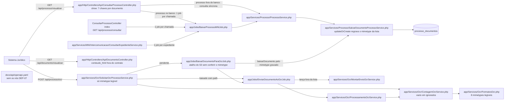
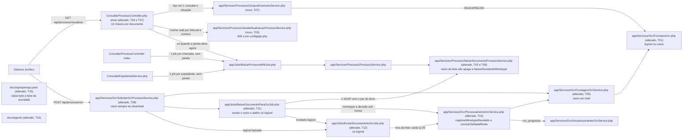

# Implementation Plan

## Request Summary
- Objective: fechar no ms-mni as dependências DEP-07 e DEP-08 do visualizador dos autos do Sistema Jurídico. Hoje o `/processo/visualizar` devolve 7 chaves por documento, o mimetype vazio cai em `ignorados` e nunca é lido pelo OCR, e cada abertura enfileira um acesso ao tribunal.
  - **DEP-07 (a)**: `GET /processo/visualizar` passa a devolver 13 chaves por documento. As 6 novas são `tipo` (1 consulta por resposta), `data_juntada`, `usuario_juntada_arquivo`, `mimetype`, `file_size` e `ocr_situacao`. A situação é calculada só nessa resposta, pela mesma regra da contagem (RF-01 a RF-05).
  - **DEP-07 (b)**: o `docs/api/openapi.yaml` passa a ser cópia byte a byte do contrato acordado (CT-04). O comportamento de `/documento/visualizar` não muda (RF-06).
  - **DEP-07 (c)**: o mimetype vazio passa a contar em `total`. O pedido manda esse documento ao download do OCR, que revela o mimetype pelo tribunal e decide entre envio, `ignorados` com aviso e `com_erro`. Nenhum mimetype fora da lista vai ao workflow, e a gravação da lista deixa de trocar um mimetype não vazio por `''` (RF-07 a RF-14).
  - **DEP-08**: no máximo 1 `BaixarProcessoMNIJob` a cada 600 s por (`tribunal_id`, `numero_processo`), só nas chamadas a `/processo/visualizar`. A janela abre no despacho ou no fim de uma consulta síncrona bem-sucedida (RF-15, RF-16).
- Scope in: "Scope → In" da SPEC v1.1. Fases, em ordem:
  1. fundações (regra única do conjunto do total, gravação da lista, serviço da janela);
  2. janela no `show`, contagem e testes de contrato do documento;
  3. campos dos autos, pedido, revelação e transições;
  4. jobs do OCR;
  5. ponta a ponta e consistência;
  6. contrato oficial e documentação, a última fase de DEP-07;
  7. verificação final e handoff ao Sistema.
- Scope out: "Scope → Out" da SPEC. Entre outros: comportamento novo de `/processo/documentos/listar`, `/documento/visualizar` e das rotas de OCR além da contagem; a janela em `/processo/consultar` e no expediente; a consulta síncrona do `/processo/visualizar`; prioridades, sigilo e OAB; as divergências O-02 a O-04; favoritos; revelar o mimetype fora do download do OCR. O lado do Sistema (VE-01, VE-02) fica como homologação e handoff, sem checkbox no `PHASES.md`.
- Tier: complete
- Architecture references: `AGENTS.md`, `docs/agents/architecture.md`, `docs/agents/domain_rules.md`. Apoio: `docs/agents/api_contracts.md`, `docs/agents/data_model.md`, `docs/agents/coding_guidelines.md`.
- Fontes da verdade:
  - SPEC v1.1 (`.spec/features/campos-dos-autos-e-trava-de-atualizacao/SPEC.md`, 0 marcadores);
  - entrada confirmada (`.handoff/confirmed-input.md`, AC1 a AC7);
  - respostas do clarifier (`.handoff/clarifier-answers.md`, Q-01 a Q-06);
  - contrato acordado (`/Users/brunosantos/orca/workspaces/sistema-juridico-lorran/fix-integracao-ia/tests/Fixtures/Mni/openapi.yaml`, SHA-256 `461fa57a769eb8d06471634610d10fb0347572793a89bc6414e4ff22e04f464a` na data do plano, idêntico à 2ª cópia do mesmo worktree, conferido com `cmp`).
- Comandos: PHP só pelo container. Um teste: `docker compose exec -T php php artisan test --compact --filter=<Teste>`. Suíte: `docker compose exec -T php php artisan test --compact`. Nunca ler `.env`.

### Regras de arquitetura preservadas pelas tasks
- `docs/agents/architecture.md` "Layer responsibilities" e `coding_guidelines.md` §2 (controller fino):
  - `ConsultarProcessoController::show` (T04, T07) só orquestra, lê o banco, chama services e despacha o job. A regra da janela fica em `app/Services/Processo/JanelaAtualizacaoProcessoService.php` (T03). A resolução de `tipo` e a montagem da situação ficam em `app/Services/Processo/CamposDosAutosService.php` (T07).
  - A regra da situação calculada e a do conjunto do total ficam em `app/Services/Ocr` (`FormatosOcr`, T01; `ContagemOcrService`, T05), como pede o RNF-03. O controller não decide situação.
  - `SalvarDocumentoProcessoService` (`Services/Processo`) só cuida da persistência da lista e do binário (T02, T09). As situações do OCR e o fim do processamento ficam em `ProcessamentoOcrService` (T10). Os jobs são donos da fila, das tentativas e da marcação de falha (T11, T12).
- `domain_rules.md` "OCR do processo": toda mudança de situação roda em `DB::transaction`, trava primeiro o processamento aberto e depois o documento, e despacha os avisos `afterCommit`. As transições novas (T10) usam o `comTravas` e o `progredir` existentes. O `com_erro` volta à fila na abertura (D-08), e isso vale também para o vazio (T08).
- `AGENTS.md` §2: os jobs que levam o par continuam `ShouldBeEncrypted`. `BaixarProcessoMNIJob` e `BaixarDocumentoParaOcrJob` não mudam de cifra, fila nem tentativas (T04, T11).
- `AGENTS.md` §3, "Never in this repository": o par nunca vai a job sem cifra, a tabela do OCR, valor de cache ou contexto de log. A janela não recebe o par (T03). Os logs novos levam só ids, contagens, mimetype e linha (T03, T10, T11, T12; conferido em T04 e T14).
- `AGENTS.md` §3: a mudança de interface atualiza `docs/api/openapi.yaml` na mesma mudança (mesma branch), só na última fase de DEP-07 (T15; Q-04).
- `coding_guidelines.md` §6: nenhum despacho ou fila novos. O `EnviarDocumentoAoOcrJob` despachado pelo download segue com `onQueue('ocr-envio')`.
- `coding_guidelines.md` §8: a janela de 600 s fica em `config/pje.php` e é lida por `config()` (T03).
- `coding_guidelines.md` §10 e §11: logs com prefixo `[ProcessoDocumento:{id}]` ou `[ProcessamentoOcr:{id}]` e comentários do porquê em pt-BR.
- `AGENTS.md` §6 e RNF-07: os arquivos de `docs/agents/` mudam na mesma branch, com o comentário de edição à mão (T16).

## AS IS — Componentes impactados

O `show` seleciona 7 colunas visíveis por documento (`ConsultarProcessoController.php:82-84`) e, com o processo no banco, despacha um `BaixarProcessoMNIJob` a cada chamada (`:106-108`). Os outros dois despachos estão em `:146` e em `ConsultarExpedienteService.php:48`. No OCR, o pedido só enfileira mimetype legível (`SolicitarOcrProcessoService.php:355-360`), a contagem põe o vazio em `ignorados` (`ContagemOcrService.php:28-54`), e o atalho do S3 do download não confere o mimetype (`BaixarDocumentoParaOcrJob.php:104-108`, `:172-177`). A gravação da lista regrava o mimetype em toda consulta (`SalvarDocumentoProcessoService.php:57-74`).

## TO BE — Componentes propostos

T01 põe numa fonte só o conjunto "legível ou vazio" e a situação calculada. T05 leva o vazio para `total`, e T07 monta as 13 chaves com `tipo` em 1 consulta. T03 e T04 criam a janela de 600 s só no `show`. T02 impede que o `''` da lista apague um mimetype. T08 manda o vazio ao download, T09 baixa revelando o mimetype, e T10 grava o mimetype sob as travas e decide. T11 e T12 aplicam a decisão e a saída Q-05 nos jobs. T15 troca o YAML, e T16 atualiza a documentação.

## Desenho da solução

Decisões tomadas dentro do FLEXIBLE da SPEC. As tasks citam estas decisões sem repeti-las. Os ids DP-xx não se confundem com as divergências D-01 a D-08 do contrato.

- **DP-01. Uma fonte da regra (RNF-03).** `FormatosOcr` continua com a única declaração dos 8 mimetypes legíveis e passa a ter:
  - a constante `MIMETYPE_NAO_INFORMADO = ''`;
  - o conjunto do total, `entraNoTotal(?string)`, que vale para legível ou `''`;
  - o complemento, `ehIgnorado(?string)`;
  - `situacaoNaLista(?string $mimetype, ?string $situacao): string`.

  O `ContagemOcrService` usa as mesmas constantes no SQL. O pedido, os jobs e o `CamposDosAutosService` usam os métodos. `ignorados` continua sendo o `ELSE` do mesmo `CASE` do conjunto, e `total + ignorados` fecha mesmo para um `NULL`, inalcançável porque a coluna é `NOT NULL`. `ehLegivel('')` continua `false`: legível e "entra no total" são coisas diferentes.
- **DP-02. Situação calculada só na resposta (RF-03, RF-04).** O `CamposDosAutosService` troca o atributo `ocr_situacao` de cada model carregado pelo valor de `situacaoNaLista` e chama `makeVisible('ocr_situacao')` só na coleção dessa resposta.
  - O `$hidden` de `ProcessoDocumento` (`ProcessoDocumento.php:59-79`) não muda, e nada chama `save()`.
  - `/documento/visualizar` e `/processo/documentos/listar` seguem sem `ocr_*`.
  - `ignorado` não é valor de coluna. Fica como `FormatosOcr::SITUACAO_IGNORADO`, ao lado das constantes `ProcessoDocumento::OCR_*`, que são valores gravados.
- **DP-03. `tipo` em 1 consulta (RF-02, RNF-02).** `TipoDocumento::query()->where('tribunal_id', $processo->tribunal_id)->whereIn('codigo', $codigos)->orderByDesc('id')->pluck('descricao', 'codigo')`.
  - O `SoftDeletes` do model tira os excluídos. Com a ordem decrescente, o `pluck` fica com o de menor `id`.
  - `ProcessoDocumento::getTipoDocumento()` não muda: é usado pelo envio do OCR e por `/processo/documentos/listar` (O-04 fora do escopo).
- **DP-04. Janela de atualização (RF-15, RF-16, RNF-01, RNF-04).** `JanelaAtualizacaoProcessoService::abrir(int $tribunalId, string $numeroProcesso): bool`:
  - chave `baixar-processo:{tribunal_id}:{numero_processo}`, com o número já normalizado por quem chama, e valor `true`, sem o par;
  - validade lida de `config('pje.atualizacao_processo.janela_segundos')`, que é 600, sem variável de ambiente, como os outros limites fixos de `config/pje.php`;
  - uma operação só, `Cache::add`, de "gravar se ausente": atômica no `database` (`insertOrIgnore` na chave primária; a linha vencida é apagada antes, `vendor/laravel/framework/src/Illuminate/Cache/DatabaseStore.php:148-156` e `:214-226`), no `redis` e no `array` dos testes;
  - devolve `true` só quando esta chamada abriu a janela. O controller despacha só com `true`.
  - A consulta síncrona que termina sem exceção chama `abrir()` e ignora o retorno (Q-03). Uma falha lança antes e não abre nada.
  - Se o cache lançar exceção, o serviço registra `Log::warning` (só a linha, o número e a classe da exceção) e devolve `false`: a resposta sai 200 sem despacho. É a proposta da SPEC; o raio está em Risks.
  - O job não ganha `ShouldBeUnique` (Q-02). `buscarPorNumeroProcesso` e `ConsultarExpedienteService` não mudam.
- **DP-05. `''` da lista nunca grava numa atualização (RF-14).** Em `salvarDocumento`, quando o mimetype da lista é `''`:
  - um documento novo é criado com `''`, como hoje;
  - num documento que já existe, a chave `mimetype` sai dos valores atualizados (`firstOrCreate` + `fill(Arr::except($valores, ['mimetype']))->save()`).

  Assim, nenhuma ordem entre a gravação da lista e a revelação faz um `''` sobrescrever um valor. Um mimetype não vazio da lista continua sobrescrevendo, por `updateOrCreate`, como hoje. O mimetype ausente da lista (`null`) segue como hoje.
- **DP-06. Revelação em 2 passos (RF-09 a RF-12, RNF-05).**
  - Passo 1, `SalvarDocumentoProcessoService::baixarRevelandoMimetype`, fora de transação:
    - 1 `consultarDocumento` com o par do dono;
    - lê o mimetype da resposta;
    - grava o binário no S3 pelo mimetype revelado, sem mudar o atributo `mimetype` do model, e marca `baixado`.
  - Passo 2, `ProcessamentoOcrService::registrarMimetypeRevelado`, em `DB::transaction` com a ordem de travas (processamento aberto, depois documento):
    - grava o mimetype só se o documento ainda está `''`;
    - decide pelo mimetype gravado: legível → `Enviar`, sem aviso; não vazio fora da lista → progresso com aviso (`Ignorado`); `''` → erro definitivo com aviso (`SemMimetype`); já revelado por outro caminho → `JaRevelado`, sem mudança.
  - Por que 2 passos: SOAP e S3 não seguram travas do banco. Gravar o mimetype sob a trava do processamento faz o aviso de RF-11 ser o 1º a mostrar `total` −1 e `ignorados` +1. Uma repetição do job encontra o mimetype já revelado e não gera 2º aviso nem 2º envio.
- **DP-07. Saída Q-05.** `ProcessamentoOcrService::concluirSeNadaResta(int $processamentoId): bool` trava o processamento. Se ele está `em_andamento`, sem pendente e sem aguardando retorno, termina `concluido` com o aviso final (o `finalizar` existente). Não grava `ultimo_progresso_em` e não gera aviso `em_andamento`. Usado pelo job de download (T11) e pelo de envio (T12) quando encontram mimetype não vazio fora da lista que não foi revelado neles.
- **DP-08. `''` no job de envio.** O caso é inalcançável depois de T08 e T11: o pedido e o download nunca mandam vazio ao envio. Se acontecer, o job sai sem `DELETE` nem `POST`, sem mudar a situação e com `Log::warning`. O documento fica pendente, e o prazo P encerra o processamento. Ver PQ-02.
- **DP-09. Ordem das fases e o YAML (CT-04, CT-05, Q-04).** DEP-08 entra nas fases 1 e 2 e não toca o YAML. As fases 1 a 5 também não tocam `docs/api/openapi.yaml`. A fase 6 é a última de DEP-07 e copia a cópia acordada, conferida pelo SHA-256 fixado acima. A fase 7 só verifica e grava arquivos em `.spec/`. O commit de base da feature é `3b756f8`; T17 confere com `git log 3b756f8..HEAD -- docs/api/openapi.yaml`.

## Tasks

### T01 — Conjunto do total e situação calculada em FormatosOcr (RF-03, RNF-03)
- **Files**: `app/Services/Ocr/FormatosOcr.php`, `tests/Unit/Services/Ocr/FormatosOcrTest.php` (casos novos)
- **Change**: seguir DP-01.
  - Constantes `MIMETYPE_NAO_INFORMADO = ''` e `SITUACAO_IGNORADO = 'ignorado'`.
  - `entraNoTotal(?string $mimetype): bool`: legível ou `''`.
  - `ehIgnorado(?string $mimetype): bool`: a negação de `entraNoTotal`, isto é, não vazio fora da lista. O `null` cai aqui, como o `ELSE` do SQL de T05.
  - `situacaoNaLista(?string $mimetype, ?string $situacao): string`: `ehIgnorado` → `ignorado`. Senão, `enviado`, `processado` ou `erro` saem como estão, e qualquer outro valor, inclusive `null`, sai `pendente`. É o mesmo critério do `pendentes` da contagem (`ContagemOcrService.php:43`).
  - `MIMETYPES_LEGIVEIS`, `ehLegivel` e `extensaoDoFilename` não mudam: `''` continua não legível e sem extensão de envio.
  - Comentário pt-BR do porquê: o mimetype não informado pelo tribunal é revelado no download do OCR (RF-09) e por isso conta em `total`.
- **Covers**: RF-03 (regra e dataset), RF-05 (base), RNF-03
- **Acceptance criteria**:
  - o dataset de 10 linhas de RF-03 passa por `situacaoNaLista` com o resultado da tabela;
  - o resultado é sempre um destes 5 valores e nunca `null`; `situacaoNaLista('', null)` e `situacaoNaLista('', 'erro')` nunca dão `ignorado`;
  - no dataset de 12 mimetypes (os 8 legíveis, `''`, `video/mp4`, `audio/mpeg`, `application/zip`), `entraNoTotal` é verdadeiro exatamente para os 8 e `''`, e `ehIgnorado` é a negação dele;
  - os testes atuais de `FormatosOcrTest` ficam verdes sem mudança, inclusive `ehLegivel('')` = `false` e `extensaoDoFilename('')` lançando exceção;
  - `grep -rln "'image/webp'" app/` devolve só `app/Services/Ocr/FormatosOcr.php`.
- **Tests**: `tests/Unit/Services/Ocr/FormatosOcrTest.php` — `--filter=FormatosOcrTest`
- **Risk**: Low — métodos novos e puros.
- **Dependencies**: none

### T02 — A gravação da lista não troca mimetype não vazio por '' (RF-14)
- **Files**: `app/Services/Processo/SalvarDocumentoProcessoService.php` (`salvarDocumento`, l. 55-77), `tests/Unit/Services/Processo/SalvarDocumentoMimetypeDaListaTest.php` (novo)
- **Change**: seguir DP-05.
  - Com o mimetype da lista igual a `''`: `ProcessoDocumento::firstOrCreate($chave, $valores)`. Se o registro já existia, `fill(Arr::except($valores, ['mimetype']))->save()`.
  - Com outro valor: `updateOrCreate` como hoje.
  - Os demais campos (`descricao`, `data_juntada`, `usuario_juntada_arquivo` etc.) e o retorno não mudam.
  - Comentário pt-BR: Q-01. O vazio da lista não apaga o mimetype revelado pelo OCR, e a lista ainda pode trocar um valor não vazio.
  - É o ponto único de gravação da lista para a consulta síncrona, o `BaixarProcessoMNIJob`, a lista do pedido de OCR e `/processo/documentos/listar` (verified at `app/Services/Processo/ProcessoService.php:64`, `:111`, `:184` → `execute` → `salvarDocumento`). Nenhum outro arquivo muda.
- **Covers**: RF-14 (dataset de 5 combinações), LIM-06
- **Acceptance criteria**:
  - dataset (gravado / lista → depois) por `salvarDocumento` com `documentoMniFake`: `video/mp4` / `''` → `video/mp4`; `application/pdf` / `''` → `application/pdf`; `''` / `application/pdf` → `application/pdf`; `application/pdf` / `text/html` → `text/html`; `''` / `''` → `''`;
  - num documento novo com `''` na lista, o registro é criado com `''`;
  - com `''` na lista, `descricao` e `data_juntada` são atualizados como hoje;
  - por `ProcessoService::consultarDocumentos` com `simularIntegracaoMni` e a lista devolvendo `''` para um documento `video/mp4`, o documento continua `video/mp4`;
  - `tests/Unit/Services/SalvarDocumentoProcessoServiceTest.php` e `tests/Unit/Services/Processo/ProcessoServiceListaCompletaTest.php` ficam verdes sem mudança.
- **Tests**: `tests/Unit/Services/Processo/SalvarDocumentoMimetypeDaListaTest.php` — `--filter=SalvarDocumentoMimetypeDaListaTest`
- **Risk**: Medium — o ponto de gravação é comum a todas as consultas. Só o `''` sobre um valor não vazio deixa de gravar.
- **Dependencies**: none

### T03 — Janela de atualização: configuração e serviço (RF-15, RNF-01, RNF-04)
- **Files**: `config/pje.php` (bloco novo `atualizacao_processo`), `app/Services/Processo/JanelaAtualizacaoProcessoService.php` (novo), `tests/Unit/Services/Processo/JanelaAtualizacaoProcessoServiceTest.php` (novo), `tests/Unit/ConfigPjeTest.php` (caso novo)
- **Change**: seguir DP-04.
  - `config/pje.php` ganha `'atualizacao_processo' => ['janela_segundos' => 600]`, com comentário pt-BR: DEP-08, só `/processo/visualizar`, e o `cache:clear` do deploy apaga as janelas (LIM-04).
  - O serviço tem `chave(int $tribunalId, string $numeroProcesso): string` (estático) e `abrir(int $tribunalId, string $numeroProcesso): bool` com `Cache::add(chave, true, max(1, (int) config(...)))`.
  - A configuração é lida a cada chamada: o serviço não guarda estado, por causa do Octane.
  - Uma exceção do cache vira `Log::warning("[JanelaAtualizacao] ...", ['tribunal_id', 'numero_processo', 'erro' => class_basename($e)])` e `false`.
  - A assinatura não recebe o par.
  - Comentário pt-BR do porquê do `add`, que é uma operação única, e de não usar `ShouldBeUnique`, que solta a trava quando o job termina (`CallQueuedHandler.php:91-93`; Q-02).
- **Covers**: RF-15 (janela de 600 s por linha e número), RNF-04 (operação atômica), RNF-01 (valor sem par)
- **Acceptance criteria**:
  - com o store `array`: `abrir(1, N)` → `true`; de novo → `false`; `travel(599)->seconds()` → `false`; `travel(2)->seconds()` → `true`; `abrir(2, N)` → `true` com a de `1` aberta;
  - com `config(['cache.default' => 'database'])`: a mesma sequência, inclusive a reabertura depois da linha vencida, e a linha em `cache` não contém login nem senha;
  - com `Cache::spy()`, `abrir` chama `add` 1 vez e nunca `has`, `get` nem `put`;
  - com o cache lançando exceção, `abrir` devolve `false` e registra 1 `warning` sem login nem senha;
  - `config('pje.atualizacao_processo.janela_segundos')` = 600 (`ConfigPjeTest`).
- **Tests**: `tests/Unit/Services/Processo/JanelaAtualizacaoProcessoServiceTest.php`; `tests/Unit/ConfigPjeTest.php`
- **Risk**: Low — serviço novo, ainda sem chamador.
- **Dependencies**: none

### T04 — Janela de 10 min no GET /processo/visualizar (RF-15, RF-16, CT-05, RNF-01)
- **Files**: `app/Http/Controllers/Api/ConsultarProcessoController.php` (construtor e `show`, l. 57-125), `tests/Feature/Api/JanelaAtualizacaoVisualizarTest.php` (novo)
- **Change**:
  - O construtor recebe `JanelaAtualizacaoProcessoService`.
  - No `show`, com o processo no banco, o `BaixarProcessoMNIJob::dispatch(...)` de `:107` só roda se `$this->janela->abrir((int) $request->tribunal_id, $numero_processo)` devolver `true`. O job leva o par da chamada, como hoje.
  - Com o processo fora do banco, depois do `consultarNumero` que volta sem exceção, a chamada é `$this->janela->abrir(...)`, sem despacho (Q-03). Uma falha lança antes e não abre a janela.
  - A resposta é a mesma com ou sem despacho.
  - `index`/`buscarPorNumeroProcesso` (l. 127-150), `ConsultarExpedienteService` e `BaixarProcessoMNIJob` não mudam (RF-16, DP-04).
  - Camadas: o controller decide o despacho, e a regra do cache fica no serviço (`architecture.md` "Layer responsibilities").
- **Covers**: RF-15 (todos os AC), RF-16 (todos os AC), CT-05, RNF-01 (medida), RNF-04 (sequência)
- **Acceptance criteria** (com `Queue::fake` e `travel`, salvo onde dito):
  - t0 com o par A → 1 `BaixarProcessoMNIJob`. t0+1 min com o par B → total 1, e o único job leva o par A. t0+9 min → nenhum job novo. t0+11 min com o par B → total 2;
  - o mesmo número em outra linha, em t0+1 min, enfileira o seu job (total 2 com o de t0);
  - as 3 respostas (t0, t0+1, t0+11) são 200 e têm as mesmas chaves no corpo e no 1º documento;
  - com o MNI fake falhando na consulta síncrona em t0, nenhuma janela abre. Com o processo gravado no banco depois, uma chamada em t0+1 min enfileira 1 job;
  - com o processo fora do banco: a 1ª chamada faz 1 `consultarProcesso` e 0 `BaixarProcessoMNIJob`; a 2ª, logo em seguida, faz 0 consultas e 0 jobs; a 3ª, 11 min depois da 1ª, faz 0 consultas e 1 job;
  - com o processo no banco e sem janela, 2 chamadas a `/processo/consultar` → 2 jobs. `/processo/visualizar` 1 min depois → total 3. Outra chamada a `/processo/consultar` com a janela aberta → total 4;
  - com a janela aberta por `/processo/visualizar`, o despacho do expediente (`BaixarProcessoMNIJob::dispatch($tribunal, $numero)`, igual a `ConsultarExpedienteService.php:48`) entra na fila. `ConsultarExpedienteService.php` e `BaixarProcessoMNIJob.php` não citam `JanelaAtualizacaoProcessoService`, e o job não implementa `ShouldBeUnique` (reflection);
  - com um job do expediente na fila e sem janela, uma chamada a `/processo/visualizar` enfileira o seu job, e esse job leva o par da chamada;
  - RNF-01, com `queue.default` e `cache.default` = `database` e sem `Queue::fake`: depois das chamadas de t0 (A), t0+1 (B) e t0+11 (B), há 0 ocorrências do login e da senha de B em `jobs.payload`, nas linhas de `cache` e nas mensagens e contextos de log (`Event::listen(MessageLogged::class)`);
  - `tests/Feature/Api/ConsultarProcessoControllerTest.php`, `tests/Feature/Jobs/JobsComParCifradosTest.php` e `tests/Feature/OcrSigiloDoParTest.php` ficam verdes sem mudança.
- **Tests**: `tests/Feature/Api/JanelaAtualizacaoVisualizarTest.php` — `--filter=JanelaAtualizacaoVisualizarTest`
- **Risk**: Medium — muda quantas vezes o Sistema dispara a atualização. O raio é só `/processo/visualizar`.
- **Dependencies**: T03

### T05 — Contagem com o mimetype vazio em total (RF-07, CT-03, RNF-02)
- **Files**: `app/Services/Ocr/ContagemOcrService.php`, `tests/Unit/Services/Ocr/ContagemOcrServiceTest.php`
- **Change**:
  - A condição do conjunto passa a ser `(mimetype IN (<8 legíveis>) OR mimetype = ?)`, com `FormatosOcr::MIMETYPES_LEGIVEIS` e `FormatosOcr::MIMETYPE_NAO_INFORMADO` (DP-01). Vale para `total`, `processados`, `com_erro`, `pendentes` e `aguardando`.
  - `ignorados` continua o `ELSE` do mesmo `CASE`, ou seja, mimetype não vazio fora da lista.
  - A consulta continua uma só, e o docblock perde o "inclusive vazio".
  - `ContagemOcr` e `paraCorpo()` não mudam: as chaves de CT-03 continuam as mesmas.
- **Covers**: RF-07 (3 AC), CT-03 (semântica de `total` e `ignorados`), RNF-02 (1 consulta)
- **Acceptance criteria**:
  - 1 `application/pdf` null, 1 `''` null, 1 `video/mp4` null e 1 `audio/mpeg` null → `total` 2, `pendentes` 2, `ignorados` 2, `processados` 0, `com_erro` 0, `aguardando` 0;
  - `''` com `erro` conta em `total` e `com_erro`, e não em `ignorados`;
  - um dataset com `''` em cada uma das 4 situações e em null mantém `processados + com_erro + pendentes + aguardando = total` e `total + ignorados` = documentos do processo;
  - "faz uma consulta só ao banco" (`:199`) continua verde;
  - o teste de `:113-132` passa a esperar `total` 2, `pendentes` 1 e `ignorados` 3, e é o único teste antigo que muda (ver "Testes que mudam de propósito").
- **Tests**: `tests/Unit/Services/Ocr/ContagemOcrServiceTest.php` — `--filter=ContagemOcrServiceTest`
- **Risk**: Medium — muda as contagens e as decisões de abrir e encerrar de todo processo com mimetype vazio. É a regra acordada.
- **Dependencies**: T01

### T06 — Contrato do documento fora de /processo/visualizar (RF-04, RF-06, CT-02)
- **Files**: `tests/Feature/Api/DocumentoContratoDep07Test.php` (novo). Nenhuma mudança em `app/`: RF-06 mantém o comportamento de `DocumentoController.php:164-190`.
- **Change**: só testes, com `Storage::fake('s3')`, `buildTemporaryUrlsUsing` (padrão de `DocumentoControllerTest.php:156`), `criarTokenApi` e `simularIntegracaoMni`.
  - `/documento/visualizar` de um `text/html` `baixado`, com `{id}.pdf` e `{id}.html` no S3, e de um `application/pdf`.
  - `/documento/visualizar` e `/processo/documentos/listar` com documentos que têm `ocr_situacao`, `ocr_job_id` e `ocr_erro` gravados, nos caminhos com o processo no banco e fora dele.
- **Covers**: RF-04 (AC), RF-06 (2 AC), CT-02 (comportamento)
- **Acceptance criteria**:
  - HTML: 200, `documento.conteudo_html` igual ao conteúdo do `.html`, e `documento.link` construído para o objeto `.pdf`;
  - PDF: 200, com a chave `conteudo_html` presente e `null`;
  - nenhuma chave que comece com `ocr_` no `documento` de `/documento/visualizar` nem nos itens de `/processo/documentos/listar`, nos 2 caminhos;
  - nenhuma linha em `processo_documentos` muda de `conteudo_html` nem de `ocr_*` por essas leituras.
- **Tests**: `tests/Feature/Api/DocumentoContratoDep07Test.php` — `--filter=DocumentoContratoDep07Test`
- **Risk**: Low — só testes.
- **Dependencies**: none

### T07 — Campos dos autos e situação do OCR em /processo/visualizar (RF-01, RF-02, RF-03, CT-01, RNF-02)
- **Files**: `app/Services/Processo/CamposDosAutosService.php` (novo), `app/Http/Controllers/Api/ConsultarProcessoController.php` (`show`: `select` de l. 82-84 e uma chamada antes do `response()->json`), `tests/Feature/Api/VisualizarCamposDosAutosTest.php` (novo)
- **Change**:
  - O `select` dos documentos ganha `data_juntada`, `usuario_juntada_arquivo`, `mimetype`, `file_size` e `ocr_situacao`. `id` e `processo_id` ficam, ocultos.
  - `CamposDosAutosService::preparar(?Processo $processo): void`:
    - sem processo ou sem documentos, nada;
    - resolve os tipos em 1 consulta (DP-03) e grava o atributo `tipo` de cada documento (`null` sem registro);
    - troca `ocr_situacao` por `FormatosOcr::situacaoNaLista(mimetype, ocr_situacao)` e chama `makeVisible('ocr_situacao')` na coleção (DP-02);
    - se o PDO devolver `file_size` como string, converte para `int` aqui, e só aqui [UNVERIFIED];
    - nunca chama `save()`.
  - O `show` chama `preparar($processo)` nos 2 caminhos (processo no banco e consultado na hora), logo antes da resposta. O controller não decide nada de OCR (RNF-03).
  - A ordem dos documentos (`Processo::documentos`, `data_hora` desc) não muda, nem o resto do `Processo`.
- **Covers**: RF-01 (4 AC), RF-02 (4 AC), RF-03 (dataset e coluna inalterada), CT-01, RNF-02 (parte de `/processo/visualizar`), RNF-03 (consumidor da situação)
- **Acceptance criteria**:
  - com o processo no banco e um documento com `data_juntada` "2026-03-06 10:00:00", `usuario_juntada_arquivo` "LUCAS MONTEIRO PEREIRA", `mimetype` "application/pdf" e `file_size` 655360, as chaves do item são exatamente as 13 de RF-01, e os 4 valores saem iguais aos da coluna. `file_size` é inteiro JSON, e `data_juntada` sai no formato de `data_hora`;
  - com o processo fora do banco (MNI fake), as chaves também são exatamente as 13;
  - `mimetype` `''` com `file_size` null → `"mimetype": ""` e `"file_size": null`;
  - nenhuma das 14 chaves proibidas de RF-01 aparece em nenhum item;
  - `tipo`: "Certidão" com o tipo da linha do processo e outro de outra linha com o mesmo código; `null` sem tipo na linha; "Certidão" entre `id` 10 "Certidão" e `id` 11 "Certidão antiga"; um tipo excluído (`deleted_at`) não conta;
  - um processo com 1 documento e outro com 50 (50 `tipo_documento` diferentes) fazem o mesmo número de consultas (`DB::enableQueryLog`), com exatamente 1 consulta a `tipos_documentos` em cada. O token fica com `last_used_at` = agora antes das chamadas, para tirar a escrita de `registrarUso` (`app/Models/ApiToken.php:60-69`);
  - o dataset de 10 linhas de RF-03 sai com o `ocr_situacao` da tabela, e a coluna `ocr_situacao` de cada documento no banco fica igual à de antes, com `null` continuando `null`;
  - `ConsultarProcessoControllerTest`, `RecusaDoParVisualizarTest` e `JanelaAtualizacaoVisualizarTest` ficam verdes.
- **Tests**: `tests/Feature/Api/VisualizarCamposDosAutosTest.php` — `--filter=VisualizarCamposDosAutosTest`
- **Risk**: Medium — muda o formato da rota principal do visualizador. A mudança é aditiva.
- **Dependencies**: T01, T04 (mesmo arquivo)

### T08 — Pedido de OCR com o mimetype vazio (RF-08, RF-13 atalho do pedido)
- **Files**: `app/Services/Ocr/SolicitarOcrProcessoService.php` (`legiveis()` l. 355-360; `abrir()` l. 225-254; `despachar()` l. 323-350), `tests/Unit/Services/Ocr/SolicitarOcrProcessoServiceTest.php` (casos novos)
- **Change**:
  - `legiveis()` passa a se chamar `doConjuntoDoTotal()`: `whereIn('mimetype', MIMETYPES_LEGIVEIS)` ou `mimetype = MIMETYPE_NAO_INFORMADO` (DP-01). Vale para a devolução do `com_erro` (D-08), para "a enfileirar" e para "a consultar".
  - "A enfileirar" passa a ler também `mimetype`.
  - Em `despachar()`, o atalho direto a `EnviarDocumentoAoOcrJob` exige `FormatosOcr::ehLegivel($documento->mimetype)`, além de `baixado` e `path`. O vazio vai sempre a `BaixarDocumentoParaOcrJob` com o par do dono, mesmo `baixado` com `path`.
  - O log de despacho ganha a contagem `downloads_sem_mimetype`, sem o par.
  - A carona não muda.
- **Covers**: RF-08 (3 AC e "só vazios → `em_andamento`"), RF-13 (ponto "atalho do pedido", AC a)
- **Acceptance criteria**:
  - 1 PDF `processado` e 1 `''` null `pendente` → 202 `em_andamento` com `total` 2, `processados` 1 e `ignorados` 0; 1 job em `ocr-download` e 0 em `ocr-envio`;
  - `''` null `baixado` com `path` `.dat` no S3 → 1 job em `ocr-download` e 0 em `ocr-envio`;
  - `''` com `erro` → volta a pendente (`ocr_job_id` em `ocr_job_id_cancelar`, como hoje), 1 job em `ocr-download`, e o 202 sai com `com_erro` 0;
  - pedido só com vazios pendentes → abre o processamento e responde `em_andamento`, não `concluido`;
  - PDF `baixado` com `path` → continua indo direto a `ocr-envio`, com 0 SOAP;
  - os testes atuais do arquivo ficam verdes sem mudança.
- **Tests**: `tests/Unit/Services/Ocr/SolicitarOcrProcessoServiceTest.php` — `--filter=SolicitarOcrProcessoServiceTest`
- **Risk**: Medium — mais documentos entram na fila de download por pedido (LIM-02).
- **Dependencies**: T01, T05

### T09 — Download que revela o mimetype (RF-09, parte do binário)
- **Files**: `app/Services/Processo/SalvarDocumentoProcessoService.php` (método novo `baixarRevelandoMimetype`; parâmetro opcional `?string $mimetype = null` em `salvarConteudoOutros`, l. 365-385, e `salvarConteudoAudio`, l. 740), `tests/Unit/Services/Processo/BaixarRevelandoMimetypeTest.php` (novo)
- **Change**: seguir DP-06, passo 1. `baixarRevelandoMimetype(ProcessoDocumento $documento, #[\SensitiveParameter] ?string $login, #[\SensitiveParameter] ?string $senha): string`:
  1. 1 `consultarDocumento()`. As exceções tipadas sobem sem embrulho, como hoje. O resto é embrulhado em `\Exception('Erro ao processar documento sem mimetype: ...', 0, $e)`, como `downloadOutros`, para que `ClassificarFalhaMniService::recusaNaCadeia` reconheça a recusa.
  2. `$revelado = trim((string) ($documentoMni->mimetype ?? ''))`. A fonte é só a resposta do tribunal, sem inspecionar o binário.
  3. Grava o binário pelo mimetype revelado, sem trocar o atributo `mimetype` do model:
     - `text/html` → `salvarConteudoHtml` (`{id}.pdf` e `{id}.html`, `path_html`);
     - `application/pdf` → `salvarConteudoPdf`;
     - `audio/*` → `salvarConteudoAudio(..., $revelado)`;
     - os demais, vídeo e `''` inclusive → `salvarConteudoOutros(..., $revelado)`, com a extensão de `getFileExtension` (`mp4`; `dat` para desconhecido e vazio). Não usa `salvarConteudo()`, que recusa vídeo.
  4. `marcarComoBaixado($documento, $path)`.
  5. Devolve `$revelado`. Não grava `mimetype`: isso fica com T10, sob as travas.

  Os parâmetros novos têm padrão `null`, que mantém o mimetype gravado. Assim, o lote (`BaixarDocumentosEmLoteService.php:357`) e os `download*` não mudam. O atalho "baixado e no S3" de `baixarDocumento` (l. 111) não é usado aqui.
- **Covers**: RF-09 (4 AC no nível do serviço)
- **Acceptance criteria** (com `simularIntegracaoMni` e `Storage::fake('s3')`):
  - `''` `pendente` com o fake devolvendo "application/pdf" e conteúdo → devolve "application/pdf", `path` termina em `.pdf`, `status` `baixado`, 1 SOAP com o par informado, e a coluna `mimetype` continua `''`;
  - `''` `baixado` com `{id}.dat` no S3 → 1 SOAP;
  - "text/html" → `path` `.pdf`, `path_html` `.html`, e os 2 objetos existem;
  - "video/mp4" → `path` `.mp4`; `''` → `path` `.dat`;
  - recusa do par informado (`loginfailed`) → a exceção tem `CredencialPjeRecusadaException` na cadeia (`recusaNaCadeia` = `true`), e o documento não muda;
  - `tests/Unit/Services/SalvarDocumentoProcessoServiceTest.php` e `tests/Unit/Services/Processo/BaixarDocumentosEmLoteServiceTest.php` ficam verdes sem mudança.
- **Tests**: `tests/Unit/Services/Processo/BaixarRevelandoMimetypeTest.php` — `--filter=BaixarRevelandoMimetypeTest`
- **Risk**: Medium — um vídeo vem inteiro pela resposta SOAP, em memória (LIM-03).
- **Dependencies**: T02 (mesmo arquivo)

### T10 — Transições da revelação e saída Q-05 (RF-10, RF-11, RF-12, RF-13, RNF-05)
- **Files**: `app/Services/Ocr/ProcessamentoOcrService.php` (2 métodos novos), `app/Services/Ocr/ResultadoRevelacaoOcr.php` (novo enum), `tests/Unit/Services/Ocr/ProcessamentoOcrServiceTest.php` (casos novos)
- **Change**:
  - Enum `ResultadoRevelacaoOcr`: `Enviar`, `Ignorado`, `SemMimetype`, `JaRevelado`.
  - `registrarMimetypeRevelado(ProcessoDocumento $documento, string $mimetype): ResultadoRevelacaoOcr` (DP-06, passo 2), pelo `comTravas` existente (processamento aberto e depois documento). Com o documento relido e travado:
    - mimetype já não vazio → `JaRevelado`, sem mudança e sem aviso;
    - senão, grava `mimetype` quando o revelado não é vazio e decide pelo valor gravado:
      - legível → `Enviar`: não é progresso, não grava `ultimo_progresso_em` e não avisa (RF-10);
      - não vazio fora da lista → `progredir($aberto)`, se houver processamento aberto: aviso `em_andamento` com as contagens do momento, P renovado e final `concluido` sem pendente nem aguardando. Devolve `Ignorado` (RF-11);
      - `''` → `ocr_situacao` `erro` e `ocr_erro` "mimetype não informado pelo tribunal", salvo se `processado`, que nunca rebaixa; `progredir` se houver processamento aberto. Devolve `SemMimetype` (RF-12).
    - Os avisos saem `afterCommit`, pelo `AvisarAssinantesOcrService`.
    - Log `[ProcessoDocumento:{id}] mimetype revelado` com o mimetype, o resultado e o `processamento_id`, sem o par.
  - `concluirSeNadaResta(int $processamentoId): bool` (DP-07): transação com `lockForUpdate` do processamento. Em andamento, com `pendentes` = 0 e `aguardando` = 0 → `finalizar(..., concluido, null, $contagem)` e `true`. Senão, `false`, sem aviso. Idempotente.
- **Covers**: RF-10 (sem aviso), RF-11 (aviso T−1 / I+1 e final), RF-12, RF-13 (encerramento Q-05), RNF-05 (transação, travas, aviso depois do commit, sem 2º aviso)
- **Acceptance criteria**:
  - revelado "application/pdf" → `Enviar`, `mimetype` gravado, 0 avisos e `ultimo_progresso_em` sem mudança;
  - processamento com só 1 `''` pendente (`total` T, `ignorados` I) e revelado "video/mp4" → `Ignorado`, 1 aviso `em_andamento` por assinante ativo com `total` T−1 e `ignorados` I+1, depois 1 final `concluido`. As 2 invariantes valem em cada aviso;
  - com outro documento pendente → 1 aviso `em_andamento`, e o processamento continua `em_andamento`;
  - revelado `''` → `SemMimetype`, `ocr_situacao` `erro`, `ocr_erro` = "mimetype não informado pelo tribunal", e o aviso traz `com_erro` +1;
  - 2ª chamada para o mesmo documento já revelado → `JaRevelado` e 0 avisos novos;
  - sem processamento aberto → o mimetype é gravado, e há 0 avisos;
  - `concluirSeNadaResta`: sem pendente nem aguardando → `concluido` com 1 final por assinante ativo e 0 `em_andamento`; com pendente → `false` e 0 avisos; processamento já encerrado → `false`;
  - os testes atuais do arquivo ficam verdes sem mudança.
- **Tests**: `tests/Unit/Services/Ocr/ProcessamentoOcrServiceTest.php` — `--filter=ProcessamentoOcrServiceTest`
- **Risk**: Medium — mexe na máquina de estados. A ordem de travas e o `progredir` são os de hoje.
- **Dependencies**: T01, T05

### T11 — Job de download do OCR com o mimetype vazio (RF-09 a RF-13, RNF-05)
- **Files**: `app/Jobs/BaixarDocumentoParaOcrJob.php` (`handle()`, l. 72-136; `temObjetoNoS3()`, l. 172-177), `tests/Feature/Jobs/BaixarDocumentoParaOcrJobTest.php` (casos novos)
- **Change**: nova ordem do `handle()`:
  1. a 3. Iguais a hoje: processamento encerrado, documento de outro processo, processado.
  4. Mimetype não vazio fora da lista, não revelado neste job (por exemplo, regravado pela lista no `BaixarProcessoMNIJob`): log `[ProcessoDocumento:{id}]` com o mimetype, `$processamentos->concluirSeNadaResta($this->processamentoId)` e `return`. São 0 SOAP, 0 envio e 0 aviso intermediário (RF-13, Q-05).
  5. Mimetype `''`: `baixarRevelandoMimetype` com o par do dono (T09), no mesmo `try/catch` de hoje. A recusa → `encerrarPorRecusa` e `return`; as demais falhas → `warning` com a classe e relança. Esgotadas as tentativas, `failed()` registra o erro com o mimetype ainda `''`. Depois, `registrarMimetypeRevelado` (T10):
     - `Enviar` → `despacharEnvio`;
     - `Ignorado` ou `SemMimetype` → `return`;
     - `JaRevelado` → relê o documento e segue os itens 4, 6 ou 7, sem nova chamada SOAP.
  6. Legível com o objeto no S3 → envio. O `temObjetoNoS3()` passa a exigir `FormatosOcr::ehLegivel($documento->mimetype)` (RF-13).
  7. Legível → `baixarDocumento` como hoje → envio.

  Cifra, fila, `$tries`, `backoff()`, `$timeout` e `failed()` não mudam.
- **Covers**: RF-09 (com o par do dono, mesmo `baixado` no S3; recusa e tentativas), RF-10 (envio, 0 avisos), RF-11, RF-12, RF-13 (AC b, c e regravado), RNF-05
- **Acceptance criteria**:
  - `''` `pendente`, revelado "application/pdf" → `mimetype` "application/pdf", `path` `.pdf`, `baixado`, 1 SOAP com o par do dono e 1 `EnviarDocumentoAoOcrJob` em `ocr-envio`;
  - `''` `baixado` com `{id}.dat` no S3 → 1 SOAP;
  - revelado "video/mp4" → 0 envio, `mimetype` "video/mp4" e `path` `.mp4`;
  - revelado `''` → `erro` com o texto fixo e 0 envio;
  - `audio/mpeg` `baixado` no S3 → 0 SOAP, 0 envio e 0 aviso `em_andamento`. Se nada resta, `concluido` com 1 final por assinante; com outro pendente, segue `em_andamento` com 0 avisos;
  - recusa no `''` → processamento `falhou` por papel, sem relançar e com o documento `''` pendente;
  - 2 execuções do job no mesmo `''` revelado "video/mp4", com outro documento pendente → 1 aviso, 0 envios e 1 SOAP no total;
  - os testes atuais do arquivo ficam verdes sem mudança, inclusive o payload cifrado (`:213`).
- **Tests**: `tests/Feature/Jobs/BaixarDocumentoParaOcrJobTest.php` — `--filter=BaixarDocumentoParaOcrJobTest`
- **Risk**: Medium — o job tem um caminho novo com SOAP. O par segue só no payload cifrado.
- **Dependencies**: T01, T09, T10

### T12 — Envio ao OCR só com mimetype legível (RF-13, Q-05)
- **Files**: `app/Jobs/EnviarDocumentoAoOcrJob.php` (`handle()`, depois do item 2, l. 98-102), `tests/Feature/Jobs/EnviarDocumentoAoOcrJobTest.php` (casos novos)
- **Change**:
  - Item novo, antes da conferência do S3: com `! FormatosOcr::ehLegivel($documento->mimetype)`, nenhum `DELETE` nem `POST`, nenhum `registrarErroDefinitivo` e nenhum aviso intermediário.
  - Mimetype não vazio → log e `$processamentos->concluirSeNadaResta($this->processamentoId)` (DP-07).
  - `''` → `Log::warning` e `return` (DP-08).
  - `MontarEnvioOcrService::corpo` continua lançando como última barreira, sem mudança.
- **Covers**: RF-13 (ponto "job da fila `ocr-envio`"; "0 falhas do job de envio por mimetype")
- **Acceptance criteria**:
  - `audio/mpeg` `baixado` no S3 → 0 requisições ao workflow, o job termina sem exceção e o documento não muda. Sem outro pendente, `concluido` com 1 final por assinante; com outro pendente, 0 avisos e `em_andamento`;
  - `''` → 0 requisições, 0 exceções e documento pendente;
  - os testes atuais do arquivo e de `tests/Unit/Services/Ocr/MontarEnvioOcrServiceTest.php` ficam verdes sem mudança.
- **Tests**: `tests/Feature/Jobs/EnviarDocumentoAoOcrJobTest.php` — `--filter=EnviarDocumentoAoOcrJobTest`
- **Risk**: Low — só uma guarda no início do job.
- **Dependencies**: T01, T10

### T13 — Fluxos ponta a ponta do mimetype vazio (AC4; RF-08 a RF-14, RNF-05)
- **Files**: `tests/Feature/OcrFluxoTest.php` (fluxos novos). Se um fluxo falhar, a correção entra no ponto da falha, nos arquivos de T02 e T08 a T12.
- **Change**: só testes, no padrão do arquivo: pedido por `POST /api/processo/ocr`, fila `FilaSyncFluxoOcr`, `simularIntegracaoMni`, `Http::fake` do workflow e dos callbacks, e retorno pelo `webhook_url` capturado. Todo 202 e todo aviso conferem as 2 invariantes e validam contra `AvisoDeProgressoDoOcr`. Os fluxos:
  - (a) `''` revelado PDF: 1 SOAP de download, 1 `POST documents/process` com `filename` `{id_documento}.pdf` e 0 avisos da revelação. O `success` do webhook → aviso e final;
  - (b) `''` revelado HTML: o `url` do envio aponta para o `.pdf`, e o `filename` é `.pdf`;
  - (c) só 1 `''` revelado "video/mp4": 0 `POST`, 1 `em_andamento` por assinante com `total` −1 e `ignorados` +1, depois o final `concluido`. `/processo/visualizar` mostra `mimetype` "video/mp4" e `ocr_situacao` `ignorado`;
  - (d) `''` que continua `''`: `erro` com o texto fixo, aviso com `com_erro` +1 e 0 `POST`. `/processo/visualizar` mostra `erro`, e o pedido seguinte devolve o documento à fila com 1 job em `ocr-download` (D-08, LIM-02);
  - (e) RF-14: depois de (c), um pedido cuja lista devolve `''` para o vídeo → continua `video/mp4`, `ignorados` não muda, e há 0 download dele;
  - (f) RF-14: depois de (c), `BaixarProcessoMNIJob` executado com a lista devolvendo `''` → `/processo/visualizar` mostra "video/mp4" e `ignorado`;
  - (g) RF-13: o único pendente é um `''` na fila `ocr-download`, capturado com `Queue::fake([BaixarDocumentoParaOcrJob::class])`. A lista o regrava "video/mp4", e o job roda depois: 0 SOAP, 0 `POST`, 0 `em_andamento`, `concluido` com 1 final por assinante. Variante com outro pendente: 0 avisos e `em_andamento`.
- **Covers**: RF-08, RF-09, RF-10, RF-11 (AC de `/processo/visualizar`), RF-12 (AC de `/processo/visualizar`), RF-13 (AC do regravado), RF-14 (AC 1 e 2), RNF-05
- **Acceptance criteria**: os 7 fluxos existem e passam com as asserções acima. Todo 202 e todo aviso mantêm as 2 invariantes e validam contra o schema. Os fluxos atuais do arquivo ficam verdes sem mudança.
- **Tests**: `tests/Feature/OcrFluxoTest.php` — `--filter=OcrFluxoTest`
- **Risk**: Low — só testes.
- **Dependencies**: T02, T07, T08, T11, T12

### T14 — Consistência lista × contagem × pedido e sigilo da revelação (RF-05, RNF-03, RNF-01)
- **Files**: `tests/Feature/OcrConsistenciaVisualizarTest.php` (novo), `tests/Feature/OcrSigiloDoParTest.php` (fluxo novo)
- **Change**: só testes.
  - RF-05: o dataset de 10 linhas de RF-03 num processo, comparando `GET /processo/visualizar` com `ContagemOcrService::contar`.
  - RNF-03: dataset de 12 mimetypes, cada um num processo com `ocr_situacao` null e `status` `pendente`. Compara a contagem, a lista e o pedido com `Queue::fake`.
  - RNF-03: varredura de `app/` por `'image/webp'` (arquivos `*.php`).
  - RNF-01: um fluxo de revelação ("video/mp4" e `''`) no `OcrSigiloDoParTest`, com a coleta de logs, linhas, payloads e requisições que o arquivo já faz.
- **Covers**: RF-05 (AC), RNF-03 (2 medidas), RNF-01 (logs novos da revelação)
- **Acceptance criteria**:
  - as 4 igualdades de RF-05 valem: `processado` = `processados`, `erro` = `com_erro`, `ignorado` = `ignorados`, não `ignorado` = `total`;
  - para cada um dos 12 mimetypes: conta em `total` ⇔ sai diferente de `ignorado` em `/processo/visualizar` ⇔ o pedido enfileira um `BaixarDocumentoParaOcrJob` ou `EnviarDocumentoAoOcrJob` para ele;
  - a varredura acha a lista legível declarada só em `app/Services/Ocr/FormatosOcr.php`;
  - no fluxo de revelação, há 0 ocorrências do login e da senha do par em logs, respostas, linhas e payloads crus, com `app.debug` `true` e `false`;
  - `OcrSigiloDoParTest` continua verde nos fluxos atuais.
- **Tests**: `tests/Feature/OcrConsistenciaVisualizarTest.php`; `tests/Feature/OcrSigiloDoParTest.php`
- **Risk**: Low — só testes.
- **Dependencies**: T07, T08, T11

### T15 — Contrato oficial igual à cópia acordada (CT-04; última fase de DEP-07)
- **Files**: `docs/api/openapi.yaml`, `tests/Unit/OpenApiContratoDep07Test.php` (novo)
- **Change**:
  - Antes de copiar, conferir que `shasum -a 256` da cópia acordada é `461fa57a769eb8d06471634610d10fb0347572793a89bc6414e4ff22e04f464a` e que `cmp` entre as 2 cópias do Sistema sai 0:
    - `/Users/brunosantos/orca/workspaces/sistema-juridico-lorran/fix-integracao-ia/tests/Fixtures/Mni/openapi.yaml`;
    - `.../fix-integracao-ia/.spec/features/consulta-processual-mni-credenciais-pje/.handoff/ms-mni-openapi.yaml`.
  - Se alguma conferência falhar, parar sem copiar e registrar o motivo. É divergência nova: a SPEC volta para CT-04, e o Sistema é avisado antes do merge.
  - Com as conferências certas, `cp` da cópia acordada sobre `docs/api/openapi.yaml`, sem nenhuma edição: aplica os 13 trechos de "Comparação dos contratos" da SPEC.
  - Teste novo (`Yaml::parseFile`), sem ler arquivo fora do repo:
    - `openapi` = 3.1.0;
    - o schema `Documento` tem as 13 chaves de RF-01 como propriedades, com os tipos de CT-01;
    - `ocr_situacao` tem o `enum` dos 5 valores e `x-dependencia: DEP-07`, e `conteudo_html` existe com `x-dependencia: DEP-07`;
    - `Prioridade` e `RepresentanteProcessual` existem, e os `$ref` resolvem;
    - o arquivo não tem a string `DEP-08` (CT-05);
    - as chaves de cada item de `documentos` de um `GET /processo/visualizar` real (banco de teste) são propriedades de `Documento`.
- **Covers**: CT-04 (AC `cmp` e `DocsApiTest`; o AC do `git log` fica com T17), CT-01, CT-02, CT-03 (texto do contrato), CT-05 (sem texto de DEP-08), RF-06 (contrato)
- **Acceptance criteria**:
  - `cmp docs/api/openapi.yaml /Users/brunosantos/orca/workspaces/sistema-juridico-lorran/fix-integracao-ia/tests/Fixtures/Mni/openapi.yaml` sai 0;
  - `tests/Unit/OpenApiContratoDep07Test.php` passa;
  - `tests/Feature/DocsApiTest.php`, `tests/Unit/OpenApiContratoDep01Test.php` e `tests/Unit/OpenApiContratoOcrTest.php` ficam verdes sem mudança;
  - o commit desta fase é o único da feature que altera o YAML.
- **Tests**: `tests/Unit/OpenApiContratoDep07Test.php`; `--filter='DocsApiTest|OpenApiContrato'`
- **Risk**: Low — a cópia é aditiva, e as estruturas dos nós DEP-01 a DEP-05 não mudam (verificado pelo `diff`).
- **Dependencies**: T07, T11, T12, T13, T14 (DEP-07 (a), (b) e (c) prontos)

### T16 — Documentação docs/agents (RNF-07)
- **Files**: `docs/agents/domain_rules.md`, `docs/agents/api_contracts.md`, `docs/agents/architecture.md`, `docs/agents/data_model.md` (seção "Cache", l. 231-243)
- **Change**: em cada arquivo, atualizar o comentário de edição à mão (l. 4) para citar também DEP-07 e DEP-08 desta feature ("rodar /ai-context depois do merge e conferir").
  - `domain_rules.md`:
    - "Readable formats and counts": `''` em `total` como pendente; `ignorados` só para mimetype conhecido fora da lista; a situação calculada de `/processo/visualizar`;
    - "Processo persistence and caching": a linha de `GET /processo/visualizar` ganha a janela de 600 s por (`tribunal_id`, número) com `Cache::add`, só nessa rota e aberta também pela consulta síncrona bem-sucedida; `/processo/consultar` e o expediente seguem 1 job por chamada; a regra de RF-14 na gravação da lista;
    - "Download" do OCR: a revelação, as 3 decisões, a saída Q-05 e o atalho só para legível;
    - LIM-01 a LIM-06.
  - `api_contracts.md`: as 13 chaves do documento em `/processo/visualizar`, com exemplo (`tipo`, `ocr_situacao` com 5 valores e nunca `null`), `conteudo_html` no contrato de `/documento/visualizar`, a semântica nova de `total` e `ignorados` (CT-03) e, na linha de `GET /api/processo/visualizar`, o despacho de no máximo 1 `BaixarProcessoMNIJob` a cada 600 s por (`tribunal_id`, número).
  - `architecture.md`: no macro flow do OCR, o vazio vai ao download, que revela e decide (envio, `ignorados` com aviso ou `com_erro`); no fluxo de consulta, a janela antes do `BaixarProcessoMNIJob`.
  - `data_model.md`: "App-level `Cache::` use" passa a citar `baixar-processo:{tribunal_id}:{numero}` (600 s, `Cache::add`), que deixa de ser "none".
- **Covers**: RNF-07 (medida)
- **Acceptance criteria**:
  - os 3 arquivos de RNF-07 citam o mimetype vazio em `total`, a situação calculada (`ocr_situacao`) e a janela de 600 s só em `/processo/visualizar`, aberta também pela consulta síncrona;
  - `domain_rules.md` cita a regra de RF-14;
  - `data_model.md` cita a chave da janela;
  - nenhuma linha de `AGENTS.md` muda.
- **Tests**: revisão (só documentação)
- **Risk**: Low
- **Dependencies**: T04, T07, T11, T12

### T17 — Verificação final e relatório (RNF-06, CT-04, RNF-03)
- **Files**: `.spec/features/campos-dos-autos-e-trava-de-atualizacao/RELATORIO.md` (novo)
- **Change**: rodar e registrar no relatório:
  - `docker compose exec -T php php artisan test --compact`, que deve sair verde;
  - `cmp` do YAML com a cópia acordada, que deve sair 0;
  - `git log --format='%h %s' 3b756f8..HEAD -- docs/api/openapi.yaml`, que deve listar só o commit da fase 6;
  - `grep -rln "'image/webp'" app/`, que deve listar só `FormatosOcr.php`.

  O relatório traz: a tabela RF-01..RF-16, RNF-01..RNF-07 e CT-01..CT-05 → testes; os testes que mudaram de propósito, com o motivo; as decisões DP-01 a DP-09; LIM-01 a LIM-06; e os itens externos pendentes (VE-01, VE-02).
- **Covers**: RNF-06, CT-04 (AC do `git log` e `cmp`), RNF-03 (`grep`)
- **Acceptance criteria**:
  - a suíte termina verde, com a saída resumida no relatório;
  - `cmp` sai 0;
  - o `git log` mostra exatamente 1 commit, o da fase 6;
  - o `grep` acha 1 arquivo;
  - cada ID RIGID aponta para pelo menos 1 teste, salvo RNF-07, que é revisão.
- **Tests**: `docker compose exec -T php php artisan test --compact`
- **Risk**: Low
- **Dependencies**: T15, T16

### T18 — Handoff de volta ao Sistema (VE-01, VE-02, O-01 a O-06)
- **Files**: `.spec/features/campos-dos-autos-e-trava-de-atualizacao/.handoff/retorno-ao-sistema.md` (novo)
- **Change**: gravar o handoff para o worktree do Sistema (`/Users/brunosantos/orca/workspaces/sistema-juridico-lorran/fix-integracao-ia/`), sem código. Conteúdo:
  - o que foi entregue (DEP-07 a–c e DEP-08) e a branch `feat/ocr-do-processo-para-o-sistema`;
  - o SHA-256 de `docs/api/openapi.yaml`, igual ao da cópia acordada, e o resultado do `cmp`;
  - VE-01: trocar as 2 cópias pelo oficial e rodar `./vendor/bin/sail test tests/Feature/Servicos/MniTest.php`. Com CT-04, a troca não muda nenhum byte;
  - VE-02: a lista de homologação no processo 0000294-58.2023.8.03.0011 (linha 2):
    - "Lido pela IA", com "Resumir" e "Perguntar";
    - a mesma contagem no cabeçalho e no chat;
    - o tipo e a data de juntada;
    - o áudio em "Mídias" tocando;
    - o vídeo homologado em outro processo da linha 1 (ex.: 0039922-84.2023.8.03.0001; Q-06);
  - a semântica de CT-03: `total` pode cair, e `ignorados` subir, entre avisos;
  - LIM-01, LIM-04 e LIM-05, que o Sistema percebe;
  - as observações O-01 a O-06, com o texto da SPEC.
- **Covers**: VE-01 e VE-02 (handoff), O-01 a O-06, AC6 e AC7 (lado externo)
- **Acceptance criteria**:
  - o arquivo existe e tem as seções "Entregue", "Contrato" (com o SHA-256 e o `cmp`), "VE-01", "VE-02", "Semântica das contagens", "Limitações" e "Observações";
  - as 6 observações O-01 a O-06 aparecem pelo id;
  - o SHA-256 registrado é igual ao de `shasum -a 256 docs/api/openapi.yaml`;
  - nenhum arquivo fora de `.spec/features/campos-dos-autos-e-trava-de-atualizacao/` muda.
- **Tests**: revisão; `shasum -a 256 docs/api/openapi.yaml`
- **Risk**: Low
- **Dependencies**: T15

## Execution Phases
| Phase | Tasks | Parallel-safe? |
|-------|-------|----------------|
| 1 — Fundações | T01, T02, T03 | Sim: arquivos disjuntos (`FormatosOcr`; `salvarDocumento`; `config/pje.php` + serviço novo + `ConfigPjeTest`) |
| 2 — Janela no visualizar, contagem e contrato do documento | T04, T05, T06 | Sim: `ConsultarProcessoController` + teste novo; `ContagemOcrService` + teste; teste novo de `/documento/visualizar` |
| 3 — Campos dos autos, pedido, revelação e transições | T07, T08, T09, T10 | Sim: controller + serviço novo; `SolicitarOcrProcessoService`; `SalvarDocumentoProcessoService`; `ProcessamentoOcrService` + enum, cada um com o seu teste |
| 4 — Jobs do OCR | T11, T12 | Sim: `BaixarDocumentoParaOcrJob` e `EnviarDocumentoAoOcrJob`, cada um com o seu teste |
| 5 — Ponta a ponta e consistência | T13, T14 | Sim: `OcrFluxoTest`; teste novo + `OcrSigiloDoParTest` |
| 6 — Contrato oficial e documentação (última fase de DEP-07) | T15, T16 | Sim: `docs/api/openapi.yaml` + teste novo; `docs/agents/` |
| 7 — Verificação final e handoff ao Sistema | T17, T18 | Sim: `RELATORIO.md`; `.handoff/retorno-ao-sistema.md` |

## Contrato oficial (CT-04) — sem artefato novo

A SPEC tem `### Contracts`, e o tier é `complete`, mas por decisão do desenvolvedor (Q-04) nenhum contrato novo é emitido em `.spec/features/campos-dos-autos-e-trava-de-atualizacao/`. O contrato é o próprio `docs/api/openapi.yaml`, que muda no lugar e fica idêntico à cópia acordada (T15).

Validação cruzada da cópia acordada (13 trechos da SPEC, "Comparação dos contratos"):
- Cada trecho aponta para um requisito: 1 → CT-04; 2 → RF-01, RF-02 e CT-01; 3 → RF-06 e CT-02; 4 a 7 → RF-07, RF-11 e CT-03; 8 e 13 → CT-04 (o JSON não muda); 9 → RF-02; 10 → RF-01; 11 → RF-06; 12 → RF-03, RF-04 e RF-06. Não há campo sem RF.
- Compatibilidade: tudo é aditivo. São 2 propriedades novas em `Documento` (`ocr_situacao`, `conteudo_html`), 2 schemas novos (`Prioridade`, `RepresentanteProcessual`) no lugar de `{ type: object }` e descrições novas. Nenhuma chave some, nenhum `required` muda, e os nós DEP-01 a DEP-05 conferidos por `OpenApiContratoDep01Test` e `OpenApiContratoOcrTest` ficam iguais na estrutura. O `diff` dá 16 blocos, todos dentro dos 13 trechos.
- Tipos concretos: os 2 `{ type: object }` de hoje viram `$ref` com propriedades tipadas, e nenhum tipo genérico entra.
- Divergência conhecida, sem efeito: `ocr_situacao` aceita `null` no schema (`oneOf`), mas a rota nunca manda `null` (CT-01). É compatível: o provedor é mais estrito que o contrato.
- Sem texto de DEP-08 (CT-05).

## Validação externa (Sistema) — fora do PHASES.md

Não são tarefas do ms-mni e não têm checkbox: o `ralph.sh` roda só neste repo. T18 grava o handoff, e o desenvolvedor o leva ao Sistema.

- **VE-01** (AC6, lado do Sistema), no worktree `/Users/brunosantos/orca/workspaces/sistema-juridico-lorran/fix-integracao-ia/`:
  1. trocar `tests/Fixtures/Mni/openapi.yaml` e `.spec/features/consulta-processual-mni-credenciais-pje/.handoff/ms-mni-openapi.yaml` pelo `docs/api/openapi.yaml` oficial;
  2. rodar `./vendor/bin/sail test tests/Feature/Servicos/MniTest.php` até ficar verde.

  Com CT-04, a troca não muda nenhum byte, e as conferências de `MniTest.php:462-483` (cópias iguais e SHA-256 do `info.description` antes de DEP-07) seguem valendo.
- **VE-02** (AC7), homologação depois do deploy do ms-mni, no processo 0000294-58.2023.8.03.0011 (linha 2):
  - documentos lidos com "Lido pela IA", "Resumir" e "Perguntar" habilitados;
  - o cabeçalho e o bloco do chat com a mesma contagem;
  - o tipo e a data de juntada nos documentos;
  - o áudio (`audio/mpeg`) em "Mídias" e tocando;
  - o vídeo homologado em outro processo da linha 1 com `video/mp4` `baixado`, por exemplo 0039922-84.2023.8.03.0001 (Q-06).

  Base: RF-01, RF-03 e RF-05.

## Rastreio dos IDs RIGID

| ID | Tasks |
|----|-------|
| RF-01, RF-02 | T07 (T15 no contrato) |
| RF-03 | T01, T07 |
| RF-04 | T06 |
| RF-05 | T14 |
| RF-06 | T06 (T15 no contrato) |
| RF-07 | T05 |
| RF-08 | T08, T13 |
| RF-09 | T09, T11, T13 |
| RF-10, RF-11, RF-12 | T10, T11, T13 |
| RF-13 | T08, T10, T11, T12, T13 |
| RF-14 | T02, T13 |
| RF-15 | T03, T04 |
| RF-16 | T04 |
| CT-01 | T07, T15 |
| CT-02 | T06, T15 |
| CT-03 | T05, T15 |
| CT-04 | T15, T17 |
| CT-05 | T04, T15 |
| RNF-01 | T03, T04, T14 |
| RNF-02 | T05, T07 |
| RNF-03 | T01, T14, T17 |
| RNF-04 | T03, T04 |
| RNF-05 | T10, T11, T13 |
| RNF-06 | T17 (e um teste Pest por task) |
| RNF-07 | T16 |
| VE-01, VE-02 | T18 (handoff, sem checkbox) |

## Testes que mudam de propósito (RNF-06)
- `tests/Unit/Services/Ocr/ContagemOcrServiceTest.php:113-132` ("situação do OCR em documento não legível não entra nas contagens dos legíveis"): o `['', null]` sai de `ignorados` e entra em `total` como pendente. A expectativa passa de `total` 1, `pendentes` 0, `ignorados` 4 para `total` 2, `pendentes` 1, `ignorados` 3 (T05). O dataset "misto com ignorados" (`:188-196`) só confere invariantes e não muda.
- Nenhum outro esperado. Conferir sem mudar asserção:
  - `ConsultarProcessoControllerTest`: o cache `array` é novo a cada teste, e cada teste faz 1 chamada a `/processo/visualizar`;
  - `FormatosOcrTest`: `ehLegivel('')` continua `false`;
  - `SolicitarOcrProcessoServiceTest` e `BaixarDocumentoParaOcrJobTest`: os datasets de hoje só têm mimetype legível ou mídia (`:367-385`);
  - `EnviarDocumentoAoOcrJobTest`, `MontarEnvioOcrServiceTest`, `SalvarDocumentoProcessoServiceTest`, `OcrFluxoTest` e `OcrSigiloDoParTest`.

  Qualquer asserção alterada entra no `RELATORIO.md` (T17) com o motivo.

## Risks
| Risk | Blast radius | Mitigation | Rollback |
|------|-------------|------------|----------|
| O job da janela usa o par da 1ª chamada; recusado, o processo fica sem atualização em segundo plano até a janela vencer (LIM-01) | Processos abertos por membros com pares diferentes, por até 10 min | Aceito pelo AC5; o job só registra no log; a janela vence em 600 s | Reduzir `pje.atualizacao_processo.janela_segundos` (deploy) |
| Falha do store de cache suprime o despacho (DP-04) | Nenhuma atualização em segundo plano por `/processo/visualizar` enquanto o cache falhar | `Log::warning` com ids; a resposta segue 200; `/processo/consultar` continua despachando | Reverter T04 |
| `cache:clear` do deploy apaga as janelas (LIM-04) | 1 job por processo aberto logo depois do deploy | Aceito | — |
| RF-14 muda o ponto comum de gravação da lista (T02) | Toda consulta que grava documentos e o `BaixarProcessoMNIJob` | Só o `''` sobre um valor não vazio deixa de gravar; dataset de 5 casos; suíte verde | Reverter T02 |
| Contagens novas para todo processo com mimetype vazio (T05, T08) | 202 e avisos do OCR consumidos pelo Sistema (CT-03) | Semântica acordada e descrita no contrato; handoff T18 | Reverter T05, T08, T10, T11 e T12 juntos |
| Vídeo grande com mimetype vazio no download do OCR (LIM-03) | Worker de `supervisor-ocr-download` (512 MB, 300 s, 3 tentativas) | Aceito; o documento vai a `com_erro` com mimetype vazio; acompanhar o Horizon | Reduzir `maxProcesses` de `supervisor-ocr-download` e rodar `horizon:terminate` |
| Documento que segue vazio volta à fila a cada pedido (LIM-02) | 1 SOAP por documento desses em cada pedido que abre processamento | Aceito | — |
| Revelação concorrente com a gravação da lista | O mesmo documento revelado e regravado ao mesmo tempo | DP-05 (o `''` nunca grava numa atualização) + DP-06 (o mimetype só é gravado sob trava e só se ainda vazio) + saída Q-05 | — |
| A cópia acordada muda antes de T15 | Contrato diverge do Sistema | SHA-256 fixado; T15 para sem copiar | — |
| Resposta de `/processo/visualizar` maior (6 chaves × documentos) | Payload ao Sistema (294 documentos no AC7) | Aditivo; `tipo` em 1 consulta (RNF-02) | Reverter T07 |
| Horizon com código antigo depois do deploy | Jobs do OCR rodando sem a regra nova | `php artisan horizon:terminate` no deploy | — |

Rollout:
1. Merge na branch `feat/ocr-do-processo-para-o-sistema`, sem migration.
2. Deploy. O `build.sh` roda `cache:clear` (LIM-04).
3. `php artisan horizon:terminate`, para os workers carregarem os jobs novos.
4. Entregar `.handoff/retorno-ao-sistema.md` ao Sistema (VE-01).
5. Homologar (VE-02).

## Open Questions
- **PQ-01 (RF-16, AC do expediente; não bloqueante)**: `ConsultarExpedienteService` cria `IntegracaoBase` com `new` (verified at app/Services/MNI/Intercomunicacao/ConsultarExpedienteService.php:27), então o `simularIntegracaoMni` não o alcança. O plano prova o AC sem mudar o serviço: o mesmo despacho de `:48` com a janela aberta, mais a conferência de que nem o serviço nem o job consultam a janela (T04). Impacto: se o desenvolvedor quiser rodar `execute()` no teste, uma task extra troca a linha 27 por `app(IntegracaoBase::class, ['url' => ...])`, uma mudança fora do escopo da SPEC.
- **PQ-02 (DP-08; não bloqueante)**: um `''` no job de envio é inalcançável depois de T08 e T11. Se acontecer, o plano deixa o documento pendente, e P encerra o processamento. A alternativa é marcar `erro` com "mimetype não informado pelo tribunal" sem consultar o tribunal. Impacto: só no caso inalcançável. A SPEC não define essa saída.

## Assumptions
- `file_size` (`bigint`) chega ao PHP como `int` pelo `pdo_pgsql` [UNVERIFIED — conferir em T07; se vier string, T07 converte só na resposta, sem cast no model, para não mudar `/documento/visualizar`].
- `Cache::add` é atômico nos stores usados: `database` (`insertOrIgnore` na chave primária, verified at vendor/laravel/framework/src/Illuminate/Cache/DatabaseStore.php:214-226; a linha vencida é apagada no `get`, :148-156), `redis` (`SET NX`) e `array` (testes, `phpunit.xml:24`). O store de produção é [UNVERIFIED]; `.env.example:44` usa `database`.
- O `travel()` dos testes move o relógio do store `array` e do `database`, que usam `Carbon::now()` pelo `InteractsWithTime` [UNVERIFIED — conferir em T03].
- `ApiToken::registrarUso` escreve no máximo 1 vez por minuto (verified at app/Models/ApiToken.php:60-69). O teste de RNF-02 neutraliza essa escrita.
- A resposta de `consultarDocumento` traz o `mimetype` do documento (verified at app/Services/MNI/Intercomunicacao/ConsultarDocumentoService.php:67; app/Services/MNI/NormalizarDocumentoMniService.php:132). Que o tribunal informe o mimetype na consulta por documento quando a lista mandou `''` é a premissa do AC4 [UNVERIFIED no tribunal real; RF-12 cobre o caso negativo, e VE-02 confere].
- O mimetype ausente da lista (`null`, `isset` falso em `SalvarDocumentoProcessoService.php:66`) segue como hoje (DP-05). A coluna é `NOT NULL` (verified at database/migrations/2024_11_28_222314_create_processo_documentos_table.php:22).
- `TipoDocumento` usa `SoftDeletes` (verified at app/Models/TipoDocumento.php:12), então os excluídos já ficam fora da consulta de DP-03.
- O worktree do Sistema existe no caminho da SPEC, e as 2 cópias são idênticas, com o SHA-256 citado (verified em 2026-11-09 por `cmp` e `shasum`). Se mudar até T15, T15 para.
- O commit de base da feature é `3b756f8` (HEAD na data do plano), e o `ralph.sh` faz 1 commit por fase (`feat(phase-N): ...`, como no histórico).
- Os testes usam `Queue::fake`, `Storage::fake('s3')`, `Http::fake` e `simularIntegracaoMni` (verified at tests/Pest.php:135-156); nenhum chama o MNI, o S3 ou o n8n reais (RNF-06).
