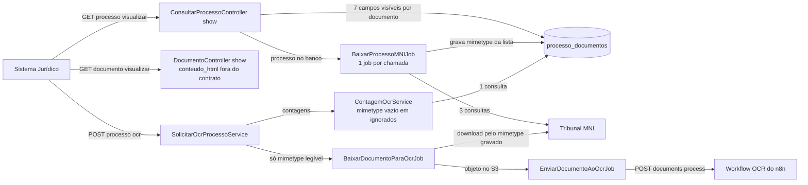
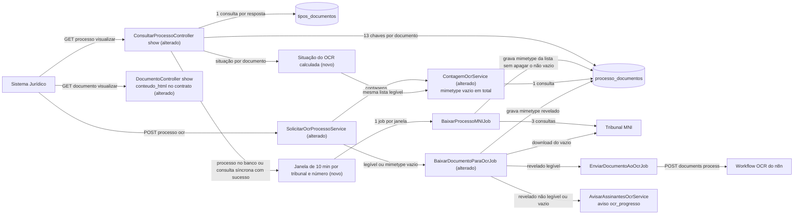

# SPEC: campos-dos-autos-e-trava-de-atualizacao

## Metadata
- Source: developer description via /plan (`/Users/brunosantos/orca/workspaces/sistema-juridico-lorran/fix-integracao-ia/.spec/features/visualizador-de-processo/.handoff/ms-mni-dep-07-e-08.md`), com os critérios e as decisões confirmados em `.spec/features/campos-dos-autos-e-trava-de-atualizacao/.handoff/confirmed-input.md` (checkpoint §3, 2026-11-09)
- Service: ms-mni (`/Users/brunosantos/Projetos/ms-mni`, branch `feat/ocr-do-processo-para-o-sistema`)
- Tier: complete
- Version: 1.1
- Clarifier: 6 respostas do desenvolvedor aplicadas em 2026-11-09 (`.handoff/clarifier-questions.md` e `.handoff/clarifier-answers.md`). Ver "Decisões do clarifier".
- Architecture references: `AGENTS.md`, `docs/agents/architecture.md`, `docs/agents/domain_rules.md` (apoio: `docs/agents/api_contracts.md`, `docs/agents/data_model.md`, `docs/agents/coding_guidelines.md`)
- Init chain: ausente (`.spec/init/` não existe)

## Context

**Problema.** O Sistema Jurídico ganhou o visualizador dos autos (feature `visualizador-de-processo`), que lista os documentos por `GET /processo/visualizar` a cada abertura, com o par do PJe do próprio membro. No teste de 2026-11-08 (processo 0000294-58.2023.8.03.0011, TJAP 2º grau, 294 documentos):
- a lista chegou sem `mimetype`, `tipo`, `data_juntada`, `usuario_juntada_arquivo`, `file_size` e sem a situação do OCR;
- todo documento apareceu como "Ainda não lido pela IA": o cabeçalho mostrou "0 de 294", e o bloco do chat mostrou "293 de 293";
- "Resumir" e "Perguntar" ficaram desabilitados em todos os documentos;
- o filtro "Mídias" mostrou 0.

Além disso, cada abertura enfileira um acesso ao tribunal (LIM-05 do Sistema). O lado do Sistema está pronto e testado contra um fake do contrato acordado. Falta o ms-mni.

**Fontes da verdade.**
- Critérios de aceite: os 7 confirmados em `.handoff/confirmed-input.md`, citados como AC1 a AC7. O lado do Sistema do AC6 e o AC7 inteiro são validação externa (VE-01, VE-02). Por decisão do checkpoint, não viram requisito implementável no ms-mni.
- Interface: o contrato acordado `/Users/brunosantos/orca/workspaces/sistema-juridico-lorran/fix-integracao-ia/tests/Fixtures/Mni/openapi.yaml`, com as marcas `x-dependencia: DEP-07`. A segunda cópia, `.spec/features/consulta-processual-mni-credenciais-pje/.handoff/ms-mni-openapi.yaml` no mesmo worktree, é idêntica byte a byte (verificado por `diff`).
- Requisitos de origem, no mesmo worktree: `.spec/features/visualizador-de-processo/SPEC.md` v1.1 (External Dependencies, CT-08, CT-09, RF-05, LIM-05 e Q-02) e o `PLAN.md`, seção "Dependências no ms-mni (DEP-07 e DEP-08, fora deste repo)". Os nomes de classe de lá são propostas.

**Glossário.**
- *Linha*: o `tribunal_id`, isto é, uma linha de `tribunais`.
- *Lista legível*: os 8 mimetypes que o OCR lê (`application/pdf`, `text/html` e `image/png`, `image/jpeg`, `image/webp`, `image/tiff`, `image/bmp`, `image/gif`), comparados de forma exata (verified at app/Services/Ocr/FormatosOcr.php:22-31; `docs/agents/domain_rules.md` "Readable formats and counts").
- *Mimetype vazio*: `processo_documentos.mimetype` = `''`. A coluna é `NOT NULL` (verified at database/migrations/2024_11_28_222314_create_processo_documentos_table.php:22 e no banco de desenvolvimento, `information_schema`). Então "sem mimetype" é sempre a string vazia.
- *Revelar o mimetype*: gravar no documento o mimetype que o tribunal informa na resposta do download daquele documento.
- *Janela de atualização*: o período de 600 s em que `GET /processo/visualizar` não enfileira de novo o job de atualização em segundo plano de um (`tribunal_id`, `numero_processo`) (DEP-08). Abre no despacho desse job ou no fim de uma consulta síncrona bem-sucedida do `/processo/visualizar` (RF-15). Não vale para os outros despachos do job (RF-16).

**Achados no código (AS IS).**
- `GET /processo/visualizar` (verified at routes/api.php:24) carrega os documentos com `select('id', 'id_documento', 'descricao', 'id_documento_vinculado', 'movimento', 'tipo_documento', 'data_hora', 'nivel_sigilo', 'processo_id')` (verified at app/Http/Controllers/Api/ConsultarProcessoController.php:82-84). Como `id` e `processo_id` são ocultos, saem 7 chaves por documento.
- Com o processo no banco, cada chamada despacha `BaixarProcessoMNIJob` com o par da chamada (verified at app/Http/Controllers/Api/ConsultarProcessoController.php:106-108). O job é `ShouldBeEncrypted` (verified at app/Jobs/BaixarProcessoMNIJob.php:19), faz 3 consultas SOAP e, na falha, só registra no log (verified at app/Jobs/BaixarProcessoMNIJob.php:48-83). Há outros 2 despachos do mesmo job: `/processo/consultar` com o processo no banco (verified at app/Http/Controllers/Api/ConsultarProcessoController.php:146) e `ConsultarExpedienteService` (verified at app/Services/MNI/Intercomunicacao/ConsultarExpedienteService.php:48). Esses 2 continuam sem janela (RF-16, decisão Q-02).
- `ShouldBeUnique` sozinho não segura uma janela: o Laravel solta a trava única quando o job termina (verified at vendor/laravel/framework/src/Illuminate/Queue/CallQueuedHandler.php:91-93).
- O cache padrão é `database` (verified at config/cache.php:18; `.env.example:44`), e os testes usam `array` (verified at phpunit.xml:24). O deploy roda `cache:clear` (verified at build.sh:10).
- `ProcessoDocumento::getTipoDocumento()` faz 1 consulta por documento, por `codigo` + `tribunal_id` (verified at app/Models/ProcessoDocumento.php:91-96). `tipos_documentos` não tem índice único em (`tribunal_id`, `codigo`) (verified at database/migrations/2026_07_14_100001_create_tipos_documentos_table.php:11-21). O banco de desenvolvimento tem 0 pares repetidos, com 434 tipos na linha 1 e 424 na linha 2.
- Os campos `ocr_*` estão em `$hidden` (verified at app/Models/ProcessoDocumento.php:59-79). `data_juntada` não tem cast, de propósito (verified at app/Models/ProcessoDocumento.php:51).
- `/documento/visualizar` já anexa `conteudo_html` à resposta (verified at app/Http/Controllers/Api/DocumentoController.php:164-190). O `path` de um HTML é o `{id}.pdf` renderizado, e o `.html` fica em `path_html` (verified at app/Services/Processo/SalvarDocumentoProcessoService.php:244-266).
- A contagem põe todo mimetype fora da lista em `ignorados`, inclusive o vazio, numa consulta só (verified at app/Services/Ocr/ContagemOcrService.php:28-54; tests/Unit/Services/Ocr/ContagemOcrServiceTest.php:199).
- O pedido só enfileira mimetype da lista (verified at app/Services/Ocr/SolicitarOcrProcessoService.php:355-360). Um pendente `baixado` com `path` vai direto ao envio, sem SOAP (verified at app/Services/Ocr/SolicitarOcrProcessoService.php:330-335).
- O download do OCR também tem um atalho: objeto já no S3 vai ao envio sem conferir o mimetype (verified at app/Jobs/BaixarDocumentoParaOcrJob.php:104-108 e :172-177). O envio lança exceção para mimetype fora da lista (verified at app/Services/Ocr/MontarEnvioOcrService.php:49; app/Services/Ocr/FormatosOcr.php:59-66).
- Nenhum código grava hoje o mimetype vindo do download. O download roteia pelo mimetype já gravado, e o vazio cai em `downloadOutros`, que grava `{id}.dat` (verified at app/Services/Processo/SalvarDocumentoProcessoService.php:132-145 e :387-420). Com `baixado` e objeto no S3, `baixarDocumento` não chama o tribunal (verified at app/Services/Processo/SalvarDocumentoProcessoService.php:111-123).
- A resposta do tribunal ao download traz o `mimetype` do documento (verified at app/Services/MNI/Intercomunicacao/ConsultarDocumentoService.php:67; app/Services/MNI/NormalizarDocumentoMniService.php:132).
- Toda consulta da lista regrava o `mimetype` com o valor da lista, por `updateOrCreate` (verified at app/Services/Processo/SalvarDocumentoProcessoService.php:57-74, linha 66). RF-14 muda isso só para o `''`: ele não apaga mais um mimetype não vazio (decisão Q-01).
- O processo do AC7 está no banco de desenvolvimento (processo `id` 14068, `tribunal_id` 2) com 294 documentos: 84 `application/pdf` e 209 `text/html`, todos `processado`, e 1 `audio/mpeg`. Não tem vídeo: o vídeo é homologado em outro processo da linha 1 (VE-02, decisão Q-06).
- O handoff cita `/documento/listar` no item (d). A rota é `GET /processo/documentos/listar` (verified at routes/api.php:33).

**Regras de arquitetura aplicadas** (fonte: os arquivos de Metadata):
- `docs/agents/architecture.md` "Layer responsibilities":
  - o controller da API orquestra, lê o banco, despacha jobs e decide o status HTTP;
  - `Services/Ocr` é dono das regras do OCR (contagens, decisão do pedido, situações);
  - os jobs são donos da fila, das tentativas e da marcação de falha.

  `docs/agents/coding_guidelines.md` §2 complementa: controller fino, regra de negócio em `app/Services`. A situação calculada e a contagem ficam em `Services/Ocr` (RNF-03), e a janela de DEP-08 fica no ponto de despacho.
- `AGENTS.md` §2: todo job que leva o par do PJe implementa `ShouldBeEncrypted`. Isso vale para o job de atualização e para o download do OCR (RNF-01).
- `AGENTS.md` §3, "Never in this repository": o par nunca vai a job sem cifra, a tabela do OCR ou contexto de log (RNF-01).
- `AGENTS.md` §3: uma mudança de interface atualiza `docs/api/openapi.yaml` na mesma mudança (CT-04).
- `docs/agents/domain_rules.md` "OCR do processo":
  - toda mudança de situação roda em `DB::transaction`, travando antes o processamento aberto e depois o documento;
  - os avisos saem depois do commit;
  - o `com_erro` volta à fila quando um pedido abre processamento (D-08).

  As transições novas seguem essas regras (RNF-05).
- `docs/agents/coding_guidelines.md` §8: parâmetros ajustáveis ficam em `config/` e são lidos por `config()`. A janela de 600 s é uma sugestão para lá (FLEXIBLE).

## AS IS — Estado atual

Hoje, o `show` devolve 7 campos visíveis por documento e despacha um job de atualização a cada chamada com o processo no banco. No OCR, o documento com mimetype vazio fica fora da fila e conta em `ignorados`. O `conteudo_html` já sai de `/documento/visualizar`, mas não está no contrato.

## TO BE — Estado proposto

Mudam o `show`, com 13 chaves, `tipo` em 1 consulta e a situação calculada pela mesma lista da contagem (RF-01 a RF-05, CT-01), e a janela de 10 min antes do job de atualização, só em `/processo/visualizar` (RF-15, RF-16, CT-05). No OCR, o pedido, a contagem e o download passam a tratar o mimetype vazio e decidem pelo mimetype revelado (RF-07 a RF-13, CT-03). A gravação da lista, compartilhada por todas as consultas, deixa de trocar um mimetype não vazio por `''` (RF-14). Em `/documento/visualizar`, só o contrato muda (RF-06, CT-02, CT-04).

## Scope
- **In**:
  - DEP-07 (a): as 6 chaves novas por documento em `/processo/visualizar`; `tipo` sem uma consulta por documento; `ocr_situacao` calculada só nessa resposta.
  - DEP-07 (b): `docs/api/openapi.yaml` igual à cópia acordada (13 trechos, ver "Comparação dos contratos").
  - DEP-07 (c): contagem com o mimetype vazio em `total`; o documento vazio entra na fila de download; o mimetype revelado decide entre envio, `ignorados` e `com_erro`; nenhum envio de mimetype fora da lista; a gravação da lista não troca um mimetype não vazio por `''` (RF-14).
  - DEP-08: no máximo 1 job de atualização por (`tribunal_id`, `numero_processo`) a cada 600 s nas chamadas a `/processo/visualizar` com o processo no banco. A janela abre no despacho desse job ou no fim de uma consulta síncrona bem-sucedida do `/processo/visualizar` (RF-15).
  - Atualização de `docs/agents/` na mesma mudança (RNF-07).
- **Out**:
  - Mudança de comportamento em `/processo/documentos/listar`, `/documento/visualizar` e nas rotas de OCR, além do que a contagem muda (DEP-07 (d)). A exceção é a regra de RF-14 na gravação da lista, que não muda o contrato de nenhuma rota.
  - A janela de DEP-08 em `/processo/consultar` e no despacho a partir do expediente: os 2 continuam com 1 job por chamada (RF-16).
  - Mudar como `/processo/visualizar` consulta o tribunal: o caminho sem o processo no banco continua síncrono. "Atualizar" no Sistema traz o que o ms-mni tem no banco (LIM-01 do Sistema).
  - Prioridades, sigilo do processo e advogados com OAB: já chegam certos e não mudam. O contrato passa a descrever `Prioridade` e `RepresentanteProcessual`, sem mudança no JSON.
  - Divergências que já existem entre contrato e implementação (O-02 a O-04): são avisadas, mas não corrigidas.
  - Favoritos (fase 2 do Sistema).
  - Lado do Sistema: trocar as duas cópias do contrato, rodar o `MniTest` e homologar (VE-01, VE-02). Fica no PLAN como homologação e handoff, sem checkbox no `PHASES.md`.
  - Revelar o mimetype fora do download do OCR. Os downloads da consulta, do lote e de `/documento/visualizar` continuam roteando pelo mimetype gravado, como hoje.

## Known Limitations — limitações conhecidas

- **LIM-01** (DEP-08): o job da janela usa o par da 1ª chamada. Se o tribunal recusar esse par, o job só registra no log (verified at app/Jobs/BaixarProcessoMNIJob.php:78-82), e o banco fica sem atualização até a janela vencer, mesmo que outra chamada traga um par válido. É o comportamento aceito pelo AC5 ("pares diferentes enfileiram 1 job").
- **LIM-02** (DEP-07 (c)): um documento cujo mimetype continua vazio vai a `com_erro` (RF-12) e volta à fila em cada pedido que abre processamento (D-08). Isso dá 1 acesso ao tribunal por documento desses em cada pedido.
- **LIM-03** (DEP-07 (c)): um documento vazio que é um vídeo grande pode estourar o download do OCR. Os limites são 3 tentativas e 300 s (verified at app/Jobs/BaixarDocumentoParaOcrJob.php:38-40) e 512 MB no supervisor `supervisor-ocr-download` (verified at config/horizon.php:294-305). Nesse caso, o documento vai a `com_erro` com mimetype vazio, e não a `ignorados`.
- **LIM-04** (DEP-08): o `cache:clear` de cada deploy (verified at build.sh:10) apaga as janelas abertas, e a 1ª chamada depois do deploy enfileira um job.
- **LIM-05** (DEP-08; decisão Q-02): a janela vale só para `/processo/visualizar`. `/processo/consultar` com o processo no banco e o despacho a partir do expediente continuam enfileirando 1 job por chamada, também com a janela aberta (RF-16). O limite de 1 job a cada 10 min por processo e linha vale só para o que o Sistema chama hoje (`/processo/visualizar`).
- **LIM-06** (DEP-07 (c); decisão Q-01): a lista do tribunal não consegue mais limpar um mimetype. Se o tribunal passar a mandar `''` para um documento que já tem mimetype não vazio no banco, o ms-mni mantém o valor gravado (RF-14).

## RIGID (Non-Negotiable)

### Functional Requirements

**`GET /processo/visualizar` — campos dos autos (DEP-07 (a))**

- RF-01 [Event-Driven] (AC1): Quando `GET /processo/visualizar` responder 200, o ms-mni deve devolver cada item de `documentos` com exatamente 13 chaves:
  - as 7 de hoje, com os mesmos valores e a mesma serialização: `id_documento`, `descricao`, `id_documento_vinculado`, `movimento`, `tipo_documento`, `data_hora`, `nivel_sigilo`;
  - as 6 novas: `tipo` (RF-02), `data_juntada`, `usuario_juntada_arquivo`, `mimetype`, `file_size` e `ocr_situacao` (RF-03).

  Regras:
  - `data_juntada`, `usuario_juntada_arquivo`, `mimetype` e `file_size` trazem o valor da coluna de `processo_documentos`, sem conversão. `data_juntada` sai no mesmo formato de `data_hora` na mesma resposta, e `mimetype` sai `''` quando a coluna está vazia.
  - Vale nos dois caminhos: processo já no banco e processo consultado na hora porque não estava no banco.
  - A ordem dos documentos não muda (`data_hora` decrescente).
  - Nunca saem no documento: `status`, `path`, `path_html`, `hash`, `url`, `link`, `conteudo_html`, `id`, `processo_id`, `ocr_job_id`, `ocr_job_id_cancelar`, `ocr_enviado_em`, `ocr_concluido_em` e `ocr_erro`.
  - AC: Com o processo no banco e um documento com `data_juntada` "2026-03-06 10:00:00", `usuario_juntada_arquivo` "LUCAS MONTEIRO PEREIRA", `mimetype` "application/pdf" e `file_size` 655360, as chaves do item são exatamente as 13, e esses 4 valores saem iguais aos da coluna.
  - AC: Com o processo fora do banco (MNI fake), as chaves do item também são exatamente as 13.
  - AC: Um documento com `mimetype` `''` e `file_size` null sai com `"mimetype": ""` e `"file_size": null`.
  - AC: Nenhuma das 14 chaves proibidas aparece em nenhum item.

- RF-02 [Event-Driven] (AC1): Quando montar a resposta de RF-01, o ms-mni deve preencher `tipo` com a `descricao` do registro de `tipos_documentos` em que `tribunal_id` é o do processo e `codigo` é o `tipo_documento` do documento.
  - Registros excluídos (`deleted_at` preenchido) não contam.
  - Sem registro, `tipo` é `null`.
  - Com mais de um registro para o mesmo (`tribunal_id`, `codigo`), vale o de menor `id`.
  - O número de consultas ao banco para resolver os tipos não depende do número de documentos (RNF-02).
  - AC: Com o documento `tipo_documento` "57", o tipo (linha do processo, "57", "Certidão") e o tipo (outra linha, "57", "Outro"), `tipo` sai "Certidão".
  - AC: Sem tipo com o `codigo` do documento na linha do processo, `tipo` sai `null`.
  - AC: Com 2 tipos (linha do processo, "57") de `id` 10 "Certidão" e `id` 11 "Certidão antiga", `tipo` sai "Certidão".
  - AC: A resposta para um processo com 1 documento e para outro com 50 documentos (50 `tipo_documento` diferentes) faz o mesmo número de consultas ao banco (`DB::enableQueryLog`).

- RF-03 [State-Driven] (AC2): Enquanto `GET /processo/visualizar` montar cada documento, o ms-mni deve calcular `ocr_situacao` só para essa resposta:
  - `mimetype` diferente de `''` e fora da lista legível → `ignorado`, seja qual for a coluna `ocr_situacao`;
  - nos demais casos (mimetype na lista legível, ou `''`) → o valor da coluna `ocr_situacao` (`pendente`, `enviado`, `processado` ou `erro`), com `null` → `pendente`.

  O valor nunca é `null` e é sempre um destes 5: `pendente`, `enviado`, `processado`, `erro`, `ignorado`. Um documento com mimetype `''` nunca sai `ignorado`. A coluna `ocr_situacao` não é alterada pela leitura.
  - AC (dataset, `mimetype` / coluna → `ocr_situacao`):
    - `video/mp4` / null → `ignorado`;
    - `application/pdf` / null → `pendente`;
    - `''` / null → `pendente`;
    - `application/pdf` / `processado` → `processado`;
    - `text/html` / `enviado` → `enviado`;
    - `image/png` / `erro` → `erro`;
    - `''` / `erro` → `erro`;
    - `audio/mpeg` / null → `ignorado`;
    - `application/zip` / `pendente` → `ignorado`;
    - `video/mp4` / `processado` → `ignorado`.
  - AC: Depois da resposta, a coluna `ocr_situacao` de cada documento é a mesma de antes, e `null` continua `null`.

- RF-04 [Unwanted] (AC2): Se um documento for serializado por `GET /documento/visualizar` ou `GET /processo/documentos/listar`, então o ms-mni não deve incluir `ocr_situacao` nem outro campo `ocr_*`. A situação calculada só existe em `/processo/visualizar`.
  - AC: O 200 de `/documento/visualizar` e os itens de `/processo/documentos/listar` (com o processo no banco e fora dele) não têm nenhuma chave que comece com `ocr_`.

- RF-05 [Ubiquitous] (AC2; apoio ao AC7): A lista de `/processo/visualizar` e as contagens do OCR (o 202 de `POST /processo/ocr`, o aviso `ocr_progresso` e RF-07) devem bater para o mesmo processo e linha, no mesmo estado do banco:
  - documentos com `ocr_situacao` `processado` = `processados`;
  - `erro` = `com_erro`;
  - `ignorado` = `ignorados`;
  - todos os documentos que não saem `ignorado` = `total`.
  - AC: Para o dataset de RF-03 num mesmo processo, as 4 igualdades valem entre a resposta de `/processo/visualizar` e a contagem do mesmo processo.

**`GET /documento/visualizar` — HTML (DEP-07 (b))**

- RF-06 [Event-Driven] (AC3): Quando `GET /documento/visualizar` responder 200, o ms-mni deve manter o comportamento de hoje (verified at app/Http/Controllers/Api/DocumentoController.php:164-190):
  - `documento.conteudo_html` está sempre presente;
  - num documento `text/html` com o HTML recuperável (coluna legada, objeto de `path_html` ou a autocorreção de hoje), `conteudo_html` traz esse HTML;
  - nos demais casos, `conteudo_html` é `null`;
  - num `text/html`, `documento.link` é a URL temporária do PDF renderizado, o objeto de `path` terminado em `.pdf`.

  Nada é persistido, e o contrato passa a descrever o campo (CT-02, CT-04).
  - AC: Um documento `text/html` `baixado`, com `{id}.pdf` e `{id}.html` no S3 (fake), responde 200 com `conteudo_html` igual ao conteúdo do `.html`, e o `link` aponta para o objeto `.pdf`.
  - AC: Um documento `application/pdf` responde 200 com a chave `conteudo_html` = `null`.

**Contagem e processamento do mimetype vazio (DEP-07 (c))**

- RF-07 [Ubiquitous] (AC4): O ms-mni deve calcular as contagens do OCR de um processo na linha sobre o conjunto *legível ou vazio*: documentos com mimetype na lista legível ou igual a `''`.
  - `total`: documentos do conjunto.
  - `processados`, `com_erro` e `aguardando`: documentos do conjunto com `ocr_situacao` `processado`, `erro` e `enviado`.
  - `pendentes`: os demais documentos do conjunto (`ocr_situacao` null ou `pendente`).
  - `ignorados`: mimetype diferente de `''` e fora da lista legível.

  As invariantes `processados + com_erro + pendentes + aguardando = total` e `total + ignorados` = documentos do processo no banco continuam. A regra vale para o 202 de `POST /processo/ocr`, para cada aviso `ocr_progresso` e para as decisões internas de abrir e encerrar o processamento.
  - AC: Com 1 `application/pdf` null, 1 `''` null, 1 `video/mp4` null e 1 `audio/mpeg` null, a contagem dá `total` 2, `pendentes` 2, `ignorados` 2, `processados` 0, `com_erro` 0 e `aguardando` 0.
  - AC: Um documento `''` com `ocr_situacao` `erro` conta em `total` e em `com_erro`, e não em `ignorados`.
  - AC: O dataset de invariantes da contagem, com `''` em cada uma das 4 situações e em null, mantém as 2 invariantes em todos os casos.

- RF-08 [Event-Driven] (AC4): Quando um pedido (`POST /processo/ocr`) abrir um processamento, o ms-mni deve mandar à fila `ocr-download` (verified at config/horizon.php:296) cada documento do processo com mimetype `''` que esteja pendente. Isso inclui o `erro` devolvido à fila pela D-08.
  - O job vai cifrado e com o par do dono.
  - Vale mesmo se o documento estiver `baixado` com `path`.
  - O pedido nunca manda um documento vazio direto à fila `ocr-envio` (verified at config/horizon.php:315).
  - Um pedido em que só há documentos vazios pendentes abre o processamento e responde 202 `em_andamento`, não `concluido`.
  - AC: Com 1 PDF `processado` e 1 `''` null de `status` `pendente`, o pedido responde 202 `em_andamento` com `total` 2, `processados` 1 e `ignorados` 0, e enfileira 1 job em `ocr-download` e 0 em `ocr-envio`.
  - AC: Um `''` null com `status` `baixado` e `path` `.dat` no S3 gera 1 job em `ocr-download` e 0 em `ocr-envio` no pedido.
  - AC: Um `''` com `ocr_situacao` `erro` volta a pendente e gera 1 job em `ocr-download`, e o 202 sai com `com_erro` 0.

- RF-09 [Event-Driven] (AC4): Quando o job de download do OCR tratar um documento com mimetype `''`, o ms-mni deve:
  - pedir o documento ao tribunal com o par do dono, mesmo que ele já esteja `baixado` com objeto no S3;
  - gravar em `processo_documentos.mimetype` o mimetype que o tribunal informa para o documento na resposta dessa chamada.

  A fonte é só a resposta do tribunal. O tipo não é inferido do conteúdo do binário, porque o erro de RF-12 é "não informado pelo tribunal".

  O binário fica no S3 pela regra do mimetype gravado (`docs/agents/domain_rules.md` "Document binary download"), com `status` `baixado`:
  - `text/html`: `{id}.pdf` em `path` e `{id}.html` em `path_html`;
  - `application/pdf`: `{id}.pdf`;
  - os demais: `{id}.{ext}`, com `dat` para tipo desconhecido e para o vazio.

  A recusa do par e as tentativas esgotadas seguem as regras de hoje (`docs/agents/domain_rules.md` "Refusal of the pair" e "Download"), com o mimetype ainda vazio.
  - AC: Um `''` `pendente`, com o tribunal fake devolvendo `mimetype` "application/pdf" e conteúdo, termina com `mimetype` "application/pdf", `path` terminado em `.pdf`, `status` `baixado` e 1 chamada SOAP.
  - AC: Um `''` `baixado` com `{id}.dat` no S3 gera 1 chamada SOAP. O atalho do objeto no S3 não vale para o vazio.
  - AC: Com o tribunal devolvendo "text/html", `path` termina em `.pdf`, `path_html` termina em `.html`, e os 2 objetos existem no S3.
  - AC: Com o tribunal devolvendo "video/mp4", `mimetype` é "video/mp4", e `path` termina em `.mp4`.

- RF-10 [Event-Driven] (AC4): Quando o mimetype gravado por RF-09 estiver na lista legível, o ms-mni deve mandar o documento à fila `ocr-envio` no mesmo processamento.
  - O envio usa o objeto de RF-09 e o `filename` da D-07: `{id_documento}.pdf` para PDF e HTML, e a extensão do mimetype para imagem.
  - A revelação não conta como progresso: nenhum aviso até o retorno do workflow.
  - AC: Revelado "application/pdf": 1 job em `ocr-envio`. O `POST documents/process` sai com `filename` `{id_documento}.pdf`, e a revelação gera 0 avisos.
  - AC: Revelado "text/html": o `url` do envio aponta para o objeto `.pdf`, e o `filename` é `{id_documento}.pdf`.

- RF-11 [Event-Driven] (AC4): Quando o mimetype gravado por RF-09 não for vazio e estiver fora da lista legível, o ms-mni deve:
  - não enviar o documento ao workflow;
  - tirar o documento de `total` e contá-lo em `ignorados`;
  - tratar a mudança como progresso do processamento aberto: 1 aviso `ocr_progresso` `em_andamento` por assinante ativo, com as contagens do momento, e o prazo P renovado;
  - sem documento pendente nem aguardando retorno, encerrar o processamento `concluido`, com o aviso final.
  - AC: Num processamento com só 1 `''` pendente (antes: `total` T, `ignorados` I) e o tribunal revelando "video/mp4": 0 `POST documents/process`, 1 aviso `em_andamento` por assinante com `total` T−1 e `ignorados` I+1, e depois o aviso final `concluido`.
  - AC: Com outro documento ainda pendente, sai 1 aviso `em_andamento`, e o processamento continua `em_andamento`.
  - AC: `/processo/visualizar` mostra esse documento com `mimetype` "video/mp4" e `ocr_situacao` `ignorado`.
  - AC: As 2 invariantes de RF-07 valem em cada aviso gerado.

- RF-12 [Event-Driven] (AC4): Quando o download de RF-09 terminar sem erro e o mimetype continuar `''`, o ms-mni deve:
  - marcar o documento com erro definitivo neste processamento (`ocr_situacao` `erro`, conta em `com_erro`), com `ocr_erro` = "mimetype não informado pelo tribunal";
  - não enviar o documento ao workflow;
  - tratar a mudança como progresso, com aviso.

  Na abertura seguinte, o documento volta à fila como todo `com_erro` (D-08; LIM-02).
  - AC: Com o tribunal devolvendo o documento com `mimetype` vazio, o documento termina com `ocr_situacao` `erro` e `ocr_erro` "mimetype não informado pelo tribunal". O aviso traz `com_erro` +1, sai 0 `POST documents/process`, e `/processo/visualizar` mostra `erro`.

- RF-13 [Unwanted] (AC2, AC4): Se um documento com mimetype fora da lista legível, inclusive `''`, chegar a um ponto de envio, então o ms-mni não deve chamar `POST documents/process` com ele. Os pontos de envio são:
  - o atalho do pedido para documento `baixado`;
  - o atalho do download do OCR para objeto já no S3 (verified at app/Jobs/BaixarDocumentoParaOcrJob.php:104-108);
  - o job da fila `ocr-envio`.

  O atalho do objeto no S3 só vale para mimetype da lista legível.

  Quando um job do OCR (download ou envio) encontrar um documento com mimetype não vazio fora da lista legível que não foi revelado nesse job (por exemplo, regravado pela lista no job de atualização de DEP-08 enquanto o documento estava na fila), o ms-mni deve (decisão Q-05):
  - sair do job sem chamar o tribunal, sem envio e sem aviso intermediário;
  - sem documento pendente nem aguardando retorno no processamento aberto, encerrar o processamento `concluido`, com o aviso final.
  - AC (dataset): (a) pedido com `''` `baixado` e `path`; (b) job de download com `''` `baixado` no S3; (c) job de download com `audio/mpeg` `baixado` no S3. Nos 3 casos: 0 `POST documents/process` com mimetype fora da lista, e 0 falhas do job de envio por mimetype.
  - AC: Num processamento cujo único pendente é um `''` na fila `ocr-download`, a lista do tribunal regrava o documento como "video/mp4" antes do job rodar. O job faz 0 chamadas SOAP, 0 `POST documents/process` e 0 avisos `em_andamento`, e o processamento termina `concluido`, com 1 aviso final por assinante ativo.
  - AC: No mesmo cenário, com outro documento ainda pendente, o job sai com 0 avisos, e o processamento continua `em_andamento`.

- RF-14 [Unwanted] (AC4; decisão Q-01): Se uma gravação da lista de documentos do tribunal trouxer mimetype `''` para um documento que já tem mimetype não vazio em `processo_documentos`, então o ms-mni não deve trocar o valor gravado por `''`.
  - Vale para toda gravação da lista: a consulta síncrona, o job de atualização de DEP-08, a lista do próprio pedido de OCR e `/processo/documentos/listar`. Hoje, o `updateOrCreate` regrava o valor da lista em todas elas (verified at app/Services/Processo/SalvarDocumentoProcessoService.php:57-74).
  - Um mimetype não vazio vindo da lista continua sobrescrevendo o gravado, como hoje. O resto da gravação da lista não muda.
  - Nenhuma rota muda de contrato (LIM-06).
  - AC (dataset, mimetype gravado / mimetype da lista → mimetype depois da gravação):
    - `video/mp4` / `''` → `video/mp4`;
    - `application/pdf` / `''` → `application/pdf`;
    - `''` / `application/pdf` → `application/pdf`;
    - `application/pdf` / `text/html` → `text/html`;
    - `''` / `''` → `''`.
  - AC: Com um vídeo revelado por RF-09 e um pedido de OCR em que a lista do tribunal devolve `''` para ele, o documento continua `video/mp4`, `ignorados` não muda, e sai 0 job de download para ele.
  - AC: Depois de um job de atualização (DEP-08) em que a lista devolve `''` para esse vídeo, `/processo/visualizar` mostra o documento com `mimetype` "video/mp4" e `ocr_situacao` `ignorado`.

**Atualização em segundo plano uma vez a cada 10 min (DEP-08)**

- RF-15 [State-Driven] (AC5): Enquanto houver janela de atualização aberta para um (`tribunal_id`, `numero_processo` normalizado), uma chamada a `GET /processo/visualizar` que encontra o processo no banco não deve enfileirar o job de atualização. Isso vale seja qual for o par da chamada.
  - A janela abre de 2 jeitos, sempre por 600 s:
    - sem janela aberta, a chamada com o processo no banco enfileira 1 job com o par dela e abre a janela a partir desse despacho;
    - a consulta síncrona de `/processo/visualizar` com o processo fora do banco (RF-16) que termina com sucesso abre a janela, sem job (decisão Q-03). Uma consulta síncrona que falha (a chamada responde erro) não abre a janela.
  - A janela não é estendida pelas chamadas suprimidas, e cada `tribunal_id` tem a sua.
  - A resposta da chamada é a mesma com ou sem despacho (CT-05).
  - AC: Em t0 (par A), sai 1 job. Em t0+1 min (par B), o total continua 1 job, e o único job leva o par A. Em t0+11 min (par B), o total passa a 2.
  - AC: Em t0+9 min, nenhuma chamada enfileira job novo.
  - AC: O mesmo `numero_processo` em outra linha, em t0+1 min, enfileira o seu job (total 2 com o de t0).
  - AC: As chamadas de t0, t0+1 min e t0+11 min respondem 200 com as mesmas chaves no corpo.
  - AC: Com o MNI fake falhando na consulta síncrona em t0 (processo fora do banco), nenhuma janela abre. Com o processo gravado no banco depois, uma chamada em t0+1 min enfileira 1 job.

- RF-16 [Ubiquitous] (AC5): O ms-mni deve manter o resto do comportamento em volta do job de atualização:
  - com o processo fora do banco, `/processo/visualizar` continua consultando o tribunal de forma síncrona, sem enfileirar job. A consulta que termina com sucesso abre a janela (RF-15);
  - o job continua `ShouldBeEncrypted` e na mesma fila;
  - a janela vale só para `/processo/visualizar` (decisão Q-02). `/processo/consultar` com o processo no banco (verified at app/Http/Controllers/Api/ConsultarProcessoController.php:146) e o despacho a partir do expediente (verified at app/Services/MNI/Intercomunicacao/ConsultarExpedienteService.php:48) continuam enfileirando 1 job por chamada. Eles não conferem nem abrem a janela (LIM-05);
  - o job não ganha trava de unicidade: um job já na fila, de qualquer um dos 3 despachos, não descarta outro despacho (decisão Q-02).
  - AC (substitui o AC de v1.0, que não fechava com o fluxo): Com o processo fora do banco, a 1ª chamada faz 1 consulta síncrona ao MNI fake e enfileira 0 jobs. A 2ª, logo em seguida, faz 0 consultas síncronas e enfileira 0 jobs. A 3ª, 11 min depois da 1ª, faz 0 consultas síncronas e enfileira 1 job.
  - AC: Com o processo no banco e sem janela, 2 chamadas a `/processo/consultar` enfileiram 2 jobs, e uma chamada a `/processo/visualizar` 1 min depois enfileira o seu (total 3). Em seguida, com a janela aberta, outra chamada a `/processo/consultar` enfileira mais 1 (total 4).
  - AC: Com a janela aberta por `/processo/visualizar`, o despacho a partir do expediente enfileira o seu job.
  - AC: Com um job do expediente na fila e sem janela, uma chamada a `/processo/visualizar` enfileira o seu job, e esse job leva o par da chamada.
  - AC: O payload enfileirado em t0 é cifrado (o teste de payload de `tests/Feature/Jobs/JobsComParCifradosTest.php` continua verde).

### Contracts

- CT-01 — `GET /processo/visualizar` (alterado; DEP-07; igual a `tests/Fixtures/Mni/openapi.yaml:155-199` e ao schema `Documento`, `:1373-1463`, do worktree do Sistema)
  - Query, autenticação (`ValidateApiToken` + `InjectCredenciaisPjePadrao`, verified at routes/api.php:22-24) e as respostas 400, 401, 403, 404, 422 e 500: iguais às de hoje.
  - 200: o `Processo` de hoje, com cada item de `documentos` com as 13 chaves de RF-01. Os tipos JSON das chaves novas são:

    | Chave | Tipo JSON | Regra |
    |-------|-----------|-------|
    | `tipo` | string ou null | RF-02 |
    | `data_juntada` | string ou null | valor da coluna, no formato de `data_hora` |
    | `usuario_juntada_arquivo` | string ou null | valor da coluna |
    | `mimetype` | string | `''` = mimetype não informado |
    | `file_size` | inteiro ou null | bytes |
    | `ocr_situacao` | string | `pendente`, `enviado`, `processado`, `erro` ou `ignorado`; nunca null nesta rota (RF-03) |

- CT-02 — `GET /documento/visualizar` (só o contrato muda; DEP-07; `tests/Fixtures/Mni/openapi.yaml:343-...`, `:1441` e `:1456-1463`)
  - 200: `documento.conteudo_html` (string ou null; preenchido só em `text/html`). Num `text/html`, `documento.link` é a URL temporária do PDF renderizado (RF-06).
  - Sem `ocr_situacao` (RF-04). Status e erros iguais aos de hoje.

- CT-03 — 202 de `POST /processo/ocr` (`ProcessamentoDeOcr`) e webhook `ocr_progresso` (`AvisoDeProgressoDoOcr`) (só a semântica muda; `tests/Fixtures/Mni/openapi.yaml:1047`, `:1050`, `:1063` e `:1066`)
  - Chaves, `required` e `enum` iguais aos de hoje.
  - `total` inclui o documento com mimetype `''` como pendente, e `ignorados` é só "mimetype conhecido fora da lista" (RF-07).
  - Entre avisos do mesmo processamento, `total` pode cair e `ignorados` subir, em no máximo o número de documentos vazios do início do processamento (RF-11).

- CT-04 — `docs/api/openapi.yaml` oficial (AC6; DEP-07 (b))
  - O arquivo fica idêntico, byte a byte, à cópia acordada `tests/Fixtures/Mni/openapi.yaml` do worktree do Sistema. Isso aplica os 13 trechos da seção "Comparação dos contratos" e mantém o texto de `info.description` antes de `## Mudanças acordadas (DEP-07)`.

    A identidade importa por 2 conferências do `MniTest` do Sistema (verified at /Users/brunosantos/orca/workspaces/sistema-juridico-lorran/fix-integracao-ia/tests/Feature/Servicos/MniTest.php:462-483):
    - que as duas cópias são iguais;
    - o SHA-256 desse trecho.
  - Nenhuma divergência nova (D-09 ou seguintes) é criada. Se o plano encontrar motivo para uma, a SPEC volta para esta seção, e a divergência é avisada ao Sistema antes do merge.
  - O `docs/api/openapi.yaml` entra no commit da última fase de DEP-07, quando (a), (b) e (c) estão prontos, na mesma branch (decisão Q-04). As fases anteriores de DEP-07 não tocam no YAML. A mudança continua única, como pede o `AGENTS.md` §3.
  - AC: Entre os commits das fases de DEP-07, só o da última altera `docs/api/openapi.yaml`.
  - AC: `cmp docs/api/openapi.yaml /Users/brunosantos/orca/workspaces/sistema-juridico-lorran/fix-integracao-ia/tests/Fixtures/Mni/openapi.yaml` sai com código 0.
  - AC: `tests/Feature/DocsApiTest.php` continua verde.

- CT-05 — DEP-08 sem mudança de contrato
  - `GET /processo/visualizar` mantém query, respostas e corpo com ou sem a janela.
  - `docs/api/openapi.yaml` não ganha texto sobre DEP-08, para manter CT-04.
  - AC: O teste de RF-15 compara as chaves do corpo das 3 chamadas, e CT-04 continua valendo.

### Non-Functional Requirements

- RNF-01 (AC5, AC4; sigilo do par; `AGENTS.md` §2 e §3):
  - Numa chamada suprimida pela janela, o par não vai a fila, `jobs`, `failed_jobs`, cache, tabela ou log.
  - O valor guardado para a janela não contém login nem senha.
  - O job de atualização e o download do OCR continuam cifrados.
  - Os logs novos (janela, mimetype revelado, decisão depois do download) levam só ids, contagens, o mimetype e a linha, nunca o par nem o texto cru do tribunal.
  - Medida: 0 ocorrências do login e da senha do par B nos payloads de `jobs`, nas entradas de cache e na saída de log, depois das chamadas de RF-15.
  - Medida: `tests/Feature/Jobs/JobsComParCifradosTest.php` e `tests/Feature/OcrSigiloDoParTest.php` continuam verdes.

- RNF-02 (AC1; consultas ao banco):
  - Com o processo no banco, o número de consultas de `GET /processo/visualizar` não muda entre um processo com 1 documento e outro com 50 (RF-02). A resolução de `tipo` usa no máximo 1 consulta por resposta.
  - A contagem do OCR continua em 1 consulta (`tests/Unit/Services/Ocr/ContagemOcrServiceTest.php:199`).

- RNF-03 (AC2, AC4; uma fonte da regra; `docs/agents/architecture.md` "Layer responsibilities" e `docs/agents/coding_guidelines.md` §2):
  - A lista legível existe num só lugar em `app/` e é usada por todos os consumidores:
    - a contagem (RF-07);
    - a escolha do pedido (RF-08);
    - o atalho do download (RF-13);
    - a situação calculada (RF-03).
  - A regra da situação calculada e a da contagem ficam na camada `app/Services/Ocr`. O controller só orquestra, lê do banco e despacha.
  - Medida: um teste com dataset (os 8 mimetypes legíveis, `''`, `video/mp4`, `audio/mpeg` e `application/zip`) mostra que os consumidores concordam. O documento conta em `total` exatamente quando sai diferente de `ignorado` em `/processo/visualizar`, e, se pendente, exatamente quando é enfileirado pelo pedido.
  - Medida: `grep` encontra a lista legível declarada em 1 arquivo de `app/`.

- RNF-04 (AC5; janela atômica):
  - Conferir e abrir a janela é uma operação atômica no store de cache configurado, compartilhado por todos os processos PHP (workers web do Octane e Horizon).
  - Com K chamadas simultâneas na mesma janela, sai exatamente 1 job.
  - Medida: os ACs de RF-15 (chamadas em sequência, com `travel`) e uma revisão que confirma uma operação única de "gravar se ausente", e não leitura seguida de escrita.

- RNF-05 (AC4; transações do OCR; `docs/agents/domain_rules.md` "OCR do processo"):
  - As transições novas seguem as regras de hoje: `DB::transaction`, trava do processamento aberto e depois do documento, avisos depois do commit. São elas:
    - gravar o mimetype revelado e decidir;
    - contar em `ignorados` com aviso (RF-11);
    - o erro definitivo de RF-12;
    - o encerramento `concluido` na saída do job de RF-13.
  - Repetir o job de download de um documento cujo mimetype já foi revelado não gera 2º aviso nem 2º envio pela mesma revelação.
  - Um documento com mimetype fora da lista e não vazio sai do job sem chamar o tribunal e sem aviso intermediário. O único aviso possível nessa saída é o final, quando não sobra pendente nem aguardando retorno (RF-13, decisão Q-05).
  - Medida: rodar 2 vezes o job do mesmo documento revelado "video/mp4" dá 1 aviso, 0 envios e 1 chamada SOAP no total.

- RNF-06 (regressão e testes):
  - `docker compose exec -T php php artisan test --compact` fica verde.
  - Há pelo menos 1 teste Pest por RF, RNF e CT, sem chamada real ao MNI, S3 ou n8n (`Queue::fake`, `Storage::fake('s3')`, `Http::fake` e o SOAP pelo binding de `IntegracaoBase`).
  - Testes existentes só mudam onde a regra mudou: o vazio sai de `ignorados` e entra em `total`, o despacho do job de atualização em `/processo/visualizar` fica sujeito à janela, e a gravação da lista não troca mimetype não vazio por `''`. Os testes dos despachos de `/processo/consultar` e do expediente não mudam.

- RNF-07 (documentação; `AGENTS.md` §6): na mesma mudança, refletir as regras novas, com o comentário de edição à mão usado na fase 10 (verified at AGENTS.md:4), em:
  - `docs/agents/domain_rules.md`: "Readable formats and counts", a linha de `GET /processo/visualizar` em "Processo persistence and caching" e o "Download" do OCR;
  - `docs/agents/api_contracts.md`: os campos de `/processo/visualizar`;
  - `docs/agents/architecture.md`: o fluxo do OCR.
  - Medida: os 3 arquivos citam o mimetype vazio em `total`, a situação calculada e a janela de 600 s (só em `/processo/visualizar`, aberta também pela consulta síncrona). O `domain_rules.md` cita também a regra de RF-14 na gravação da lista.

## Comparação dos contratos (oficial × acordado)

O `diff` entre o `docs/api/openapi.yaml` de hoje e a cópia acordada dá 13 trechos, todos de DEP-07. Todos entram como RIGID por CT-04, sem divergência nova.

| # | Onde (linha na cópia acordada) | Mudança | Requisito |
|---|-------------------------------|---------|-----------|
| 1 | `info.description`, `:47-69` | Seção nova "## Mudanças acordadas (DEP-07)", depois do texto de hoje, que não muda | CT-04 |
| 2 | `/processo/visualizar` `description`, `:163-167` | Parágrafo DEP-07 sobre os 6 campos e o `tipo` sem uma consulta por documento | RF-01, RF-02, CT-01 |
| 3 | `/documento/visualizar` `description`, `:350-353` | Parágrafo DEP-07 sobre `conteudo_html` e o `link` do HTML | RF-06, CT-02 |
| 4 | `ProcessamentoDeOcr.total`, `:1047` | Descrição com o documento sem mimetype dentro de `total` | RF-07, CT-03 |
| 5 | `ProcessamentoDeOcr.ignorados`, `:1050` | Descrição: só mimetype conhecido fora da lista | RF-07, RF-11, CT-03 |
| 6 | `AvisoDeProgressoDoOcr.total`, `:1063` | Descrição nova, "`total` pode diminuir entre avisos" | RF-11, CT-03 |
| 7 | `AvisoDeProgressoDoOcr.ignorados`, `:1066` | Descrição nova | RF-11, CT-03 |
| 8 | `ProcessoParte.representantes_processual.items` e schemas novos `RepresentanteProcessual` (`:1313-1338`) e `Prioridade` (`:1339-1348`) | `$ref` no lugar de `{ type: object }`, com `x-dependencia: DEP-07` | CT-04 (o JSON não muda) |
| 9 | `Documento.tipo`, `:1388` | Descrição "Vem também em /processo/visualizar ... (DEP-07)" | RF-02 |
| 10 | `Documento.data_juntada`, `usuario_juntada_arquivo`, `mimetype` e `file_size` (`:1407`, `:1412`, `:1417` e `:1435`) | Descrições DEP-07 | RF-01 |
| 11 | `Documento.link`, `:1441` | "Num documento `text/html`, aponta para o PDF renderizado (DEP-07)" | RF-06 |
| 12 | `Documento.ocr_situacao` e `Documento.conteudo_html`, `:1443-1463` | Propriedades novas, com `x-dependencia: DEP-07` | RF-03, RF-04, RF-06 |
| 13 | `Processo.prioridades.items`, `:1525` | `$ref: '#/components/schemas/Prioridade'` | CT-04 (o JSON não muda) |

**Observações para o handoff ao Sistema.** Não são diferenças entre os dois YAML e não mudam nesta feature.
- **O-01**: a descrição acordada de `Documento.mimetype` diz que "a string vazia é o documento ainda não baixado". No ms-mni, um documento `baixado` também pode ter mimetype `''`: por download fora do OCR ou por RF-12. O texto acordado fica (CT-04); a leitura correta é "mimetype não informado pelo tribunal". O comportamento do Sistema não muda, porque a SPEC dele já trata o vazio assim.
- **O-02**: `nivel_sigilo` (processo e documento) é `varchar` no banco e sai como string JSON ("0"), mas o contrato diz inteiro ou null. A divergência já existia, e o handoff manda não mexer no sigilo.
- **O-03**: `data_hora` e `data_juntada` saem no formato "AAAA-MM-DD HH:MM:SS", sem `T` e sem fuso (sem cast, verified at app/Models/ProcessoDocumento.php:51-57), mas o contrato diz `format: date-time`. A divergência já existia, e o RF-04 do Sistema converte.
- **O-04**: em `/processo/documentos/listar`, o `tipo` sai como objeto do tipo quando o processo não está no banco (verified at app/Http/Controllers/Api/DocumentoController.php:240-244) e não sai quando está (verified at :228-230), mas o contrato diz string. A divergência já existia, e o item (d) mantém a rota como está.
- **O-05**: o item (b) do handoff pede para descrever `nivel_sigilo`, mas o contrato oficial e o acordado já o descrevem (`docs/api/openapi.yaml:1352-1355` e `:1398-1401`). Não há o que fazer.
- **O-06**: o item (d) do handoff cita `/documento/listar`, mas a rota é `/processo/documentos/listar` (verified at routes/api.php:33).

## Validação externa (Sistema) — fora do PHASES.md

Não são requisitos implementáveis no ms-mni (decisão do checkpoint). Ficam no PLAN como homologação e handoff de volta ao Sistema. O `ralph.sh` roda só no ms-mni.

- **VE-01** (AC6, lado do Sistema), no worktree `/Users/brunosantos/orca/workspaces/sistema-juridico-lorran/fix-integracao-ia/`:
  1. Trocar as duas cópias (`tests/Fixtures/Mni/openapi.yaml` e `.spec/features/consulta-processual-mni-credenciais-pje/.handoff/ms-mni-openapi.yaml`) pelo `docs/api/openapi.yaml` oficial.
  2. Rodar `./vendor/bin/sail test tests/Feature/Servicos/MniTest.php` até ficar verde.

  Com CT-04, a troca não muda nenhum byte.
- **VE-02** (AC7), homologação no processo 0000294-58.2023.8.03.0011 (linha 2), exceto o vídeo:
  - os documentos lidos mostram "Lido pela IA", com "Resumir" e "Perguntar" habilitados;
  - o cabeçalho e o bloco do chat mostram a mesma contagem;
  - os documentos mostram o tipo e a data de juntada;
  - o áudio (`audio/mpeg`) do processo aparece em "Mídias" e toca no player;
  - um vídeo aparece em "Mídias" e toca no player, homologado em outro processo da linha 1 com `video/mp4` `baixado` no banco de desenvolvimento, por exemplo 0039922-84.2023.8.03.0001 (decisão Q-06). No banco de desenvolvimento, o processo do AC7 não tem vídeo: tem 84 PDF e 209 HTML `processado` e 1 `audio/mpeg`.

## FLEXIBLE (Implementation Suggestions)

- **Campos (RF-01, RF-02)**:
  - acrescentar `data_juntada`, `usuario_juntada_arquivo`, `mimetype`, `file_size` e `ocr_situacao` ao `select` dos documentos, mantendo `id` e `processo_id`;
  - resolver os tipos numa consulta: `TipoDocumento::where('tribunal_id', $tribunalId)->whereIn('codigo', $codigos)->orderByDesc('id')->pluck('descricao', 'codigo')`. Com a ordem decrescente, o `pluck` fica com o de menor `id`;
  - deixar isso num service, por exemplo em `app/Services/Processo`, chamado pelo `show`, que hoje é usado nos dois caminhos.
- **Situação calculada (RF-03)**:
  - um método estático em `FormatosOcr`, por exemplo `situacaoNaLista(string $mimetype, ?string $situacao): string`, usado pelo `show`;
  - trocar o valor do atributo e chamar `makeVisible('ocr_situacao')` só na coleção dessa resposta. O `$hidden` do model não muda, por RF-04;
  - outra opção é um Resource só para essa resposta.
- **Contagem (RF-07)**: trocar a condição por `(mimetype IN (...) OR mimetype = '')` em `total`, `processados`, `com_erro`, `pendentes` e `aguardando`, e usar `mimetype <> '' AND mimetype NOT IN (...)` em `ignorados`, mantendo a consulta única.
- **Pedido (RF-08, RF-13)**:
  - `SolicitarOcrProcessoService::legiveis()` inclui `orWhere('mimetype', '')`;
  - em `despachar()`, o vazio vai sempre a `BaixarDocumentoParaOcrJob`.
- **Download (RF-09 a RF-12)**:
  - em `BaixarDocumentoParaOcrJob`, para o vazio, pular o atalho `temObjetoNoS3()` e chamar um método novo de `SalvarDocumentoProcessoService`, por exemplo `baixarRevelandoMimetype()`;
  - esse método faz 1 `consultarDocumento()`, lê o `mimetype` da resposta, grava e roteia a gravação por `salvarConteudo()`. Para vídeo, que `salvarConteudo()` recusa, usar `salvarConteudoOutros()` com a extensão do mimetype, sem 2ª chamada;
  - depois, reler o documento e decidir:
    - legível: `despacharEnvio()`;
    - conhecido e fora da lista: `ProcessamentoOcrService::registrarProgresso()`;
    - vazio: `registrarErroDefinitivo($doc, 'mimetype não informado pelo tribunal')`;
  - fazer a gravação do mimetype e a decisão numa transação com a ordem de travas D6, por exemplo num método novo de `ProcessamentoOcrService`;
  - em `temObjetoNoS3()`, acrescentar `FormatosOcr::ehLegivel($documento->mimetype)`;
  - como defesa, `EnviarDocumentoAoOcrJob` pode sair com log quando o mimetype não for legível, em vez de deixar `extensaoDoFilename()` lançar.
- **Janela (RF-15, RNF-04)**:
  - no `show`, antes do despacho: `Cache::add("baixar-processo:{$tribunalId}:{$numeroProcesso}", true, 600)` e despachar só com `true`. É atômico nos stores `database` e `redis` e no `array` dos testes;
  - no `show`, depois da consulta síncrona que termina sem exceção, o mesmo `Cache::add`, sem despacho (RF-15, decisão Q-03);
  - ler os 600 s de `config()`, por exemplo `config('pje.atualizacao_processo.janela_segundos')` (`coding_guidelines.md` §8);
  - não usar `ShouldBeUnique` no job: ele valeria para os 3 despachos e quebraria RF-16 (decisão Q-02);
  - decidir no plano o que fazer se o cache falhar. Proposta: registrar no log e responder 200 sem despachar.
- **Testes**:
  - `Queue::fake()` e `$this->travel(1)->minutes()` para RF-15;
  - `DB::enableQueryLog()` para RNF-02;
  - o SOAP fake pelo binding de `IntegracaoBase` (`ConsultarDocumentoService::novaIntegracao`) para RF-09;
  - `tests/Feature/OcrFluxoTest.php` para o fluxo inteiro (vídeo, PDF e vazio);
  - `tests/Unit/Services/Ocr/ContagemOcrServiceTest.php` para o dataset com `''`.
- **Contrato (CT-04)**: copiar a cópia acordada sobre o `docs/api/openapi.yaml` e conferir com `cmp`. Fica opcional acrescentar a `tests/Feature/DocsApiTest.php` um teste dos nós DEP-07.
- **Documentação**: depois do merge, rodar `/ai-context` de novo e conferir que as regras de RNF-07 continuam.

## Acceptance Criteria Summary

| ID | Criterion | Testable? |
|----|-----------|-----------|
| RF-01 | Cada documento com exatamente as 13 chaves, nos dois caminhos. Os 4 valores das colunas saem sem conversão, o vazio sai `""`, e nenhuma das 14 chaves proibidas aparece. | Sim (Pest) |
| RF-02 | `tipo` da linha do processo, `null` sem registro, o de menor `id` quando há repetido, e o mesmo número de consultas para 1 e 50 documentos. | Sim (Pest) |
| RF-03 | Dataset de 10 combinações com o resultado da tabela. Nunca `null`, e a coluna não muda. | Sim (Pest) |
| RF-04 | Nenhuma chave `ocr_*` em `/documento/visualizar` nem em `/processo/documentos/listar`. | Sim (Pest) |
| RF-05 | As 4 igualdades entre a lista e a contagem no mesmo processo. | Sim (Pest) |
| RF-06 | HTML: `conteudo_html` igual ao `.html` e `link` para o `.pdf`. PDF: `conteudo_html` null. | Sim (Pest) |
| RF-07 | 4 documentos: `total` 2, `pendentes` 2, `ignorados` 2. Vazio com `erro` em `com_erro`. Invariantes no dataset com `''`. | Sim (Pest) |
| RF-08 | Vazio pendente, inclusive `baixado` ou `erro`: 1 job em `ocr-download`, 0 em `ocr-envio`, 202 `em_andamento`. | Sim (Pest) |
| RF-09 | 1 chamada SOAP, mesmo com `.dat` no S3. Mimetype da resposta gravado, `path` pela regra do mimetype (`.pdf`, `.pdf` + `.html`, `.mp4`). | Sim (Pest) |
| RF-10 | PDF ou HTML revelado: 1 envio com `filename` `.pdf` e 0 avisos da revelação. | Sim (Pest) |
| RF-11 | Vídeo revelado: 0 envios, aviso com `total` −1 e `ignorados` +1, final `concluido` quando nada mais resta, e `ignorado` na lista. | Sim (Pest) |
| RF-12 | Ainda vazio: `erro` com o texto fixo, `com_erro` +1 no aviso e 0 envios. | Sim (Pest) |
| RF-13 | 3 cenários: 0 `POST documents/process` com mimetype fora da lista e 0 falhas de envio por mimetype. Mimetype regravado pela lista: o job sai sem SOAP, envio nem aviso intermediário, e termina `concluido` com o aviso final se nada mais resta. | Sim (Pest) |
| RF-14 | Dataset de 5 combinações: `''` da lista não apaga mimetype não vazio, e não vazio sobrescreve. Vídeo revelado continua `video/mp4` e `ignorado` depois do pedido e do job de atualização. | Sim (Pest) |
| RF-15 | t0: 1 job. +1 min com outro par: continua 1, com o par A. +9 min: 0 novos. +11 min: 2 no total. Outra linha: o seu. As 3 respostas 200 iguais. Consulta síncrona com falha não abre janela. | Sim (Pest) |
| RF-16 | Fora do banco: 1ª chamada, 1 consulta síncrona e 0 jobs; 2ª, 0 e 0; +11 min, 1 job. `/processo/consultar` e expediente: 1 job por chamada, sem conferir nem abrir a janela. Job cifrado. | Sim (Pest) |
| CT-01 | 13 chaves com os tipos da tabela, e query e erros de hoje. | Sim (Pest) |
| CT-02 | `conteudo_html` e `link` do HTML como em RF-06. | Sim (Pest) |
| CT-03 | Chaves e `enum` do 202 e do aviso iguais aos de hoje, com a semântica nova de `total` e `ignorados`. | Sim (Pest) |
| CT-04 | `cmp` com a cópia acordada sai 0, e `DocsApiTest` fica verde. Só o commit da última fase de DEP-07 altera o YAML. | Sim (comando + Pest + `git log`) |
| CT-05 | Corpo igual com e sem a janela, e o YAML sem texto de DEP-08. | Sim (Pest + `cmp`) |
| RNF-01 | 0 ocorrências do par B em payloads, no cache e nos logs, e os 2 testes de cifra verdes. | Sim (Pest) |
| RNF-02 | Mesmo número de consultas para 1 e 50 documentos, e contagem em 1 consulta. | Sim (Pest) |
| RNF-03 | Dataset de 12 mimetypes com os consumidores concordando, e a lista declarada em 1 arquivo de `app/`. | Sim (Pest + `grep`) |
| RNF-04 | Sequência de RF-15 e revisão da operação atômica. | Parcial (Pest + revisão) |
| RNF-05 | Job repetido no mesmo vídeo revelado: 1 aviso, 0 envios e 1 chamada SOAP. Saída por mimetype fora da lista sem aviso intermediário. | Sim (Pest) |
| RNF-06 | Suíte verde, pelo menos 1 teste por ID e nenhuma chamada real. | Sim (CI local) |
| RNF-07 | Os 3 arquivos de `docs/agents/` citam as regras novas. | Sim (revisão) |
| VE-01 | `MniTest` verde no Sistema depois da troca das cópias. | Sim (validação externa) |
| VE-02 | Os itens da homologação no processo do AC7, com o áudio em "Mídias", e o vídeo em outro processo da linha 1 (ex.: 0039922-84.2023.8.03.0001). | Sim (homologação externa) |

Rastreio dos critérios confirmados:

| AC | IDs |
|----|-----|
| AC1 | RF-01, RF-02, RNF-02, CT-01 |
| AC2 | RF-03, RF-04, RF-05, RF-13, RNF-03, CT-01 |
| AC3 | RF-06, CT-02, CT-04 |
| AC4 | RF-07 a RF-14, RNF-03, RNF-05, CT-03 |
| AC5 | RF-15, RF-16, RNF-01, RNF-04, CT-05 |
| AC6 | CT-04 (ms-mni); VE-01 (Sistema) |
| AC7 | VE-02, com base em RF-01, RF-03 e RF-05 |

## Decisões do clarifier

Respondidas pelo desenvolvedor em 2026-11-09 e aplicadas na v1.1. As perguntas estão em `.handoff/clarifier-questions.md`, e as respostas em `.handoff/clarifier-answers.md`. Os 3 marcadores da v1.0 (NC-1, NC-2 e NC-3) foram resolvidos.

| Q | Ref | Decisão | Aplicada em |
|---|-----|---------|-------------|
| Q-01 (NC-2) | RF-14 | (A) A gravação da lista nunca troca um mimetype não vazio por `''`. Um valor não vazio vindo da lista continua sobrescrevendo. | RF-14, LIM-06, Scope, RNF-06, RNF-07 |
| Q-02 (NC-1) | RF-16 | (A) A janela vale só para `/processo/visualizar`. `/processo/consultar` e o expediente continuam com 1 job por chamada. Sem `ShouldBeUnique` no job. | RF-16, LIM-05, Scope, glossário, RNF-06, FLEXIBLE |
| Q-03 | RF-15, RF-16 (AC) | (A) A consulta síncrona de `/processo/visualizar` (processo fora do banco) que termina com sucesso abre a janela de 600 s, sem job. Uma falha não abre. O AC de RF-16 da v1.0, que não fechava com o fluxo, foi trocado por: 1ª chamada, 1 consulta síncrona e 0 jobs; 2ª em seguida, 0 e 0; 3ª depois de 11 min, 1 job. | RF-15, RF-16, Scope, glossário, FLEXIBLE |
| Q-04 | CT-04 | (A) O `docs/api/openapi.yaml` entra no commit da última fase de DEP-07, na mesma branch. As fases anteriores não tocam no YAML. | CT-04 |
| Q-05 | RF-13, RNF-05 | (C) O job do OCR que encontra um mimetype não vazio fora da lista, não revelado nele, sai sem aviso intermediário. Se não sobra pendente nem aguardando retorno, o processamento termina `concluido`, com o aviso final. | RF-13, RNF-05 |
| Q-06 (NC-3) | VE-02 | (A) No processo 0000294-58.2023.8.03.0011, o áudio aparece em "Mídias" e toca. O vídeo é homologado em outro processo da linha 1 com `video/mp4` baixado (ex.: 0039922-84.2023.8.03.0001). | VE-02 |

## Distribution by Repo

| Repo | RFs | Contracts |
|------|-----|-----------|
| ms-mni (`/Users/brunosantos/Projetos/ms-mni`) | RF-01 a RF-16; RNF-01 a RNF-07 | CT-01 a CT-05 (provedor) |
| sistema-juridico-lorran (worktree `/Users/brunosantos/orca/workspaces/sistema-juridico-lorran/fix-integracao-ia/`) | Nenhum RF novo. Recebe VE-01 e VE-02 (validação externa) e as observações O-01 a O-06 | CT-01 a CT-03 (cliente); CT-04 (as duas cópias passam a ser o oficial) |
