# Implementation Plan

## Request Summary
- Objective: em `GET /api/processo/visualizar` e `GET /api/documento/visualizar`, responder `403 {"codigo":"credencial_pje_recusada","message":"Credencial PJe recusada pelo tribunal"}` quando o tribunal recusa o par `login_pje`/`senha_pje` **enviado pelo cliente**, e `404 {"codigo":"processo_nao_encontrado","message":"Processo não encontrado no tribunal"}` quando o MNI devolve `sucesso=false` com `Processo de número <dígitos> não encontrado!`. Todas as outras respostas ficam como no commit base `b9f0028` (RF-06). O contrato oficial passa a ter os 5 nós DEP-01 da cópia acordada (RF-09), e `docs/agents` descreve as novas respostas (RF-10).
- Scope in: os dois endpoints acima, inclusive o caminho de download do binário (PDF, HTML, áudio, outros); seam de teste em `ConsultarProcessoService`; troca de `new ProcessoService()` (DocumentoController.php:172) pela instância injetada; `docs/api/openapi.yaml`; `docs/agents/api_contracts.md` e `docs/agents/domain_rules.md`; testes Pest; relatório final.
- Scope out: DEP-02 (`Tribunal.sigla`/`grau`); 403/404 com `codigo` em qualquer outro endpoint, webhook ou `erro_resumo`; resposta a partir do banco e `BaixarProcessoMNIJob` (LIM-01); recusa do par padrão ou da credencial do tribunal; reconsulta de HTML legado (SalvarDocumentoProcessoService.php:110-111) e recuperação complementar de HTML (RF-08); download de `video/mp4`/`video/quicktime` (Q-05); `ConsultarDocumentoService::buscar` (lote); qualquer texto, status ou formato de outro erro.
- Tier: standard
- Architecture references: `AGENTS.md`, `docs/agents/architecture.md`, `docs/agents/domain_rules.md`, `docs/agents/api_contracts.md`, `docs/agents/coding_guidelines.md`
- Contratos: nenhum artefato é emitido em `.spec/`, por instrução do router. A atualização do contrato oficial `docs/api/openapi.yaml` é a task T14, que copia os nós DEP-01 da cópia acordada (`/Users/brunosantos/Projetos/sistema-juridico-lorran/.spec/features/consulta-processual-mni-credenciais-pje/.handoff/ms-mni-openapi.yaml`).
- Comandos: PHP só pelo container (`docker compose exec -T php php artisan test --compact`). Nunca ler `.env`.

### Regras de arquitetura preservadas pelas tasks
- `docs/agents/architecture.md` (Layer responsibilities): os controllers da API decidem os status HTTP. `Services/MNI` e `IntegracaoBase` transformam a falha SOAP em exceção (`MNIException`), e `Services/Processo` não trata HTTP. Por isso a classificação nasce como **tipo de exceção** nos services (T08, T09, T11) e o status é escolhido só em `app/Http` (T10, T12, T13), como pede a RNF-03.
- `AGENTS.md` §2 e `docs/agents/coding_guidelines.md` §9: toda falha MNI/PJe é `MNIException`, com o texto padronizado no construtor e lido com `getError()`. As exceções novas estendem `MNIException` (T05), como `ConsultaMNISemSucessoException`, e herdam a padronização. `PadronizarMensagemMniService::REGRAS` não muda.
- `coding_guidelines.md` §2 (controllers finos): o mapeamento fica num helper da camada HTTP (`app/Http/Responses/ErroComCodigo.php`, T10). Cada controller ganha só um desvio no `catch`.
- `AGENTS.md` §3: mudança de contrato da API atualiza `docs/api/openapi.yaml` na mesma entrega (T14). Mensagens em pt-BR. Nunca devolver credenciais PJe (RNF-01, T10/T12/T13).
- `coding_guidelines.md` §13: Pest com `it('<frase pt-BR>')`, `uses(DatabaseTransactions::class)`, `criarTokenApi()`, `definirCredenciaisPadrao()` e mocks. A falha é injetada no seam `IntegracaoBase` do container, permitido pela RNF-04/Q-08.
- `domain_rules.md` ("Processo persistence and caching"): o banco continua sendo servido primeiro (RF-07).

## AS IS — Componentes impactados

```mermaid
flowchart LR
  ROUTES["routes/api.php"] -->|"grupo consulta"| MW["app/Http/Middleware/InjectCredenciaisPjePadrao.php"]
  MW -->|"GET /api/processo/visualizar"| CPC["app/Http/Controllers/Api/ConsultarProcessoController.php"]
  MW -->|"GET /api/documento/visualizar"| DC["app/Http/Controllers/Api/DocumentoController.php"]
  CPC -->|"consultarNumero"| PS["app/Services/Processo/ProcessoService.php"]
  DC -->|"new ProcessoService"| PS
  DC -->|"baixarDocumento e downloadHTML"| SDPS["app/Services/Processo/SalvarDocumentoProcessoService.php"]
  PS -->|"new"| CPS["app/Services/MNI/Intercomunicacao/ConsultarProcessoService.php"]
  SDPS -->|"new"| CDS["app/Services/MNI/Intercomunicacao/ConsultarDocumentoService.php"]
  CPS -->|"new IntegracaoBase"| IB["app/Services/IntegracaoBase.php"]
  CDS -->|"container makeWith"| IB
  CPS -->|"lança"| MNIE["app/Exceptions/MNIException.php"]
  CDS -->|"lança"| MNIE
  SDPS -->|"reembrulha sem o texto"| MNIE
  MNIE -->|"normalizar no construtor"| PAD["app/Services/MNI/PadronizarMensagemMniService.php"]
  SDPS -->|"vídeo via Process"| SH["scripts/mni_consultar_documento.sh"]
  OAS["docs/api/openapi.yaml"] -.->|"documenta"| CPC
  OAS -.->|"documenta"| DC
```



Hoje os dois controllers capturam qualquer exceção e devolvem erro genérico (`{error, line, file}` ou `{message}`). `ConsultarProcessoService` cria o `IntegracaoBase` com `new`, sem seam de teste, e `DocumentoController` cria `new ProcessoService()`. No download, o reembrulho em `SalvarDocumentoProcessoService` e em `DocumentoController::getDocumento` perde o texto e o tipo da falha do tribunal.

## TO BE — Componentes propostos

```mermaid
flowchart LR
  ROUTES["routes/api.php"] -->|"grupo consulta"| MW["app/Http/Middleware/InjectCredenciaisPjePadrao.php (alterado)"]
  MW -->|"atributo credenciais_pje_do_cliente"| CPC["app/Http/Controllers/Api/ConsultarProcessoController.php (alterado)"]
  MW -->|"atributo credenciais_pje_do_cliente"| DC["app/Http/Controllers/Api/DocumentoController.php (alterado)"]
  CPC -->|"classificar e resposta"| ECC["app/Http/Responses/ErroComCodigo.php (novo)"]
  DC -->|"classificar e resposta"| ECC
  CPC -->|"consultarNumero"| PS["app/Services/Processo/ProcessoService.php"]
  DC -->|"instância injetada"| PS
  DC -->|"baixarDocumento e downloadHTML"| SDPS["app/Services/Processo/SalvarDocumentoProcessoService.php (alterado)"]
  PS -->|"new"| CPS["app/Services/MNI/Intercomunicacao/ConsultarProcessoService.php (alterado)"]
  SDPS -->|"new"| CDS["app/Services/MNI/Intercomunicacao/ConsultarDocumentoService.php (alterado)"]
  CPS -->|"container makeWith"| IB["app/Services/IntegracaoBase.php"]
  CDS -->|"container makeWith"| IB
  CPS -->|"texto cru"| CLS["app/Services/MNI/ClassificarFalhaMniService.php (novo)"]
  CDS -->|"texto cru"| CLS
  CPS -->|"lança"| EXC1["app/Exceptions/CredencialPjeRecusadaException.php (novo)"]
  CPS -->|"lança"| EXC2["app/Exceptions/ProcessoNaoEncontradoNoTribunalException.php (novo)"]
  CDS -->|"lança"| EXC1
  CDS -->|"lança"| EXC2
  EXC1 -->|"extends"| MNIE["app/Exceptions/MNIException.php"]
  EXC2 -->|"extends"| MNIE
  SDPS -->|"relança ou encadeia previous"| EXC1
  SDPS -->|"relança ou encadeia previous"| EXC2
  ECC -->|"percorre getPrevious"| EXC1
  ECC -->|"percorre getPrevious"| EXC2
  SDPS -->|"vídeo via Process, sem mudança"| SH["scripts/mni_consultar_documento.sh"]
  OAS["docs/api/openapi.yaml (alterado)"] -.->|"documenta 403 e 404"| CPC
  OAS -.->|"documenta 403 e 404"| DC
  DOCS["docs/agents/api_contracts.md e domain_rules.md (alterado)"] -.->|"descreve"| OAS
```



Origem de cada nó novo ou alterado:
- T05 cria `CredencialPjeRecusadaException` e `ProcessoNaoEncontradoNoTribunalException`.
- T06 cria `ClassificarFalhaMniService`.
- T07 faz o middleware marcar a origem do par.
- T01 e T08 alteram `ConsultarProcessoService` (T01 cria o seam, T08 faz a classificação), e T09 altera `ConsultarDocumentoService`.
- T10 cria `ErroComCodigo`.
- T11 faz `SalvarDocumentoProcessoService` preservar o sinal no download.
- T12 altera `ConsultarProcessoController`, e T02 e T13 alteram `DocumentoController`.
- T14 altera `docs/api/openapi.yaml`, e T15 altera `docs/agents`.

## Desenho da solução

1. **O sinal nasce no service MNI, a partir do texto cru** (antes da padronização do construtor de `MNIException`, MNIException.php:18). `ConsultarProcessoService::execute` e `ConsultarDocumentoService::execute` usam `ClassificarFalhaMniService` e lançam:
   - `CredencialPjeRecusadaException`, só quando a chamada usou credencial informada (`login_pje`/`senha_pje` não nulos) e o texto contém `loginfailed`, no `sucesso=false` ou no SoapFault/`\Exception`;
   - `ProcessoNaoEncontradoNoTribunalException`, só no `sucesso=false` cujo `mensagem` casa com `^Processo de número \d+ não encontrado!$`.

   As duas estendem `MNIException`, com `getError()` e `getCode()` (500) iguais aos de hoje.
2. **O sinal atravessa o download.** `SalvarDocumentoProcessoService::consultarDocumento` relança as classificadas sem reembrulhar. Os wrappers `downloadHTML/PDF/Outros/Audio` mantêm a mensagem idêntica e passam a exceção original como `previous`. A reconsulta de HTML legado (:110-111) corta a cadeia de propósito (Q-02).
3. **A origem do par é marcada no middleware.** `InjectCredenciaisPjePadrao` grava `credenciais_pje_do_cliente` (`true`/`false`) em `$request->attributes`. Os parâmetros da requisição continuam iguais.
4. **O status é decidido só em `app/Http`.** `ErroComCodigo::classificar($e, $parDoCliente)` percorre `$e` e os `getPrevious()`. Devolve a recusa só se `$parDoCliente` for verdadeiro e devolve o "não encontrado" sempre que ele estiver na cadeia. `ErroComCodigo::resposta()` monta o 403 ou o 404 com os literais fixos (Q-10).
   - `ConsultarProcessoController::show` aplica isso no `catch (MNIException)`.
   - `DocumentoController::getDocumento` relança a classificada quando ela vai ser mapeada e, nos demais casos, reembrulha como hoje (mesmo texto). Em seguida, `show` responde, e a exceção encerra o laço de 3 tentativas.
5. **Os demais casos não mudam.** Tudo o que não for mapeado segue o caminho atual, byte a byte (RF-06). A fase 2 fixa esse comportamento com testes de caracterização **antes** de qualquer mudança no fluxo de erro.

Matriz de cenários (status/corpo depois da entrega → task que testa):

| Cenário | `/processo/visualizar` | `/documento/visualizar` | Teste |
|---|---|---|---|
| Par do cliente + `loginfailed` (sucesso=false ou fault CXF) | 403 com `codigo` | 403 com `codigo` (consulta do processo, download PDF/HTML) | T12, T13 |
| `Processo de número N não encontrado!` (qualquer credencial) | 404 com `codigo` | 404 com `codigo` (consulta do processo, download PDF) | T12, T13 |
| Par padrão ou credencial do tribunal + `loginfailed` | 500 `{error,line,file}` | 500 `{message}` (texto normalizado ou `Erro ao processar documento PDF:`) | T03, T04 |
| `Erro ao realizar login via MNI.` sem `loginfailed` | 500 | — | T03 |
| Texto fora do padrão (inclui sigilo) | 500 `error` = texto | 500 | T03, T04 |
| HTML legado sem `path_html`/`conteudo_html` | — | 500 `Erro ao processar documento HTML:` | T04 |
| Recuperação complementar de HTML (RF-08) | — | 200, `conteudo_html` null | T04 |
| Processo no banco (RF-07) | 200 + job, 0 SOAP | — | T03 |
| 3 tentativas sem link (RF-05) | — | 404 sem `codigo` | T04 |
| Senha do tribunal indecifrável | 422 | — | T03 |
| Vídeo | — | como hoje (sem teste novo; Q-05) | — |

## Tasks

### T01 — Seam do cliente SOAP em ConsultarProcessoService e simulador MNI para testes
- **Files**: `app/Services/MNI/Intercomunicacao/ConsultarProcessoService.php`, `tests/Pest.php`, `tests/Unit/Services/MNI/ConsultarProcessoServiceTest.php` (novo)
- **Change**: na linha 40, trocar `new IntegracaoBase($tribunal->url_webservice_mni_consultar_processo)` por `app()->makeWith(IntegracaoBase::class, ['url' => $tribunal->url_webservice_mni_consultar_processo])`, com o comentário pt-BR do mesmo seam de ConsultarDocumentoService.php:116 ("Resolvida pelo container para que os testes troquem o cliente SOAP por binding."). Nenhuma outra mudança: `try/catch`, códigos e textos ficam idênticos. Em `tests/Pest.php`, adicionar o helper global `simularIntegracaoMni(Closure $responder): stdClass`. Ele faz `app()->bind(IntegracaoBase::class, ...)` e devolve um `Mockery::mock(IntegracaoBase::class)` cujo `makeSoapRequest($operacao, $parametros)` registra `['operacao' => ..., 'parametros' => ...]` em `$registro->requisicoes` e delega ao `$responder`, que devolve o objeto de retorno ou lança, por exemplo, `SoapFault`. Um único binding atende `ConsultarProcessoService` e `ConsultarDocumentoService`. A consulta de documento é a que tem a chave `documento` em `parametros` (ConsultarDocumentoService.php:131).
- **Covers**: RNF-04 (seam "ConsultarProcessoService ou abaixo"); pré-requisito de RF-01, RF-02, RF-06 e RF-07
- **Tests**: `tests/Unit/Services/MNI/ConsultarProcessoServiceTest.php`. Os helpers locais levam um sufixo único, porque as funções Pest são globais.
  - `it('execute resolve o IntegracaoBase pelo container com a url_webservice_mni_consultar_processo')`
  - `it('execute repassa o par informado como idConsultante e senhaConsultante')`
  - `it('execute lança MNIException 500 com o texto do tribunal quando sucesso é false')`, com `"MNI indisponível"`
  - `it('execute converte SoapFault em MNIException 500 com o texto da falha')`
  - `it('execute responde 422 sem chamar o MNI quando a senha do tribunal não decifra')`
- **Risk**: Low. Muda só a instanciação, com o mesmo construtor, padrão já usado em `ConsultarDocumentoService` e `ConsultarProcessosService`.
- **Dependencies**: none

### T02 — DocumentoController usa o ProcessoService injetado
- **Files**: `app/Http/Controllers/Api/DocumentoController.php`, `tests/Feature/Api/DocumentoControllerTest.php`
- **Change**: em `vericarExistenciaDocumento` (linhas 171-173), trocar `$processoService = new ProcessoService(); $processoService->consultarNumero(...)` por `$this->processoService->consultarNumero($tribunal, $numero_processo, $login_pje, $senha_pje)`, usando a instância do construtor (linhas 22-24). Os argumentos são os mesmos e nada mais muda (Q-08). O controller continua fino e delega ao service (coding_guidelines §2).
- **Covers**: RNF-04 (seam autorizado); RF-06 (AC "Documento não encontrado")
- **Tests**: `tests/Feature/Api/DocumentoControllerTest.php`, `it('visualizar documento ausente no banco consulta o processo pelo ProcessoService injetado com o par da requisição')`:
  - `$this->mock(ProcessoService::class)` com `consultarNumero` chamado uma vez, com `login_pje`/`senha_pje` da query, sem efeito;
  - tribunal criado por factory;
  - como o documento continua ausente, a resposta é 500 e `assertExactJson(['message' => 'Documento não encontrado'])`, sem a chave `codigo`.
- **Risk**: Low. O construtor de `ProcessoService` não tem argumentos e o container monta a mesma instância.
- **Dependencies**: none

### T03 — Testes de caracterização de /api/processo/visualizar (RF-06, RF-07)
- **Files**: `tests/Feature/Api/ConsultarProcessoControllerTest.php`
- **Change**: acrescentar o bloco `// ---------- erros MNI em /api/processo/visualizar ----------`. Os testes passam com o código atual (depois de T01, que não muda comportamento) e fixam o que T08/T12 precisam preservar. A falha é injetada com `simularIntegracaoMni` (T01). O tribunal vem de `Tribunal::factory()->create([...])`, com `password` = `Crypt::encrypt('{SENHA}')` quando o cenário usa a credencial do tribunal. O processo está ausente do banco, salvo em (f). Cenários:
  - (a) par do cliente + `sucesso=false` com `"MNI indisponível"` → 500, `error` = `"MNI indisponível"`, chaves `line`/`file` presentes, `assertJsonMissingPath('codigo')`;
  - (b) par padrão (`definirCredenciaisPadrao('env-login','env-senha')`, query sem par) + `"Erro ao realizar login via MNI. exception invoking: loginFailed"` → 500, `error` = `"Erro ao realizar login via MNI. Verifique suas credenciais."`, sem `codigo`;
  - (c) dataset com textos fora do padrão de RF-02: `"Processo não encontrado ou sem permissão de acesso"`, `"Processo não encontrado"`, `"Processo de número 99999901120268030001 não encontrado"` (sem `!`) e `"Erro: Processo de número 99999901120268030001 não encontrado!"` → 500, `error` = texto, sem `codigo`;
  - (d) par do cliente + `"Erro ao realizar login via MNI."` (sem `loginfailed`) → 500, `error` normalizado, sem `codigo`;
  - (e) sem par e sem par padrão, tribunal com `password` não cifrada → 422, `error` = `"Credenciais MNI/PJ-e tribunal inválidas."`, 0 chamadas SOAP;
  - (f) RF-07: processo no banco, par do cliente, `Queue::fake()` e simulador que recusaria (`loginFailed`) → 200, `BaixarProcessoMNIJob` enfileirado com o par, 0 chamadas SOAP, sem 403/404;
  - (g) par do cliente + `SoapFault('Server', 'Could not connect to host')` → 500, `error` = texto, sem `codigo`;
  - (h) sem par e sem par padrão (credencial do tribunal, senha cifrada) + `loginFailed` → 500 com `error` normalizado, sem `codigo`.
- **Covers**: RF-06, RF-07, RNF-04
- **Tests**: o próprio arquivo, rodado com `docker compose exec -T php php artisan test --compact --filter=ConsultarProcessoControllerTest`
- **Risk**: Low. Só testes. Todo cenário que chega ao MNI precisa do simulador, senão o teste tentaria a rede.
- **Dependencies**: T01

### T04 — Testes de caracterização de /api/documento/visualizar (RF-05, RF-06, RF-08)
- **Files**: `tests/Feature/Api/DocumentoControllerTest.php`
- **Change**: os testes passam com o código depois de T01/T02 e fixam o comportamento atual. A falha é injetada com `simularIntegracaoMni`. Os processos ficam ligados a um tribunal real com senha cifrada (`criarDocumentosLote()` de tests/Pest.php ou factory). `fakeS3ComLinks()` é usado quando o cenário precisa de link. Cenários:
  - (a) no teste existente (:252-273), acrescentar `->assertJsonMissingPath('codigo')`;
  - (b) RF-05 sem `partialMock` de `getDocumento`: PDF `baixado` com objeto no S3 fake e `buildTemporaryUrlsUsing` lançando `RuntimeException` → 404, `message` contém `após 3 tentativas`, sem `codigo`, 0 chamadas SOAP;
  - (c) documento ausente + par do cliente + consulta do processo com `sucesso=false` `"MNI indisponível"` → 500 com `assertExactJson(['message' => 'MNI indisponível'])`;
  - (d) par padrão + documento ausente + `loginFailed` → 500 com `{"message":"Erro ao realizar login via MNI. Verifique suas credenciais."}` exato;
  - (e) par padrão + PDF `pendente` + consulta do documento com `loginFailed` → 500 com `{"message":"Erro ao processar documento PDF:"}` exato;
  - (f) par do cliente + PDF `pendente` + consulta do documento com `"MNI indisponível"` → 500 com `{"message":"Erro ao processar documento PDF:"}` exato;
  - (g) HTML legado: `text/html` `baixado`, PDF no S3, sem `path_html`/`conteudo_html`, par do cliente e reconsulta falhando. Dataset com `loginFailed` e com `"Processo de número 99999901120268030001 não encontrado!"` → 500 com `{"message":"Erro ao processar documento HTML:"}` exato, sem `codigo`;
  - (h) RF-08: `text/html` `baixado`, PDF no S3, `path_html` apontando para objeto ausente, par do cliente e reconsulta falhando. Dataset com `loginFailed` e com o texto de processo não encontrado → 200, `documento.link` preenchido, `documento.conteudo_html` null;
  - (i) credencial do tribunal (sem par, sem par padrão) + documento ausente + `loginFailed` → 500 com `{"message":"Erro ao realizar login via MNI. Verifique suas credenciais."}`.
- **Covers**: RF-05, RF-06, RF-08, RNF-04
- **Tests**: o próprio arquivo, rodado com `docker compose exec -T php php artisan test --compact --filter=DocumentoControllerTest`
- **Risk**: Low. Só testes.
- **Dependencies**: T01, T02

### T05 — Exceções classificadas da falha MNI
- **Files**: `app/Exceptions/CredencialPjeRecusadaException.php` (novo), `app/Exceptions/ProcessoNaoEncontradoNoTribunalException.php` (novo), `tests/Unit/Exceptions/ExcecoesClassificadasMniTest.php` (novo)
- **Change**: duas subclasses vazias de `MNIException`, no padrão de `ConsultaMNISemSucessoException`. O docblock pt-BR explica que elas levam o sinal do tribunal até a camada HTTP, que o texto passa pela padronização e é lido por `getError()` (coding_guidelines §9) e que elas não escolhem status HTTP (architecture.md: `Services/MNI` não cuida de HTTP). Nenhuma das duas estende `ConsultaMNISemSucessoException`, para não mudar o lote.
- **Covers**: RF-01, RF-02, RF-03, RF-04 (suporte); RNF-03
- **Tests**: `tests/Unit/Exceptions/ExcecoesClassificadasMniTest.php`
  - as duas são `instanceof MNIException` e não são `ConsultaMNISemSucessoException`;
  - o `getError()` de `CredencialPjeRecusadaException` criada com `'Erro ao realizar login via MNI. exception invoking: loginFailed'` é o texto padronizado, e `getCode()` é 500;
  - `ProcessoNaoEncontradoNoTribunalException` mantém o texto cru em `getError()`.
- **Risk**: Low
- **Dependencies**: none

### T06 — Classificador da falha MNI pelo texto cru
- **Files**: `app/Services/MNI/ClassificarFalhaMniService.php` (novo), `tests/Unit/Services/MNI/ClassificarFalhaMniServiceTest.php` (novo)
- **Change**: classe com métodos estáticos puros.
  - `credencialRecusada(?string $textoCru): bool` → `str_contains(mb_strtolower((string) $textoCru), 'loginfailed')`. Só esse trecho (Q-04): nunca `erro ao realizar login via mni`.
  - `processoNaoEncontrado(?string $mensagemCrua): bool` → `preg_match(self::PADRAO_PROCESSO_NAO_ENCONTRADO, (string) $mensagemCrua) === 1`, com a constante pública `'/^Processo de número \d+ não encontrado!$/u'` (RF-02).
  - `PadronizarMensagemMniService` não muda.
- **Covers**: RF-01, RF-02, RF-03, RF-04
- **Tests**: `tests/Unit/Services/MNI/ClassificarFalhaMniServiceTest.php`, com datasets.
  - `credencialRecusada` verdadeiro para `"Erro ao realizar login via MNI. exception invoking: loginFailed"`, `"org.apache.cxf.interceptor.Fault: exception invoking: loginFailed"` e `"LOGINFAILED"`.
  - `credencialRecusada` falso para `"Erro ao realizar login via MNI."`, `"Erro ao realizar login via MNI. Verifique suas credenciais."`, `""` e `null`.
  - `processoNaoEncontrado` verdadeiro para os dois textos capturados (`99999901120268030001`, `99999901420268030000`).
  - `processoNaoEncontrado` falso para `"Processo não encontrado"`, `"Processo não encontrado ou sem permissão de acesso"`, a versão sem `!`, a versão com prefixo, `" Processo de número 1 não encontrado!"`, o número com máscara (`0600125-81.2024.8.03.0003`) e `null`.
- **Risk**: Low. Função pura, e os casos negativos controlam o falso positivo.
- **Dependencies**: none

### T07 — Middleware marca se o par é do cliente
- **Files**: `app/Http/Middleware/InjectCredenciaisPjePadrao.php`, `tests/Unit/InjectCredenciaisPjePadraoTest.php`
- **Change**: criar a constante pública `ATRIBUTO_PAR_DO_CLIENTE = 'credenciais_pje_do_cliente'`. No ramo em que `login_pje` e `senha_pje` vêm preenchidos (linhas 25-27), fazer `$request->attributes->set(self::ATRIBUTO_PAR_DO_CLIENTE, true)` antes de `$next`. Nos demais ramos, fazer `set(..., false)` antes do `merge`. `login_pje`/`senha_pje` e o `merge` não mudam. Comentário why em pt-BR: depois do `merge`, o controller não distingue o par do cliente do par padrão, e o 403 vale só para o par do cliente (Q-01). Isso respeita architecture.md, porque o middleware injeta credencial e não toma decisão de domínio, e AGENTS.md §3, porque o middleware continua fora de `/processo/monitoramentos`.
- **Covers**: RF-01, RF-03 (Q-01), RF-06 (par padrão)
- **Tests**: `tests/Unit/InjectCredenciaisPjePadraoTest.php`. Novos `it(...)`:
  - atributo `true` com par completo, mesmo igual ao par padrão;
  - `false` com par padrão injetado;
  - `false` com par incompleto;
  - `false` sem par padrão configurado.

  Os 6 testes existentes continuam iguais e passando.
- **Risk**: Low. O atributo só é lido por T12/T13.
- **Dependencies**: none

### T08 — ConsultarProcessoService lança as exceções classificadas
- **Files**: `app/Services/MNI/Intercomunicacao/ConsultarProcessoService.php`, `tests/Unit/Services/MNI/ConsultarProcessoServiceTest.php`
- **Change**:
  - Antes do `try`, `$credencialInformada = $login_pje !== null && $senha_pje !== null;` (`null` = credencial do tribunal, linhas 31-32).
  - No ramo `sucesso = false` (linhas 46-47):
    - com `$credencialInformada` e `ClassificarFalhaMniService::credencialRecusada($retorno->mensagem)` → `throw new CredencialPjeRecusadaException($retorno->mensagem, 500)`;
    - senão, se `processoNaoEncontrado($retorno->mensagem)` → `throw new ProcessoNaoEncontradoNoTribunalException($retorno->mensagem, 500)`;
    - senão, como hoje.
  - Novo `catch (CredencialPjeRecusadaException|ProcessoNaoEncontradoNoTribunalException $e) { throw $e; }` entre o `catch (DecryptException)` e o `catch (MNIException)`, porque o reembrulho das linhas 51-52 apagaria o tipo. Comentário why em pt-BR.
  - No `catch (\Exception $e)` (SoapFault/transporte, linhas 53-54): com `$credencialInformada` e `credencialRecusada($e->getMessage())` → `CredencialPjeRecusadaException($e->getMessage(), 500)`; senão, como hoje. O 404 só existe no ramo `sucesso=false` (RF-02).
  - Nenhum `response()`, `JsonResponse` ou status HTTP no service (RNF-03; architecture.md "Services/MNI + IntegracaoBase").
- **Covers**: RF-01, RF-02, RF-06 (credencial do tribunal, texto fora do padrão), RNF-02, RNF-03
- **Tests**: `tests/Unit/Services/MNI/ConsultarProcessoServiceTest.php`, com `simularIntegracaoMni`:
  - `sucesso=false` com `loginFailed` e par informado → `CredencialPjeRecusadaException`, `getError()` padronizado, `getCode()` 500;
  - fault CXF com `loginFailed` e par informado → `CredencialPjeRecusadaException`;
  - `loginFailed` com credencial do tribunal (`login_pje` null, senha cifrada) → `MNIException` que não é classificada;
  - `"Erro ao realizar login via MNI."` → `MNIException` não classificada;
  - texto capturado de processo não encontrado → `ProcessoNaoEncontradoNoTribunalException`, com par informado e com credencial do tribunal;
  - SoapFault com o texto de processo não encontrado → `MNIException` não classificada;
  - textos fora do padrão (dataset de T03-c) → `MNIException` não classificada;
  - exatamente 1 `makeSoapRequest` por `execute` (RNF-02).
- **Risk**: Medium. `ProcessoService` também é usado por jobs e outros endpoints. As subclasses mantêm `getError()`/`getCode()`, e `catch (MNIException)` continua capturando.
- **Dependencies**: T01, T05, T06

### T09 — ConsultarDocumentoService::execute lança as exceções classificadas
- **Files**: `app/Services/MNI/Intercomunicacao/ConsultarDocumentoService.php`, `tests/Unit/Services/MNI/ConsultarDocumentoServiceTest.php`
- **Change**: mesma regra de T08 aplicada só a `execute`:
  - `$credencialInformada` antes do `try`;
  - classificação no ramo `sucesso = false` (linhas 61-62);
  - `catch` das classificadas relançando sem reembrulhar, antes do `catch (MNIException)` das linhas 64-65;
  - recusa por `loginfailed` no `catch (\Exception)` (linhas 66-67), só com credencial informada.

  `buscar()` não muda: o lote continua separando `ConsultaMNISemSucessoException` por `instanceof`, em BaixarDocumentosEmLoteService.php:190/285. Nenhum status HTTP no service (RNF-03).
- **Covers**: RF-03(b), RF-04(b), RNF-02, RNF-03
- **Tests**: `tests/Unit/Services/MNI/ConsultarDocumentoServiceTest.php`, nova seção `// execute`, com o `simularIntegracaoConsultarDocumento` existente ou o `simularIntegracaoMni`:
  - `execute` lança `CredencialPjeRecusadaException` para `loginFailed` com par informado, tanto em `sucesso=false` quanto em SoapFault;
  - `MNIException` comum quando usa a credencial do tribunal (login null);
  - `ProcessoNaoEncontradoNoTribunalException` para o texto capturado;
  - `MNIException` comum para texto fora do padrão;
  - `buscar` continua lançando `ConsultaMNISemSucessoException` para `loginFailed` e para o texto de processo não encontrado (regressão do lote).
- **Risk**: Medium. É o caminho do download síncrono e do `BaixarDocumentoMNIJob`, e a mitigação é a mesma de T08.
- **Dependencies**: T05, T06

### T10 — Helper HTTP ErroComCodigo
- **Files**: `app/Http/Responses/ErroComCodigo.php` (novo), `tests/Unit/Http/ErroComCodigoTest.php` (novo)
- **Change**: classe `final` com constantes para os dois `codigo` e os dois literais de `message` (Q-10) e dois métodos estáticos:
  - `classificar(\Throwable $e, bool $parDoCliente): CredencialPjeRecusadaException|ProcessoNaoEncontradoNoTribunalException|null` percorre `$e` e os `getPrevious()` em sequência. Devolve a primeira `ProcessoNaoEncontradoNoTribunalException` encontrada, ou a primeira `CredencialPjeRecusadaException` quando `$parDoCliente` é verdadeiro. Sem nenhuma das duas, devolve `null`.
  - `resposta(CredencialPjeRecusadaException|ProcessoNaoEncontradoNoTribunalException $e): JsonResponse` devolve `response()->json(['codigo' => 'credencial_pje_recusada', 'message' => 'Credencial PJe recusada pelo tribunal'], 403)` ou `(['codigo' => 'processo_nao_encontrado', 'message' => 'Processo não encontrado no tribunal'], 404)`. Nunca usa `getError()` nem o texto do tribunal (RNF-01).

  A classe fica em `app/Http` porque os controllers decidem os status (architecture.md; RNF-03).
- **Covers**: RF-01, RF-02, RF-03, RF-04, CT-01, CT-02, CT-03, RNF-01, RNF-03
- **Tests**: `tests/Unit/Http/ErroComCodigoTest.php`
  - `resposta` → status 403 e JSON exatamente `{codigo, message}`; o mesmo para 404;
  - `classificar` devolve a recusa só com `$parDoCliente = true`;
  - devolve o "não encontrado" com `true` e com `false`;
  - acha a classificada em `new \Exception('Erro ao processar documento PDF: ', 0, $classificada)`;
  - devolve `null` para `MNIException` comum e para `RuntimeException`;
  - o corpo serializado não contém `loginFailed`, `Processo de número`, `login_pje=`, `senha_pje=`, `http://` nem `https://`.
- **Risk**: Low
- **Dependencies**: T05

### T11 — O download preserva o sinal do tribunal
- **Files**: `app/Services/Processo/SalvarDocumentoProcessoService.php`, `tests/Unit/Services/SalvarDocumentoProcessoServiceTest.php`
- **Change**:
  - `consultarDocumento` (:415-450): novo `catch (CredencialPjeRecusadaException|ProcessoNaoEncontradoNoTribunalException $e)` antes do `catch (MNIException $e)`. Ele mantém o mesmo `Log::error('Erro MNI ao consultar documento', ...)` e faz `throw $e`, sem reembrulhar.
  - Wrappers `downloadHTML` (:232), `downloadPDF` (:321), `downloadOutros` (:353) e `downloadAudio` (:719): a mensagem fica exatamente igual e a exceção original vai como `previous`. Exemplo: `throw new \Exception('Erro ao processar documento PDF: ' . $e->getMessage(), 0, $e);`.
  - `baixarDocumento` (:110-111), reconsulta de HTML legado sem credenciais: envolver `$this->downloadHTML($documento)` em `try { ... } catch (\Exception $e) { throw new \Exception($e->getMessage()); }`. A mensagem é a mesma e não há `previous`. Comentário why em pt-BR: a reconsulta complementar usa a credencial do tribunal, segue RF-06 e não pode virar 403/404 (Q-02).
  - Não tocar `downloadMP4`/`downloadQuicktime` (Q-05), `salvarConteudo*` nem `marcarComo*`. Nenhum status HTTP: architecture.md diz que `Services/Processo` "does NOT own HTTP concerns".
- **Covers**: RF-03(b), RF-04(b), RF-06 (texto dos 500 do download, HTML legado), RF-08
- **Tests**: `tests/Unit/Services/SalvarDocumentoProcessoServiceTest.php`
  - `download* preservam a exceção classificada como previous sem mudar a mensagem`: dataset com os 4 wrappers e `partialMock` de `consultarDocumento` lançando `CredencialPjeRecusadaException`. A mensagem resultante é `'Erro ao processar documento PDF: '` (ou o prefixo do respectivo wrapper), e `getPrevious()` é `instanceof` a classificada.
  - `consultarDocumento relança a exceção classificada sem reembrulhar`: `simularIntegracaoMni` com `sucesso=false` e o texto de processo não encontrado → `ProcessoNaoEncontradoNoTribunalException`.
  - `baixarDocumento de HTML legado não leva exceção classificada na cadeia`: `partialMock` de `downloadHTML` lançando `\Exception` com `previous` classificada. A exceção resultante tem a mesma mensagem e `getPrevious()` null.
  - Os testes existentes :134-149 e :357-382 continuam passando.
- **Risk**: Medium. O caminho é compartilhado com `BaixarDocumentoMNIJob` e o download síncrono, mas só o `previous` muda e as mensagens continuam idênticas.
- **Dependencies**: T05, T09

### T12 — /api/processo/visualizar responde 403/404 com codigo
- **Files**: `app/Http/Controllers/Api/ConsultarProcessoController.php`, `tests/Feature/Api/ConsultarProcessoControllerTest.php`
- **Change**: alterar só `show`; `index` fica fora do escopo. No `catch (MNIException $e)` (:109-110), antes da resposta atual:

  ```php
  $classificada = ErroComCodigo::classificar(
      $e,
      (bool) $request->attributes->get(InjectCredenciaisPjePadrao::ATRIBUTO_PAR_DO_CLIENTE, false)
  );

  if ($classificada) {
      return ErroComCodigo::resposta($classificada);
  }
  ```

  As demais respostas ficam idênticas. O controller continua fino (coding_guidelines §2) e só escolhe status HTTP (architecture.md).
- **Covers**: RF-01, RF-02, RF-06, RF-07, CT-01, RNF-01, RNF-02, RNF-03, RNF-04
- **Tests**: `tests/Feature/Api/ConsultarProcessoControllerTest.php`, com `simularIntegracaoMni`, processo ausente e tribunal criado por factory:
  - RF-01 AC1: par do cliente com valores distintivos (`login_pje=LOGIN-DISTINTO-4471`, `senha_pje=SENHA-DISTINTA-8823`) + `sucesso=false` com `"Erro ao realizar login via MNI. exception invoking: loginFailed"` → 403 com `assertExactJson({"codigo":"credencial_pje_recusada","message":"Credencial PJe recusada pelo tribunal"})` e 1 chamada SOAP;
  - RF-01 AC2: `SoapFault('Server', 'org.apache.cxf.interceptor.Fault: exception invoking: loginFailed')` → o mesmo 403;
  - RF-02: `"Processo de número 99999901120268030001 não encontrado!"` → 404 com `assertExactJson({"codigo":"processo_nao_encontrado","message":"Processo não encontrado no tribunal"})`. Dataset: par do cliente, par padrão e credencial do tribunal;
  - RNF-01: em cada corpo com `codigo`, `getContent()` não contém os valores de login/senha, `login_pje=`, `senha_pje=`, `http://` nem `https://`.

  Os testes de T03 continuam verdes sem alteração.
- **Risk**: Medium. O status muda para todos os consumidores do endpoint (ver Risks).
- **Dependencies**: T03, T07, T08, T10

### T13 — /api/documento/visualizar responde 403/404 com codigo
- **Files**: `app/Http/Controllers/Api/DocumentoController.php`, `tests/Feature/Api/DocumentoControllerTest.php`
- **Change**:
  - `show`: calcular `$parDoCliente = (bool) $request->attributes->get(InjectCredenciaisPjePadrao::ATRIBUTO_PAR_DO_CLIENTE, false)` e repassar a `getDocumento`, que ganha o último parâmetro opcional `bool $parDoCliente = false`. Novo `catch (CredencialPjeRecusadaException|ProcessoNaoEncontradoNoTribunalException $e)` antes do `catch (MNIException $e)`: `Log::warning` sem credenciais e `return ErroComCodigo::resposta($e)`. A exceção encerra o laço de 3 tentativas, sem novas tentativas.
  - `getDocumento` (:121-127): nos dois `catch`, depois do `Log::error` atual, `if ($classificada = ErroComCodigo::classificar($e, $parDoCliente)) { throw $classificada; }`. Fora desse caso, o reembrulho continua idêntico ao de hoje, e o texto dos 500 não muda.
  - `anexarConteudoHtml` (RF-08) e o 404 após 3 tentativas (RF-05) não mudam.
- **Covers**: RF-03, RF-04, RF-05, RF-06, RF-08, CT-02, RNF-01, RNF-02, RNF-03, RNF-04
- **Tests**: `tests/Feature/Api/DocumentoControllerTest.php`, com `simularIntegracaoMni`, par do cliente com valores distintivos e tribunal real com senha cifrada:
  - RF-03(a): documento ausente + consulta do processo com `loginFailed` → 403 exato, 1 chamada SOAP;
  - RF-03(b): PDF `pendente` + consulta do documento com `loginFailed` → 403 exato, 1 chamada com `documento`;
  - RF-03(b): HTML `pendente`, mesmo cenário → 403 exato;
  - RF-04(a): documento ausente + `"Processo de número 99999901120268030001 não encontrado!"` → 404 exato, 1 chamada;
  - RF-04(b): PDF `pendente` + o mesmo texto na consulta do documento → 404 exato, 1 chamada com `documento`;
  - RNF-01 verificada em todos os corpos com `codigo`.

  Os testes de T04 continuam verdes sem alteração (par padrão no download → 500 `Erro ao processar documento PDF:`; HTML legado → 500; RF-05 → 404 sem `codigo`; RF-08 → 200).
- **Risk**: Medium. O status muda para todos os consumidores do endpoint, e o 404 passa a ter duas formas.
- **Dependencies**: T04, T07, T10, T11

### T14 — Contrato oficial com os 5 nós DEP-01
- **Files**: `docs/api/openapi.yaml`, `tests/Unit/OpenApiContratoDep01Test.php` (novo)
- **Change**: copiar literalmente estes nós da cópia acordada para o contrato oficial:

  | Nó | Origem na cópia | Onde entra no oficial |
  |---|---|---|
  | `paths./processo/visualizar.get.responses.403` e `.404` | linhas 137-158 | entre `'401'` e `'422'` |
  | `paths./documento/visualizar.get.responses.403` | linhas 323-333 | entre `'401'` e `'404'` |
  | `404` de `/documento/visualizar` | linhas 334-358 | substitui o atual (oficial :287-292) |
  | `components.schemas.ErroComCodigo` | linhas 707-719 | depois de `ErroMensagem` |

  Manter `x-dependencia: DEP-01`. Não copiar o bloco "Mudanças acordadas (DEP-01 e DEP-02)" do `info.description` nem nada de DEP-02 (`Tribunal.sigla`/`grau`). Não remover itens que só existem no oficial. Isso cumpre AGENTS.md §3 (contrato atualizado na mesma entrega).
- **Covers**: RF-09, CT-01, CT-02, CT-03, RNF-05
- **Tests**: `tests/Unit/OpenApiContratoDep01Test.php`:
  - carrega `docs/api/openapi.yaml` com `Symfony\Component\Yaml\Yaml::parseFile`, o que também prova que o YAML é válido;
  - `openapi` = `3.1.0`;
  - remove recursivamente `description`, `example`, `examples` e `summary` e compara os 5 nós com a estrutura esperada, embutida no teste e copiada da cópia acordada (inclui `x-dependencia`);
  - `Tribunal.properties` sem `sigla`/`grau`;
  - `PaginacaoProcessos.properties` mantém `first_page_url`, `from`, `last_page_url`, `next_page_url`, `path`, `prev_page_url` e `to`.

  `tests/Feature/DocsApiTest.php` continua verde. Para a RNF-05, rodar `npx @redocly/cli lint docs/api/openapi.yaml` e o mesmo lint em `git show b9f0028:docs/api/openapi.yaml`, salvo no scratchpad. Nenhum erro novo é aceito.
- **Risk**: Low
- **Dependencies**: T12, T13 (o contrato descreve o comportamento entregue)

### T15 — docs/agents descrevem as novas respostas
- **Files**: `docs/agents/api_contracts.md`, `docs/agents/domain_rules.md`
- **Change**:
  - `api_contracts.md`:
    - na tabela "HTTP endpoints", a coluna Errors de `/api/processo/visualizar` passa a listar `400, 401, 403 (codigo credencial_pje_recusada), 404 (codigo processo_nao_encontrado), 422, MNI code or 500`;
    - a de `/api/documento/visualizar` passa a listar `401, 403 (codigo), 404 com codigo processo_nao_encontrado ou sem codigo (3 tentativas), 500`;
    - em "Common error shapes", entram os exemplos `ErroComCodigo` 403 e 404, com a nota de que eles existem só nesses dois endpoints e que o 403 vale só para o par enviado pelo cliente;
    - em "Documentos", entram os dois 404, com e sem `codigo`.
  - `domain_rules.md`:
    - em "Document visualization", ou numa seção nova "Erros com código estável (DEP-01)": recusa do par enviado pelo cliente (`loginfailed` no texto cru) → 403 `credencial_pje_recusada`; `sucesso = false` com `Processo de número <dígitos> não encontrado!` → 404 `processo_nao_encontrado`;
    - as exclusões: par padrão ou credencial do tribunal, HTML legado, recuperação complementar de HTML, vídeo e processo já no banco (LIM-01);
    - em "MNI message standardization", registrar que `loginfailed` também decide o 403 nesses dois endpoints, fora de `REGRAS`.

  O cabeçalho "Generated by /ai-context" é mantido, porque a edição só antecipa o que o gerador produziria a partir do código.
- **Covers**: RF-10
- **Risk**: Low. Um novo `/ai-context` reescreveria a partir do código, que já reflete o comportamento.
- **Dependencies**: T12, T13

### T16 — Verificação final e relatório de entrega
- **Files**: `.spec/features/erros-codigo-estavel-visualizar/RELATORIO.md` (novo; único arquivo escrito)
- **Change**:
  1. Rodar `docker compose exec -T php php artisan test --compact`, que precisa terminar com 0 falhas (RNF-04).
  2. RNF-03: `git diff b9f0028 -- app/Services | grep -E '^\+.*(response\(|JsonResponse)'` precisa devolver 0 linhas.
  3. Comparação estrutural entre o contrato oficial e a cópia acordada, feita com um script PHP descartável (symfony/yaml) que roda no serviço `php`. A cópia acordada e o script vão para `/tmp` do container com `docker compose cp`, e nada é gravado no repositório. O script remove `description`, `example`, `examples` e `summary` e lista **todos** os caminhos que divergem. Os 5 nós DEP-01 precisam dar 0 diferenças.
  4. Registrar o resultado do lint do redocly (T14).
  5. Escrever `RELATORIO.md` em pt-BR com:
     - (i) o resultado DEP-01: 0 diferenças, e como foi verificado;
     - (ii) as divergências fora de DEP-01 achadas no diff completo, que incluem no mínimo as do SPEC Context: `Tribunal.sigla`/`grau` (DEP-02) só na cópia; `PaginacaoProcessos.first_page_url`, `from`, `last_page_url`, `next_page_url`, `path`, `prev_page_url`, `to`, `WebhookMonitoramentoPayload.movimentos/documentos.items.properties` e os exemplos dos webhooks só no oficial; o bloco "Mudanças acordadas (DEP-01 e DEP-02)" no `info.description` da cópia. Junto, a recomendação de o cliente trocar as cópias pelo oficial sem perder campos;
     - (iii) as limitações conhecidas: `video/mp4`/`video/quicktime` fora de RF-03/RF-04 (Q-05); os 2 bugs de `scripts/mni_consultar_documento.sh` (`curl` sem `--fail` pode gerar falso 200 com XML salvo como `.mp4`; URL fixa do TJAP 1º grau na linha 20); LIM-01 (processo no banco → 200, sem consulta síncrona); recusa do par padrão ou da credencial do tribunal → 500; HTML legado → 500; sigilo ou texto fora do padrão → 500; regex do 404 calibrado só com a captura do TJAP 1º e 2º grau;
     - (iv) os resultados das verificações 1, 2 e 4.
- **Covers**: RF-09 (comparação com a cópia), RNF-03, RNF-04, RNF-05; "Entrega final" da entrada
- **Risk**: Low
- **Dependencies**: T01–T15

## Execution Phases
| Phase | Tasks | Parallel-safe? |
|-------|-------|----------------|
| 1 — Seams sem mudança de comportamento | T01, T02 | Sim (arquivos distintos) |
| 2 — Caracterização do comportamento atual | T03, T04 | Sim (arquivos de teste distintos) |
| 3 — Blocos da classificação | T05, T06, T07 | Sim (arquivos novos ou distintos) |
| 4 — Services classificam e helper HTTP | T08, T09, T10 | Sim (cada um no seu service ou arquivo novo; só leem T05/T06) |
| 5 — Download preserva o sinal | T11 | Não se aplica (task única; depende de T09) |
| 6 — Mapeamento HTTP nos controllers | T12, T13 | Sim (controllers e testes distintos; só leem T07/T10) |
| 7 — Contrato e documentação | T14, T15 | Sim (arquivos distintos) |
| 8 — Verificação final e relatório | T16 | Não se aplica (task única; depende de todas) |

## Risks
| Risk | Blast radius | Mitigation | Rollback |
|------|-------------|------------|----------|
| Falso positivo de 403: o cliente marca a credencial como `invalida` (custo para o usuário final) | Usuários do Sistema Jurídico | Só `loginfailed` (Q-04), só com a marca do par do cliente (T07) e com credencial informada no service (T08/T09). A reconsulta de HTML legado corta a cadeia (T11). Casos negativos em T03/T04/T06/T08 | Reverter T12/T13: volta o 500 de hoje, e as exceções classificadas ficam inertes |
| O texto dos 500 não classificados muda (RF-06/Q-07) | Clientes que leem `error`/`message` | Caracterização na fase 2, antes de qualquer mudança no fluxo de erro. Os wrappers mantêm a mensagem e só ganham `previous`. `getDocumento` reembrulha como hoje | Reverter T11 e T13 |
| Subclasses novas em fluxos fora do escopo (`BaixarProcessoMNIJob`, `ExecutarMonitoramentoProcessoJob`, `BaixarDocumentoMNIJob`, `/processo/consultar`, async) | `ProcessoService` e `SalvarDocumentoProcessoService` compartilhados | Estendem `MNIException` com o mesmo `getError()` e `getCode()` 500, e `erro_resumo` não muda. `buscar()` do lote não é tocado. Suíte completa em T16 | Reverter T08/T09/T11 |
| Com `APP_DEBUG=true`, o JSON de debug de endpoints sem try/catch (`/processo/dados-basicos`, `/processo/movimentos/listar`, `/processo/documentos/listar`) passa a mostrar o nome da classe nova | Ambientes com debug ligado (`.env.example` tem `APP_DEBUG=true`) | Status 500 e `message` não mudam. Confirmar `APP_DEBUG=false` em produção (Assumptions) | Reverter T08/T09 |
| Regex do 404 calibrado só com TJAP 1º e 2º grau | Outros tribunais | Seguro em caso de falha: outro texto continua 500 como hoje (RF-06). Registrado no relatório (T16) | Não precisa |
| Todos os consumidores da API passam a receber 403/404 com `codigo` onde hoje recebem 500 (risco aceito) | Todos os tokens que usam os dois endpoints | Decisão do desenvolvedor (2026-10-08): é o novo comportamento padrão da API para todos os consumidores, sem tratamento especial nem aviso prévio. O contrato oficial (T14) e os docs (T15) documentam a mudança | Reverter T12/T13 |
| Contrato YAML inválido ou com erro novo de lint | `/docs/api` (Redoc) e clientes que geram código do yaml | Teste de contrato (T14), `DocsApiTest` e redocly lint comparado com `b9f0028` | `git checkout b9f0028 -- docs/api/openapi.yaml` |
| Testes chamando a rede ou sujando o banco de dev (os testes usam a conexão do `.env`) | Suíte local | `simularIntegracaoMni` em todo cenário que chega ao MNI, com contagem de chamadas. `Queue::fake()` no RF-07. `DatabaseTransactions` | Não se aplica |
| `docs/agents` sobrescrito por um novo `/ai-context` | Documentação | O texto espelha o código entregue, então a regeneração o reproduz | Rodar `/ai-context` de novo |

## Open Questions
- Nenhuma em aberto. As três perguntas da primeira versão do plano foram respondidas pelo desenvolvedor e estão abaixo.

### Decisões resolvidas (desenvolvedor, 2026-10-08)
- [RESOLVIDA] Consumidores além do Sistema Jurídico em `/api/processo/visualizar` e `/api/documento/visualizar`: o 403/404 com `codigo` passa a ser o comportamento padrão da API para todos os consumidores, sem tratamento especial nem aviso prévio. O risco correspondente está registrado como aceito em Risks.
- [RESOLVIDA] Diretório novo `app/Http/Responses/`: aprovado. T10 cria `app/Http/Responses/ErroComCodigo.php`, sem a alternativa do trait em `app/Http/Controllers/Api/Concerns/`.
- [RESOLVIDA] Local do relatório final: aprovado `.spec/features/erros-codigo-estavel-visualizar/RELATORIO.md`, escrito por T16.

## Assumptions
- O par do cliente é aquele que `InjectCredenciaisPjePadrao` deixa intacto (InjectCredenciaisPjePadrao.php:25-27, verificado). O par é atômico, então no service "credencial informada" equivale a `$login_pje !== null && $senha_pje !== null` (InjectCredenciaisPjePadrao.php:35-38 e ConsultarProcessoService.php:31-32, verificados).
- Os testes de caracterização da fase 2 rodam sobre um código que só ganhou seams sem efeito (T01/T02). Passar neles equivale a reproduzir o comportamento de `b9f0028` pedido pela RF-06. Isso é inferido da leitura do código, e os testes passam a ser a prova executável.
- O classificador fica numa classe própria (`ClassificarFalhaMniService`), e não em `PadronizarMensagemMniService`, como o FLEXIBLE sugeria. Assim `REGRAS`, que casa `erro ao realizar login via mni`, não se mistura com a regra do 403 (só `loginfailed`, Q-04). As duas formas são FLEXIBLE, e nenhuma regra de arquitetura é contrariada.
- `MNIException::getMessage()` continua vazio e não ganha `parent::__construct` (FLEXIBLE do SPEC). Por isso a cadeia `previous` só é usada em `\Exception` (wrappers), e as classificadas são relançadas sem reembrulho.
- As exceções classificadas usam o código 500, igual ao de hoje, para que `ConsultarProcessoController::index` e os jobs, que leem `getCode()`, não mudem.
- Os valores de `line`/`file` em `{error, line, file}` mudam com qualquer edição de código, e nenhum AC fixa esses valores.
- `consultarProcesso` não devolve `recibo`. As exceções de recibo de `IntegracaoBase` (`\Exception` com `descritivo`) seguiriam a regra do SoapFault [UNVERIFIED], com impacto baixo.
- Produção roda com `APP_DEBUG=false` [UNVERIFIED].
- `npx @redocly/cli` está acessível no host, com rede para baixar o pacote [UNVERIFIED]. `docker compose cp` (Compose v2) está disponível [UNVERIFIED].
- `symfony/yaml` (v8.1.8) está instalado como dependência de produção (composer.lock, seção `packages`; verificado) e pode ser usado no teste de contrato.
- `Tribunal::factory()` não preenche `url_webservice_mni_consultar_processo` nem cifra `password` (database/factories/TribunalFactory.php, verificado). Os testes que usam a credencial do tribunal precisam cifrar a senha, e a URL não importa com o simulador.
