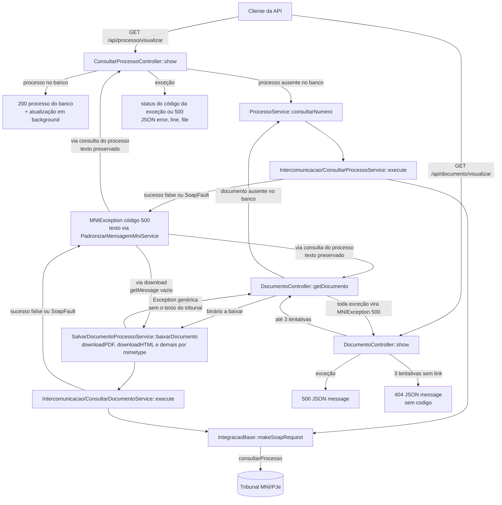
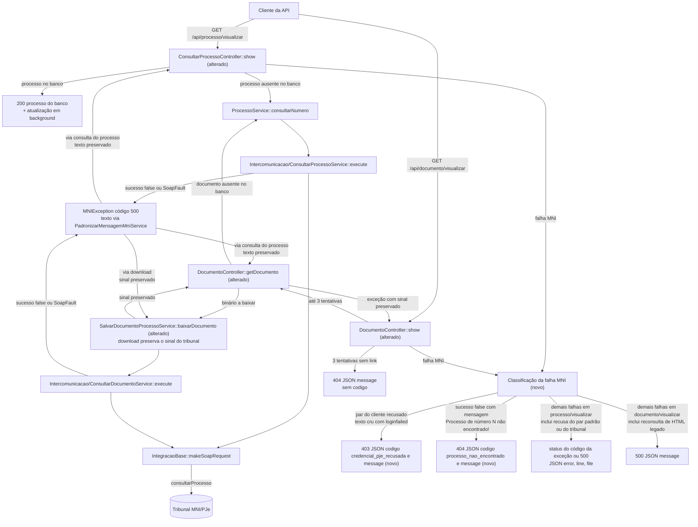

# SPEC: erros-codigo-estavel-visualizar

## Metadata
- Source: developer description via /plan (`.spec/features/erros-codigo-estavel-visualizar/.handoff/input.md`)
- Service: ms-mni (SIM-MNI), API REST `X-API-Token`
- Tier: standard
- Version: 1.1 (clarificação: `.handoff/clarifier-questions.md` → `.handoff/clarifier-answers.md`, 2026-10-08; M1–M3 resolvidos)
- Architecture references: `AGENTS.md`, `docs/agents/architecture.md`, `docs/agents/domain_rules.md`, `docs/agents/api_contracts.md`, `docs/agents/coding_guidelines.md`
- Contrato acordado (externo, leitura): `/Users/brunosantos/Projetos/sistema-juridico-lorran/.spec/features/consulta-processual-mni-credenciais-pje/.handoff/ms-mni-openapi.yaml`, daqui em diante "cópia acordada". Só valem os itens `x-dependencia: DEP-01`.
- Contrato oficial a atualizar: `docs/api/openapi.yaml`

## Context

O Sistema Jurídico, cliente da API, foi implementado contra a cópia acordada e precisa diferenciar, sem ler texto livre, dois casos em `GET /api/processo/visualizar` e `GET /api/documento/visualizar`: (1) o tribunal recusou o par `login_pje`/`senha_pje` e (2) o processo não existe no tribunal. Hoje os dois casos chegam como erro genérico. O cliente reage a eles assim: um `403 credencial_pje_recusada` marca a credencial do usuário como `invalida` até que ele a troque (RF-11 da SPEC do cliente), e um `404 processo_nao_encontrado` vira 422 para o usuário (RF-17 da SPEC do cliente). Um falso positivo em 403 tem custo para o usuário final.

### O que o código faz hoje

- Rotas: `GET /processo/visualizar` → `ConsultarProcessoController@show` (verified at routes/api.php:20) e `GET /documento/visualizar` → `DocumentoController@show` (verified at routes/api.php:22), no grupo `ValidateApiToken` + `InjectCredenciaisPjePadrao` e com prefixo `/api` (verified at bootstrap/app.php:10).
- Não existe handler global: `withExceptions` está vazio (verified at bootstrap/app.php:32). Cada controller trata as próprias exceções com try/catch.
- `/processo/visualizar`: quando o processo está no banco, responde 200 com o registro do banco e enfileira a atualização em background, sem chamar o MNI de forma síncrona (verified at app/Http/Controllers/Api/ConsultarProcessoController.php:104-106). Quando não está, faz a consulta MNI síncrona. Qualquer exceção responde com status = código da exceção (se > 0) ou 500 e corpo `{error, line, file}` (verified at ConsultarProcessoController.php:109-113).
- A consulta MNI do processo transforma toda falha em `MNIException` com código 500: `sucesso = false` usa o `mensagem` do tribunal, e uma exceção/SoapFault usa o texto da exceção (verified at app/Services/MNI/Intercomunicacao/ConsultarProcessoService.php:44-55). A única exceção é falha ao decifrar a senha do tribunal, que vira `MNIException('Credenciais MNI/PJ-e tribunal inválidas.', 422)` (ConsultarProcessoService.php:49-50) e hoje sai como 422 em `/processo/visualizar`.
- `/documento/visualizar`: tenta até 3 vezes obter o link. Sem link nas 3 tentativas, responde 404 `{"message": "Não foi possível obter o documento {id} do processo {numero} após 3 tentativas"}` (verified at app/Http/Controllers/Api/DocumentoController.php:58-60). Qualquer exceção interrompe as tentativas e responde 500 `{"message": ...}` (DocumentoController.php:61-67), porque `getDocumento` reembrulha tudo em `MNIException(..., 500)` (DocumentoController.php:121-127). O documento "Documento não encontrado" (processo existe, id ausente) também sai como 500 (DocumentoController.php:181 lança 404, que é reembrulhado em 500).
- Nesse endpoint o MNI é chamado em dois pontos: (a) consulta do processo quando o documento não está no banco (DocumentoController.php:171-173) e (b) consulta do documento para baixar o binário (`SalvarDocumentoProcessoService::baixarDocumento` → `downloadPDF`/`downloadHTML`/`downloadOutros`/`downloadAudio` → `consultarDocumento` → `ConsultarDocumentoService::execute`).
- **O sinal do tribunal se perde no ponto (b).** `MNIException` não chama `parent::__construct` (verified at app/Exceptions/MNIException.php:14-21), então `getMessage()` devolve vazio. Os wrappers de download montam a nova mensagem com `getMessage()`, por exemplo `'Erro ao processar documento PDF: ' . $e->getMessage()` (verified at app/Services/Processo/SalvarDocumentoProcessoService.php:321; HTML em :232). O reembrulho em `getDocumento` (DocumentoController.php:124-126) passa pelo `trim` de `PadronizarMensagemMniService::normalizar` (verified at app/Services/MNI/PadronizarMensagemMniService.php:50), então a resposta é 500 `{"message": "Erro ao processar documento PDF:"}`. O log local, gravado antes do reembrulho, mostra o efeito: `"error":"Erro ao processar documento HTML: "`.
- Documentos de vídeo (`video/mp4`, `video/quicktime`) são baixados por `scripts/mni_consultar_documento.sh`. O script faz um `curl` sem `--fail` para uma URL fixa do TJAP 1º grau (verified at scripts/mni_consultar_documento.sh:20) e grava a resposta em arquivo seja qual for o resultado SOAP. Uma recusa pode virar 200 com link para um XML salvo como `.mp4`. Decisão (Q-05): vídeos ficam fora de RF-03/RF-04 no download e mantêm o comportamento atual (limitação conhecida; ver Scope Out).
- Para `text/html` já baixado mas sem `path_html` nem `conteudo_html` (`temConteudoHtml()`, verified at app/Models/ProcessoDocumento.php:56-59), `baixarDocumento` chama `downloadHTML($documento)` **sem** repassar `login_pje`/`senha_pje` (verified at SalvarDocumentoProcessoService.php:110-111). Nesse caso quem é recusada é a credencial do tribunal, não o par da requisição. Decisão (Q-01, Q-02): esse caso segue RF-06.
- `InjectCredenciaisPjePadrao` deixa a requisição intacta só quando `login_pje` e `senha_pje` vêm preenchidos; caso contrário sobrescreve os dois com o par padrão ou com `null` (verified at app/Http/Middleware/InjectCredenciaisPjePadrao.php:25-38). Depois do middleware, o controller não distingue pelo `$request` um par do cliente de um par padrão. Com `null`, a consulta usa a credencial do tribunal (ConsultarProcessoService.php:31-32).

### Evidência das falhas do MNI (AC6)

- **Credencial recusada: há evidência.** O PJe devolve literalmente `"Erro ao realizar login via MNI. exception invoking: loginFailed"` (verified at app/Services/MNI/PadronizarMensagemMniService.php:9; commit `241e7fd`). Esse texto chega no `mensagem` de uma resposta `sucesso = false` (`ValidarCredencialService` o lê de `$retorno->mensagem`, verified at app/Services/MNI/Intercomunicacao/ValidarCredencialService.php:25) e também embrulhado em fault CXF (`org.apache.cxf.interceptor.Fault: exception invoking: loginFailed ...`, caso coberto em tests/Unit/Services/MNI/PadronizarMensagemMniServiceTest.php:22). Nas duas formas, o construtor da `MNIException` normaliza o texto pela regra de `REGRAS` (trechos `erro ao realizar login via mni`, `loginfailed`) para `"Erro ao realizar login via MNI. Verifique suas credenciais."` (verified at PadronizarMensagemMniService.php:35-44). Depois disso, `getError()` não mostra qual trecho casou (MNIException.php:18). Decisão (Q-04): só o trecho `loginfailed` (sem diferenciar maiúsculas), procurado no texto cru, classifica a recusa.
- **Processo inexistente: captura real (2026-10-08, desenvolvedor, `.handoff/clarifier-answers.md`).** Operação `consultarProcesso` via `IntegracaoBase::makeSoapRequest`, credencial válida (par padrão `config('pje.credenciais_padrao')`), CNJ válido e inexistente, `incluirDocumentos=false`, `movimentos=false`, sem o parâmetro `documento`:
  - TJAP 1º Grau (id 1, `/1g`), `99999901120268030001` → `sucesso=false`, `mensagem="Processo de número 99999901120268030001 não encontrado!"`. O retorno tem só as chaves `sucesso` e `mensagem` (sem `processo`) e não há SoapFault.
  - TJAP 2º Grau (id 2, `/2g`), `99999901420268030000` → `sucesso=false`, `mensagem="Processo de número 99999901420268030000 não encontrado!"`, na mesma forma.
  - Hoje `ConsultarProcessoService::execute` lança `MNIException` código 500 com `getError()` igual a esse texto, sem alteração, porque nenhuma regra de `REGRAS` casa.
  - O download usa a mesma operação `consultarProcesso`, com `documento` (verified at app/Services/MNI/Intercomunicacao/ConsultarDocumentoService.php:28). A captura não cobriu essa variante, mas a decisão (Q-03 ii) aplica o mesmo sinal nesse caminho.
  - Processo sob sigilo: não foi capturado, porque não se conhece um processo sigiloso. Decisão (Q-03 i): só o padrão acima vira 404, e qualquer outro texto, inclusive o de sigilo, segue RF-06. As fixtures "Processo não encontrado" (tests/Unit/Services/MNI/ConsultarDocumentoServiceTest.php:179; ConsultarProcessosServiceTest.php:238) e "Processo não encontrado ou sem permissão de acesso" (PadronizarMensagemMniServiceTest.php:38) não são texto real do tribunal.

### Decisões de clarificação (v1.1)

- Q-01 (M2): o 403 vale só quando a chamada MNI recusada usou o par `login_pje`/`senha_pje` enviado pelo cliente. Recusa do par padrão ou da credencial do tribunal segue RF-06.
- Q-02: `text/html` legado (baixado, sem `path_html`/`conteudo_html`) com falha na reconsulta de SalvarDocumentoProcessoService.php:111 fica como hoje (RF-06, 500). RF-08 vale só para HTML com `path_html`/`conteudo_html`. RF-03 não cobre a recuperação complementar de HTML.
- Q-03 (M1): o sinal é `sucesso=false` com `mensagem` `Processo de número <dígitos> não encontrado!`. As opções (c) e (d) foram descartadas. RF-04 vale também no download, com AC próprio.
- Q-04: a recusa é classificada só por `loginfailed` (sem diferenciar maiúsculas) no texto cru.
- Q-05 (M3): `video/mp4` e `video/quicktime` ficam fora de RF-03/RF-04 no download, com o comportamento atual mantido e sem status fixado.
- Q-06: falhas não classificadas respondem "como hoje" em cada endpoint. O "500 com `error`" do AC5 é lido assim.
- Q-07: o texto dos 500 não classificados dos wrappers de download fica idêntico ao de hoje.
- Q-08: os testes injetam a falha em `ProcessoService`/`ConsultarProcessoService` ou abaixo (consulta) e em `consultarDocumento`/`IntegracaoBase` ou abaixo (download). Fica autorizado trocar `new ProcessoService()` (DocumentoController.php:172) pela instância injetada, sem mudar o comportamento.
- Q-09: na comparação estrutural do openapi, `description`, `example(s)` e `summary` são ignorados e `x-dependencia` entra. Os nós são copiados literalmente.
- Q-10: `message` usa os literais fixos da cópia acordada.

### Testes existentes

- `tests/Feature/ProcessoConsultaTest.php` e `tests/Feature/ProcessoDocumentoVisualizarTest.php`, indicados pelo router, cobrem as rotas **web** Inertia (`/processos/...`) e não a API.
- Os testes da API são `tests/Feature/Api/ConsultarProcessoControllerTest.php` (bloco `/api/processo/visualizar`, linhas 100-166) e `tests/Feature/Api/DocumentoControllerTest.php`. O 404 após 3 tentativas está em DocumentoControllerTest.php:252-273 e hoje confere só o `message`.

### Contrato oficial × cópia acordada

Comparação estrutural (ignorando `description`, `example`, `examples`, `summary`):

- Itens DEP-01 ausentes no oficial: `paths./processo/visualizar.get.responses.403` e `.404` (cópia :137-158), `paths./documento/visualizar.get.responses.403` (cópia :323-333), o `404` de `/documento/visualizar` em `oneOf` (cópia :334-358; no oficial ainda é `ErroMensagem`, docs/api/openapi.yaml:287-292) e `components.schemas.ErroComCodigo` (cópia :707-719).
- Divergências fora de DEP-01, a reportar e sem alterar nesta feature: (i) a cópia tem `Tribunal.sigla`/`grau` (DEP-02, bloqueado); (ii) o oficial tem campos e exemplos que faltam na cópia: `PaginacaoProcessos.first_page_url`, `from`, `last_page_url`, `next_page_url`, `path`, `prev_page_url`, `to`; `WebhookMonitoramentoPayload.movimentos/documentos.items.properties`; exemplos dos webhooks; (iii) a cópia traz no `info.description` o bloco "Mudanças acordadas (DEP-01 e DEP-02)", que cita DEP-02 e caminhos de arquivos do cliente.

### Regras de arquitetura aplicáveis

- `docs/agents/architecture.md` (Layer responsibilities): a camada de API controllers é dona de "Orchestration, DB lookups, HTTP status codes"; `Services/Processo` "does NOT own HTTP concerns"; `Services/MNI` + `IntegracaoBase` cuidam de "recibo error → exception → MNIException".
- `AGENTS.md` §2 e `docs/agents/coding_guidelines.md` §9: falha MNI/PJe vira `MNIException`, o texto é padronizado por `PadronizarMensagemMniService::REGRAS` e lido com `getError()`.
- `AGENTS.md` §3: quem muda o contrato da API atualiza `docs/api/openapi.yaml` na mesma mudança. Mensagens voltadas ao usuário ficam em pt-BR.
- `AGENTS.md` §3 "Never in this repository": nunca devolver credenciais PJe pela API.
- `docs/agents/coding_guidelines.md` §13: testes Pest com `it('<frase pt-BR>')`, `uses(DatabaseTransactions::class)`, `criarTokenApi()`, `definirCredenciaisPadrao()` e mocks de serviço.
- `docs/agents/domain_rules.md` ("Processo persistence and caching"): os endpoints de leitura servem primeiro a cópia do banco. A limitação "responde do banco quando o processo já existe" foi mantida (AC5; é a LIM-01 do cliente).

## AS IS — Estado atual

Hoje as duas rotas devolvem como erro genérico toda falha do MNI, inclusive credencial recusada e processo inexistente: `/processo/visualizar` responde 500 `{error, line, file}` e `/documento/visualizar` responde 500 `{message}`. No download do binário, o texto do tribunal se perde porque `MNIException::getMessage()` é vazio. O único 404 de `/documento/visualizar` é o de "documento não obtido após 3 tentativas".

## TO BE — Estado proposto

`NEW_CLS` classifica a falha MNI. Produz `NEW_R403` só quando a chamada recusada usou o par enviado pelo cliente (RF-01, RF-03, CT-01, CT-02, CT-03) e `NEW_R404` só com o sinal capturado (RF-02, RF-04, CT-01, CT-02, CT-03). As demais falhas seguem para as respostas atuais (RF-06). Isso inclui a recusa do par padrão ou da credencial do tribunal, a reconsulta de HTML legado e o download de vídeo, cujo comportamento atual é mantido sem status fixado. Os controllers `(alterado)` passam a decidir esses status (RNF-03), e `getDocumento`/`baixarDocumento` `(alterado)` deixam de apagar o sinal do tribunal no download (RF-03, RF-04). O 404 sem `codigo` e a resposta a partir do banco não mudam (RF-05, RF-07, RF-08).

## Scope
- **In**:
  - `GET /api/processo/visualizar` e `GET /api/documento/visualizar`: 403 `credencial_pje_recusada` (só para recusa do par enviado pelo cliente) e 404 `processo_nao_encontrado` (só para o sinal capturado), com corpo `{codigo, message}`.
  - No download do binário de `/documento/visualizar`, exceto vídeo, preservar o sinal do tribunal (hoje perdido) para que a classificação funcione nesse caminho também.
  - Manter o 404 sem `codigo` de `/documento/visualizar` e todas as demais respostas de erro como estão, inclusive o texto dos 500 não classificados dos wrappers de download.
  - Testes Pest de feature da API para os três casos do AC7.
  - Trocar `new ProcessoService()` em DocumentoController.php:172 pela instância injetada (`$this->processoService`, DocumentoController.php:22-24), sem mudança de comportamento (Q-08).
  - `docs/api/openapi.yaml`: os 5 nós DEP-01 iguais aos da cópia acordada.
  - `docs/agents/api_contracts.md` e `docs/agents/domain_rules.md`: descrever as novas respostas.
- **Out**:
  - DEP-02 (`sigla`/`grau` no schema `Tribunal`): bloqueado; não tocar no schema `Tribunal`.
  - 403/404 com `codigo` nos demais endpoints que recebem `login_pje` (`/processo/consultar`, `/processo/dados-basicos`, `/processo/movimentos/listar`, `/processo/documentos/listar`, `/processo/consultar/*/async`, `/processo/download`, `/processo/monitoramentos*`), em webhooks e no `erro_resumo` de monitoramento.
  - Mudar a resposta a partir do banco quando o processo já existe e a atualização em background (`BaixarProcessoMNIJob`, que segue engolindo exceções). É a limitação LIM-01, aceita pelo cliente.
  - Mudar texto, status ou formato de qualquer outro erro, inclusive "Documento não encontrado" (500), "Credenciais MNI/PJ-e tribunal inválidas." (422 em `/processo/visualizar`, 500 em `/documento/visualizar`), "Visualização do documento bloqueada..." (500) e o texto dos 500 não classificados dos wrappers de download (por exemplo `"Erro ao processar documento PDF:"`).
  - 403 com `codigo` para recusa do par padrão (`InjectCredenciaisPjePadrao`) ou da credencial do tribunal, inclusive na reconsulta de HTML legado sem credenciais (SalvarDocumentoProcessoService.php:111) e na recuperação complementar de HTML (RF-08).
  - Repassar o par da requisição na reconsulta de SalvarDocumentoProcessoService.php:111.
  - 404 com `codigo` para processo sob sigilo ou para qualquer texto fora do padrão capturado.
  - Download de `video/mp4` e `video/quicktime`: RF-03/RF-04 não se aplicam e o comportamento atual é mantido. É uma limitação conhecida. O relatório final deve reportar dois bugs: (i) `curl` sem `--fail` pode gerar falso 200 com XML salvo como `.mp4`; (ii) URL fixa do TJAP 1º grau em `scripts/mni_consultar_documento.sh:20`.
  - Alterar o repositório do cliente (`sistema-juridico-lorran`) e as cópias do yaml mantidas por ele.
  - Normalizar `numero_processo` em `DocumentoController::show` e filtrar documento por `tribunal_id` (comportamentos atuais mantidos).
  - Registro em log de URLs com credenciais (já alertado no `info.description` do contrato; sem mudança aqui).

## RIGID (Non-Negotiable)

### Functional Requirements

- RF-01 [Unwanted]: Se, durante `GET /api/processo/visualizar` (verified at routes/api.php:20), a requisição trouxer `login_pje` e `senha_pje` preenchidos (o par do cliente, que `InjectCredenciaisPjePadrao` não substitui, verified at app/Http/Middleware/InjectCredenciaisPjePadrao.php:25-27) e a consulta MNI síncrona feita com esse par for recusada, então o ms-mni deve responder HTTP `403` com corpo JSON exatamente `{"codigo": "credencial_pje_recusada", "message": "Credencial PJe recusada pelo tribunal"}` (verified at cópia acordada:717; literal de `message` em :147). Recusa é `sucesso = false` com `mensagem`, ou falha SOAP com texto, que contém `loginfailed` sem diferenciar maiúsculas, verificado no texto cru, antes da padronização de `PadronizarMensagemMniService`. Recusa de chamada que não usou o par do cliente (par padrão injetado ou credencial do tribunal) segue RF-06.
  - AC: Processo ausente no banco, requisição com `login_pje`/`senha_pje` preenchidos e consulta MNI devolvendo `sucesso = false` com `mensagem` = `"Erro ao realizar login via MNI. exception invoking: loginFailed"` → status 403 e corpo exatamente `{"codigo": "credencial_pje_recusada", "message": "Credencial PJe recusada pelo tribunal"}`, sem as chaves `error`, `line` ou `file`.
  - AC: O mesmo cenário com falha SOAP `"org.apache.cxf.interceptor.Fault: exception invoking: loginFailed"` → a mesma resposta 403.

- RF-02 [Unwanted]: Se, durante `GET /api/processo/visualizar`, a consulta MNI síncrona devolver `sucesso = false` com `mensagem` que casa por inteiro com o padrão `Processo de número <dígitos> não encontrado!` (regex `^Processo de número \d+ não encontrado!$`; verified at captura real TJAP 1º/2º grau, Context), então o ms-mni deve responder HTTP `404` com corpo JSON exatamente `{"codigo": "processo_nao_encontrado", "message": "Processo não encontrado no tribunal"}` (verified at cópia acordada:717; literal de `message` em :158). Qualquer outro texto ou forma de falha, inclusive a de processo sob sigilo, segue RF-06.
  - AC: Processo ausente no banco e consulta MNI devolvendo `sucesso = false` com `mensagem` = `"Processo de número 99999901120268030001 não encontrado!"` → status 404 e corpo exatamente `{"codigo": "processo_nao_encontrado", "message": "Processo não encontrado no tribunal"}`, sem as chaves `error`, `line` ou `file`.

- RF-03 [Unwanted]: Se, durante `GET /api/documento/visualizar` (verified at routes/api.php:22), a requisição trouxer `login_pje` e `senha_pje` preenchidos e uma consulta MNI feita com esse par for recusada (mesmo critério de RF-01), então o ms-mni deve responder HTTP `403` com corpo exatamente `{"codigo": "credencial_pje_recusada", "message": "Credencial PJe recusada pelo tribunal"}`, sem novas tentativas. Vale para (a) a consulta do processo quando o documento não está no banco (DocumentoController.php:171-173) e (b) a consulta do documento para baixar o binário com o par da requisição, exceto `video/mp4` e `video/quicktime`. Não vale para a recuperação complementar de HTML (RF-08), para a reconsulta de HTML legado sem credenciais (SalvarDocumentoProcessoService.php:110-111) nem para o download de vídeo. Esses casos seguem como hoje (RF-06/RF-08).
  - AC: Documento ausente no banco, par do cliente e consulta MNI do processo com `"Erro ao realizar login via MNI. exception invoking: loginFailed"` → 403 com o corpo exato acima e sem chave `error`/`line`/`file`.
  - AC: Documento `application/pdf` no banco com status `pendente`, par do cliente e consulta MNI do documento com o mesmo texto de login → 403 com o corpo exato acima, com a consulta MNI do documento chamada 1 vez. Hoje esse cenário responde 500 `{"message": "Erro ao processar documento PDF:"}`.
  - AC: O mesmo cenário com documento `text/html` → 403 com o corpo exato acima.

- RF-04 [Unwanted]: Se, durante `GET /api/documento/visualizar`, uma consulta MNI feita pela requisição devolver o sinal de processo inexistente definido em RF-02, então o ms-mni deve responder HTTP `404` com corpo exatamente `{"codigo": "processo_nao_encontrado", "message": "Processo não encontrado no tribunal"}`, sem novas tentativas. Vale para (a) a consulta do processo quando o documento não está no banco e (b) a consulta do documento para baixar o binário (documento no banco cujo processo não existe no tribunal), exceto `video/mp4` e `video/quicktime`. Não vale para a recuperação complementar de HTML (RF-08) nem para a reconsulta de HTML legado (SalvarDocumentoProcessoService.php:110-111), que seguem como hoje.
  - AC: Documento ausente no banco e consulta MNI do processo devolvendo `sucesso = false` com `mensagem` = `"Processo de número 99999901120268030001 não encontrado!"` → 404 com o corpo exato acima e sem chave `error`/`line`/`file`.
  - AC (download): Documento `application/pdf` no banco com status `pendente` e consulta MNI do documento devolvendo `sucesso = false` com `mensagem` = `"Processo de número 99999901120268030001 não encontrado!"` → 404 com o corpo exato acima, sem chave `error`/`line`/`file`, com a consulta MNI do documento chamada 1 vez.

- RF-05 [Unwanted]: Se nenhuma das 3 tentativas de `GET /api/documento/visualizar` obtiver o link do documento sem que ocorra exceção, então o ms-mni deve continuar respondendo HTTP `404` com corpo `{"message": "Não foi possível obter o documento {id_documento} do processo {numero_processo} após 3 tentativas"}` (verified at app/Http/Controllers/Api/DocumentoController.php:58-60), **sem** a chave `codigo`.
  - AC: Obtenção do documento sem link nas 3 tentativas → status 404, `message` contendo `após 3 tentativas`, chave `codigo` ausente, e a obtenção chamada exatamente 3 vezes.

- RF-06 [Unwanted]: Se uma requisição a qualquer dos dois endpoints falhar por motivo diferente dos tratados em RF-01 a RF-05, então o ms-mni deve responder exatamente como hoje, sem a chave `codigo`. Entram aqui: a recusa de login em chamada que não usou o par enviado pelo cliente (par padrão injetado ou credencial do tribunal); texto de recusa sem `loginfailed`; `mensagem` fora do padrão de RF-02, inclusive a de processo sob sigilo; e a falha na reconsulta de `text/html` legado sem `path_html`/`conteudo_html` (SalvarDocumentoProcessoService.php:110-111). Em `/api/processo/visualizar`, o status é o código da exceção quando > 0, senão 500, e o corpo é `{error, line, file}` (verified at ConsultarProcessoController.php:109-113). Em `/api/documento/visualizar`, a resposta é 500 com `{message}` (verified at DocumentoController.php:61-67), e o texto dos 500 não classificados dos wrappers de download não muda. O "500 com `error`" do AC5 da entrada significa "o formato de hoje de cada endpoint" (Q-06). Exceção: no download do binário de `video/mp4`/`video/quicktime` vale o comportamento atual, seja qual for o status (sem valor fixado nesta SPEC; limitação conhecida, Scope Out).
  - AC: Falha MNI com texto sem regra de padronização (por exemplo `"MNI indisponível"`) em `/api/processo/visualizar` → 500 com chaves `error`, `line`, `file` e sem `codigo`.
  - AC: Documento ausente no banco e consulta MNI do processo falhando com o mesmo texto em `/api/documento/visualizar` → 500 `{"message": "MNI indisponível"}` sem `codigo`.
  - AC (download não classificado): Documento `application/pdf` no banco com status `pendente` e consulta MNI do documento falhando com `"MNI indisponível"` → status 500 e corpo idêntico ao do commit base `b9f0028` no mesmo cenário (pela leitura do código, `{"message": "Erro ao processar documento PDF:"}`; ver Context), sem `codigo`.
  - AC (par padrão): Requisição sem `login_pje`/`senha_pje` (par padrão injetado), processo ausente no banco e consulta MNI com `"Erro ao realizar login via MNI. exception invoking: loginFailed"` → em `/api/processo/visualizar`, 500 com `error` = `"Erro ao realizar login via MNI. Verifique suas credenciais."`, `line`, `file` e sem `codigo`; em `/api/documento/visualizar`, com documento ausente no banco, 500 `{"message": "Erro ao realizar login via MNI. Verifique suas credenciais."}` sem `codigo`.
  - AC (HTML legado): Documento `text/html` com status `baixado`, objeto presente no armazenamento, sem `path_html` e `conteudo_html`, e reconsulta de SalvarDocumentoProcessoService.php:111 falhando com o texto de login → status 500 e corpo idêntico ao de `b9f0028` no mesmo cenário (pela leitura do código, `{"message": "Erro ao processar documento HTML:"}`), sem `codigo`, mesmo com o par do cliente na requisição.
  - AC (texto fora do padrão de RF-02): Processo ausente no banco e consulta MNI devolvendo `sucesso = false` com `mensagem` = `"Processo não encontrado ou sem permissão de acesso"` em `/api/processo/visualizar` → 500 com `error` = esse texto e sem `codigo`.
  - AC (recusa sem `loginfailed`): Par do cliente e consulta MNI devolvendo `sucesso = false` com `mensagem` = `"Erro ao realizar login via MNI."` em `/api/processo/visualizar` → 500 com `error` = `"Erro ao realizar login via MNI. Verifique suas credenciais."` e sem `codigo`.
  - AC: Processo existente no tribunal sem o `id_documento` pedido → 500 com `message` = `"Documento não encontrado"`, sem `codigo` (comportamento atual).
  - AC: Falha ao decifrar a senha do tribunal em `/api/processo/visualizar` → 422 com `error` = `"Credenciais MNI/PJ-e tribunal inválidas."` (comportamento atual).

- RF-07 [State-Driven]: Enquanto o processo pedido existir no banco local para o par (`tribunal_id`, `numero_processo`), `GET /api/processo/visualizar` deve continuar respondendo 200 com o processo do banco e enfileirando a atualização em background (verified at ConsultarProcessoController.php:104-106), sem consulta MNI síncrona e, portanto, sem 403 ou 404 com `codigo`, mesmo que a credencial enviada seja inválida.
  - AC: Processo no banco e `login_pje`/`senha_pje` quaisquer → status 200, atualização em background enfileirada com essas credenciais e nenhuma resposta 403/404.

- RF-08 [State-Driven]: Enquanto o documento pedido já estiver baixado, o link puder ser gerado e, se for `text/html`, tiver `path_html` ou `conteudo_html` preenchido (`temConteudoHtml()`, verified at app/Models/ProcessoDocumento.php:56-59), `GET /api/documento/visualizar` deve continuar respondendo 200. Qualquer falha na recuperação complementar do conteúdo HTML, inclusive recusa do par do cliente, segue resultando em `documento.conteudo_html` = `null` (verified at DocumentoController.php:135-161), sem 403 ou 404. Um `text/html` baixado sem `path_html` nem `conteudo_html` segue RF-06.
  - AC: Documento `text/html` baixado, objeto PDF presente no armazenamento, `path_html` apontando para objeto ausente e reconsulta ao tribunal falhando com o texto de login → status 200, `documento.link` preenchido e `documento.conteudo_html` = `null`.

- RF-09 [Event-Driven]: Quando a feature for entregue, `docs/api/openapi.yaml` deve conter os itens DEP-01 com os mesmos nomes, status, campos e estrutura da cópia acordada: `paths./processo/visualizar.get.responses.403`, `paths./processo/visualizar.get.responses.404`, `paths./documento/visualizar.get.responses.403`, `paths./documento/visualizar.get.responses.404` e `components.schemas.ErroComCodigo`. Não pode incluir itens DEP-02 nem remover itens que já existem só no oficial.
  - AC: A comparação estrutural desses 5 nós entre `docs/api/openapi.yaml` e a cópia acordada dá 0 diferenças. A comparação ignora `description`, `example`, `examples` e `summary` e inclui `x-dependencia: DEP-01`; os nós são copiados literalmente (Q-09).
  - AC: `components.schemas.Tribunal.properties` não tem `sigla` nem `grau`.
  - AC: `components.schemas.PaginacaoProcessos.properties` mantém `first_page_url`, `from`, `last_page_url`, `next_page_url`, `path`, `prev_page_url`, `to`.

- RF-10 [Event-Driven]: Quando `docs/api/openapi.yaml` for atualizado, `docs/agents/api_contracts.md` e `docs/agents/domain_rules.md` devem descrever as novas respostas dos dois endpoints.
  - AC: Em `docs/agents/api_contracts.md`, as linhas da tabela de endpoints para `/api/processo/visualizar` e `/api/documento/visualizar` listam 403 e 404, e a seção "Documentos" descreve os dois 404, com e sem `codigo`.
  - AC: Em `docs/agents/domain_rules.md`, a seção "Document visualization" (ou uma seção dedicada) registra, para esses dois endpoints, o mapeamento recusa do par enviado pelo cliente → 403 `credencial_pje_recusada` e `sucesso = false` com `Processo de número <dígitos> não encontrado!` → 404 `processo_nao_encontrado`.

### Contracts

- CT-01: `GET /api/processo/visualizar`. Novas respostas, iguais à cópia acordada :137-158:
  - `403` `application/json`: `allOf` [`ErroComCodigo`, `codigo` `const` `credencial_pje_recusada`]. Exemplo `{"codigo": "credencial_pje_recusada", "message": "Credencial PJe recusada pelo tribunal"}`.
  - `404` `application/json`: `allOf` [`ErroComCodigo`, `codigo` `const` `processo_nao_encontrado`]. Exemplo `{"codigo": "processo_nao_encontrado", "message": "Processo não encontrado no tribunal"}`.
  - `200`, `400`, `401`, `422` e `500` não mudam.
- CT-02: `GET /api/documento/visualizar`. Novas respostas, iguais à cópia acordada :323-358:
  - `403`: igual ao `403` de CT-01.
  - `404` `application/json`: `oneOf` [`allOf` [`ErroComCodigo`, `codigo` `const` `processo_nao_encontrado`], `allOf` [`ErroMensagem`, `not: {required: [codigo]}`]], com os exemplos `processo_nao_encontrado` e `documento_nao_obtido`.
  - `200`, `401`, `422` e `500` (`ErroMensagem`) não mudam.
- CT-03: `components.schemas.ErroComCodigo`, igual à cópia acordada :707-719: `type: object`; `codigo` `string` `enum` [`credencial_pje_recusada`, `processo_nao_encontrado`]; `message` `string`; `required` [`codigo`, `message`].
- Os `message` dos exemplos de CT-01/CT-02 são os literais que RF-01 a RF-04 exigem nas respostas reais (Q-10).

### Non-Functional Requirements

- RNF-01 (sigilo): Nos corpos com `codigo` (RF-01 a RF-04), nenhum valor pode conter o valor recebido em `login_pje`, o valor recebido em `senha_pje`, as substrings `login_pje=` ou `senha_pje=` ou qualquer URL (`http://` ou `https://`). `message` é exatamente `"Credencial PJe recusada pelo tribunal"` (403) ou `"Processo não encontrado no tribunal"` (404) e nunca reproduz texto cru do tribunal. Verificação: testes com valores distintivos de `login_pje`/`senha_pje` conferem a ausência deles no corpo serializado: 0 ocorrências.
- RNF-02 (custo de integração): Classificar a falha não pode gerar chamada SOAP extra. O número de chamadas ao MNI por requisição nos dois endpoints é igual ao de hoje para o mesmo cenário (0 chamadas adicionais; por exemplo, nenhuma validação prévia de credencial).
- RNF-03 (camadas, `docs/agents/architecture.md`): A decisão dos status 403/404 com `codigo` fica na camada HTTP (`app/Http`). Nenhum arquivo em `app/Services` passa a montar resposta HTTP ou escolher status HTTP. Verificação: 0 ocorrências de `response()` ou `JsonResponse` introduzidas em `app/Services` pelo diff.
- RNF-04 (testes, AC7): Existem testes Pest de feature da API cobrindo, no mínimo: 403 com `codigo` em cada um dos dois endpoints, 404 com `codigo` em cada um dos dois endpoints e 404 sem `codigo` em `/api/documento/visualizar`. Os testes injetam a falha em `ProcessoService`/`Intercomunicacao\ConsultarProcessoService` ou abaixo (consulta do processo) e em `SalvarDocumentoProcessoService::consultarDocumento`/`IntegracaoBase` ou abaixo (download). Não vale `partialMock` de `DocumentoController::getDocumento` nem de `vericarExistenciaDocumento` (Q-08). `docker compose exec -T php php artisan test --compact` termina com 0 falhas.
- RNF-05 (contrato válido): Depois da alteração, `docs/api/openapi.yaml` continua carregando como YAML e OpenAPI 3.1, e `npx @redocly/cli lint docs/api/openapi.yaml` não reporta nenhum erro que não existisse no commit base `b9f0028`.

## FLEXIBLE (Implementation Suggestions)

- **Classificação por tipo, no padrão de `ConsultaMNISemSucessoException`:** criar subclasses de `MNIException` (por exemplo `CredencialPjeRecusadaException` e `ProcessoNaoEncontradoNoTribunalException`), lançadas por `Intercomunicacao/ConsultarProcessoService::execute` e `Intercomunicacao/ConsultarDocumentoService::execute` ao reconhecer o sinal. Elas herdam a padronização de texto e continuam legíveis por `getError()` (coding_guidelines §9).
- **Detecção de credencial recusada:** só `loginfailed` (RF-01). A verificação precisa ver o texto cru, antes do `normalizar` do construtor (MNIException.php:18), porque `getError()` devolve o texto já padronizado. Uma forma é classificar no `catch`/`else` de `ConsultarProcessoService::execute` e `ConsultarDocumentoService::execute`, por exemplo com um método `PadronizarMensagemMniService::ehCredencialRecusada(string)` restrito a `loginfailed`.
- **Detecção de processo inexistente:** aplicar o regex de RF-02 ao `mensagem` cru no ramo `sucesso = false` dos mesmos dois services.
- **Identificar o par do cliente (RF-01/RF-03):** depois de `InjectCredenciaisPjePadrao`, o `$request` não distingue o par do cliente do par padrão. Por exemplo, o middleware marca em `$request->attributes` quando deixa o par passar intacto (InjectCredenciaisPjePadrao.php:25-27), e o controller só mapeia para 403 com essa marca. A exceção também pode registrar se a chamada usou credencial informada ou o fallback do tribunal (`login_pje` nulo, como em SalvarDocumentoProcessoService.php:111). O comportamento do middleware não muda.
- **Pontos de reembrulho que hoje apagam o tipo ou o texto e precisam preservar a subclasse:** `ConsultarProcessoService.php:51-52`, `ConsultarDocumentoService.php:64-65`, `SalvarDocumentoProcessoService::consultarDocumento` (:434-440), os wrappers `downloadHTML` (:232), `downloadPDF` (:321), `downloadOutros` (:353) e `downloadAudio` (:719), e `DocumentoController::getDocumento` (:121-127). Sugestão: relançar a subclasse sem reembrulhar, ou encadear como `previous` e classificar percorrendo `getPrevious()`.
- **Não corrigir `MNIException::getMessage()` de forma global** (chamar `parent::__construct`). Isso mudaria o texto de outros 500 de `/documento/visualizar` (por exemplo `"Erro ao processar documento PDF: <texto>"`), o que fere RF-06/AC5.
- **Mapeamento HTTP nos controllers:** adicionar `catch` específicos antes do `catch (MNIException $e)` em `ConsultarProcessoController::show` e `DocumentoController::show`, ou um helper compartilhado na camada HTTP. Um `render` em `bootstrap/app.php` `withExceptions` não serve sozinho, porque os controllers capturam tudo antes.
- **Testes de `/processo/visualizar`** (`tests/Feature/Api/ConsultarProcessoControllerTest.php`): `$this->mock(ProcessoService::class)` com `consultarNumero` lançando a exceção classificada, ou um mock mais abaixo (`ConsultarProcessoService`/`IntegracaoBase`) devolvendo o retorno cru nas formas `sucesso = false` e fault CXF, com `assertExactJson`/`assertJsonMissingPath('error')`. Uma `MNIException` comum com o texto cru de login, lançada pelo mock de `ProcessoService`, chega já padronizada e não prova a classificação.
- **Testes de `/documento/visualizar`** (`tests/Feature/Api/DocumentoControllerTest.php`):
  - `vericarExistenciaDocumento` instancia `new ProcessoService()` (DocumentoController.php:172), então `$this->mock(ProcessoService::class)` não intercepta. Use `$this->processoService` (troca autorizada no Scope). `partialMock` de `getDocumento`/`vericarExistenciaDocumento` não vale (RNF-04).
  - Para o caminho do download, `partialMock` de `SalvarDocumentoProcessoService::consultarDocumento` lançando a falha, ou um mock de `IntegracaoBase` pelo seam `app()->makeWith` (ConsultarDocumentoService.php:117-119), prova que o sinal sobrevive ao wrapper `downloadPDF`/`downloadHTML` e ao reembrulho de `getDocumento`.
  - No teste existente (:252-273), acrescentar `->assertJsonMissingPath('codigo')`.
- **openapi:** copiar literalmente os 5 nós DEP-01 da cópia acordada, mantendo `x-dependencia: DEP-01`, para que a comparação estrutural dê 0 diferenças. Não copiar o bloco "Mudanças acordadas (DEP-01 e DEP-02)" do `info.description`, que cita DEP-02 e caminhos de arquivos do cliente. Validar com `npx @redocly/cli lint docs/api/openapi.yaml`.
- **docs/agents:** os arquivos têm o cabeçalho "Generated by /ai-context. Manual edits are overwritten on re-run." A edição manual só antecipa o que um novo `/ai-context` geraria a partir do código. Atualizar em `api_contracts.md` a tabela de endpoints (linhas de `/api/processo/visualizar` e `/api/documento/visualizar`), "Common error shapes" (exemplo `ErroComCodigo`) e "Documentos" (os dois 404); em `domain_rules.md`, "Document visualization" e "MNI message standardization" (a regra de login agora também decide o 403).
- **Relatório final:** listar como divergências fora de DEP-01 os itens do Context ("Contrato oficial × cópia acordada"), para o cliente substituir as cópias dele sem perder campos. Reportar também a limitação de vídeo e os dois bugs de `scripts/mni_consultar_documento.sh` (Scope Out).

## Acceptance Criteria Summary
| ID | Criterion | Testable? |
|----|-----------|-----------|
| RF-01 | `/processo/visualizar`, par do cliente recusado (`loginfailed` em `sucesso=false` ou fault CXF) → 403 exatamente `{codigo: credencial_pje_recusada, message: "Credencial PJe recusada pelo tribunal"}` | Sim |
| RF-02 | `/processo/visualizar`, `sucesso=false` com `Processo de número <dígitos> não encontrado!` → 404 exatamente `{codigo: processo_nao_encontrado, message: "Processo não encontrado no tribunal"}` | Sim |
| RF-03 | `/documento/visualizar`, par do cliente recusado na consulta do processo ou no download (PDF/HTML; sem vídeo, recuperação complementar e HTML legado) → 403 com `codigo` | Sim |
| RF-04 | `/documento/visualizar`, sinal de RF-02 na consulta do processo ou no download (sem vídeo) → 404 com `codigo` | Sim |
| RF-05 | 404 após 3 tentativas sem link continua com `message` e sem `codigo`; 3 chamadas | Sim |
| RF-06 | Demais falhas (par padrão/tribunal recusado, texto fora do padrão, HTML legado, download não classificado): mesmo status e corpo de `b9f0028`, sem `codigo`; vídeo como hoje | Sim |
| RF-07 | Processo no banco → 200 + atualização em background, nunca 403/404 com `codigo` | Sim |
| RF-08 | Documento baixado com link (HTML só com `path_html`/`conteudo_html`) → 200; falha da recuperação de HTML → `conteudo_html` null | Sim |
| RF-09 | openapi oficial: 5 nós DEP-01 com 0 diferenças estruturais (ignora `description`/`example(s)`/`summary`, inclui `x-dependencia`); sem DEP-02; itens só do oficial mantidos | Sim |
| RF-10 | `api_contracts.md` e `domain_rules.md` descrevem 403/404 com `codigo` nos dois endpoints | Sim (revisão) |
| CT-01 | Respostas 403/404 de `/processo/visualizar` iguais à cópia :137-158 | Sim |
| CT-02 | Respostas 403/404 (`oneOf`) de `/documento/visualizar` iguais à cópia :323-358 | Sim |
| CT-03 | Schema `ErroComCodigo` igual à cópia :707-719 | Sim |
| RNF-01 | 0 ocorrências de `login_pje`/`senha_pje` (valores e chaves) e de URL nos corpos com `codigo`; `message` com os literais fixos | Sim |
| RNF-02 | 0 chamadas SOAP adicionais por requisição | Sim |
| RNF-03 | Status HTTP decididos só em `app/Http`; 0 `response()`/`JsonResponse` novos em `app/Services` | Sim (revisão do diff) |
| RNF-04 | Testes Pest dos três casos do AC7, com a falha injetada nos seams permitidos; suíte com 0 falhas | Sim |
| RNF-05 | `redocly lint` sem erros novos em relação a `b9f0028` | Sim |
