# Implementation Plan

## Request Summary
- Objective: (1) corrigir a recusa do par do PJe que hoje chega ao Sistema como 500 genérico. Em `GET /api/processo/visualizar` (processo novo) e `GET /api/documento/visualizar`, inclusive no HTML legado, a recusa do par do cliente passa a responder 403 `credencial_pje_recusada` (RF-01). (2) Portar do sim-mni o OCR do processo para o Sistema Jurídico (DEP-03 a DEP-05). São quatro peças. `POST /api/processo/ocr` tem trava por processo e linha, carona e processamento incremental (RF-02 a RF-08). O download sai cifrado com o par do dono, e o envio ao workflow "Jurídico OCR (Gemini)" sai sem o par (RF-09 a RF-11). O workflow responde pelo webhook, e há um acompanhamento de reserva a cada minuto. Antes de reenviar um documento aguardando retorno com idade ≥ A, o ms-mni consulta o job antigo; um job preso em `pending`/`running` só é cancelado e reenviado a partir da idade M (RF-12, RF-13, RF-18). Os avisos `ocr_progresso` vão a cada assinante (RF-14 a RF-16). Junto vêm os hosts liberados do `CallbackUrlValidator` fora de produção (RF-17), a cifra dos 6 jobs que já levam o par (RNF-01), 20 workers no Horizon (RNF-02) e o contrato publicado (RNF-04).
- Scope in: tudo o que está em "Scope → In" da SPEC v1.7. Na ordem das fases: correção RF-01; fundações (cifra dos 6 jobs, validador de callback, configuração com A, P, M e W, migration, Horizon, parâmetros sensíveis); serviços do OCR; webhook; envio e consulta do job antes do reenvio; download e acompanhamento; pedido; rota e contrato; testes ponta a ponta, varredura de sigilo e documentação; verificação final com o roteiro de homologação.
- Scope out: tudo o que está em "Scope → Out" da SPEC. Entre outros: mudar o contrato acordado sem avisar, fan-out, monitoramento, OCR de áudio e vídeo, `POST /documento/ocr`, `JuntarOCRProcessoJob`, mudança do workflow, filtro por `nivel_sigilo`, consulta da situação pelo Sistema, limite da consulta síncrona abaixo de 60 s (LIM-01), limite de downloads por par (Q-06) e conversão de imagem em PDF.
- Tier: complete
- Architecture references: `AGENTS.md`, `docs/agents/architecture.md`, `docs/agents/domain_rules.md`, `docs/agents/api_contracts.md`, `docs/agents/data_model.md`, `docs/agents/coding_guidelines.md`, `docs/agents/tech_stack.md` (consultado para os comandos; nada muda nele).
- Fontes da verdade: SPEC v1.7 (`.spec/features/ocr-do-processo-para-o-sistema/SPEC.md`), ACs confirmados (`.handoff/acs-confirmados.md`), respostas do clarifier, rodadas 1 a 7 (`.handoff/clarifier-answers.md`), contrato acordado (`~/Projetos/sistema-juridico-lorran/tests/Fixtures/Mni/openapi.yaml`) e workflow (`~/Projetos/sistema-juridico-lorran/docker/n8n/juridico-ocr.json`). Origem do port: `~/Projetos/sim-mni` (`OCRWebhookController`, `ValidateOCRWebhook`, `OCRRequestJob`, `OCRPollStatus`).
- Comandos: PHP só pelo container (`docker compose exec -T php php artisan test --compact --filter=<Teste>`; suíte `docker compose exec -T php composer test`). Nunca ler `.env`.

### Regras de arquitetura preservadas pelas tasks
- `docs/agents/architecture.md` ("Layer responsibilities") e `coding_guidelines.md` §2: os controllers novos (`OcrProcessoController`, `OcrWebhookController`) validam com FormRequest, chamam um service, escolhem o status HTTP e não fazem SOAP nem HTTP de saída. A lógica fica em `app/Services/Ocr/` (T10, T11, T13, T14, T16, T18, T19). O comando `ocr:acompanhar` é fino e delega ao `AcompanharProcessamentosOcrService` (T18).
- `domain_rules.md` ("Erros com código estável (DEP-01)"): o status 403/404 com `codigo` é decidido só em `app/Http` (`ErroComCodigo::classificar`/`resposta`, T20). Os services e jobs só lançam ou reconhecem exceções tipadas. O job de download reconhece a recusa por `ClassificarFalhaMniService::recusaNaCadeia`, um helper puro de `app/Services/MNI` (T17), e não chama `ErroComCodigo` de `app/Http`. Essa decisão (PQ-03) foi aceita na rodada 5 do clarifier.
- `coding_guidelines.md` §3: a validação fica em FormRequests de `app/Http/Requests/Api/` com `authorize()` = `true` e comentário do middleware. `numero_processo` é normalizado em `prepareForValidation()` (T15, T20).
- `AGENTS.md` §2 e `coding_guidelines.md` §6: as filas novas `ocr-download`, `ocr-envio` e `ocr-aviso` ganham supervisor em `production`, `local` e `*` (T08). Cada despacho nomeia a fila, e cada job declara `$tries` e `$timeout`, e `backoff()` quando tem nova tentativa. Os jobs recebem ids e recarregam o model no `handle()` (T13, T16, T17).
- `AGENTS.md` §2 e `coding_guidelines.md` §7: o aviso sai por `CallbackNotifier`, com `lockForUpdate`, pulando o aviso já enviado e `CallbackPermanentException` → `$this->fail($e)` (T13). O `callback_url` passa pela regra `CallbackUrl` (T20).
- `coding_guidelines.md` §4 e §8: as situações são constantes `OCR_*`/`SITUACAO_*` nos models (T07). Os parâmetros são lidos por `config()` (`services.n8n_ocr`, `pje.callback.hosts_liberados`), nunca por `env()` fora de `config/` (T05, T06).
- `coding_guidelines.md` §10 e §11: os logs usam os prefixos `[ProcessamentoOcr:{id}]` e `[ProcessoDocumento:{id}]`, só com ids e contagens. Os comentários explicam o porquê, em pt-BR.
- `AGENTS.md` §3: mudou `routes/api.php`, muda `docs/api/openapi.yaml` na mesma task (T15 para `/ocr/webhook`, T20 para `/processo/ocr`). A API nunca devolve credencial do PJe (T07 esconde as colunas `ocr_*`; T20 e T22 conferem os corpos).
- `AGENTS.md` ("Never in this repository"): `supervisor-monitoramento` continua com `maxProcesses` 1 (T08). `InjectCredenciaisPjePadrao` não entra nas rotas novas (T15, T20). Nada muda no monitoramento.

## AS IS — Componentes impactados

```mermaid
flowchart LR
  ROUTES["routes/api.php"] -->|"grupo consulta"| MWC["app/Http/Middleware/InjectCredenciaisPjePadrao.php"]
  ROUTES -->|"grupo monitoramento"| MWT["app/Http/Middleware/ValidateApiToken.php"]
  MWC -->|"GET /api/processo/visualizar"| CPC["app/Http/Controllers/Api/ConsultarProcessoController.php"]
  MWC -->|"GET /api/documento/visualizar"| DC["app/Http/Controllers/Api/DocumentoController.php"]
  CPC -->|"consultarNumero: recorte de 90 dias"| PS["app/Services/Processo/ProcessoService.php"]
  DC -->|"baixarDocumento"| SDPS["app/Services/Processo/SalvarDocumentoProcessoService.php"]
  SDPS -->|"HTML legado: credencial do tribunal, cadeia cortada"| CDS["app/Services/MNI/Intercomunicacao/ConsultarDocumentoService.php"]
  PS --> CPS["app/Services/MNI/Intercomunicacao/ConsultarProcessoService.php"]
  CPS --> IB["app/Services/IntegracaoBase.php"]
  CDS --> IB
  CPC -->|"classificar e resposta"| ECC["app/Http/Responses/ErroComCodigo.php"]
  DC -->|"classificar e resposta"| ECC
  PS -->|"baixar_binarios"| EDS["app/Services/Processo/EnfileirarDownloadDocumentosService.php"]
  EDS -->|"par sem cifra"| JD["app/Jobs/BaixarDocumentosMNIEmLoteJob.php<br/>app/Jobs/BaixarDocumentoMNIJob.php"]
  CPC -->|"par sem cifra"| JP["app/Jobs/BaixarProcessoMNIJob.php<br/>app/Jobs/ConsultarDadosBasicosProcessoMNIJob.php<br/>app/Jobs/ConsultarMovimentosProcessoMNIJob.php"]
  DC -->|"par sem cifra"| JC["app/Jobs/ConsultarDocumentosProcessoMNIJob.php"]
  JW["app/Jobs/EnviarWebhookMonitoramentoJob.php"] --> CN["app/Services/Callback/CallbackNotifier.php"]
  CN --> CUV["app/Services/Callback/CallbackUrlValidator.php<br/>só https e IP público"]
  RULE["app/Rules/CallbackUrl.php"] --> CUV
  HZ["config/horizon.php<br/>mni-download: 8 em produção"] -.->|"supervisores"| JD
```

Hoje não há rota, fila nem tabela de OCR: tudo isso saiu em 2026-07-07 (`database/migrations/2026_07_07_000000_drop_ocr_and_samia_columns.php:17-30`). A recusa do par já é classificada em `ConsultarProcessoService.php:53/69`, `ConsultarDocumentoService.php:68/82` e na cadeia de `DocumentoController.php:138-156`. Só o HTML legado (`SalvarDocumentoProcessoService.php:111-122`) reconsulta com a credencial do tribunal e corta a cadeia. Os 6 jobs que levam o par não são cifrados, e o `CallbackUrlValidator.php:17-37` só aceita `https` com IP público.

## TO BE — Componentes propostos

```mermaid
flowchart LR
  ROUTES["routes/api.php (alterado, T15 e T20)"] -->|"grupo consulta"| MWC["InjectCredenciaisPjePadrao.php"]
  ROUTES -->|"grupo só com token"| MWT["ValidateApiToken.php"]
  ROUTES -->|"sem token"| MWS["app/Http/Middleware/ValidarAssinaturaWebhookOcr.php (novo, T15)"]
  MWC --> DC["DocumentoController.php"]
  DC --> SDPS["SalvarDocumentoProcessoService.php (alterado, T02 e T09)<br/>HTML legado com o par da requisição"]
  MWT -->|"POST /api/processo/ocr"| OPC["app/Http/Controllers/Api/OcrProcessoController.php (novo, T20)"]
  OPC --> SOL["app/Services/Ocr/SolicitarOcrProcessoService.php (novo, T19)<br/>trava W, carona e abertura"]
  OPC -->|"403 e 404"| ECC["ErroComCodigo.php"]
  SOL -->|"lista completa sem recorte"| PS["ProcessoService.php (alterado, T09 e T12)"]
  PS --> CPS["MNI ConsultarProcessoService.php (alterado, T09)"]
  SOL --> PROC["app/Services/Ocr/ProcessamentoOcrService.php (novo, T14)"]
  SOL --> CONT["app/Services/Ocr/ContagemOcrService.php (novo, T10)"]
  SOL -->|"par cifrado"| JBD["app/Jobs/BaixarDocumentoParaOcrJob.php (novo, T17)<br/>fila ocr-download"]
  SOL -->|"aguardando com idade ≥ A"| VER["app/Jobs/VerificarReenvioOcrJob.php (novo, T16)<br/>GET jobs/:id antes do reenvio"]
  JBD --> SDPS
  JBD -->|"recusa"| PROC
  JBD --> JEN["app/Jobs/EnviarDocumentoAoOcrJob.php (novo, T16)<br/>fila ocr-envio, sem o par"]
  VER -->|"decisão Reenviar"| JEN
  VER -->|"success: processado"| PROC
  VER --> CLI["app/Services/Ocr/ClienteWorkflowOcr.php (novo, T11)"]
  JEN --> MONT["app/Services/Ocr/MontarEnvioOcrService.php (novo, T16)"]
  JEN --> CLI
  CLI -->|"POST documents/process<br/>DELETE jobs/:id/chunks<br/>GET jobs/:id"| N8N[("Workflow Jurídico OCR no n8n")]
  N8N -->|"POST webhook_url"| MWS
  MWS --> OWC["app/Http/Controllers/Api/OcrWebhookController.php (novo, T15)"]
  OWC --> PROC
  CMD["app/Console/Commands/OcrAcompanhar.php (novo, T18)<br/>a cada minuto"] --> ACP["app/Services/Ocr/AcompanharProcessamentosOcrService.php (novo, T18)"]
  ACP -->|"GET jobs ao vencer P"| CLI
  ACP --> PROC
  ACP -->|"aguardando com idade ≥ A"| VER
  PROC --> AV["app/Services/Ocr/AvisarAssinantesOcrService.php (novo, T13)"]
  AV --> JAV["app/Jobs/EnviarAvisoOcrJob.php (novo, T13)<br/>fila ocr-aviso"]
  JAV --> CN["CallbackNotifier.php"]
  CN --> CUV["CallbackUrlValidator.php (alterado, T05)<br/>hosts liberados fora de produção"]
  PROC --> DB[("processo_ocr_processamentos, assinantes e avisos<br/>colunas ocr_* em processo_documentos (novo, T07)")]
  J6["6 jobs que já levam o par (alterado, T04)<br/>ShouldBeEncrypted"]
  HZ["config/horizon.php (alterado, T08)<br/>ocr-download 12, ocr-envio 8, ocr-aviso 2"] -.-> JBD
  HZ -.-> JEN
  HZ -.-> VER
  HZ -.-> JAV
```

T02 tira o corte da cadeia no HTML legado, e T01 prova que os outros caminhos já respondem 403. T07 cria as tabelas e colunas do OCR. T10, T13 e T14 montam as contagens, os avisos e a máquina de estados. T15 e T20 expõem as rotas. T16 envia ao workflow e consulta o job antigo antes de todo reenvio (`VerificarReenvioOcrJob`). T17 baixa os documentos, T18 é o acompanhamento e T19 é o pedido. T04 cifra os 6 jobs antigos, T05 libera hosts fora de produção e T08 soma os 20 workers.

## Desenho da solução

Decisões tomadas dentro do FLEXIBLE da SPEC. As tasks citam estas decisões, sem repetir.

- **D1. Situação do documento no OCR** (`processo_documentos.ocr_situacao`):
  - `null` e `pendente` contam como pendente;
  - `enviado` é o "aguardando retorno";
  - `processado`;
  - `erro` é o `com_erro`.

  `ocr_job_id` guarda o job atual, e só ele é "conhecido" pelo webhook. `ProcessamentoOcrService::devolverParaFila` move `ocr_job_id` para `ocr_job_id_cancelar` e o deixa `null`. Isso acontece em dois casos: o `com_erro` na reabertura, sem consulta, e o `enviado` com idade ≥ A, só depois que a consulta do job (D9) decide reenviar. Assim, o job antigo recebe 404 desde a devolução (RF-12), e o job de envio faz o `DELETE` (CT-07) antes do `POST` sempre que `ocr_job_id_cancelar` estiver preenchido (R2-2). Enquanto a consulta decide `Aguardar`, o job segue conhecido, e o webhook dele continua valendo.
- **D2. Trava da decisão (RF-06):** `Cache::lock("ocr:processamento:{tribunal_id}:{numero}", trava_validade_segundos)->block(W)`. A consulta ao MNI roda dentro da trava, para que o 2º pedido simultâneo vire carona. Como rede de segurança, há um índice único parcial em `processo_ocr_processamentos (processo_id) WHERE situacao = 'em_andamento'`. Se a trava vencer durante uma consulta longa, a `UniqueConstraintViolationException` faz o pedido virar carona.
- **D3. Documento já `baixado`:** a decisão do despacho olha só o banco (`status = baixado` e `path` preenchido). Esse documento vai direto ao `EnviarDocumentoAoOcrJob`, com 0 SOAP e 0 job de download (RF-09 AC e). O job de envio confere `Storage::disk('s3')->exists($path)`. Se o objeto não existir, o documento vira `erro` no OCR, e o binário vira `erro` (`marcarComoErro`), para que a reabertura baixe de novo. Assim, o pedido não faz 300 `HEAD` no S3 (RNF-03). O job de download também confere `baixado` com o objeto no S3 antes de chamar o MNI. Isso cobre a corrida com o download em lote e o HTML legado (NC-2).
- **D4. Credencial do `webhook_url`:** `URL::temporarySignedRoute('ocr.webhook', now()->addMinutes(M), ['documento' => $id], absolute: false)`, prefixada por `services.n8n_ocr.webhook_base_url`. A validação usa `$request->hasValidRelativeSignature()`, que não depende do host por onde o n8n chega (`host.docker.internal` em desenvolvimento).
  - A validade é M (60 min), que é > A pela invariante de T06. Isso cumpre o "pelo menos A" de RF-11 e evita o 401 no retorno que chega entre A e M, quando a consulta (D9) manteve o job em andamento sem reenvio (nota do clarifier).
  - O controller busca o documento por `id = documento` e `ocr_job_id = job_id`; se não achar, responde 404.
- **D5. Avisos:** uma linha em `processo_ocr_avisos` por (assinante, aviso), com o payload congelado no momento da geração (as contagens do momento, RF-14) e um `uuid` que vai no `X-Idempotency-Key`. `EnviarAvisoOcrJob` segue o padrão de `EnviarWebhookMonitoramentoJob`. Q-03: um aviso não final sai sem enviar quando o assinante já tem `aviso_final_entregue_em`.
- **D6. Ordem de travas:** toda mudança de situação trava primeiro o processamento aberto do processo (`lockForUpdate`) e depois o documento, dentro de `DB::transaction`. Os avisos são despachados com `afterCommit()`. Isso serializa as contagens e garante exatamente 1 aviso final.
- **D7. Recusa no download (RF-10):** o job de download reconhece a recusa na cadeia, encerra o processamento (`encerrarPorRecusa`) e retorna sem relançar. Assim, o job não vai a `failed_jobs`, e o documento fica pendente. Os demais jobs de download, de consulta e de envio conferem a situação do processamento no início do `handle()` e saem sem chamar o MNI nem o workflow.
- **D8. Listagem completa:** um método novo, `ProcessoService::consultarListaCompletaParaOcr`, consulta com `dataReferencia` nulo e grava com `baixar_binarios = false`. `consultarNumero` não muda, e o recorte de 90 dias continua nas rotas de consulta.
- **D9. Consulta do job antes do reenvio (R5-1, R6-1 a R6-3, R7-1):** todo `enviado` com idade ≥ A passa por `VerificarReenvioOcrJob` → `VerificarJobAntigoOcrService::verificar`. Isso vale na abertura (T19) e em cada rodada do acompanhamento com o processamento aberto, depois da avaliação de P (T18).
  - O resultado de `GET jobs/{job_id}` (CT-05):

    | Resposta | Decisão |
    |---|---|
    | `success` | `Processado`: vira processado pela regra de RF-12, conta como progresso e não reenvia |
    | 404, `failed` ou `cancelled` | `Reenviar` |
    | `pending` ou `running` com idade < M | `Aguardar` |
    | `pending` ou `running` com idade ≥ M | `Reenviar` |
    | tempo esgotado, 5xx, falha de rede ou `status` fora do enum | `Aguardar`; a rodada seguinte consulta de novo |

  - Só `Reenviar` devolve o documento à fila (D1) e despacha `EnviarDocumentoAoOcrJob`, que faz o `DELETE` antes do `POST`.
  - A consulta fica fora do pedido HTTP: o pedido só despacha o job, para não somar N `GET` ao tempo de resposta (RNF-03).
  - `ShouldBeUnique` por documento evita consultas acumuladas entre rodadas.

## Tasks

### T01 — Matriz da recusa do par nos caminhos já classificados (RF-01)
- **Files**: `tests/Feature/Api/RecusaDoParVisualizarTest.php` (novo). Se algum caso falhar, a correção entra nesta task, no ponto da falha, entre os sugeridos pelo desenvolvedor: `app/Services/MNI/Intercomunicacao/ConsultarProcessoService.php:66-67`, `app/Services/MNI/Intercomunicacao/ConsultarDocumentoService.php:79-80`, `app/Services/IntegracaoBase.php:46-60`, `app/Services/Processo/ProcessoService.php:26-65`.
- **Change**: teste Pest com `simularIntegracaoMni`, `criarDocumentosLote`, `criarTokenApi` e `definirCredenciaisPadrao`. O dataset tem as 3 formas cruas da recusa:
  1. `(object)['sucesso' => false, 'mensagem' => 'Erro ao realizar login via MNI. exception invoking: loginFailed']`;
  2. `throw new Exception(<mesmo texto>, 0)`, como o recibo que `IntegracaoBase.php:53-57` lança;
  3. `throw new SoapFault('Server', <mesmo texto>)`.

  São 4 caminhos:
  - (a) `/processo/visualizar` com o processo ausente;
  - (b) `/documento/visualizar` com o documento ausente do banco;
  - (c) PDF `pendente`;
  - (d) HTML `pendente`.

  Em cada caso: 403 com `assertExactJson(['codigo' => 'credencial_pje_recusada', 'message' => 'Credencial PJe recusada pelo tribunal'])`; exatamente 1 requisição SOAP com `idConsultante`/`senhaConsultante` do cliente; corpo sem `error`, `line`, `file`, sem o texto do tribunal, sem o login e sem a senha. Mais os controles: com o par padrão (sem o par na query), os mesmos caminhos seguem 500 sem `codigo`. Pela leitura do código, os 4 caminhos já classificam (`ConsultarProcessoService.php:53/69`, `ConsultarDocumentoService.php:68/82`, `SalvarDocumentoProcessoService.php:444-452`, `DocumentoController.php:138-156`). O HTML legado fica com T02.
- **Covers**: RF-01 (AC a, b, c), CT-06
- **Acceptance criteria**: o arquivo existe com o dataset 3 formas × 4 caminhos (12 casos 403) e os casos de controle do par padrão (500 sem `codigo`). Todos passam. Cada caso 403 confere 1 requisição SOAP com o par do cliente e um corpo sem `error`, `line`, `file`, login, senha e texto do tribunal. Se houve correção em `app/`, ela está num dos pontos listados e não muda nenhum teste DEP-01 existente.
- **Tests**: `tests/Feature/Api/RecusaDoParVisualizarTest.php` — `docker compose exec -T php php artisan test --compact --filter=RecusaDoParVisualizarTest`
- **Risk**: Low — só testes. Uma falha inesperada revela a causa do 500 de `/processo/visualizar` (SPEC, "Achados", 3º item), e a correção fica restrita ao ponto.
- **Dependencies**: none

### T02 — HTML legado reconsulta com o par da requisição (RF-01, NC-2)
- **Files**: `app/Services/Processo/SalvarDocumentoProcessoService.php` (l. 111-122), `tests/Feature/Api/DocumentoControllerTest.php` (substitui o teste de :449-472), `tests/Unit/Services/SalvarDocumentoProcessoServiceTest.php` (substitui os testes de :513-534 e :536-558)
- **Change**: no ramo de `baixarDocumento` do `text/html` `baixado` sem `path_html`/`conteudo_html`, chamar `$this->downloadHTML($documento, $login_pje, $senha_pje)` e remover o `try/catch` que relança `new \Exception($e->getMessage())`. O `downloadHTML` já embrulha com `'Erro ao processar documento HTML: '` e leva a falha como `previous`. O comentário pt-BR explica que a reconsulta segue a tabela do DEP-01 dos outros downloads. `DocumentoController` não muda: ele já repassa o par (l. 95) e classifica a cadeia (l. 150-153). Sem par, `ConsultarDocumentoService::parametros` continua caindo na credencial do tribunal.
- **Covers**: RF-01 (AC a, b, c, e no HTML legado), CT-06, RNF-05
- **Acceptance criteria**:
  - o ramo do HTML legado chama `downloadHTML` com o par recebido e não tem mais o `catch` que corta a cadeia;
  - com o par do cliente, nas 3 formas cruas, a resposta é 403 com o corpo exato, com 1 SOAP com `idConsultante`/`senhaConsultante` do cliente;
  - com "processo não encontrado", a resposta é 404 `processo_nao_encontrado`;
  - sem o par na query e com o par padrão configurado, o SOAP sai com o par padrão, e a recusa responde 500 `{"message":"Erro ao processar documento HTML:"}` sem `codigo`;
  - sem par nenhum, o SOAP sai com `login-do-tribunal`;
  - os 3 testes antigos foram substituídos (listados em "Testes que mudam de propósito").
- **Tests**: `tests/Feature/Api/DocumentoControllerTest.php` — "visualizar HTML legado com o par do cliente recusado responde 403 com codigo", "… processo não encontrado responde 404 com codigo", "… com o par padrão recusado responde 500 sem codigo", "… sem par usa a credencial do tribunal"; `tests/Unit/Services/SalvarDocumentoProcessoServiceTest.php` — "baixarDocumento de HTML legado repassa o par e mantém a exceção classificada na cadeia"
- **Risk**: Medium — muda o comportamento do HTML legado para quem dependia da credencial do tribunal. O raio é só `/documento/visualizar` de HTML legado (NC-2 aceito). Os outros chamadores de `baixarDocumento` (`BaixarDocumentoMNIJob.php:45`, `DocumentoController.php:95/114`) já passam o par ou `null`.
- **Dependencies**: none

### T03 — Documentação da correção (RF-01)
- **Files**: `docs/agents/domain_rules.md` (l. 184 e 188), `docs/agents/api_contracts.md` (seção "Documentos", l. 141)
- **Change**: em `domain_rules.md`, remover o item de exclusão do HTML legado (l. 188). Em "Covered MNI calls" (l. 184), incluir a reconsulta do HTML legado com o par da requisição: recusa do par do cliente → 403; do par padrão → 500; sem par → credencial do tribunal. Em `api_contracts.md` l. 141, dizer que o 403 vale também para o HTML legado.
- **Covers**: RF-01, RNF-06
- **Acceptance criteria**: `grep -n 'legacy \`text/html\`' docs/agents/domain_rules.md` não acha mais o item de exclusão. A lista "Covered MNI calls" cita o HTML legado com o par da requisição. `api_contracts.md` cita o HTML legado no 403 de `/documento/visualizar`.
- **Tests**: revisão (só documentação)
- **Risk**: Low
- **Dependencies**: none

### T04 — Cifra dos 6 jobs que já levam o par (RNF-01, NC-5)
- **Files**: `app/Jobs/BaixarDocumentoMNIJob.php`, `app/Jobs/BaixarDocumentosMNIEmLoteJob.php`, `app/Jobs/BaixarProcessoMNIJob.php`, `app/Jobs/ConsultarDadosBasicosProcessoMNIJob.php`, `app/Jobs/ConsultarDocumentosProcessoMNIJob.php`, `app/Jobs/ConsultarMovimentosProcessoMNIJob.php`, `tests/Feature/Jobs/JobsComParCifradosTest.php` (novo)
- **Change**: acrescentar `Illuminate\Contracts\Queue\ShouldBeEncrypted` ao `implements` de cada job, mantendo `ShouldBeUnique` onde já existe. Marcar com `#[\SensitiveParameter]` os parâmetros `login_pje`/`senha_pje` dos construtores e pôr um comentário pt-BR do porquê: "no ms-mni, o par só fica em jobs cifrados". Fila, `$tries`, `uniqueId()` e `handle()` não mudam.
- **Covers**: RNF-01 (escopo NC-5)
- **Acceptance criteria**:
  - os 6 jobs implementam `ShouldBeEncrypted`;
  - para cada job (dataset), com `queue.default` = `database`, o despacho com o par `login-cifra-7a1`/`senha-cifra-9b2` grava em `jobs.payload` um texto sem as 2 strings;
  - `data.command` decifrado (`Crypt::decryptString`) desserializa no mesmo job com o par;
  - executado com `simularIntegracaoMni` (e `Http::fake` para o callback dos `Consultar*`), o job chama o MNI com `idConsultante`/`senhaConsultante` = o par;
  - um payload antigo sem cifra (`command` começando com `O:`) continua processável por `CallQueuedHandler`;
  - os testes que hoje despacham esses jobs passam sem mudar asserção.
- **Tests**: `tests/Feature/Jobs/JobsComParCifradosTest.php` — "payload do <job> na fila não contém o par", "job decifrado chama o MNI com o mesmo par", "payload antigo sem cifra continua processável"
- **Risk**: Medium — rotação de `APP_KEY` invalida os jobs cifrados que estiverem na fila. Os payloads antigos já enfileirados no deploy seguem processáveis (`CallQueuedHandler.php:115-120`).
- **Dependencies**: none

### T05 — Hosts liberados no CallbackUrlValidator fora de produção (RF-17)
- **Files**: `app/Services/Callback/CallbackUrlValidator.php`, `config/pje.php` (chave nova `callback.hosts_liberados`), `tests/Unit/Services/Callback/CallbackUrlValidatorTest.php` (casos novos), `tests/Feature/Api/CallbackHostsLiberadosTest.php` (novo)
- **Change**:
  - `config/pje.php` ganha `'callback' => ['hosts_liberados' => ...]`, uma lista de `CALLBACK_HOSTS_LIBERADOS` separada por vírgula, com `trim`, sem vazios e vazia por padrão;
  - em `assertValida`, antes das regras de hoje: se `config('app.env') !== 'production'`, o host (`parse_url`) está na lista (`strcasecmp`, com qualquer porta e caminho) e o esquema é `http` ou `https`, a URL é válida mesmo com IP interno;
  - nos demais casos, valem as regras de hoje, sem mudança;
  - comentário pt-BR: o validador é um só, e a regra vale para todo `callback_url` (OCR, monitoramento, exportação e consulta assíncrona).
- **Covers**: RF-17 (AC b, c no validador e numa rota existente), D-03
- **Acceptance criteria**:
  - com `app.env` = `local` e a lista `['host.docker.internal']`, `http://HOST.docker.internal:8006/x?y=1` é válida;
  - com `app.env` = `production` e a mesma lista, é inválida;
  - com a lista vazia ou outro host, é inválida;
  - `POST /api/processo/monitoramentos` com esse `callback_url` responde 201 em `local` com a lista e 422 em `production`, com a mensagem exata de `app/Rules/CallbackUrl.php:14`;
  - os 5 testes atuais de `CallbackUrlValidatorTest` passam sem mudança.
- **Tests**: `tests/Unit/Services/Callback/CallbackUrlValidatorTest.php`; `tests/Feature/Api/CallbackHostsLiberadosTest.php` — `--filter='CallbackUrlValidatorTest|CallbackHostsLiberadosTest'`
- **Risk**: Medium — afrouxa a validação de todo callback fora de produção. Está restrita a `app.env` ≠ `production` e a uma lista vazia por padrão.
- **Dependencies**: none

### T06 — Configuração do OCR e chaves do .env.example
- **Files**: `config/services.php`, `.env.example`, `tests/Unit/ConfigOcrTest.php` (novo)
- **Change**: bloco `n8n_ocr` em `config/services.php`:

  | Chave | Origem | Padrão |
  |---|---|---|
  | `url` | `N8N_OCR_URL` | sem padrão (base do workflow, por exemplo `http://n8n:5678/webhook/juridico-ocr`) |
  | `token` | `N8N_OCR_TOKEN` | sem padrão |
  | `base_conhecimento` | `N8N_OCR_BASE_CONHECIMENTO` | `''`; o valor deve ser igual ao `SIM_OCR_BASE_CONHECIMENTO` do Sistema |
  | `webhook_base_url` | `N8N_OCR_WEBHOOK_BASE_URL` | `APP_URL` |
  | `prazo_sem_progresso_minutos` (P) | — | 25 |
  | `idade_maxima_sem_retorno_minutos` (A) | — | 20 |
  | `idade_maxima_absoluta_minutos` (M) | — | 60; também é a validade da credencial do `webhook_url` (D4) |
  | `espera_da_trava_segundos` (W) | — | 45 |
  | `trava_validade_segundos` | — | 600 |
  | `timeout_http_segundos` | — | 30 |

  No `.env.example`, acrescentar as chaves `N8N_OCR_*` sem valores e `CALLBACK_HOSTS_LIBERADOS=`, com comentário pt-BR: em desenvolvimento, `host.docker.internal`; ignorada em `production`.
- **Covers**: RF-18 (AC i), RF-11 (base_conhecimento, webhook), RF-06 (W), RF-13 (P)
- **Acceptance criteria**: `config('services.n8n_ocr')` tem as 10 chaves com os padrões acima. O teste confere A = 20, P = 25, M = 60, A < P, A < M, W = 45 e W < 60. `.env.example` tem as chaves novas sem valor e o comentário de `CALLBACK_HOSTS_LIBERADOS`. Nenhum `env()` fora de `config/`.
- **Tests**: `tests/Unit/ConfigOcrTest.php` — "A é menor que P e menor que M na configuração padrão", "W fica abaixo dos 60 s do cliente"
- **Risk**: Low
- **Dependencies**: none

### T07 — Tabelas e colunas do OCR
- **Files**: `database/migrations/2026_11_06_000001_create_processo_ocr_tables.php` (novo), `app/Models/ProcessoOcrProcessamento.php` (novo), `app/Models/ProcessoOcrAssinante.php` (novo), `app/Models/ProcessoOcrAviso.php` (novo), `app/Models/ProcessoDocumento.php`, `tests/Feature/Migrations/OcrTabelasTest.php` (novo), `tests/Unit/Models/ProcessoOcrModelsTest.php` (novo)
- **Change**:
  - `processo_ocr_processamentos`:
    - `id`; `processo_id` (FK `processos`, `cascadeOnDelete`);
    - `situacao` string(20), padrão `em_andamento`, com `index`;
    - `codigo_falha` string(50), nullable;
    - `aberto_em`; `ultimo_progresso_em` (nullable); `finalizado_em` (nullable);
    - timestamps;
    - `DB::statement` do índice único parcial `processo_ocr_processamentos_aberto_unico (processo_id) WHERE situacao = 'em_andamento'`, com comentário pt-BR (D2).
  - `processo_ocr_assinantes`:
    - `id`; `processamento_id` (FK, `cascadeOnDelete`); `api_token_id` (FK nullable, `nullOnDelete`);
    - `dono` boolean, padrão `false`;
    - `callback_url` string(2048); `callback_token` text; `callback_hash` char(64) (sha256 de url + `"\n"` + token);
    - `encerrado_em` e `aviso_final_entregue_em`, nullable;
    - timestamps;
    - unique (`processamento_id`, `callback_hash`).
  - `processo_ocr_avisos`:
    - `id`; `uuid` unique; `assinante_id` (FK, `cascadeOnDelete`);
    - `final` boolean; `payload` json;
    - `enviado_em` nullable; `tentativas` unsignedTinyInteger, padrão 0; `status_http` smallint nullable;
    - timestamps;
    - index (`assinante_id`, `final`).
  - `processo_documentos` ganha:
    - `ocr_situacao` string(20), nullable;
    - `ocr_job_id` string(64), nullable, `index`;
    - `ocr_job_id_cancelar` string(64), nullable;
    - `ocr_enviado_em` e `ocr_concluido_em`, timestamps nullable;
    - `ocr_erro` string(1000), nullable;
    - index (`processo_id`, `ocr_situacao`).
  - `down()` desfaz tudo.
  - Models:
    - `ProcessoOcrProcessamento`: `SITUACAO_EM_ANDAMENTO`/`CONCLUIDO`/`FALHOU`, casts de datetime, relações `processo()` e `assinantes()`;
    - `ProcessoOcrAssinante`: cast `callback_token` `encrypted`, `$hidden` com `callback_token` e `callback_hash`, `scopeAtivos()` (`encerrado_em` e `aviso_final_entregue_em` nulos);
    - `ProcessoOcrAviso`: `uuid` no `creating`, cast `payload` `array`.
  - `ProcessoDocumento`:
    - constantes `OCR_PENDENTE`, `OCR_ENVIADO`, `OCR_PROCESSADO` e `OCR_ERRO`;
    - as 6 colunas em `$fillable` e em `$hidden`, para que `/documento/visualizar` e `/processo/documentos/listar` não ganhem campo novo (CT-06);
    - sem cast em `data_juntada`, para não mudar a serialização atual.
- **Covers**: RF-06 (índice único), RF-08 (situações), RF-12 (job conhecido), RF-18 (idade), CT-06, RNF-01 (sem o par em tabela)
- **Acceptance criteria**:
  - `migrate` roda e `migrate:rollback --step=1` desfaz;
  - as colunas e tabelas existem;
  - um 2º processamento `em_andamento` para o mesmo `processo_id` lança `UniqueConstraintViolationException`, e um `concluido` não colide;
  - o valor cru de `callback_token` no banco é diferente do texto;
  - `ProcessoDocumento::toArray()` não tem nenhuma chave `ocr_*`;
  - nenhuma tabela nova tem coluna para `login_pje`/`senha_pje`.
- **Tests**: `tests/Feature/Migrations/OcrTabelasTest.php`; `tests/Unit/Models/ProcessoOcrModelsTest.php`
- **Risk**: Medium — `ALTER TABLE processo_documentos` com índices numa tabela grande trava as escritas durante a criação do índice. Mitigação em Risks.
- **Dependencies**: none

### T08 — Supervisores do Horizon para as filas do OCR (RNF-02)
- **Files**: `config/horizon.php`, `tests/Unit/HorizonConfigOcrTest.php` (novo)
- **Change**:
  - `defaults` ganha 3 supervisores:

    | Supervisor | Fila | `balance` | `tries` | `timeout` | `memory` | `maxTime` |
    |---|---|---|---|---|---|---|
    | `supervisor-ocr-download` | `ocr-download` | `auto` | 3 | 300 | 512 | 1800 |
    | `supervisor-ocr-envio` | `ocr-envio` | `simple` | 5 | 60 | — | — |
    | `supervisor-ocr-aviso` | `ocr-aviso` | `simple` | 5 | 60 | — | — |

  - `environments`: `production` com 12 / 8 / 2; `local` com 2 / 2 / 1; `*` com 2 / 2 / 1;
  - `waits`: `redis:ocr-download` 60 e `redis:ocr-envio` 60;
  - comentário pt-BR: download + envio somam 20 em produção (RNF-02); a fila `ocr-envio` também atende a consulta do job antes do reenvio (T16).
- **Covers**: RNF-02 (parte Pest)
- **Acceptance criteria**:
  - em `production`, o `maxProcesses` de `supervisor-ocr-download` + o de `supervisor-ocr-envio` = 20;
  - os 3 supervisores existem em `production`, `local` e `*`, com `connection` resolvida;
  - `supervisor-monitoramento` tem `maxProcesses` 1 em todos os ambientes;
  - `tests/Unit/HorizonConfigTest.php` passa sem mudança.
- **Tests**: `tests/Unit/HorizonConfigOcrTest.php`; `tests/Unit/HorizonConfigTest.php`
- **Risk**: Medium — 12 downloads em paralelo com o mesmo par contra o MNI do tribunal. Mitigação em Risks.
- **Dependencies**: none

### T09 — Par marcado como sensível na cadeia MNI (RNF-01)
- **Files**:
  - `app/Services/IntegracaoBase.php` (`makeSoapRequest $params`);
  - `app/Services/MNI/Intercomunicacao/ConsultarProcessoService.php` (`execute`);
  - `app/Services/MNI/Intercomunicacao/ConsultarDocumentoService.php` (`execute`, `buscar`, `parametros`);
  - `app/Services/Processo/SalvarDocumentoProcessoService.php` (`execute`, `salvarDocumento`, `baixarDocumento`, `downloadHTML`, `downloadPDF`, `downloadOutros`, `downloadAudio`, `downloadMP4`, `downloadQuicktime`, `consultarDocumento`);
  - `app/Services/Processo/ProcessoService.php` (`consultarNumero`, `consultarDadosBasicos`, `consultarMovimentos`, `consultarDocumentos`, `getProcesso`);
  - `app/Services/Processo/EnfileirarDownloadDocumentosService.php` (`enfileirar`, `despacharLote`);
  - `tests/Unit/Services/MNI/ParSensivelNoTraceTest.php` (novo).
- **Change**: só o atributo `#[\SensitiveParameter]` nos parâmetros que carregam login, senha ou o array de parâmetros SOAP. Nenhuma outra mudança. O motivo, num comentário pt-BR em `IntegracaoBase`: com `zend.exception_ignore_args = 0`, o trace como texto mostra os argumentos em string.
- **Covers**: RNF-01 (texto de exceção e trace)
- **Acceptance criteria**: com `ini_set('zend.exception_ignore_args', '0')`, `simularIntegracaoMni` lançando `SoapFault` e o par `login-trace-4c2`/`senha-trace-8d6`, o `getTraceAsString()` de toda exceção da cadeia não tem as 2 strings, em 2 chamadas: `ProcessoService::consultarNumero` e `SalvarDocumentoProcessoService::baixarDocumento` de um PDF pendente. Por reflection, os parâmetros listados têm o atributo. A suíte não regride.
- **Tests**: `tests/Unit/Services/MNI/ParSensivelNoTraceTest.php`
- **Risk**: Low — atributo sem efeito no comportamento.
- **Dependencies**: none

### T10 — Formatos legíveis e contagens (RF-08)
- **Files**: `app/Services/Ocr/FormatosOcr.php` (novo), `app/Services/Ocr/ContagemOcr.php` (novo, DTO readonly), `app/Services/Ocr/ContagemOcrService.php` (novo), `tests/Unit/Services/Ocr/FormatosOcrTest.php` (novo), `tests/Unit/Services/Ocr/ContagemOcrServiceTest.php` (novo)
- **Change**:
  - `FormatosOcr` é puro:
    - `MIMETYPES_LEGIVEIS` (`application/pdf`, `text/html` e as 6 imagens);
    - `ehLegivel(?string)`;
    - `extensaoDoFilename(string $mimetype)`: pdf → `pdf`, html → `pdf`, png → `png`, jpeg → `jpg`, webp → `webp`, tiff → `tif`, bmp → `bmp`, gif → `gif`.
  - `ContagemOcrService::contar(int $processoId): ContagemOcr` faz uma consulta com agregados condicionais em `processo_documentos` do processo:

    | Campo | Documentos |
    |---|---|
    | `total` | legíveis |
    | `processados` | legíveis com `OCR_PROCESSADO` |
    | `comErro` | legíveis com `OCR_ERRO` |
    | `ignorados` | não legíveis |
    | `pendentes` | legíveis com `ocr_situacao` nulo ou `OCR_PENDENTE` |
    | `aguardando` | legíveis com `OCR_ENVIADO` |

  - `ContagemOcr::paraCorpo(): array` devolve só `total`, `processados`, `com_erro` e `ignorados`.
- **Covers**: RF-08, RF-04 (classificação), AC10
- **Acceptance criteria**: um processo com 3 PDF, 1 HTML, 1 PNG, 1 MP4 e 1 MP3 dá `total` 5 e `ignorados` 2. `ocr_situacao` nulo conta como pendente. Em todo cenário do teste, `processados + com_erro ≤ total` e `total + ignorados` = documentos do processo. As 6 imagens têm a extensão da tabela da SPEC (RF-11).
- **Tests**: `tests/Unit/Services/Ocr/FormatosOcrTest.php`; `tests/Unit/Services/Ocr/ContagemOcrServiceTest.php`
- **Risk**: Low
- **Dependencies**: T07

### T11 — Cliente HTTP do workflow (CT-03, CT-05, CT-07)
- **Files**: `app/Services/Ocr/ClienteWorkflowOcr.php` (novo), `app/Services/Ocr/ResultadoEnvioOcr.php` (novo, DTO: `aceito` + `jobId` ou `recusado` + `detalhe`), `app/Services/Ocr/SituacaoJobOcr.php` (novo, enum), `app/Exceptions/FalhaTransitoriaWorkflowOcrException.php` (novo), `tests/Unit/Services/Ocr/ClienteWorkflowOcrTest.php` (novo)
- **Change**: `Http::withToken(config('services.n8n_ocr.token'))->acceptJson()->timeout(timeout_http_segundos)` sobre `services.n8n_ocr.url`, com 3 métodos:
  - `enviarDocumento(array $corpo): ResultadoEnvioOcr` (`POST documents/process`):
    - 202 com `id` → aceito;
    - 422 → recusado, com `detail`;
    - 5xx, tempo esgotado, `ConnectionException` ou 202 sem `id` → `FalhaTransitoriaWorkflowOcrException`.
  - `consultarJob(string $jobId): SituacaoJobOcr` (`GET jobs/{id}`, `rawurlencode`):
    - 200 → o `status` lido no enum `SituacaoJobOcr`: `Pendente` (`pending`), `EmExecucao` (`running`), `Sucesso` (`success`), `Falhou` (`failed`) ou `Cancelado` (`cancelled`);
    - 404 → `Inexistente`;
    - `status` fora do enum, outras respostas, tempo esgotado ou falha de rede → `FalhaTransitoriaWorkflowOcrException`.
  - `cancelarJob(string $jobId): void` (`DELETE jobs/{id}/chunks`):
    - 200 → ok;
    - qualquer outra resposta, tempo esgotado ou falha de rede → exceção.

  Nada de log do corpo do envio. Os logs levam só o status HTTP e o `job_id`. O cliente só traduz a resposta; o que cada situação significa é decidido por quem chama (T16, T18).
- **Covers**: CT-03, CT-05, CT-07; RF-11 (tratamento das respostas), RF-13 (consulta), RF-18 (consulta antes do reenvio e cancelamento)
- **Acceptance criteria**: com `Http::fake`, os 3 métodos mandam `Authorization: Bearer <token>` para `<url>/documents/process`, `<url>/jobs/<id>` e `<url>/jobs/<id>/chunks`. As respostas mapeiam como acima:
  - envio: 202 → aceito com `id`; 422 → recusado; 500 e `ConnectionException` → exceção;
  - consulta: `pending`, `running`, `success`, `failed` e `cancelled` → o caso respectivo do enum; 404 → `Inexistente`; `status` desconhecido, 503 e `ConnectionException` → exceção;
  - cancelamento: 200 → sem exceção; 500 → exceção.

  As formas batem com `.spec/features/ocr-do-processo-para-o-sistema/workflow-ocr.openapi.yaml`.
- **Tests**: `tests/Unit/Services/Ocr/ClienteWorkflowOcrTest.php`
- **Risk**: Low
- **Dependencies**: T06

### T12 — Listagem completa do processo, sem recorte e sem download (RF-04 item 1)
- **Files**: `app/Services/Processo/ProcessoService.php` (método novo), `tests/Unit/Services/Processo/ProcessoServiceListaCompletaTest.php` (novo)
- **Change**: `consultarListaCompletaParaOcr(Tribunal $tribunal, string $numero, #[\SensitiveParameter] string $login, #[\SensitiveParameter] string $senha): Processo` (D8):
  - chama `consultarProcessoService->execute($tribunal, $numero, $login, $senha, true, true, true, null)`, nunca com o padrão de 90 dias;
  - grava dados básicos, partes, movimentos e documentos como `consultarNumero`, mas com `baixar_binarios = false`, sem despachar `EnfileirarDownloadDocumentosService`;
  - as exceções classificadas sobem sem embrulho;
  - `consultarNumero` fica igual.
- **Covers**: RF-04 (item 1, AC b, c), RF-02 (só o par do pedido)
- **Acceptance criteria**:
  - com `simularIntegracaoMni`, a requisição `consultarProcesso` sai com `dataReferencia` nulo e `incluirDocumentos` = `true`, para a URL `url_webservice_mni_consultar_processo` do tribunal informado (0 para outra linha da mesma `sigla`);
  - um documento com `dataHora` de 120 dias atrás é gravado;
  - com `Queue::fake`, há 0 `BaixarDocumentosMNIEmLoteJob` e 0 `BaixarDocumentoMNIJob`;
  - recusa → `CredencialPjeRecusadaException`; "não encontrado" → `ProcessoNaoEncontradoNoTribunalException`;
  - os testes de `consultarNumero` não mudam.
- **Tests**: `tests/Unit/Services/Processo/ProcessoServiceListaCompletaTest.php`
- **Risk**: Low — método novo; o recorte de 90 dias continua nas rotas de consulta.
- **Dependencies**: T09 (mesmo arquivo)

### T13 — Avisos ocr_progresso: geração e entrega (RF-14, RF-15, RF-16, CT-02)
- **Files**: `app/Services/Ocr/AvisarAssinantesOcrService.php` (novo), `app/Jobs/EnviarAvisoOcrJob.php` (novo), `tests/Unit/Services/Ocr/AvisarAssinantesOcrServiceTest.php` (novo), `tests/Feature/Jobs/EnviarAvisoOcrJobTest.php` (novo)
- **Change**:
  - Service (D5):
    - `avisarProgresso(ProcessoOcrProcessamento $p, array $contagens)` cria um `ProcessoOcrAviso` (`final` = `false`) por assinante `ativos()`. O payload tem exatamente as chaves de `AvisoDeProgressoDoOcr`, com `situacao` = `em_andamento` e sem `codigo`;
    - `avisarFinal(ProcessoOcrProcessamento $p, array $contagens, string $situacao, ?string $codigoRecusa)` cria o aviso final (`final` = `true`). Com `$codigoRecusa`, o dono recebe `credencial_pje_recusada`, e cada outro assinante recebe `credencial_de_outro_pedido_recusada`;
    - os dois despacham `EnviarAvisoOcrJob::dispatch($avisoId)->onQueue('ocr-aviso')->afterCommit()`.
  - Job:
    - `$tries = 5`, `backoff()` = `[10, 60, 300, 900, 3600]`, `$timeout = 30`;
    - transação com `lockForUpdate` no aviso e no assinante;
    - sai sem enviar se o aviso já foi enviado, se o assinante está encerrado ou se o aviso não é final e o assinante já tem `aviso_final_entregue_em` (Q-03);
    - `increment('tentativas')`;
    - fora da transação, `CallbackNotifier::notificar($url, $token, $payload, ['X-Evento' => 'processo.ocr.progresso', 'X-Idempotency-Key' => $aviso->uuid])`.
  - Respostas:
    - 2xx → `enviado_em` e `status_http`; se o aviso for final, `assinante.aviso_final_entregue_em`;
    - `CallbackPermanentException` ou `InvalidCallbackUrlException` → `assinante.encerrado_em`, `Log::critical("[ProcessamentoOcr:{id}] ...")` e `$this->fail($e)`;
    - outras → relança;
    - `failed()` → `Log::critical` com o motivo, sem token.
- **Covers**: RF-14, RF-15 (Q-03 e entrega), RF-16, CT-02
- **Acceptance criteria**:
  - com 2 assinantes e `Http::fake`, cada aviso vai à URL byte a byte igual ao `callback_url`, com a query, e com o `X-API-Token` do próprio assinante;
  - o corpo tem exatamente as 7 chaves, e `codigo` só no final `falhou` com recusa, por papel;
  - 410 no 2º aviso → o assinante fica encerrado, recebe 0 requisições depois e o outro recebe todas;
  - `backoff()` = `[10, 60, 300, 900, 3600]` e `$tries` = 5;
  - 503 no 3º aviso e final entregue antes da nova tentativa → a nova tentativa sai com 0 requisições;
  - aviso já enviado → 0 requisições.
- **Tests**: `tests/Unit/Services/Ocr/AvisarAssinantesOcrServiceTest.php`; `tests/Feature/Jobs/EnviarAvisoOcrJobTest.php`
- **Risk**: Medium — avisos podem chegar fora de ordem com retentativas (ver Risks).
- **Dependencies**: T07, T08

### T14 — Máquina de estados do processamento (RF-08, RF-10, RF-12, RF-15, RF-18 item 2)
- **Files**: `app/Services/Ocr/ProcessamentoOcrService.php` (novo), `app/Services/Ocr/ResultadoRetornoOcr.php` (novo, enum `Aplicado`/`Repetido`/`SemMudanca`), `tests/Unit/Services/Ocr/ProcessamentoOcrServiceTest.php` (novo)
- **Change**: todas as mudanças rodam em `DB::transaction`, com a ordem de travas de D6.
  - `processamentoAberto(int $processoId, bool $travar)`.
  - `registrarEnvio(ProcessoDocumento, string $jobId)`: passa a `OCR_ENVIADO` e grava `ocr_job_id` e `ocr_enviado_em` = `now()`. Não é progresso (R4-1).
  - `aplicarRetorno(ProcessoDocumento, bool $sucesso, ?string $detalhe): ResultadoRetornoOcr` aplica as regras de RF-12:
    - `success` sobre `enviado` ou `erro` → `processado` e `ocr_concluido_em`;
    - `success` sobre `processado` → repetido;
    - `error` sobre `enviado` → `erro`, com `ocr_erro` resumido;
    - `error` sobre `erro` → repetido;
    - `error` sobre `processado` → sem mudança.
  - `registrarErroDefinitivo(ProcessoDocumento, string $motivo)`: `pendente` ou `enviado` → `erro`, com `ocr_erro` ≤ 1000 caracteres e sem credencial. Mantém `ocr_job_id`.
  - Toda mudança chama `registrarProgresso($processoId)`:
    - sem processamento aberto, só atualiza (0 avisos);
    - com processamento aberto, grava `ultimo_progresso_em` = `now()`, conta (T10), `avisarProgresso` (T13) e, se `pendentes` = 0 e `aguardando` = 0, finaliza `concluido`.
  - `encerrarPorRecusa(int $processamentoId)`: idempotente; só age em `em_andamento`. Grava `falhou`, `codigo_falha` = `credencial_pje_recusada` e o aviso final por papel.
  - `encerrarPorPrazo(ProcessoOcrProcessamento)`: `falhou` sem `codigo`.
  - `devolverParaFila(ProcessoDocumento)` (D1).
  - Depois do final, nenhum aviso novo é gerado.
- **Covers**: RF-08 (situações), RF-10 (itens 1 e 3), RF-12 (regras), RF-14 (geração), RF-15, RF-18 (item 2)
- **Acceptance criteria**:
  - `success` sobre `erro` dá `processados` + 1 e `com_erro` − 1, com 1 aviso por assinante se houver processamento aberto e 0 se não houver (RF-12 AC a);
  - `error` sobre `processado` não muda nada e gera 0 avisos (AC b);
  - repetido → 0 avisos;
  - um processamento de 4 documentos que termina com 3 processados e 1 erro gera 1 final `concluido` com `{"total": 4, "processados": 3, "com_erro": 1}` (RF-15 AC a);
  - `encerrarPorRecusa` deixa os pendentes pendentes, não aumenta `com_erro` e gera o final `falhou` com `codigo` por papel; chamado 2 vezes, gera 1 final;
  - retorno depois do final, sem outro processamento aberto → 0 avisos (RF-15 AC c);
  - retorno de um envio do processamento 1 com o processamento 2 aberto → aviso só aos assinantes do 2 (RF-18 AC a, b);
  - `devolverParaFila` move `ocr_job_id` para `ocr_job_id_cancelar`.
- **Tests**: `tests/Unit/Services/Ocr/ProcessamentoOcrServiceTest.php`
- **Risk**: High — núcleo de concorrência. Mitigação: ordem de travas única (D6) e o teste de final único.
- **Dependencies**: T10, T13

### T15 — Webhook do workflow: rota, credencial e controller (RF-12, CT-04, D-01)
- **Files**: `routes/api.php`, `app/Http/Middleware/ForcarRespostaJson.php` (novo), `app/Http/Middleware/ValidarAssinaturaWebhookOcr.php` (novo), `app/Http/Requests/Api/RetornoWorkflowOcrRequest.php` (novo), `app/Http/Controllers/Api/OcrWebhookController.php` (novo), `app/Services/Ocr/WebhookOcrUrl.php` (novo), `docs/api/openapi.yaml` (path `/ocr/webhook`), `tests/Feature/Api/OcrWebhookControllerTest.php` (novo)
- **Change**:
  - Rota `Route::post('/ocr/webhook', [OcrWebhookController::class, 'store'])->name('ocr.webhook')->middleware([ForcarRespostaJson::class, ValidarAssinaturaWebhookOcr::class])`, fora dos 2 grupos, com comentário pt-BR: só o workflow chama, autenticado pela credencial do `webhook_url`.
  - `ForcarRespostaJson` grava `Accept: application/json`, para que o 422 saia em JSON mesmo sem esse header.
  - `ValidarAssinaturaWebhookOcr`: sem `$request->hasValidRelativeSignature()`, responde 401 `{"message": "Credencial do webhook inválida"}` antes da validação do corpo.
  - `RetornoWorkflowOcrRequest`: `job_id` `required|string|max:64` e `status` `required|in:success,error`.
  - Controller fino:
    - busca o `ProcessoDocumento` com `id` = `query('documento')` e `ocr_job_id` = `job_id`; se não achar, responde 404 `{"message": "Job não encontrado"}`;
    - se achar, chama `ProcessamentoOcrService::aplicarRetorno` e responde 200 `{"message": "OK"}`;
    - log `[ProcessoDocumento:{id}] retorno do workflow`, com `status` e `job_id`, nunca o corpo.
  - `WebhookOcrUrl::gerar(ProcessoDocumento)` segue D4, com validade `idade_maxima_absoluta_minutos` (M) e comentário pt-BR: M cobre o retorno que chega entre A e M sem reenvio.
  - `docs/api/openapi.yaml` ganha `/ocr/webhook`, igual ao nó de `.spec/features/ocr-do-processo-para-o-sistema/openapi.yaml`.
- **Covers**: RF-12, CT-04, RF-11 (AC g, validade da credencial), D-01
- **Acceptance criteria**:
  - 1 teste por caso de RF-12: 401, 422, 404, `success`, `error`, `success` sobre `erro`, `error` sobre `processado` e repetido;
  - sem `X-API-Token`, a rota funciona;
  - com o corpo `{"status": "success"}` ou `{"status": "outro", "job_id": "<uuid>"}`: 422 com credencial e 401 sem credencial (AC c);
  - documento devolvido à fila → o job antigo recebe 404 com contagens iguais e 0 avisos (AC d);
  - URL gerada e `travel(20)->minutes()` → aceita (RF-11 AC g); aos 59 min → aceita; aos 61 min → 401;
  - adulterar `documento` na query → 401;
  - `docs/api/openapi.yaml` tem `/ocr/webhook` com `security: []` e respostas 200, 401, 404 e 422;
  - `OpenApiContratoDep01Test` passa.
- **Tests**: `tests/Feature/Api/OcrWebhookControllerTest.php`; `tests/Unit/OpenApiContratoDep01Test.php`
- **Risk**: Medium — a assinatura relativa evita o problema de host atrás de proxy (D4). Risco de 302 em vez de 422 coberto por `ForcarRespostaJson`.
- **Dependencies**: T14

### T16 — Envio ao workflow e consulta do job antes do reenvio (RF-11, RF-18 item 3, CT-03, CT-05, CT-07)
- **Files**: `app/Services/Ocr/MontarEnvioOcrService.php`, `app/Jobs/EnviarDocumentoAoOcrJob.php`, `app/Services/Ocr/DecisaoReenvioOcr.php` (enum `Reenviar`/`Aguardar`/`Processado`), `app/Services/Ocr/VerificarJobAntigoOcrService.php`, `app/Jobs/VerificarReenvioOcrJob.php` (novos); `tests/Unit/Services/Ocr/MontarEnvioOcrServiceTest.php`, `tests/Feature/Jobs/EnviarDocumentoAoOcrJobTest.php`, `tests/Unit/Services/Ocr/VerificarJobAntigoOcrServiceTest.php`, `tests/Feature/Jobs/VerificarReenvioOcrJobTest.php` (novos)
- **Change**:
  - `MontarEnvioOcrService::corpo(ProcessoDocumento): array` monta exatamente 5 chaves:
    - `url` = `Storage::disk('s3')->temporaryUrl($path, now()->addMinutes(P))`;
    - `filename` = `{id_documento}.{FormatosOcr::extensaoDoFilename}`;
    - `webhook_url` = `WebhookOcrUrl::gerar`;
    - `base_conhecimento`;
    - `metadata`:
      - `numero_processo`;
      - `tribunal_id` (int);
      - `numero_documento` (string);
      - `tipo_documento` = `getTipoDocumento()?->descricao`;
      - `descricao`, `movimento` e `mimetype`;
      - `data_juntada` = `Carbon::parse(...)->toIso8601String()`, ou `null`;
      - `nivel_sigilo` = `(int) ($nivel ?? 0)`;
      - sem `escritorio_id`.
  - `EnviarDocumentoAoOcrJob(int $processamentoId, int $processoDocumentoId)`:
    - sem o par; `ShouldBeUnique` por documento; fila `ocr-envio`; `$tries = 5`, `backoff()` = `[60, 120, 300, 600]`, `$timeout = 60`.
  - `handle()`, em ordem:
    1. processamento fora de `em_andamento` → sai sem HTTP;
    2. documento `processado` ou `enviado` → sai;
    3. sem `baixado`, `path` ou objeto no S3 → `registrarErroDefinitivo` + `marcarComoErro` do binário, e sai (D3);
    4. com `ocr_job_id_cancelar` → `ClienteWorkflowOcr::cancelarJob` (a exceção relança, para nova tentativa) e limpa a coluna;
    5. `enviarDocumento`:
       - aceito → `registrarEnvio`;
       - recusado (422) → `registrarErroDefinitivo` sem nova tentativa;
       - exceção transitória → relança.
  - `failed()` → `registrarErroDefinitivo` (`envio esgotou as tentativas`), salvo se o documento já está `processado` ou `enviado`.
  - `VerificarJobAntigoOcrService::verificar(ProcessoDocumento): DecisaoReenvioOcr` (D9), para um `OCR_ENVIADO` com `ocr_job_id`, chama `ClienteWorkflowOcr::consultarJob`:
    - `Sucesso` → `ProcessamentoOcrService::aplicarRetorno($doc, true)` e `Processado`, sem reenvio. Conta como progresso (R6-1);
    - `Inexistente`, `Falhou` ou `Cancelado` → `Reenviar`, sem marcar erro (R6-1, R7-1);
    - `Pendente` ou `EmExecucao` → `Reenviar` com idade (`ocr_enviado_em`) ≥ M (R6-3); senão, `Aguardar`;
    - `FalhaTransitoriaWorkflowOcrException` → `Aguardar`, com `Log::warning("[ProcessoDocumento:{id}] consulta do job falhou")` (R6-2).
  - `VerificarReenvioOcrJob(int $processamentoId, int $processoDocumentoId)`:
    - sem o par; fila `ocr-envio`; `ShouldBeUnique` por documento (`uniqueFor` 120); `$tries = 1`, `$timeout = 60`;
    - comentário pt-BR: a nova consulta é a da rodada seguinte, e não uma nova tentativa (R6-2).
  - `handle()`, em ordem:
    1. processamento fora de `em_andamento` → sai sem HTTP;
    2. documento fora de `enviado`, ou com idade < A → sai;
    3. `verificar()`; com `Reenviar` → `ProcessamentoOcrService::devolverParaFila` (o job antigo deixa de ser conhecido, RF-12) e `EnviarDocumentoAoOcrJob::dispatch` na fila `ocr-envio`, que faz o `DELETE` antes do `POST`.
- **Covers**: RF-11 (AC a–g), RF-18 (item 3 e AC c, d, g, l, m, n, o, p no envio e na consulta), CT-03, CT-05, CT-07, RF-09 (D3)
- **Acceptance criteria**:
  - Envio:
    - o corpo de 1 PDF tem exatamente as 5 chaves e o `metadata` de RF-11, sem `escritorio_id`, com `Authorization: Bearer`;
    - HTML → `url` do `.pdf` e `filename` `.pdf`;
    - as 6 imagens → a extensão da tabela e a `url` do objeto gravado, com 0 objetos novos no S3;
    - `data_juntada` `2026-01-05 10:00:00` e `nivel_sigilo` `null` → `"2026-01-05T10:00:00+00:00"` e `0`;
    - a expiração do link é ≥ `now()` + 25 min;
    - os payloads serializados de `EnviarDocumentoAoOcrJob` e de `VerificarReenvioOcrJob` não têm o par;
    - 422 → 1 tentativa e `com_erro` + 1; 500 em todas → `com_erro` + 1 só no `failed()`;
    - com `ocr_job_id_cancelar`, sai 1 `DELETE` antes de 1 `POST`, na ordem;
    - `com_erro` sem `job_id` → 0 `DELETE` (AC g);
    - processamento encerrado → 0 requisições.
  - Consulta antes do reenvio, com fila `sync`:
    - `failed` → exatamente `GET jobs/{antigo}`, `DELETE jobs/{antigo}/chunks` e `POST documents/process`, nessa ordem, com 0 SOAP. Depois, o webhook do job antigo responde 404 com 0 avisos (AC c);
    - 404 no `GET` e `DELETE` 500 em todas as tentativas → 0 `POST` e, depois do `failed()` do envio, `erro` (AC d);
    - `running` ou `pending` com idade < M → 0 `DELETE` e 0 `POST`, o documento segue `enviado` e o `ocr_job_id` segue conhecido (AC l);
    - `success` → 0 `DELETE` e 0 `POST`, `processados` + 1, 1 aviso por assinante com processamento aberto e `ultimo_progresso_em` atualizado (AC m);
    - 503 ou tempo esgotado → 0 `DELETE` e 0 `POST`, sem exceção do job (AC n);
    - `running` com idade ≥ M → 1 `DELETE` e 1 `POST` (AC o);
    - `cancelled` → 1 `DELETE` e 1 `POST` (AC p);
    - processamento encerrado ou documento que já não está `enviado` → 0 requisições.
- **Tests**: `tests/Unit/Services/Ocr/MontarEnvioOcrServiceTest.php`; `tests/Feature/Jobs/EnviarDocumentoAoOcrJobTest.php`; `tests/Unit/Services/Ocr/VerificarJobAntigoOcrServiceTest.php`; `tests/Feature/Jobs/VerificarReenvioOcrJobTest.php`
- **Risk**: Medium — credenciais temporárias do S3 (role da task) limitam a validade do link; P = 25 min fica bem abaixo. A consulta repetida entre A e M aumenta a carga no n8n (ver Risks).
- **Dependencies**: T11, T14, T15

### T17 — Download para o OCR, com a recusa encerrando o processamento (RF-09, RF-10)
- **Files**: `app/Jobs/BaixarDocumentoParaOcrJob.php` (novo), `app/Services/MNI/ClassificarFalhaMniService.php` (método novo `recusaNaCadeia(Throwable): bool`), `tests/Feature/Jobs/BaixarDocumentoParaOcrJobTest.php` (novo), `tests/Unit/Services/MNI/ClassificarFalhaMniServiceTest.php` (casos novos)
- **Change**:
  - `recusaNaCadeia` percorre `getPrevious()` atrás de `CredencialPjeRecusadaException`. É puro e não decide status.
  - Job: `BaixarDocumentoParaOcrJob(int $processamentoId, int $processoDocumentoId, #[\SensitiveParameter] string $login, #[\SensitiveParameter] string $senha)`, `implements ShouldQueue, ShouldBeEncrypted`, fila `ocr-download`, `$tries = 3`, `backoff()` = `[10, 30, 60]`, `$timeout = 300`.
  - `handle()`, em ordem:
    1. processamento fora de `em_andamento` → sai com 0 SOAP (RF-10 item 2);
    2. documento `processado` → sai;
    3. `baixado` com `path` e objeto no S3 → despacha `EnviarDocumentoAoOcrJob` e sai com 0 SOAP (R2-1, NC-2);
    4. senão, `SalvarDocumentoProcessoService::baixarDocumento($doc, $login, $senha)` e depois despacha o envio.
  - `catch (Throwable)`:
    - com `recusaNaCadeia` → `ProcessamentoOcrService::encerrarPorRecusa` e `return`, sem relançar e sem `com_erro` (D7);
    - senão, `Log::warning("[ProcessoDocumento:{id}] download do OCR falhou")` com a classe da exceção e relança.
  - `failed()`: com o processamento ainda `em_andamento` e o documento sem `processado`, chama `registrarErroDefinitivo`.
- **Covers**: RF-09 (AC a–e), RF-10 (AC), RF-02 (AC c), RNF-01 (payload)
- **Acceptance criteria**:
  - depois do job, `GET /api/documento/visualizar` do documento responde 200 com `link` e 0 SOAP;
  - falha sem `loginfailed` em todas as tentativas, mais o `failed()` → `com_erro` + 1;
  - o payload do job em `jobs.payload` (fila `database`) não tem o par;
  - HTML legado `baixado` → 0 SOAP e 1 envio despachado;
  - PDF e PNG `baixado` no S3 → 0 SOAP e envio despachado;
  - com 10 documentos e recusa no 4º download: 0 SOAP nos jobs seguintes, `com_erro` sem mudança, os 7 pendentes ficam pendentes e 1 final `falhou` por assinante com `codigo` por papel;
  - toda requisição SOAP leva o par do dono.
- **Tests**: `tests/Feature/Jobs/BaixarDocumentoParaOcrJobTest.php`; `tests/Unit/Services/MNI/ClassificarFalhaMniServiceTest.php`
- **Risk**: Medium — com workers em paralelo, chamadas SOAP já em voo quando a recusa é registrada ainda saem (ver Risks).
- **Dependencies**: T14, T16

### T18 — Acompanhamento de reserva e consulta antes do reenvio (RF-13, RF-18 item 3, LIM-02, LIM-03)
- **Files**: `app/Services/Ocr/AcompanharProcessamentosOcrService.php` (novo), `app/Console/Commands/OcrAcompanhar.php` (novo, `ocr:acompanhar`), `routes/console.php`, `tests/Feature/Console/OcrAcompanharTest.php` (novo)
- **Change**:
  - Agenda: `Schedule::command('ocr:acompanhar')->everyMinute()->withoutOverlapping()->runInBackground()`.
  - `rodada()`: para cada processamento `em_andamento`, com `$base = max(aberto_em, ultimo_progresso_em)`.
  - Se `now() ≥ $base + P`, a rodada para no item 2, sem consulta de reenvio e sem reenvio (R4-1):
    1. para cada documento do processo em `OCR_ENVIADO` com `ocr_job_id`, de qualquer processamento, chama `ClienteWorkflowOcr::consultarJob`:
       - `Sucesso` → `aplicarRetorno(true)`;
       - `Falhou`, `Cancelado` ou `Inexistente` → `aplicarRetorno(false)`;
       - `Pendente`, `EmExecucao` ou exceção → nada;
    2. se o processamento segue aberto e sobra pendente ou aguardando → `encerrarPorPrazo`.
  - Senão, cada documento `OCR_ENVIADO` com `ocr_enviado_em ≤ now() − A` → `VerificarReenvioOcrJob::dispatch($processamento->id, $doc->id)` na fila `ocr-envio` (D9). O job consulta o job antigo e decide entre reenviar, aguardar ou marcar processado. A rodada não devolve nada à fila, e o `ShouldBeUnique` evita consultas acumuladas.
  - O comando é fino: chama o service e escreve o resumo.
- **Covers**: RF-13 (AC a, b, c), RF-18 (AC f, h, j, k, l, m, n, o, p na rodada), CT-05, LIM-02, LIM-03
- **Acceptance criteria**: com fila `sync` e `travel()`:
  - RF-13:
    - `GET jobs` → `success` depois de P → `concluido` com `processados` = `total` (AC a);
    - `running` → `falhou` sem `codigo`, e um novo pedido abre processamento novo (AC b);
    - último progresso há 24 min → 0 `GET`; aos 25 min, consulta e final; progresso aos 10 min → fim aos 35 min (AC c).
  - RF-18 na rodada:
    - com progresso a cada 10 min, um documento passa de A com o job antigo em `failed` → na rodada seguinte, 1 `GET`, 1 `DELETE` e 1 `POST`, com 0 SOAP, e o processamento segue `em_andamento` (AC f);
    - sem progresso e com 404 → na rodada dos 20 min, 1 `GET`, 1 `DELETE` e 1 `POST`; na dos 25 min, `GET` só do job novo e `falhou` (AC h, k);
    - documento enviado aos 5 min → na rodada dos 25, a consulta de P responde `running`, o processamento termina `falhou`, e há 0 `DELETE` e 0 `POST` (AC j);
    - `running` → 0 `DELETE` e 0 `POST`; na rodada seguinte, 1 novo `GET`; com 404, 1 `DELETE` e 1 `POST`; `pending` dá o mesmo (AC l);
    - `success` → 0 `DELETE` e 0 `POST`, `processados` + 1, 1 aviso por assinante e a contagem de P recomeça (AC m);
    - 503 ou tempo esgotado → 0 `DELETE` e 0 `POST`; na rodada seguinte, 1 novo `GET` (AC n);
    - com progresso de outros documentos e `running` sempre → 0 reenvios até M; na primeira rodada com idade ≥ M, 1 `DELETE` e 1 `POST` (AC o);
    - `cancelled` → 1 `DELETE` e 1 `POST` (AC p).
  - `schedule:list` mostra `ocr:acompanhar` a cada minuto.
- **Tests**: `tests/Feature/Console/OcrAcompanharTest.php`
- **Risk**: Medium — um `GET` por documento aguardando entre A e M a cada minuto (ver Risks); LIM-03 aceito pela SPEC.
- **Dependencies**: T11, T14, T16

### T19 — Pedido de OCR: trava, carona, listagem e abertura (RF-04, RF-05, RF-06, RF-07, RF-18 itens 1, 3 e 4)
- **Files**: `app/Services/Ocr/SolicitarOcrProcessoService.php` (novo), `app/Services/Ocr/DadosSolicitacaoOcr.php` (novo, DTO readonly com `#[\SensitiveParameter]` no par), `app/Services/Ocr/ResultadoSolicitacaoOcr.php` (novo), `app/Exceptions/EsperaDaTravaOcrEsgotadaException.php` (novo), `app/Exceptions/ConfiguracaoOcrIncompletaException.php` (novo), `tests/Unit/Services/Ocr/SolicitarOcrProcessoServiceTest.php` (novo)
- **Change**: `solicitar(DadosSolicitacaoOcr $dados): ResultadoSolicitacaoOcr`:
  - Sem `services.n8n_ocr.url` ou `token` → `ConfiguracaoOcrIncompletaException`, antes de qualquer SOAP.
  - Trava D2 com `block(W)`; esgotada → `EsperaDaTravaOcrEsgotadaException`.
  - Dentro da trava:
    - (a) processo existente com processamento aberto → carona: registra o assinante (`dono` = `false`; com o mesmo `callback_hash`, reusa o existente) e devolve as contagens atuais com `em_andamento`, sem SOAP e sem guardar o par;
    - (b) senão, `consultarListaCompletaParaOcr` (as exceções classificadas sobem antes de qualquer gravação);
    - (c) em transação:
      - `devolverParaFila` só dos legíveis em `erro` (NC-3, sem consulta);
      - "a enfileirar" = legíveis pendentes;
      - "a consultar" = `enviado` com idade ≥ A, que continuam `enviado` com o job conhecido até a decisão de D9;
      - "aguardando recentes" = `enviado` com idade < A;
      - sem pendentes e sem `enviado` de qualquer idade → `concluido`, sem processamento, sem assinante, sem job e sem aviso (RF-07);
      - senão, cria o processamento (`aberto_em` = `now()`) e o assinante dono. Uma `UniqueConstraintViolationException` no processamento → recarrega o aberto e segue como carona (D2);
    - (d) depois do commit:
      - para cada "a enfileirar": `baixado` com `path` → `EnviarDocumentoAoOcrJob` na fila `ocr-envio` (D3); senão → `BaixarDocumentoParaOcrJob` na fila `ocr-download`, com o par do dono;
      - para cada "a consultar": `VerificarReenvioOcrJob` na fila `ocr-envio` (D9), sem o par;
    - (e) devolve as contagens depois da devolução (`com_erro` = 0) e `em_andamento`.
  - Só a linha `tribunal_id`, sem fan-out.
  - Logs `[ProcessamentoOcr:{id}]` só com ids e contagens.
- **Covers**: RF-04 (AC a, b, c), RF-05, RF-06 (AC a, c, d), RF-07 (AC a–d), RF-18 (itens 1, 3 e 4; AC a, e, g no pedido), RF-02 (AC c), D-08
- **Acceptance criteria** (com `Queue::fake` e `simularIntegracaoMni`):
  - 3 PDF, 1 HTML, 1 PNG, 1 MP4 e 1 MP3 → `{total 5, processados 0, com_erro 0, ignorados 2, em_andamento}`, 5 `BaixarDocumentoParaOcrJob` e 0 para vídeo e áudio;
  - recusa, inexistente e outra falha → a exceção respectiva, com 0 linhas de processamento e de assinante e 0 jobs;
  - processamento aberto → carona com 0 SOAP e 0 jobs, e o par da carona em 0 linhas e 0 payloads;
  - 2 pedidos em sequência sem processamento → 1 processamento e 1 `consultarProcesso`;
  - com a trava presa por outro dono e W = 1 → a exceção em < 2 s, com 0 SOAP e 0 assinantes;
  - 300 processados → `concluido` com 0 jobs;
  - 2 novos → `total 302` e 2 jobs;
  - 8 processados e 2 em `erro` → `{total 10, processados 8, com_erro 0, em_andamento}` e 2 jobs;
  - só vídeo e áudio → `{total 0, ignorados 2, concluido}`;
  - 1 `enviado` há menos de A → `em_andamento` com 0 jobs;
  - 1 `enviado` há A + 1 min → 1 `VerificarReenvioOcrJob`, 0 `EnviarDocumentoAoOcrJob`, o documento segue `enviado` com o mesmo `ocr_job_id`, e `ocr_job_id_cancelar` segue nulo;
  - `baixado` → `EnviarDocumentoAoOcrJob`, sem job de download.
- **Tests**: `tests/Unit/Services/Ocr/SolicitarOcrProcessoServiceTest.php`
- **Risk**: High — decisão concorrente e a consulta longa dentro da trava (LIM-01). Mitigação: D2 e o teste de W.
- **Dependencies**: T10, T12, T14, T16, T17

### T20 — Rota POST /api/processo/ocr e contrato publicado (RF-02, RF-03, RF-05, RF-17, CT-01, RNF-04)
- **Files**: `routes/api.php`, `app/Http/Requests/Api/SolicitarOcrProcessoRequest.php` (novo), `app/Http/Controllers/Api/OcrProcessoController.php` (novo), `docs/api/openapi.yaml`, `tests/Feature/Api/OcrProcessoControllerTest.php` (novo), `tests/Unit/OpenApiContratoOcrTest.php` (novo)
- **Change**:
  - Rota: `Route::post('/processo/ocr', [OcrProcessoController::class, 'store'])->middleware(ForcarRespostaJson::class)` dentro do grupo `Route::middleware([ValidateApiToken::class])` do monitoramento e fora do prefixo, com comentário pt-BR: sem `InjectCredenciaisPjePadrao`, para nunca usar o par padrão.
  - FormRequest (`authorize()` = `true`, com o comentário do middleware), com `prepareForValidation` aplicando `cleanNumeroProcesso`:

    | Campo | Regras |
    |---|---|
    | `numero_processo` | `required`, `string`, `regex:/^\d{20}$/` |
    | `tribunal_id` | `required`, `integer`, `min:1`, `Rule::exists('tribunais','id')->where('ativo', true)` |
    | `login_pje` | `required`, `string` |
    | `senha_pje` | `required`, `string` |
    | `callback_url` | `required`, `string`, `max:2048`, `new CallbackUrl` |
    | `callback_token` | `required`, `string`, `min:1`, `max:255` |

  - Controller fino:
    - monta o DTO com `validated()` e o `apiToken` do atributo e chama o service;
    - sucesso → 202 com o corpo `ProcessamentoDeOcr`;
    - `catch (Throwable)`:
      - `ErroComCodigo::classificar($e, true)` → `ErroComCodigo::resposta` (403 ou 404);
      - `EsperaDaTravaOcrEsgotadaException` → 500 `{"message": "Pedido de OCR em andamento para este processo; tente de novo"}`;
      - qualquer outra → `Log::error` só com `tribunal_id`, `numero_processo` e a classe, e 500 `{"message": "Não foi possível processar o pedido de OCR"}`.
  - `docs/api/openapi.yaml`:
    - `/processo/ocr`, o webhook `ocr_progresso` e os schemas `SolicitacaoDeOcr`, `ProcessamentoDeOcr` e `AvisoDeProgressoDoOcr`, iguais aos de `.spec/features/ocr-do-processo-para-o-sistema/openapi.yaml`;
    - o `info.description` ganha "Mudanças acordadas (DEP-03 e DEP-05)" e a lista D-01 a D-08;
    - `OpenApiContratoOcrTest` compara esses nós sem texto livre (`description`, `example`, `examples`, `summary`), como `tests/Unit/OpenApiContratoDep01Test.php:17-37`, com a estrutura da cópia acordada mais `maxLength: 2048` em `callback_url` (D-05), a única diferença estrutural.
- **Covers**: RF-02 (AC a, b), RF-03, RF-05, RF-06 (AC d via HTTP), RF-17 (AC a, b, c), CT-01, RNF-04, D-01 a D-08
- **Acceptance criteria**:
  - sem token → 401 `{"message": "Token inválido ou não fornecido"}`, 0 SOAP e 0 jobs;
  - com o par padrão configurado e sem `senha_pje` → 422, 0 SOAP e 0 jobs;
  - para cada campo, ausente e inválido → 422 com a chave em `errors`, 0 SOAP, 0 jobs e 0 linhas nas tabelas do OCR, e o corpo sem o login, a senha e o `callback_token`;
  - recusa → 403 com o corpo exato; inexistente → 404 com o corpo exato; outra falha → 500 `{message}`. Nos 3, sem `error`, `line` e `file`, com 1 SOAP e 0 processamentos;
  - trava presa e W = 1 → 500 em < 2 s;
  - `local` com a lista `host.docker.internal` e `callback_url` `http://host.docker.internal:8006/mni/aviso?assinatura=x` → 202, e o aviso vai para essa URL;
  - `production` → 422 com a mensagem de `CallbackUrl.php:14`; lista vazia → 422;
  - `OpenApiContratoOcrTest` e `OpenApiContratoDep01Test` passam;
  - `GET /docs/api/openapi.yaml` contém `/processo/ocr`.
- **Tests**: `tests/Feature/Api/OcrProcessoControllerTest.php`; `tests/Unit/OpenApiContratoOcrTest.php`; `tests/Feature/DocsApiTest.php`
- **Risk**: Medium — rota pública nova. O par só no corpo, sem log do corpo.
- **Dependencies**: T05, T15, T19

### T21 — Fluxos ponta a ponta do OCR (AC1, AC3, AC4, AC5, AC9, AC10)
- **Files**: `tests/Feature/OcrFluxoTest.php` (novo)
- **Change**: só testes, com fila `sync`, `Storage::fake('s3')`, `simularIntegracaoMni` e `Http::fake` do workflow (202 com ids sequenciais, `GET jobs` e `DELETE` por cenário) e dos callbacks. Os retornos são simulados por `postJson` no `webhook_url` capturado em `Http::recorded()`. Um helper local valida cada aviso contra o schema `AvisoDeProgressoDoOcr` de `docs/api/openapi.yaml`: chaves, `required`, `enum` e `codigo` só com `falhou`. Toda resposta 202 e todo aviso conferem o invariante de RF-08.
- **Covers**: RF-06 (AC b), RF-08 (AC), RF-09 (AC b), RF-10 (AC), RF-14 (AC a, b), RF-15 (AC a, b, c, d), RF-18 (AC a, c, e, j no pedido seguinte, o sem processamento aberto), RF-02 (AC c)
- **Acceptance criteria**: 1 teste por fluxo:
  - 5 documentos e 2 assinantes → 5 avisos `em_andamento` por assinante + 1 final;
  - carona com 4 de 10 processados → 6 avisos + 1 final;
  - 1 de 5 falha sempre no MNI → `com_erro` 1 e `processados` 4;
  - recusa no 4º de 10 → finais por papel, e um novo par abre outro processamento com 7 jobs;
  - o processamento 1 falha por recusa, e o retorno do documento 2 conta no processamento 2;
  - 1 aguardando há menos de A, com `success` → 1 `em_andamento` + 1 `concluido`;
  - 1 aguardando há A + 1 min, com o job antigo em `failed` → o pedido seguinte faz, nesta ordem, 1 `GET`, 1 `DELETE` e 1 `POST` desse documento, e o webhook do job antigo responde 404 com 0 avisos (RF-18 AC c);
  - depois de um `falhou` por P com o documento ainda aguardando, o pedido seguinte com o job antigo em `failed` faz 1 `GET`, 1 `DELETE` e 1 reenvio (RF-18 AC j);
  - sem processamento aberto, um aguardando com idade ≥ M e o job antigo em `running` → o pedido seguinte faz 1 `GET`, 1 `DELETE` e 1 `POST` (RF-18 AC o);
  - 503 no 3º aviso → o final é entregue antes, e depois há 0 requisições;
  - 100% dos SOAP com o par do dono;
  - todos os avisos validam contra o schema.
- **Tests**: `tests/Feature/OcrFluxoTest.php` — `--filter=OcrFluxoTest`
- **Risk**: Low
- **Dependencies**: T20

### T22 — Varredura de sigilo do par (RNF-01)
- **Files**: `tests/Feature/OcrSigiloDoParTest.php` (novo)
- **Change**: só testes. Dataset com `app.debug` `true` e `false`; par `login-sigilo-7f3a`/`senha-sigilo-9c1d`; `callback_token` `tok-sigilo-2b8e`; `ini_set('zend.exception_ignore_args', '0')`; `queue.default` = `database`, com os jobs processados por `Artisan::call('queue:work', ['--once' => true, '--stop-when-empty' => true, ...])` até esvaziar.
  - Fluxos de RNF-01:
    - pedido novo, carona e `concluido`;
    - 401, 403, 404, 422 e 500;
    - download com sucesso, com falha definitiva e com recusa no meio;
    - envio, consulta antes do reenvio, retorno, aviso e acompanhamento;
    - job em `failed_jobs`.
  - O que é coletado:
    - logs, por `Event::listen(MessageLogged::class)`, com mensagem e contexto serializados, inclusive `(string) $exception`;
    - corpo e headers de toda resposta;
    - as linhas cruas de `processo_ocr_processamentos`, `processo_ocr_assinantes`, `processo_ocr_avisos`, `processo_documentos`, `jobs` e `failed_jobs`;
    - o corpo das requisições de saída (`Http::recorded()`).
  - Por reflection, todo job do OCR com o par implementa `ShouldBeEncrypted`, e `EnviarDocumentoAoOcrJob`, `VerificarReenvioOcrJob` e `EnviarAvisoOcrJob` não têm propriedade de login nem de senha.
- **Covers**: RNF-01, RF-06 (AC a), RF-09 (AC c), RF-11 (AC b)
- **Acceptance criteria**: em todos os fluxos e nos 2 valores de `app.debug`, há 0 ocorrências do login e da senha em logs, respostas, linhas e payloads crus e chamadas de saída, e 0 ocorrências do `callback_token` em logs e respostas. A checagem por reflection passa.
- **Tests**: `tests/Feature/OcrSigiloDoParTest.php`
- **Risk**: Low
- **Dependencies**: T20

### T23 — Documentação: docs/agents e AGENTS.md (RNF-06)
- **Files**: `AGENTS.md`, `docs/agents/api_contracts.md`, `docs/agents/domain_rules.md`, `docs/agents/data_model.md`, `docs/agents/architecture.md`
- **Change**:
  - `AGENTS.md` §2 (l. 48): a lista de filas ganha `ocr-download`, `ocr-envio` e `ocr-aviso`; "Ops artisan commands" ganha `ocr:acompanhar`.
  - `api_contracts.md`:
    - `POST /api/processo/ocr` e `POST /api/ocr/webhook` na tabela;
    - o webhook `ocr_progresso` em "Message formats", com corpo de exemplo e headers;
    - as filas na tabela de filas, com `VerificarReenvioOcrJob` em `ocr-envio`;
    - as saídas ao n8n (CT-03, CT-05, CT-07) e a validade M da credencial do `webhook_url`.
  - `domain_rules.md`, seção "OCR do processo (DEP-03 a DEP-05)":
    - legíveis e contagens;
    - situações e D1;
    - carona e trava W;
    - P, A, M e a ordem R4-1;
    - a consulta do job antes do reenvio (D9, R5-1 a R7-1);
    - LIM-02 e LIM-03;
    - recusa (RF-10);
    - avisos e Q-03;
    - hosts liberados (RF-17);
    - "Credential resolution": a rota de OCR não usa o par padrão.
  - `data_model.md`: as 3 tabelas e as 6 colunas.
  - `architecture.md`: "Queue topology" e um macro flow "OCR do processo".
  - Nota: os arquivos são gerados por `/ai-context`; rodar de novo depois do merge e conferir que o conteúdo novo se mantém.
- **Covers**: RNF-06
- **Acceptance criteria**: `grep` acha `ocr-download`, `ocr-envio` e `ocr-aviso` em `AGENTS.md` e `architecture.md`; `/processo/ocr` e `/ocr/webhook` em `api_contracts.md`; `processo_ocr_processamentos` em `data_model.md`; a seção "OCR do processo" em `domain_rules.md`, com a consulta antes do reenvio e LIM-03. Os valores P = 25, A = 20, M = 60 e W = 45 estão citados.
- **Tests**: revisão (só documentação)
- **Risk**: Low
- **Dependencies**: T20

### T24 — Verificação final, relatório e roteiro de homologação (RNF-02, RNF-03, RNF-05, RF-01 AC d)
- **Files**: `.spec/features/ocr-do-processo-para-o-sistema/RELATORIO.md` (novo)
- **Change**:
  - Rodar `docker compose exec -T php composer test`, que deve ficar verde, e `npm run typecheck`, que não deve mudar.
  - `php artisan route:list --path=api` deve mostrar `POST api/processo/ocr` com `ValidateApiToken`, sem `InjectCredenciaisPjePadrao`, e `POST api/ocr/webhook` sem `ValidateApiToken`.
  - `php artisan schedule:list` deve mostrar `ocr:acompanhar` a cada minuto.
  - O relatório traz:
    - tabela RF/RNF/CT → testes;
    - os testes que mudaram de propósito (RNF-05);
    - D-01 a D-08 e as Open Questions para o Sistema;
    - o roteiro de homologação, com pré-condições a conferir e registrar: workflow com o RF-14 do Sistema importado, concorrência do n8n e cota do Gemini;
    - os passos: TJAP real com senha errada → 403 nas 2 rotas (RF-01 AC d); 300 PDFs entre o 202 e o `concluido` em ≤ 10 min; 300 `ocr_enviado_em` em ≤ X = 5 min depois do 202; cada `POST` em < 60 s (RNF-03); a busca do Sistema acha um trecho real;
    - os itens manuais marcados como pendentes.
- **Covers**: RNF-05, RNF-02 e RNF-03 (homologação), RF-01 (AC d)
- **Acceptance criteria**: `composer test` termina verde, com a saída registrada no relatório. `route:list` e `schedule:list` conferem o esperado. `RELATORIO.md` tem as 5 seções acima, e cada RF-01..RF-18 e RNF-01..RNF-04 aponta para pelo menos 1 teste, salvo os itens de homologação.
- **Tests**: `docker compose exec -T php composer test`
- **Risk**: Low
- **Dependencies**: T21, T22, T23

## Execution Phases
| Phase | Tasks | Parallel-safe? |
|-------|-------|----------------|
| 1 — Correção da recusa do par (RF-01) | T01, T02, T03 | Sim: arquivos disjuntos (teste novo; service + 2 testes; docs) |
| 2 — Fundações | T04, T05, T06, T07, T08, T09 | Sim: arquivos disjuntos (jobs; validador + `config/pje.php`; `config/services.php` + `.env.example`; migration + models; `config/horizon.php`; services MNI e Processo) |
| 3 — Serviços base do OCR | T10, T11, T12, T13 | Sim: arquivos novos disjuntos; T12 só toca `ProcessoService.php` |
| 4 — Máquina de estados | T14 | Não: depende de T10 e T13 |
| 5 — Webhook do workflow | T15 | Não: depende de T14; a rota nomeada é usada por T16 |
| 6 — Envio e consulta antes do reenvio | T16 | Não: depende de T11, T14 e T15 |
| 7 — Download e acompanhamento | T17, T18 | Sim: arquivos disjuntos; os 2 só despacham jobs de T16 |
| 8 — Pedido de OCR | T19 | Não: depende de T12, T16 e T17 |
| 9 — Rota e contrato | T20 | Não: depende de T19; toca `routes/api.php` depois de T15 |
| 10 — Ponta a ponta, sigilo e documentação | T21, T22, T23 | Sim: 2 testes novos e documentação |
| 11 — Verificação final | T24 | Não: depende de todas |

## Contracts emitted
| Artifact | Path | RFs covered | Compatibility |
|---|---|---|---|
| OpenAPI 3.1 do ms-mni (provedor): `/processo/ocr` (CT-01), `/ocr/webhook` (CT-04, D-01), webhook `ocr_progresso` (CT-02) | `.spec/features/ocr-do-processo-para-o-sistema/openapi.yaml` | RF-02 a RF-08, RF-11 (validade da credencial), RF-12, RF-14 a RF-16, RF-17 (texto D-03), RNF-04 | Compatível. Os nós DEP-03/DEP-05 seguem a cópia acordada (l. 423-499, 771-799, 835-909), com uma diferença estrutural: `maxLength: 2048` em `callback_url` (D-05). D-02, D-03, D-04, D-06, D-07 e D-08 só no texto livre. `/ocr/webhook` é adição (D-01); a credencial vale M = 60 min, ≥ A (texto livre). Os schemas `ErroComCodigo` e `ErroMensagem` e as respostas `Erro401`, `Erro422` e `Erro500Generico` são iguais aos de `docs/api/openapi.yaml`; nenhum nó existente muda. |
| OpenAPI 3.1 do workflow (visão de cliente), v1.1.0: `POST /documents/process` (CT-03), `GET /jobs/{job_id}` (CT-05), `DELETE /jobs/{job_id}/chunks` (CT-07), retorno `retorno_do_job` (CT-04) | `.spec/features/ocr-do-processo-para-o-sistema/workflow-ocr.openapi.yaml` | RF-09, RF-11, RF-12, RF-13, RF-18 | Compatível com os nós do workflow `juridico-ocr.json` (webhookId `juridico-ocr` nos paths `jobs/:job_id` e `jobs/:job_id/chunks`; corpos de "Responder 202", "Pedido invalido", "Responder job", "Job nao encontrado", "Responder exclusao", "Avisar o sistema" e "Avisar falha"). Na v1.1.0 (SPEC v1.7), só as descrições de CT-05 e CT-07 mudaram: a consulta antes do reenvio com idade ≥ A, a regra de cada `status` e o teto M. Os corpos e status do workflow não mudaram. Não há contrato desse provedor no repo. Não é publicado em `docs/api/`. |

Validação cruzada:
- Cada operação aponta para RFs: CT-01 → RF-02 a RF-07; CT-02 → RF-14 a RF-16; CT-03 → RF-11; CT-04 → RF-12; CT-05 → RF-13 e RF-18 item 3; CT-07 → RF-18.
- O pedido cobre os 6 campos de `SolicitacaoDeOcr`.
- As respostas cobrem 401, 403, 404, 422 e 500 (RF-05) e, no webhook, 200, 401, 404 e 422 (RF-12).
- O `status` do CT-05 cobre os 5 valores lidos por `SituacaoJobOcr` (T11), inclusive `cancelled` (R7-1).
- Nenhum schema genérico: o único mapa é `errors` do 422, com valores `array<string>`, igual ao oficial.
- A forma da credencial do `webhook_url` (D4) não entra no contrato, porque é FLEXIBLE.
- Os corpos das respostas de `/ocr/webhook` são `ErroMensagem`, como a convenção do repo (PQ-05, aceita).

## Testes que mudam de propósito (RNF-05)
- RF-01 (HTML legado, NC-2):
  - `tests/Feature/Api/DocumentoControllerTest.php:449-472` ("visualizar HTML legado … responde 500 … pela credencial do tribunal") vira os testes de 403/404 com o par da requisição (T02);
  - `tests/Unit/Services/SalvarDocumentoProcessoServiceTest.php:513-534` ("… não leva a exceção classificada na cadeia") e `:536-558` ("… reconsulta com a credencial do tribunal e corta a cadeia") viram os testes do par repassado e da cadeia preservada (T02).
- RF-17: nenhum esperado. A lista é vazia por padrão, e os 5 testes de `tests/Unit/Services/Callback/CallbackUrlValidatorTest.php` ficam iguais (T05).
- Cifra dos 6 jobs (RNF-01): nenhum esperado. `Queue::fake` guarda o objeto do job, então as asserções de propriedades continuam valendo. Arquivos a conferir em T04:
  - `tests/Feature/Jobs/BaixarDocumentoMNIJobTest.php`, `BaixarDocumentosMNIEmLoteJobTest.php`, `BaixarProcessoMNIJobTest.php`, `ConsultarAsyncJobsTest.php` e `SalvarDocumentoSemBinarioTest.php`;
  - `tests/Unit/Services/Processo/EnfileirarDownloadDocumentosServiceTest.php`;
  - `tests/Feature/DownloadDocumentosEmLoteFluxoTest.php`;
  - `tests/Feature/Console/MNIBaixarDocumentoPendenteTest.php` e `MediaComandosDownloadEmLoteTest.php`;
  - `tests/Feature/Api/ConsultarProcessoControllerTest.php` e `DocumentoControllerTest.php`.

  Qualquer asserção alterada entra no `RELATORIO.md` com o motivo.

## Risks
| Risk | Blast radius | Mitigation | Rollback |
|------|-------------|------------|----------|
| Concorrência na decisão (2 processamentos ou aviso final duplicado) | Todos os pedidos de OCR do mesmo processo e linha | Trava D2 com W; índice único parcial (T07); ordem de travas D6; testes de final único (T14) e de W (T19, T20) | Reverter o deploy. A migration `down()` remove as tabelas do OCR |
| Consulta MNI longa dentro da trava (LIM-01) | Pedidos simultâneos do mesmo processo esperam até W e recebem 500 | W = 45 s configurável; `trava_validade_segundos` = 600; o índice único cobre a trava vencida | Ajustar `services.n8n_ocr` por env, sem deploy |
| 12 downloads em paralelo com o mesmo par contra o MNI do tribunal (RNF-02) | Bloqueio de login ou limitação no tribunal; `mni-download` disputa o mesmo MNI | O par já foi aceito pela consulta síncrona antes de qualquer download; os valores de produção ficam em `config/horizon.php` | Reduzir `maxProcesses` de `supervisor-ocr-download` e rodar `horizon:terminate` |
| Recusa no meio com workers em paralelo: chamadas já em voo ainda saem | Até N−1 chamadas SOAP com o par recusado | Os jobs conferem a situação no início (D7); a recusa no meio exige troca de senha durante o processamento | — |
| Cifra dos 6 jobs antigos (T04) | Todas as filas MNI | Os payloads antigos seguem processáveis; os testes de payload passam | Reverter T04: os jobs cifrados que estiverem na fila continuam decifráveis pelo `CallQueuedHandler` |
| `ALTER TABLE processo_documentos` com 2 índices (T07) | Escritas em `processo_documentos` durante a criação dos índices | Rodar a migration fora do pico; colunas nullable sem default; avaliar `CREATE INDEX CONCURRENTLY` com `$withinTransaction = false` se a tabela for grande | `migrate:rollback --step=1` |
| HTML legado passa a usar o par do cliente (T02) | `/documento/visualizar` de HTML legado | Decisão NC-2; sem par, o fallback para a credencial do tribunal continua | Reverter T02 |
| Avisos fora de ordem (retentativas e workers em paralelo) | Barra de progresso do Sistema | Payload congelado com as contagens do momento; `X-Idempotency-Key`; avisar o Sistema (PQ-04) | — |
| Consulta `GET jobs` a cada minuto para cada documento aguardando entre A e M (D9) | Carga no n8n em processos grandes com OCR lento; `ocr-envio` divide workers entre consulta e envio | 1 consulta por documento por rodada, com `ShouldBeUnique`; `$tries = 1`; `timeout_http_segundos` configurável; só com o processamento aberto | Subir A ou reduzir M por config, mantendo A < P e A < M |
| Job preso em `pending`/`running` só é reenviado a partir de M; o processamento pode terminar `falhou` por P antes (LIM-03) | O usuário pode precisar de mais de um "sim" para o mesmo documento | Aceito pela SPEC (LIM-03); qualquer retorno de outro documento reinicia P; registrar casos no `RELATORIO.md` | Reduzir M por config (sempre > A) |
| Credencial do `webhook_url` válida por M = 60 min (D4) | Janela maior para uso da URL assinada | Assinatura por documento; só o `job_id` atual do documento é aceito; o job cancelado recebe 404 | Reduzir M por config (sempre > A) |
| Crescimento de `processo_ocr_avisos` | Tamanho do banco | Uma linha por aviso; limpeza fica para depois (PQ-06) | — |
| Credenciais temporárias do S3 limitam o link | Envios com link vencido | P = 25 min, bem abaixo da sessão da role | — |

Rollout:
1. Configurar `N8N_OCR_*` em produção e homologação (e `CALLBACK_HOSTS_LIBERADOS` só em desenvolvimento).
2. Deploy com `migrate --force`.
3. `php artisan horizon:terminate`, para subir os supervisores novos.
4. Conferir `schedule:list`.
5. Mandar ao Sistema o `docs/api/openapi.yaml` oficial com D-01 a D-08.
6. Homologação (T24).

O pedido responde 500 sem abrir processamento enquanto `services.n8n_ocr` estiver incompleto (T19). Isso serve de desligamento natural antes da configuração.

## Open Questions
- **PQ-01 (D-04, texto do contrato)**: o plano mantém o par só em jobs cifrados. Uma recusa não vai a `failed_jobs` (D7), mas uma falha esgotada ou um timeout do worker guarda o payload cifrado em `failed_jobs` e no Horizon por até 10.080 min. Impacto: o texto da cópia acordada ("deixa de existir quando esses jobs terminam") fica falso nesses casos. Proposta, como na SPEC: o Sistema troca o texto por "só em jobs cifrados". Se o desenvolvedor exigir apagar os jobs falhos do OCR, uma task nova limpa `failed_jobs` e o Horizon no `failed()` de `BaixarDocumentoParaOcrJob`.
- **PQ-04 (ordem dos avisos)**: com retentativas e 2 workers em `ocr-aviso`, um aviso com contagem menor pode chegar depois de um maior. O RF-08 do Sistema "não deixa o progresso regredir". Impacto: o Sistema precisa ignorar regressão dentro do mesmo processamento. Vai junto de D-08.
- **PQ-06 (retenção)**: `processo_ocr_avisos` e `processo_ocr_processamentos` crescem sem limpeza. Sugestão para depois: um comando de limpeza no padrão de `monitoramentos:limpar-execucoes`. Fora do escopo da SPEC.

### Resolvidas
- **PQ-02 (RF-18, OCR mais longo que A)**: fechada pela SPEC v1.5 a v1.7 (R5-1, R6-1 a R6-3, R7-1), com a recomendação do plano aceita. Com idade ≥ A, o ms-mni consulta o job antes de reenviar, e um job preso só é reenviado a partir de M = 60 min. O plano aplica isso em D9, T11, T16, T18, T19 e T21, e M entra em T06. O caso restante fica em LIM-03 (Risks).
- **PQ-03 (arquitetura × FLEXIBLE)**: aceita como está (rodada 5). O job de download reconhece a recusa por `ClassificarFalhaMniService::recusaNaCadeia` (T17), e `ErroComCodigo` fica só nos controllers.
- **PQ-05 (corpos das respostas de `/ocr/webhook`)**: aceita como está (rodada 5). Os corpos são `{"message": ...}` (`ErroMensagem`).
- **Validade da credencial do `webhook_url`**: o plano adota M = 60 min (nota do clarifier). Isso não contraria a SPEC, que pede "pelo menos A" (RF-11, CT-04), e evita o 401 no retorno que chega entre A e M sem reenvio (D4, T15).

## Assumptions
- `processos` existe pelo dump (`database/schema/pgsql-schema.sql`), e a FK de `processo_ocr_processamentos.processo_id` funciona sobre ele (verified at docs/agents/data_model.md, "Tables only in dump").
- O banco de testes é PostgreSQL (`.env`, `phpunit.xml` com sqlite comentado), e o índice único parcial com `DB::statement` roda nos testes, como em `2026_08_12_000002_create_processo_monitoramentos_table.php:36-38`.
- O cache de produção suporta trava atômica: `CACHE_STORE=database` em `.env.example:44` usa `cache_locks` (verified at database/schema/pgsql-schema.sql:159). O valor real de produção é [UNVERIFIED].
- `DatabaseTransactions` dispara os callbacks de `afterCommit()` das transações internas nos testes (Laravel 13) [UNVERIFIED — conferir em T14].
- A base do workflow é `{n8n}/webhook/juridico-ocr`. Os nós "Consultar job" e "Excluir trechos" têm `webhookId` `juridico-ocr` (verified at ~/Projetos/sistema-juridico-lorran/docker/n8n/juridico-ocr.json).
- O erro do job aparece como `failed` no `GET jobs` (nó "Responder job" devolve o `status` da tabela do workflow; SPEC CT-05). `cancelled` resulta do `DELETE` (nó "Cancelar job").
- A versão do workflow com documento dos autos sem `escritorio_id` existe no arquivo local ("Validar pedido", `dosAutos`) e precisa estar importada no n8n da homologação (pré-condição de RNF-02).
- O Sistema chama o ms-mni com `acceptJson()` (verified at ~/Projetos/sistema-juridico-lorran/app/Services/Mni/ConexaoDoMni.php:38). `ForcarRespostaJson` cobre o n8n.
- O `path` de um HTML baixado aponta para o `.pdf` renderizado (verified at app/Services/Processo/SalvarDocumentoProcessoService.php:259). Documentos HTML muito antigos com `path` `.html` são [UNVERIFIED]; se existirem, o workflow os recusa, e eles viram `com_erro`.
- `TrimStrings` (middleware global do Laravel) apara `login_pje`/`senha_pje`, como já acontece nas rotas de consulta. Uma senha do PJe com espaço nas pontas é [UNVERIFIED].
- `app.timezone` = `UTC` por padrão (verified at .env.example:5; config/app.php:70), o que dá o `+00:00` de RF-11 AC (f).
- Os testes usam `Http::fake`, `Storage::fake('s3')` e `simularIntegracaoMni` (verified at tests/Pest.php:135-156); nenhum chama o MNI, o n8n ou o S3 reais (RNF-06).
