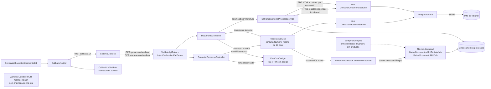
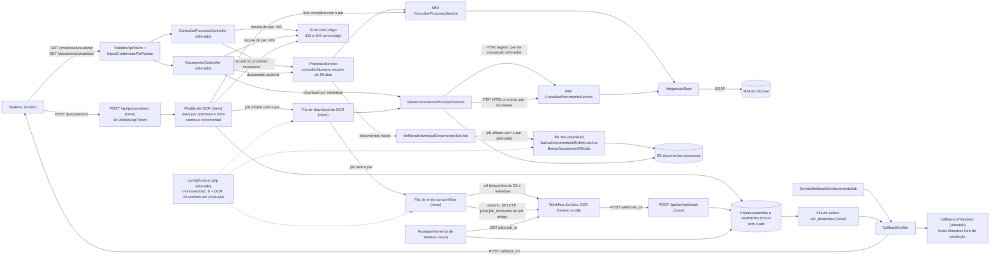

# SPEC: ocr-do-processo-para-o-sistema

## Metadata
- Source: developer description via /plan (`~/Projetos/sistema-juridico-lorran/.spec/features/consulta-de-processo-pelo-chat/.handoff/ms-mni-dep-03-a-05.md`), com os critérios confirmados em `.spec/features/ocr-do-processo-para-o-sistema/.handoff/acs-confirmados.md` (2026-11-05)
- Service: ms-mni (`~/Projetos/ms-mni`)
- Tier: complete
- Version: 1.7
- Architecture references: `AGENTS.md`, `docs/agents/architecture.md`, `docs/agents/domain_rules.md`, `docs/agents/api_contracts.md`, `docs/agents/data_model.md`, `docs/agents/coding_guidelines.md`
- Init chain: nenhuma (`.spec/init/` ausente)
- Changelog: v1.1 — respostas do desenvolvedor ao clarifier (`.handoff/clarifier-answers.md`, sobre `.handoff/clarifier-perguntas.md`), opção (a) nas 11 perguntas. NC-1 a NC-5 resolvidos (seção "Decisões do clarifier"). Novos: RF-18 (documento aguardando retorno), CT-07 (`DELETE jobs/{job_id}/chunks` do workflow), D-08 (`com_erro` cai na reabertura) e LIM-01 (pedido abandonado pelo cliente). Fixados P = 25 min (NC-4). Valores propostos e configuráveis: A = 25 min (Q-01), W = 45 s (Q-02) e X = 5 min (Q-06). A cifra passa a valer para os 6 jobs que já levam o par (NC-5).
- Changelog: v1.2 — rodada 2 do clarifier (`.handoff/clarifier-answers.md`, "Rodada 2"), opção recomendada em todos os pontos. R2-1: documento `baixado` com o objeto no S3 vai ao envio sem chamar o MNI (RF-09). R2-2: todo reenvio de documento com `job_id` cancela antes o job antigo pelo CT-07, e o retorno do job antigo recebe 404 (RF-04, RF-12, RF-18, CT-07). R2-3: o acompanhamento, a cada minuto, reenvia dentro do processamento aberto o documento cuja idade passa de A (RF-13, RF-18). R2-4: confirmadas as interpretações do RF-18 item 4 e do `data_juntada` `null`. O AC10 de `.handoff/acs-confirmados.md` foi emendado pelo router (NC-1).
- Changelog: v1.3 — rodada 3 do clarifier (`.handoff/clarifier-answers.md`, "Rodada 3"). R3-1: A passa de 25 para 20 min, configurável e sempre menor que P, que continua 25 min. A < P vira invariante de configuração (RF-11, RF-13, RF-18, CT-04).
- Changelog: v1.4 — rodada 4 do clarifier (`.handoff/clarifier-answers.md`, "Rodada 4"). R4-1: ordem fixa em cada rodada do acompanhamento. Primeiro o RF-13 avalia P e, se P venceu, encerra o processamento sem reenvio. Só com o processamento aberto o RF-18 reenvia. O envio e o reenvio não contam como progresso. Novo: LIM-02 (RF-13, RF-18).
- Changelog: v1.5 — rodada 5 do clarifier (`.handoff/clarifier-answers.md`, "Rodada 5", origem PQ-02 do planner). R5-1: com idade ≥ A, o ms-mni consulta o job antigo (CT-05) antes de cancelar e reenviar. Com `pending` ou `running`, não reenvia e consulta de novo na rodada seguinte (RF-04, RF-13, RF-18, CT-05, CT-07, LIM-02).
- Changelog: v1.6 — rodada 6 do clarifier (`.handoff/clarifier-answers.md`, "Rodada 6", defaults do router avisados ao desenvolvedor). R6-1: `success` na consulta nunca leva a reenvio. R6-2: a consulta com falha não reenvia na rodada. R6-3: idade máxima M = 60 min, com A < M invariante. Novo: LIM-03 (RF-13, RF-18, CT-05, CT-07).
- Changelog: v1.7 — rodada 7, fechamento da clarificação (`.handoff/clarifier-answers.md`, "Rodada 7", default do router). R7-1: `cancelled` na consulta com idade ≥ A é tratado como 404 ou `failed` e leva a cancelar pelo CT-07 e reenviar (RF-18, CT-05, CT-07).

## Context

**Problema.** O Sistema Jurídico (`~/Projetos/sistema-juridico-lorran`) consulta um processo pelo chat com o par do PJe do próprio membro (`GET /processo/visualizar`). Depois do "sim" do usuário, chama `POST /processo/ocr` (DEP-03). O ms-mni baixa os documentos do processo, manda cada um ao workflow "Jurídico OCR (Gemini)" do n8n (DEP-04) e avisa o progresso por webhook (DEP-05). O Sistema já está pronto e testado contra um fake do contrato acordado. Falta o ms-mni. Junto vem uma correção: nos testes de 2026-11-04 e 05 com o TJAP e uma senha errada, o par recusado chegou ao Sistema como 500 genérico, e não como 403 `credencial_pje_recusada`. Por isso o Sistema não marca a credencial como inválida. A correção é a primeira fase.

**Fontes da verdade.**
- Critérios de aceite: os 11 confirmados, citados como AC1 a AC11.
- Interface: o contrato acordado `~/Projetos/sistema-juridico-lorran/tests/Fixtures/Mni/openapi.yaml`. Lá estão o path `/processo/ocr` (l. 423-499, `x-dependencia: DEP-03`), o webhook `ocr_progresso` (l. 771-799, `DEP-05`) e os schemas `SolicitacaoDeOcr` (l. 835-866), `ProcessamentoDeOcr` (l. 867-882) e `AvisoDeProgressoDoOcr` (l. 883-909).
- Requisitos de origem: SPEC do Sistema (`.spec/features/consulta-de-processo-pelo-chat/SPEC.md`), com CT-04, CT-05, CT-08, CT-09, RNF-01, RNF-02, RF-15 e LIM-04, e a seção "Dependências no ms-mni" do PLAN de lá.

**Glossário.**
- *Linha*: o `tribunal_id`, isto é, uma linha de `tribunais`. Vários tribunais podem ter a mesma `sigla` (DEP-02).
- *Processamento*: o OCR de um (`numero_processo`, `tribunal_id`), do pedido que o abre até o aviso final.
- *Assinante*: cada pedido aceito (`callback_url` + `callback_token`).
- *Dono do par*: o assinante cujo pedido abriu o processamento e cujo par é usado nos downloads.
- *Carona*: o pedido aceito enquanto já há processamento em andamento.

**Achados no código (AS IS)**
- O OCR saiu do ms-mni em 2026-07-07. A migration `2026_07_07_000000_drop_ocr_and_samia_columns` derrubou `ocr_processado`, `ocr_enviado_fila`, `ocr_concluido_data` e `ocr_job_id` de `processo_documentos` e `ocr_status` de `processos` (verified at database/migrations/2026_07_07_000000_drop_ocr_and_samia_columns.php:17-30). A decisão está em `docs/superpowers/specs/2026-07-07-remocao-ocr-samia-credenciais-obrigatorias-design.md`. Hoje não há rota nem fila de OCR.
- `routes/api.php` tem dois grupos. A consulta usa `ValidateApiToken` + `InjectCredenciaisPjePadrao` (verified at routes/api.php:18). O monitoramento usa só `ValidateApiToken`, para nunca usar o par padrão (verified at routes/api.php:38-42).
- `ProcessoService::consultarNumero` usa `data_referencia` padrão de 90 dias atrás (verified at app/Services/Processo/ProcessoService.php:35-37). Por isso a lista de documentos do banco pode não ter os documentos mais antigos do processo.
- Com `baixar_binarios = true`, salvar os documentos enfileira `BaixarDocumentosMNIEmLoteJob` (não-vídeo) e `BaixarDocumentoMNIJob` (vídeo) na fila `mni-download`, com o par do pedido (verified at app/Services/Processo/SalvarDocumentoProcessoService.php:19-47; app/Services/Processo/EnfileirarDownloadDocumentosService.php:41-49 e :122-133). Nenhum dos dois implementa `ShouldBeEncrypted` (verified at app/Jobs/BaixarDocumentosMNIEmLoteJob.php:23 e :36-43; app/Jobs/BaixarDocumentoMNIJob.php:13 e :26-31). `BaixarProcessoMNIJob` também recebe o par (verified at app/Http/Controllers/Api/ConsultarProcessoController.php:107 e :146).
- O download em lote não classifica a recusa. Um `sucesso = false` aciona o fallback unitário documento a documento (verified at app/Services/Processo/BaixarDocumentosEmLoteService.php:183-199 e :269). Com o par recusado, o mesmo par seria reenviado ao tribunal uma vez por documento.
- A recusa já é classificada (DEP-01) por `ClassificarFalhaMniService::credencialRecusada` sobre o texto cru (verified at app/Services/MNI/ClassificarFalhaMniService.php:28-31) e respondida por `ErroComCodigo` (verified at app/Http/Responses/ErroComCodigo.php:20-24 e :34-65). Evidência do log local (`storage/logs/laravel.log`):
  - Em 2026-11-03 17:42 e em 2026-11-04 21:45 e 22:13, o `/documento/visualizar` do documento 31775179 (`text/html`) respondeu 500 `Erro ao processar documento HTML:`. Esse é o caminho do HTML legado (`baixado`, sem `path_html`), que reconsulta o MNI com a credencial do tribunal e corta a cadeia de propósito (verified at app/Services/Processo/SalvarDocumentoProcessoService.php:111-121). É uma exclusão documentada do DEP-01 (`docs/agents/domain_rules.md`, "Exclusions"). A exclusão sai nesta SPEC (RF-01, NC-2).
  - Em 2026-11-05 20:58 e 21:00, `BaixarProcessoMNIJob` registrou `CredencialPjeRecusadaException` (linha 54 de `ConsultarProcessoService.php`, o ramo classificado). Logo, o texto cru do TJAP traz `loginfailed` quando o par é informado.
  - Não há registro do 500 de `/processo/visualizar` com processo novo, porque esse controller não loga. A reprodução fica para o plano, nos pontos sugeridos pelo desenvolvedor: os `catch (MNIException $e)` de `ConsultarProcessoService` (l. 66-67) e `ConsultarDocumentoService` (l. 79-80), `IntegracaoBase::makeSoapRequest` (l. 46-60), `ProcessoService::consultarNumero` e `BaixarProcessoMNIJob`.
- `CallbackUrlValidator` só aceita `https`, com host presente, sem `localhost` e com IP fora das faixas privadas e reservadas (verified at app/Services/Callback/CallbackUrlValidator.php:17-37). `CallbackNotifier` valida de novo antes de cada envio (verified at app/Services/Callback/CallbackNotifier.php:15). O Sistema de desenvolvimento chama de `http://host.docker.internal`.
- `EnviarWebhookMonitoramentoJob` usa `$tries = 5` e `backoff()` `[10, 60, 300, 900, 3600]` (verified at app/Jobs/EnviarWebhookMonitoramentoJob.php:20-27).
- `supervisor-mni-download` tem 8 `maxProcesses` em produção (verified at config/horizon.php:295-296). O Horizon guarda os jobs que falharam por 10.080 min (verified at config/horizon.php:117-122), e `failed_jobs` usa o driver `database-uuids` (verified at config/queue.php:106-110).
- `APP_LOCALE` padrão é `en` (verified at config/app.php:83; .env.example:8). As mensagens de validação 422 saem em inglês.

**Workflow do n8n (contrato com o ms-mni).** Arquivo `~/Projetos/sistema-juridico-lorran/docker/n8n/juridico-ocr.json`, workflow "Jurídico OCR (Gemini)":
- `POST /webhook/juridico-ocr/documents/process` (nó "Receber documento", autenticação por header).
- O nó "Validar pedido" exige uma fonte só (`url`, `file_base64` ou `bucket_origem` + `path_origem`) e um `filename` com extensão em `.pdf, .png, .jpg, .jpeg, .webp, .tif, .tiff, .bmp, .gif`. Exige também `metadata.escritorio_id` ausente ou `null`, com `metadata.numero_processo` de 20 dígitos e `metadata.tribunal_id` inteiro positivo. Senão, responde 422 `{detail}`.
- O nó "Arquivo" escolhe o MIME pela extensão do `filename` (`MIME[pedido.ext]`).
- Os nós "Avisar o sistema" e "Avisar falha" fazem `POST {webhook_url}` com `{status: "success", job_id, ...}` ou `{status: "error", job_id, error_detail, ...}`. A chamada não tem autenticação e o workflow não tenta de novo.
- `GET /webhook/juridico-ocr/jobs/:job_id` (nó "Consultar job") devolve a situação do job.
- `DELETE /webhook/juridico-ocr/jobs/:job_id/chunks` (nó "Excluir trechos", autenticação por header) cancela o job em `pending` ou `running` ("Cancelar job") e apaga os trechos dele ("Apagar trechos"). Responde 200 `{job_id, deleted_chunks}`, também sem trechos ou sem job (nota "Exclusão": "Idempotente"). O nó "Indexar" só grava trechos de job em `running`, com trava na linha do job. Um job cancelado não grava nada.
- Os nós "Validar pedido" e "Arquivo" não olham a extensão do objeto no S3, só a do `filename`. O ms-mni grava `image/webp`, `image/tiff`, `image/bmp` e `image/gif` como `{id}.dat` (verified at app/Services/Processo/SalvarDocumentoProcessoService.php:399-422).
- O Sistema autentica com `Authorization: Bearer {token}` (verified at ~/Projetos/sistema-juridico-lorran/app/Services/SimOcr/SimOcrHttp.php:139) e usa `base_conhecimento` = `SIM_OCR_BASE_CONHECIMENTO` (verified at ~/Projetos/sistema-juridico-lorran/config/sim_ocr.php:42).

**Origem do port (`~/Projetos/sim-mni`).**
- Portados, com as mudanças desta SPEC:
  - `POST /ocr/webhook` (verified at ~/Projetos/sim-mni/routes/api.php:24) e `POST /processo/ocr` (verified at ~/Projetos/sim-mni/routes/api.php:51);
  - `OCRProcessoJob`, `OCRRequestJob` e `ValidateOCRWebhook`;
  - `OCRPollStatus`, como acompanhamento de reserva (RF-13).
- Não portados:
  - o log de `$request->all()` (verified at ~/Projetos/sim-mni/app/Http/Controllers/Api/OCRProcessoController.php:15);
  - o fan-out para outras linhas;
  - `notificacao_id`;
  - `codigos_documentos_ignorados`;
  - o `.metadata.json` no disco `s3_ocr`;
  - `notificarProgressoSim` sem contagens;
  - `JuntarOCRProcessoJob`, cujo despacho está desligado lá (verified at ~/Projetos/sim-mni/app/Http/Controllers/Api/OCRWebhookController.php:88).

**Regras de arquitetura aplicáveis** (fonte: `AGENTS.md` e `docs/agents/`)
- Controller fino: os controllers da API validam, consultam o banco, escolhem o status HTTP e despacham jobs. Não fazem SOAP nem entregam webhook. A lógica fica em `app/Services/` (`docs/agents/architecture.md`, "Layer responsibilities"; `docs/agents/coding_guidelines.md` §2).
- O status do erro com código é decidido em `app/Http` (`ErroComCodigo`). Os services só lançam exceções tipadas (`docs/agents/domain_rules.md`, "Erros com código estável (DEP-01)").
- A validação fica em FormRequests de `app/Http/Requests/Api/`, com `authorize()` = `true`. A autenticação fica no middleware (`coding_guidelines.md` §3).
- Toda fila tem um supervisor no `config/horizon.php`. Cada despacho nomeia a fila, e o job declara `$tries`, `$timeout` e `backoff()` (`AGENTS.md` §2; `coding_guidelines.md` §6).
- Webhooks de saída passam por `CallbackNotifier`, e o `callback_url` passa pela regra `CallbackUrl`. A entrega é idempotente (`AGENTS.md` §2; `coding_guidelines.md` §7).
- Mudou `routes/api.php`, muda `docs/api/openapi.yaml` na mesma mudança (`AGENTS.md` §3).
- A API nunca devolve credencial do PJe (`AGENTS.md`, "Never in this repository").
- `supervisor-monitoramento` nunca passa de `maxProcesses` 1 (`AGENTS.md`, "Never in this repository").

## AS IS — Estado atual



Hoje o ms-mni não tem rota nem fila de OCR. Elas saíram em 2026-07-07, e o workflow do n8n não recebe nada do ms-mni. A recusa do par já é classificada (DEP-01), mas o HTML legado reconsulta com a credencial do tribunal, os jobs de download levam o par sem cifra e o `CallbackUrlValidator` só aceita `https` com IP público.

## TO BE — Estado proposto



A rota nova `POST /api/processo/ocr` (RF-02 a RF-08, CT-01) garante a lista completa com o par, trava por processo e linha e guarda os assinantes sem o par; a fila de download cifrada (RF-09, RF-10) e a de envio sem o par (RF-11, CT-03) alimentam o workflow, cujo retorno chega pelo webhook novo e pelo acompanhamento de reserva (RF-12, RF-13, CT-04, CT-05). O documento enviado e sem retorno não é reenviado até a idade A, e o reenvio cancela antes o job antigo (RF-18, CT-07). Os avisos `ocr_progresso` saem pela fila nova via `CallbackNotifier` (RF-14 a RF-16, CT-02), e o `config/horizon.php` soma 20 workers nas filas de RF-09 e RF-11 (RNF-02). Os controllers de visualização passam a responder 403 na recusa do par, inclusive no HTML legado, que passa a reconsultar com o par da requisição (RF-01, CT-06). Os pontos de código ficam para o plano. Os 6 jobs que já levam o par passam a ser cifrados (RNF-01), e o `CallbackUrlValidator` aceita hosts liberados fora de produção (RF-17).

## Scope
- **In**:
  - Fase 1: recusa do par classificada como 403 `credencial_pje_recusada` em `GET /api/processo/visualizar` (processo novo) e em `GET /api/documento/visualizar`, inclusive no HTML legado, que passa a reconsultar com o par da requisição (RF-01).
  - DEP-03: `POST /api/processo/ocr`, com trava, carona, processamento incremental e contagens (RF-02 a RF-08, CT-01).
  - DEP-04:
    - download cifrado com o par do dono e envio ao workflow sem o par (RF-09 a RF-11, CT-03);
    - webhook do workflow (RF-12, CT-04);
    - acompanhamento de reserva e prazo do processamento (RF-13, CT-05);
    - documento aguardando retorno e reenvio com cancelamento do job antigo (RF-18, CT-07);
    - supervisores do Horizon que somam 20 workers (RNF-02).
  - Cifra (`ShouldBeEncrypted`) dos 6 jobs que já existem e levam o par: `BaixarDocumentoMNIJob`, `BaixarDocumentosMNIEmLoteJob`, `BaixarProcessoMNIJob`, `ConsultarDadosBasicosProcessoMNIJob`, `ConsultarDocumentosProcessoMNIJob` e `ConsultarMovimentosProcessoMNIJob`, com teste de payload (RNF-01, NC-5).
  - DEP-05: avisos `ocr_progresso` a cada assinante, com tentativas e códigos de falha (RF-14 a RF-16, CT-02).
  - Lista de hosts liberados do `CallbackUrlValidator` fora de produção (RF-17).
  - `docs/api/openapi.yaml` igual ao contrato acordado, com as divergências avisadas (RNF-04), mais a documentação de `docs/agents/` e `AGENTS.md` (RNF-06).
- **Out**:
  - Mudar o contrato acordado sem avisar o Sistema: toda diferença vai na seção "Divergências".
  - Fan-out para outras linhas do mesmo tribunal.
  - Mudanças no monitoramento.
  - OCR de áudio e vídeo: esses formatos contam em `ignorados`.
  - OCR de documento avulso (`POST /documento/ocr` do sim-mni) e junção do OCR (`JuntarOCRProcessoJob`).
  - A troca da chave do Gemini no nó "Config" do workflow, decisão do desenvolvedor antes do primeiro OCR real.
  - A mudança do workflow "Jurídico OCR (Gemini)" para aceitar documento dos autos sem `escritorio_id`. É o RF-14 da SPEC do Sistema, feito no repositório do Sistema, e precisa estar importada no n8n antes da homologação.
  - Filtro por `nivel_sigilo`: todo documento legível vai ao OCR.
  - Consulta da situação do processamento pelo Sistema (o antigo DEP-06) e cobrança.
  - Credenciais em query string nas rotas de consulta, que já existem e o contrato já avisa.
  - Limite de tempo da consulta síncrona de RF-04 abaixo dos 60 s do cliente (Q-02; ver LIM-01).
  - Limite de downloads simultâneos por par (Q-06).
  - Conversão de imagem em PDF no ms-mni (NC-1).

## Decisões do clarifier (v1.1)

Respostas do desenvolvedor em 2026-11-05 (`.handoff/clarifier-answers.md`), opção (a) em todas. Os valores marcados "valor proposto, configurável" foram propostos pelo clarifier a pedido do desenvolvedor, que não os fixou.

- **Q-01 → (a)**: o documento enviado ao workflow e sem retorno fica "aguardando retorno". Ele não é reenviado, e o retorno dele conta como progresso do processamento aberto no momento do retorno. Passada a idade A sem retorno, o ms-mni cancela o job antigo com `DELETE jobs/{job_id}/chunks` e reenvia. A credencial do `webhook_url` vale pelo menos A. O AC de RF-10 não muda (RF-08, RF-10, RF-12, RF-13, RF-18, CT-07). O valor proposto de A era 25 min, igual a P. Na rodada 3 (R3-1), passou a 20 min.
- **NC-1 → (a)**: as imagens vão com `filename` `{id_documento}.{extensão do mimetype}`, e PDF e HTML com `.pdf`. Nada é convertido no ms-mni. O `filename` `{id_documento}.pdf` do AC10 vale para PDF e HTML (RF-11, CT-03, D-07). O router emendou o AC10 em `.handoff/acs-confirmados.md`.
- **NC-3 → (a)**: um `com_erro` volta a pendente num pedido que abre processamento, e um `processado` nunca volta. O 202 `concluido` sem trabalho só sai com `com_erro` = 0. O "não relê nada" do AC5 vale para os documentos processados (RF-04, RF-07, RF-08, D-08).
- **NC-4 → (a)**: P = 25 min, contados da abertura ou do último progresso, o que for mais recente. O link do S3 vale pelo menos P (RF-11, RF-13).
- **NC-2 → (a)**: o HTML legado do `/documento/visualizar` reconsulta com o par da requisição. A recusa do par do cliente vira 403, e a do par padrão segue 500. A exclusão de `docs/agents/domain_rules.md:188` sai. No fluxo do OCR, o HTML legado vai pelo PDF já gravado, sem reconsulta (RF-01, RF-09).
- **NC-5 → (a)**: os 6 jobs que já existem e levam o par passam a `ShouldBeEncrypted`, com teste de payload. O item sai do Out (Scope, RNF-01).
- **Q-02 → (a)**: a espera pela trava fica abaixo de 60 s. Esgotada a espera, o pedido responde 500 `{message}` sem registrar assinante. W = 45 s (valor proposto, configurável). Sobram 15 s dos 60 s do cliente para registrar a carona e responder (RF-06, RNF-03, LIM-01).
- **Q-03 → (a)**: nada é gerado depois do aviso final, e as novas tentativas pendentes do assinante terminam sem enviar quando o final já foi entregue (RF-15, RF-16).
- **Q-04 → (a)**: o 422 entra no RF-12. `success` prevalece sobre `com_erro`, e `error` nunca rebaixa um `processado` (RF-12, CT-04).
- **Q-05 → (a)**: `data_juntada` vai em ISO-8601 com fuso, e `nivel_sigilo` vai sempre inteiro, com `null` enviado como 0 (RF-11, CT-03).
- **Q-06 → (a)**: a meta de 300 PDFs em 10 min continua, com pré-condições de homologação e a medida do ms-mni de 300 enviados em até X min. X = 5 min (valor proposto, configurável), metade da meta, para separar a falha do ms-mni da do n8n e do Gemini (RNF-02).

Rodada 2 (v1.2), opção recomendada em todos os pontos:
- **R2-1 → reusar o S3**: um documento `baixado` com o objeto no S3 não chama o MNI e vai direto ao envio, com 0 SOAP. Isso vale para os `com_erro` devolvidos e para os reenvios de RF-18 (RF-09).
- **R2-2 → cancelar sempre antes**: todo reenvio de documento que já tem `job_id` cancela antes o job antigo pelo CT-07. O retorno do job antigo passa a receber 404, o que fecha também o `error` atrasado sobre documento pendente (RF-04, RF-12, RF-18, CT-07).
- **R2-3 → reenviar no mesmo processamento**: o acompanhamento de RF-13, a cada minuto, cancela o job antigo pelo CT-07 e reenvia, dentro do processamento aberto, o documento cuja idade passa de A, sem esperar nova abertura (RF-13, RF-18).
- **R2-4 → interpretações confirmadas**: (1) o pedido só com documentos aguardando retorno com idade < A abre processamento sem job e responde `em_andamento` (RF-18 item 4); (2) `data_juntada` vai `null` quando não há data gravada (RF-11).

Rodada 3 (v1.3):
- **R3-1 → A = 20 min**: com A = P = 25 min, o fim de RF-13 e o reenvio de RF-18 caíam na mesma rodada do acompanhamento, sem ordem definida. A passa a 20 min, configurável e sempre menor que P, que continua 25 min. A < P é invariante de configuração. A credencial do `webhook_url` continua valendo pelo menos A (RF-11, RF-13, RF-18, CT-04).

Rodada 4 (v1.4):
- **R4-1 → o prazo vem primeiro**: um documento enviado P − A = 5 min depois do início da contagem de P ainda chegava a A na mesma rodada em que P vencia. A ordem em cada rodada do acompanhamento passa a ser fixa. (1) O RF-13 avalia P. Se P venceu, o processamento termina, e a rodada para ali, sem reenvio. (2) Só com o processamento ainda aberto, o RF-18 cancela e reenvia os documentos com idade ≥ A. O documento que fica aguardando retorno quando P vence segue a regra da abertura seguinte do RF-18. O envio e o reenvio não contam como progresso para P. O caso raro fica registrado em LIM-02 (RF-13, RF-18).

Rodada 5 (v1.5), origem PQ-02 do planner:
- **R5-1 → consultar o job antes de reenviar**: com idade ≥ A, o ms-mni consulta `GET {base}/jobs/{job_id}` (CT-05) antes de cancelar e reenviar. Com `pending` ou `running`, não reenvia: o documento segue aguardando retorno e é consultado de novo na rodada seguinte. Só reenvia, cancelando antes pelo CT-07, quando o job não existe (404), terminou em erro ou a consulta mostra que ele não está mais em andamento. O fim por P de RF-13 continua sendo avaliado antes (R4-1) (RF-04, RF-13, RF-18, CT-05, CT-07, LIM-02).
  A redação "não está mais em andamento" foi corrigida pela R6-1: `success` não leva a reenvio.
- O planner confirmou a PQ-03 (classificação por exceções tipadas dos services no job, e `ErroComCodigo` só nos controllers) e a PQ-05 (corpos `{"message": ...}` no `/ocr/webhook`), como estão no PLAN.

Rodada 6 (v1.6), defaults do router avisados ao desenvolvedor:
- **R6-1 → `success` nunca reenvia**: o documento passa a processado pela regra de RF-12 (Q-04, o `success` prevalece) e conta como progresso se o processamento estiver aberto. Só levam a cancelar (CT-07) e reenviar: 404, o erro do job (`failed` no CT-05), ou `pending`/`running` com idade ≥ M (RF-18).
- **R6-2 → consulta com falha não reenvia**: com tempo esgotado, 5xx ou falha de rede, não há reenvio na rodada. O documento segue aguardando retorno e é consultado de novo na rodada seguinte. P continua protegendo contra processamento parado (RF-13, RF-18).
- **R6-3 → idade máxima M**: M = 60 min (valor proposto, configurável), com A < M como invariante de configuração. Com idade ≥ M e o job ainda em `pending` ou `running`, o job é considerado travado: o ms-mni cancela pelo CT-07 e reenvia, se o processamento estiver aberto, ou deixa para a abertura seguinte. O fim por P antes de M fica em LIM-03 (RF-18, CT-07).

Rodada 7 (v1.7), fechamento da clarificação, default do router:
- **R7-1 → `cancelled` como 404 ou erro**: com idade ≥ A, a consulta com `cancelled` leva a cancelar pelo CT-07, que é idempotente, e a reenviar, com o processamento aberto ou na abertura seguinte. Com idade < A, o `cancelled` segue a regra que o RF-13 já tem (RF-18, CT-05, CT-07).

## Known Limitations — limitações conhecidas

- **LIM-01** (consequência de Q-02): um pedido abandonado pelo cliente ainda abre o processamento. A consulta síncrona de RF-04 não tem limite abaixo dos 60 s do cliente (`mni.timeout`, verified at ~/Projetos/sistema-juridico-lorran/config/mni.php:51). O SOAP tem `timeout` 1.800 s (verified at app/Services/IntegracaoBase.php:26). Quando a consulta passa dos 60 s, o Sistema desiste e não liga a conversa, mas o ms-mni segue: abre o processamento, registra o assinante e enfileira os jobs. Os avisos desse assinante recebem 404 do Sistema, o que o encerra (RF-16), e o processamento vai até o fim. Um novo "sim" entra como carona (RF-06) ou encontra os documentos já lidos (RF-07).
- **LIM-02** (consequência de R4-1): um documento enviado 5 min (P − A) ou mais depois do último progresso, ou da abertura sem progresso, não chega à idade A antes de P vencer. Se ele não voltar a tempo, o processamento termina `falhou` sem que ele seja reenviado dentro do processamento (RF-13, RF-18). O reenvio fica para a abertura seguinte, depois da consulta do job (R5-1), e o usuário precisa de um novo "sim".
- **LIM-03** (consequência de R6-3): um job do workflow preso em `pending` ou `running` só é cancelado e reenviado com idade ≥ M = 60 min. Antes disso, o processamento aberto ainda pode terminar `falhou` por P (25 min sem progresso, RF-13). Um novo "sim" antes de M abre um processamento que só espera esse documento e pode terminar `falhou` de novo por P. O usuário pode precisar de mais de um "sim" até o documento ser reenviado. O caso é raro, porque os envios saem nos primeiros minutos do processamento, e qualquer retorno conta como progresso e reinicia a contagem de P.

## RIGID (Non-Negotiable)

### Functional Requirements

#### Fase 1 — Recusa do par classificada (correção)

- RF-01 [Event-Driven] (AC9, AC2): Quando o tribunal recusar o par `login_pje`/`senha_pje` enviado pelo cliente numa chamada MNI que usou esse par, o ms-mni deve responder 403 com o corpo exato `{"codigo": "credencial_pje_recusada", "message": "Credencial PJe recusada pelo tribunal"}` (verified at app/Http/Responses/ErroComCodigo.php:20-23), e não 500, em:
  - `GET /api/processo/visualizar` com o processo ausente do banco;
  - `GET /api/documento/visualizar`.

  A recusa é o texto cru com `loginfailed`, sem diferenciar maiúsculas (verified at app/Services/MNI/ClassificarFalhaMniService.php:28-31). A detecção e as exclusões do DEP-01 continuam como hoje (`docs/agents/domain_rules.md`, "Erros com código estável (DEP-01)"), menos a do HTML legado. Recusa do par padrão ou da credencial do tribunal e texto sem `loginfailed` seguem com o 500 atual.
  - HTML legado (NC-2): o 500 observado em `/documento/visualizar` (documento 31775179, `text/html`, log local de 2026-11-03 e 2026-11-04) veio do caminho do HTML legado (`baixado`, sem `path_html` e sem `conteudo_html`). Esse caminho reconsulta o MNI com a credencial do tribunal (verified at app/Services/Processo/SalvarDocumentoProcessoService.php:111-121) e passa a reconsultar com o par da requisição: o par do cliente, ou o par padrão que `InjectCredenciaisPjePadrao` injeta. Sem par nenhum, vale o fallback de hoje para a credencial do tribunal, como nos outros downloads de `/documento/visualizar` (verified at app/Http/Middleware/InjectCredenciaisPjePadrao.php:43-46; app/Services/MNI/Intercomunicacao/ConsultarDocumentoService.php:144-145). A recusa do par do cliente vira 403, e a do par padrão segue 500. A exclusão do HTML legado sai de `docs/agents/domain_rules.md:188`, e o caminho passa a seguir a mesma tabela do DEP-01 dos outros downloads de `/documento/visualizar`.
  - AC (a): O SOAP simulado devolve a recusa em cada uma das três formas cruas, com o par no pedido:
    - `sucesso = false` com `mensagem` = `Erro ao realizar login via MNI. exception invoking: loginFailed`;
    - exceção de recibo lançada por `IntegracaoBase::makeSoapRequest` com esse texto (verified at app/Services/IntegracaoBase.php:53-57);
    - `SoapFault` com esse texto.

    Em cada forma, a resposta é 403 com o corpo exato acima nos caminhos: processo ausente em `/processo/visualizar`; documento ausente do banco, PDF pendente, HTML pendente e HTML legado em `/documento/visualizar`. 0 respostas 500.
  - AC (b): Em cada caso do AC (a), o MNI recebe exatamente 1 chamada SOAP com o par recusado. O laço de 3 tentativas de `/documento/visualizar` não repete a chamada.
  - AC (c): O corpo da resposta não tem `error`, `line`, `file`, texto do tribunal, login nem senha.
  - AC (d), homologação: com o TJAP real e uma senha errada, as duas rotas respondem 403 `credencial_pje_recusada`: `/processo/visualizar` com um processo ausente do banco e `/documento/visualizar` com um documento PDF ainda não baixado.
  - AC (e): No HTML legado, com o par do cliente no pedido, a chamada SOAP sai com esse par em `idConsultante`/`senhaConsultante`, e não com a credencial do tribunal. Sem o par no pedido, sai com o par padrão configurado, e a recusa dele segue 500, sem `codigo`.

#### DEP-03 — Pedido de OCR

- RF-02 [Ubiquitous] (AC1): O ms-mni deve expor `POST /api/processo/ocr` (path `/processo/ocr` do contrato acordado, verified at ~/Projetos/sistema-juridico-lorran/tests/Fixtures/Mni/openapi.yaml:423). A rota é autenticada só por `X-API-Token` (`ValidateApiToken`, verified at app/Http/Middleware/ValidateApiToken.php:10) e fica fora de `InjectCredenciaisPjePadrao` (verified at app/Http/Middleware/InjectCredenciaisPjePadrao.php:18), como o grupo de monitoramento. Nenhuma chamada MNI desta rota ou dos jobs que ela enfileira usa o par padrão (`PJE_LOGIN_PADRAO`/`PJE_SENHA_PADRAO`) ou a credencial do tribunal.
  - AC (a): Sem `X-API-Token` válido, a resposta é 401 `{"message": "Token inválido ou não fornecido"}`, com 0 chamadas SOAP e 0 jobs.
  - AC (b): Com o par padrão configurado (`definirCredenciaisPadrao`) e o corpo sem `senha_pje`, a resposta é 422, com 0 chamadas SOAP e 0 jobs.
  - AC (c): Em todo o fluxo de um pedido aceito, 100% das chamadas SOAP levam em `idConsultante`/`senhaConsultante` o par do pedido que abriu o processamento.

- RF-03 [Unwanted] (AC1): Se o corpo não cumprir o schema `SolicitacaoDeOcr` (verified at ~/Projetos/sistema-juridico-lorran/tests/Fixtures/Mni/openapi.yaml:835-866), então o ms-mni deve responder 422 `{message, errors}`. Não consulta o MNI, não enfileira job e não registra processamento nem assinante. Regras:
  - `numero_processo`: obrigatório, com exatamente 20 dígitos depois de `cleanNumeroProcesso` (verified at app/Helpers/functions.php:76);
  - `tribunal_id`: inteiro ≥ 1, de um tribunal que existe com `ativo = true`;
  - `login_pje` e `senha_pje`: os dois obrigatórios, cada um com pelo menos 1 caractere que não seja espaço. Faltar um só já é 422, e o par padrão nunca o substitui;
  - `callback_url`: obrigatório, com a regra `App\Rules\CallbackUrl` (verified at app/Rules/CallbackUrl.php:9) e até 2.048 caracteres (D-05);
  - `callback_token`: obrigatório, de 1 a 255 caracteres.
  - AC: Para cada campo, um pedido sem ele e um com valor inválido respondem 422 com a chave do campo em `errors`, com 0 chamadas SOAP, 0 jobs e 0 linhas novas nas tabelas do OCR. O corpo do 422 não tem o valor de `login_pje`, `senha_pje` nem `callback_token`.

- RF-04 [Event-Driven] (AC1, AC10): Quando chegar um pedido válido e não houver processamento em andamento para (`numero_processo`, `tribunal_id`), o ms-mni deve, antes de responder:
  1. Consultar o MNI da linha `tribunal_id` com o par recebido e gravar o processo com a lista completa dos documentos, sem recorte de data. Assim, os documentos novos no tribunal entram a cada novo processamento (LIM-04 da SPEC do Sistema).
  2. Classificar cada documento do processo na linha como legível ou ignorado (RF-08).
  3. Se houver documento pendente, em `com_erro` ou aguardando retorno (RF-08):
     - abrir um processamento para (`numero_processo`, `tribunal_id`);
     - registrar o pedido como assinante dono do par;
     - devolver a pendente todo documento em `com_erro` (NC-3). Um processado nunca volta. Desde a devolução, o job antigo desse documento deixa de ser conhecido (RF-12), e o reenvio dele cancela antes esse job pelo CT-07 (RF-18, R2-2);
     - enfileirar o download e o OCR só dos pendentes, inclusive os que estavam em `com_erro` e os aguardando retorno com idade ≥ A. Antes de qualquer reenvio, esses últimos passam pela consulta do job antigo e pelo resultado de RF-18 item 3 (R5-1, R6-1 a R6-3). Os aguardando retorno com idade < A não entram na fila, e o processamento espera o retorno deles (RF-18);
     - responder 202 `ProcessamentoDeOcr` com `situacao` = `em_andamento` e as contagens depois da devolução, com `com_erro` = 0.
  4. Processar só a linha `tribunal_id`, sem fan-out para outras linhas do mesmo tribunal.
  - AC (a): Processo simulado com 3 `application/pdf`, 1 `text/html`, 1 `image/png`, 1 `video/mp4` e 1 `audio/mpeg`, nenhum lido:
    - resposta 202 `{"numero_processo": "<20 dígitos>", "tribunal_id": <id>, "total": 5, "processados": 0, "com_erro": 0, "ignorados": 2, "situacao": "em_andamento"}`;
    - exatamente 5 documentos entram na fila de download do OCR;
    - 0 jobs para o vídeo e o áudio.
  - AC (b): A chamada `consultarProcesso` sai com `dataReferencia` vazio e com documentos incluídos. Um documento juntado há mais de 90 dias entra na lista.
  - AC (c): Com outra linha ativa da mesma `sigla`, há 0 chamadas SOAP para a URL dela e 0 documentos dela enfileirados.

- RF-05 [Unwanted] (AC2): Se a consulta síncrona de RF-04 falhar, então o ms-mni não deve abrir processamento, registrar assinante nem enfileirar job, e deve responder:
  - recusa do par (regra de RF-01): 403 `{"codigo": "credencial_pje_recusada", "message": "Credencial PJe recusada pelo tribunal"}`;
  - processo inexistente (`sucesso = false` com `mensagem` que casa `^Processo de número \d+ não encontrado!$`, verified at app/Services/MNI/ClassificarFalhaMniService.php:26): 404 `{"codigo": "processo_nao_encontrado", "message": "Processo não encontrado no tribunal"}`. Os dois casos saem por `ErroComCodigo` (verified at app/Http/Responses/ErroComCodigo.php:51-65);
  - qualquer outra falha: 500 `{message}` (`Erro500Generico`, verified at ~/Projetos/sistema-juridico-lorran/tests/Fixtures/Mni/openapi.yaml:1182-1186), sem `error`, `line`, `file` e sem o par.
  - AC: Em cada um dos três casos, a resposta tem o status e o corpo acima, com 1 chamada SOAP, 0 linhas novas de processamento e de assinante e 0 jobs.

- RF-06 [State-Driven] (AC3): Enquanto houver processamento em andamento para (`numero_processo`, `tribunal_id`), o ms-mni deve tratar todo novo pedido válido do mesmo processo e linha, de qualquer token, como carona:
  - responder 202 `ProcessamentoDeOcr` com a contagem atual e `situacao` = `em_andamento`;
  - não chamar o MNI, não enfileirar job e não guardar o par desse pedido em tabela nem em job;
  - registrar `callback_url` e `callback_token` como novo assinante, que recebe todo aviso gerado depois do aceite, inclusive o final (RF-14, RF-15);
  - decidir entre abrir processamento (RF-04) e carona de forma exclusiva por (`numero_processo`, `tribunal_id`): pedidos simultâneos abrem no máximo 1 processamento, e o pedido aceito como carona sempre recebe o aviso final do processamento em que entrou;
  - esperar por essa decisão no máximo W = 45 s (valor proposto, configurável; Q-02). W fica abaixo dos 60 s do cliente (RNF-03). Esgotada a espera, o pedido responde 500 `{message}` (`Erro500Generico`), sem chamar o MNI, sem registrar assinante, sem guardar o par e sem enfileirar job (LIM-01).
  - AC (a): Há um processamento em andamento de 10 documentos, 4 já processados. Um pedido de outro token, com outro par e outro callback, recebe 202 `{"total": 10, "processados": 4, "com_erro": 0, "situacao": "em_andamento"}`, com 0 chamadas SOAP e 0 jobs novos. O login e a senha desse pedido aparecem em 0 linhas de tabela e em 0 payloads de job.
  - AC (b): Quando os 6 documentos restantes terminam, o callback do carona recebe exatamente 6 avisos `em_andamento` e 1 aviso final.
  - AC (c): Dois pedidos simultâneos, sem processamento aberto, resultam em exatamente 1 processamento, 1 chamada `consultarProcesso` e 1 conjunto de jobs. Os dois callbacks recebem o aviso final.
  - AC (d): Com W configurado em 1 s e a decisão do mesmo processo e linha presa por outro pedido, o pedido responde 500 `{message}` em menos de 2 s, sem `error`, `line`, `file` e sem o par. Há 0 chamadas SOAP, 0 assinantes novos e 0 jobs desse pedido.

- RF-07 [Conditional] (AC5): Se, depois da consulta de RF-04, não houver no processo e linha documento pendente, em `com_erro` nem aguardando retorno (RF-08), então o ms-mni deve responder 202 `ProcessamentoDeOcr` com `situacao` = `concluido` e as contagens. Não abre processamento, não registra assinante, não enfileira job e não envia aviso. Documento já processado nunca volta ao workflow, venha o pedido de qualquer token.
  - Documento com erro (NC-3): o `com_erro` de um processamento anterior não impede a reabertura. Num pedido que não é carona, ele volta a pendente e é tentado de novo (RF-04). Assim, o 202 `concluido` sem trabalho só sai com `com_erro` = 0 e `processados` = `total`, como o contrato define (`concluido` é "tudo já lido", verified at ~/Projetos/sistema-juridico-lorran/tests/Fixtures/Mni/openapi.yaml:879-882). Também cumpre o RF-15 do Sistema ("continua de onde parou"). O "não relê nada" do AC5 vale para os processados. Dentro de um processamento, o `com_erro` segue definitivo: o documento não é tentado de novo, e o RF-15 conclui com `com_erro` > 0. A queda do `com_erro` no 202 da reabertura vai ao Sistema (D-08).
  - AC (a): Processo com 300 documentos legíveis, todos processados, e nenhum novo no MNI. O pedido recebe 202 `{"total": 300, "processados": 300, "com_erro": 0, "situacao": "concluido"}`, com 0 jobs, 0 chamadas ao workflow e 0 avisos.
  - AC (b): O mesmo processo com 2 documentos novos no MNI. O pedido recebe 202 `em_andamento` com `"total": 302, "processados": 300`. Exatamente 2 documentos entram na fila, e nenhum dos 300 vai ao workflow.
  - AC (c): Processo só com vídeo e áudio. O pedido recebe 202 `{"total": 0, "ignorados": 2, "situacao": "concluido"}`, com 0 jobs.
  - AC (d): Processo com 10 legíveis, 8 processados e 2 em `com_erro` de um processamento anterior, e nenhum novo no MNI. O pedido recebe 202 `{"total": 10, "processados": 8, "com_erro": 0, "situacao": "em_andamento"}`. Exatamente os 2 documentos com erro entram na fila, e nenhum dos 8 vai ao workflow.

- RF-08 [Ubiquitous] (AC1, AC10): O ms-mni deve calcular as contagens de `ProcessamentoDeOcr` e de `AvisoDeProgressoDoOcr` sobre todos os documentos do processo na linha, acumuladas entre processamentos:
  - Legíveis:
    - `application/pdf`;
    - `text/html`, que vai ao OCR pelo PDF que o download já renderiza e grava (`docs/agents/domain_rules.md`, tabela "Document binary download");
    - as imagens que o workflow lê: `image/png`, `image/jpeg`, `image/webp`, `image/tiff`, `image/bmp` e `image/gif` (extensões aceitas, verified at ~/Projetos/sistema-juridico-lorran/docker/n8n/juridico-ocr.json, nó "Validar pedido", `EXTENSOES`).
  - Contagens:
    - `total`: os legíveis;
    - `processados`: os legíveis lidos pelo OCR em qualquer processamento;
    - `com_erro`: os legíveis com erro definitivo no download ou no OCR, desde a abertura do último processamento (NC-3);
    - `ignorados`: os demais documentos, que o fluxo de OCR não baixa nem envia.
  - Cada legível está em uma só situação:
    - processado: lido pelo OCR. Nunca volta ao workflow;
    - `com_erro`: erro definitivo. Não é tentado de novo no mesmo processamento e volta a pendente quando um pedido abre processamento (RF-04);
    - aguardando retorno: enviado ao workflow, com 202 `{id}` (RF-11), e ainda sem retorno final pelo webhook (RF-12) nem pela consulta de RF-13 (RF-18);
    - pendente: os demais legíveis.
  - AC: Em todo 202 e todo aviso dos testes de RF-04 a RF-18, vale `processados + com_erro ≤ total`, e `total + ignorados` é igual à quantidade de documentos do processo na linha no banco.

#### DEP-04 — Download e OCR

- RF-09 [Event-Driven] (AC6, AC10): Quando um documento pendente entrar na fila do processamento, o ms-mni deve baixá-lo do MNI com o par do dono, salvo se ele já estiver `baixado` com o objeto no S3 (R2-1). Nesse caso, o documento vai direto ao envio (RF-11), com 0 chamadas SOAP. Isso vale também para os `com_erro` devolvidos (RF-04) e para os reenvios de RF-18. O download sai num job cifrado (`ShouldBeEncrypted`, verified at vendor/laravel/framework/src/Illuminate/Contracts/Queue/ShouldBeEncrypted.php:5). O binário é gravado como no download de hoje (mesmo `path` no S3 e `status` = `baixado`), para que `/documento/visualizar` sirva o documento depois sem nova chamada ao MNI. Quando o download terminar sem binário e sem nova tentativa prevista, o documento passa a `com_erro` e gera aviso (RF-14). Esse é o caso das tentativas do job esgotadas e do documento não devolvido ou bloqueado pelo MNI. A recusa do par segue RF-10 e não conta em `com_erro`.

  O `text/html` legado (`baixado`, com o PDF no S3, sem `path_html` e sem `conteudo_html`) segue a mesma regra: vai ao envio pelo PDF já gravado, sem reconsulta ao MNI (NC-2). O fluxo do OCR nunca usa a credencial do tribunal (RF-02).
  - AC (a): Depois de baixado pelo fluxo de OCR, `GET /api/documento/visualizar` do mesmo documento responde 200 com `link`, com 0 chamadas SOAP.
  - AC (b): O MNI simulado falha sempre, sem `loginfailed`, para 1 de 5 documentos, e o workflow simulado aceita os outros 4. Ao fim, `com_erro` = 1 e `processados` = 4.
  - AC (c): O payload de cada job de download, lido na fila sem decifrar, tem 0 ocorrências do login e da senha.
  - AC (d): Um `text/html` legado pendente vai ao workflow com `url` do objeto `.pdf` dele no S3, com 0 chamadas SOAP.
  - AC (e): Um `application/pdf` e uma `image/png` pendentes, já `baixado` com o objeto no S3, vão ao workflow com 0 chamadas SOAP e 0 jobs de download. O mesmo vale para um documento em `com_erro` devolvido pela reabertura e já `baixado`.

- RF-10 [Unwanted] (AC9, AC4): Se o tribunal recusar o par do processamento num download (regra de RF-01), então o ms-mni deve:
  1. encerrar o processamento como `falhou` e enviar o aviso final de RF-15, com os códigos de lá;
  2. não fazer nenhuma nova chamada MNI com esse par nesse processamento. Os downloads que ainda estão na fila terminam sem chamar o MNI;
  3. deixar pendentes os documentos não baixados, inclusive o da recusa, sem contá-los em `com_erro`, para que um pedido seguinte continue de onde parou (RF-15 da SPEC do Sistema);
  4. aceitar o retorno dos documentos já enviados ao workflow (RF-12). Eles ficam aguardando retorno e não entram na fila do pedido seguinte antes da idade A. O retorno deles conta como progresso do processamento aberto no momento do retorno, com aviso aos assinantes dele. Sem processamento aberto, só atualiza `processados` e `com_erro` (RF-18).
  - AC: Processamento de 10 documentos, com o MNI simulado recusando o par a partir do 4º download:
    - 0 chamadas SOAP depois da recusa;
    - aviso final `falhou`, com `codigo` = `credencial_pje_recusada` para o dono e `credencial_de_outro_pedido_recusada` para cada carona;
    - `com_erro` não cresce por causa da recusa;
    - um pedido novo com outro par abre outro processamento e enfileira só os 7 pendentes.

- RF-11 [Event-Driven] (AC10, AC6): Quando um documento legível estiver baixado, o ms-mni deve enviá-lo ao workflow "Jurídico OCR (Gemini)" por `POST {base do workflow}/documents/process` (CT-03; verified at ~/Projetos/sistema-juridico-lorran/docker/n8n/juridico-ocr.json, nó "Receber documento", path `juridico-ocr/documents/process`). O job de envio não carrega o par. O corpo leva:
  - `url`: link temporário do S3 do objeto gravado do documento (`path`): o PDF, para `application/pdf`; o PDF renderizado, para `text/html`; a imagem, para as imagens. Vale por pelo menos P = 25 min (RF-13), contados do envio;
  - `filename` (NC-1): `{id_documento}.pdf` para `application/pdf` e `text/html`. Para as imagens, `{id_documento}.{extensão do mimetype}`: `png` (`image/png`), `jpg` (`image/jpeg`), `webp` (`image/webp`), `tif` (`image/tiff`), `bmp` (`image/bmp`) e `gif` (`image/gif`). A extensão vem do mimetype, e não do objeto no S3, que é `.dat` para `webp`, `tiff`, `bmp` e `gif` (verified at app/Services/Processo/SalvarDocumentoProcessoService.php:399-422). O workflow escolhe o MIME pela extensão do `filename` (nó "Arquivo"). O ms-mni não converte imagem em PDF;
  - `webhook_url`: a URL de volta ao ms-mni (CT-04), com uma credencial que o ms-mni confere e que vale pelo menos A = 20 min (RF-18), contados do envio;
  - `base_conhecimento`: valor igual ao `SIM_OCR_BASE_CONHECIMENTO` do Sistema (verified at ~/Projetos/sistema-juridico-lorran/config/sim_ocr.php:42). Com outro valor, a busca do Sistema não acha os trechos;
  - `metadata`:
    - `numero_processo`: texto de 20 dígitos;
    - `tribunal_id`: inteiro;
    - `numero_documento`: o `id_documento`, como texto de dígitos;
    - `tipo_documento`: a descrição do `TipoDocumento` do código e do tribunal, ou `null` se não houver cadastro;
    - `descricao`, `movimento` e `mimetype`;
    - `data_juntada` (Q-05): ISO-8601 com fuso, como as datas do webhook de monitoramento (`toIso8601String()`, verified at app/Jobs/EnviarWebhookMonitoramentoJob.php:98), por exemplo `2026-01-05T10:00:00+00:00`. Vai `null` quando o documento não tem a data gravada;
    - `nivel_sigilo` (Q-05): sempre inteiro. O `null` gravado vai como 0 (o salvamento grava 0 como `null`, verified at app/Services/Processo/SalvarDocumentoProcessoService.php:69);
    - sem a chave `escritorio_id`.

  O corpo não leva outra fonte (`file_base64`, `bucket_origem`/`path_origem`), porque o workflow aceita uma só. O ms-mni trata a resposta do workflow assim:
  - 202 `{id}`: o documento fica aguardando retorno (RF-12, RF-18);
  - 422 `{detail}`: `com_erro`, sem nova tentativa;
  - 5xx, tempo esgotado ou falha de rede: nova tentativa. Quando as tentativas do job acabam, o documento vira `com_erro`.
  - AC (a): Com o workflow simulado, o corpo enviado para 1 PDF tem exatamente as chaves `url`, `filename`, `webhook_url`, `base_conhecimento` e `metadata`, com os valores acima. `metadata` não tem `escritorio_id`. O header é `Authorization: Bearer {token}`, como no Sistema (verified at ~/Projetos/sistema-juridico-lorran/app/Services/SimOcr/SimOcrHttp.php:139).
  - AC (b): O payload serializado do job de envio tem 0 ocorrências do login e da senha.
  - AC (c): Com o workflow simulado respondendo 422, há 1 tentativa e `com_erro` cresce 1. Respondendo 500 em todas, `com_erro` cresce 1 depois da última tentativa.
  - AC (d): Para `text/html`, `url` aponta para o objeto `.pdf` do documento no S3, e `filename` termina em `.pdf`.
  - AC (e): Para cada um dos 6 mimetypes de imagem, `filename` é `{id_documento}` mais a extensão da lista acima, e `url` aponta para o objeto gravado da imagem. 0 objetos novos no S3.
  - AC (f): Um documento com `data_juntada` gravada `2026-01-05 10:00:00` e `nivel_sigilo` `null` sai com `"data_juntada": "2026-01-05T10:00:00+00:00"` (com `app.timezone` = `UTC`) e `"nivel_sigilo": 0`.
  - AC (g): O link de `url` é gerado com expiração de pelo menos 25 min depois do envio. Com o relógio avançado 20 min (A, `travel()`), o `webhook_url` enviado ainda é aceito pelo RF-12.

- RF-12 [Event-Driven] (AC10, AC4): Quando o workflow chamar o `webhook_url` (CT-04; payloads verified at ~/Projetos/sistema-juridico-lorran/docker/n8n/juridico-ocr.json, nós "Avisar o sistema" e "Avisar falha"), o ms-mni deve responder assim:
  - sem credencial válida: 401, sem mudança;
  - credencial válida, mas corpo sem `job_id` ou com `status` fora de `success` e `error`: 422, sem mudança (Q-04);
  - `job_id` desconhecido: 404, sem mudança. Deixa de ser conhecido o job antigo de um documento que vai ser reenviado: desde a devolução a pendente (RF-04) ou a entrada na fila de reenvio (RF-18), e também depois do cancelamento pelo CT-07 (R2-2). Por isso, um `success` ou `error` atrasado do job antigo sobre um documento pendente recebe 404, sem mudança;
  - `status` = `success` de um job conhecido: marcar o documento como processado, por processo e linha. O `success` prevalece sobre `com_erro` (Q-04): um documento em `com_erro` passa a processado, e as contagens se ajustam (`processados` + 1, `com_erro` − 1). Responde 200;
  - `status` = `error` de um job conhecido: marcar o documento aguardando retorno como `com_erro` definitivo, sem reenviar no mesmo processamento. Responde 200. Um `error` nunca rebaixa um processado: 200, sem mudança e com 0 avisos (Q-04);
  - retorno repetido do mesmo job, com o resultado já aplicado: 200, sem mudança e com 0 avisos.

  Toda mudança de `success` ou `error` gera o aviso de RF-14 aos assinantes do processamento aberto no momento do retorno, ainda que o envio seja de um processamento anterior (RF-18). Sem processamento aberto, só atualiza as contagens, com 0 avisos.
  - AC: 1 teste por caso. A rota não exige `X-API-Token`.
  - AC (a): Um documento em `com_erro` por 404 na consulta de RF-13, ainda não devolvido a pendente, recebe depois o webhook `success` do mesmo job. As contagens passam a `processados` + 1 e `com_erro` − 1. Com processamento aberto, cada assinante recebe 1 aviso `em_andamento`. Sem processamento aberto, há 0 avisos.
  - AC (b): Um documento processado recebe o webhook `error`. A resposta é 200, as contagens não mudam, e há 0 avisos.
  - AC (c): Com credencial válida e corpo `{"status": "success"}` sem `job_id`, ou `{"status": "outro", "job_id": "<uuid>"}`, a resposta é 422, sem mudança. Sem credencial válida e com o mesmo corpo, a resposta é 401.
  - AC (d): Um documento em `com_erro` é devolvido a pendente pela reabertura. Antes do reenvio, o webhook `success` e o `error` do job antigo recebem 404, com contagens iguais e 0 avisos. Depois do reenvio, o mesmo vale para o job antigo, e só o retorno do job novo muda o documento.

- RF-13 [State-Driven] (AC4): Enquanto um processamento estiver em andamento, ele deve terminar com aviso final em no máximo P minutos sem progresso. P = 25 min (NC-4), contados da abertura ou do último progresso, o que for mais recente. Progresso é a mudança em `processados` ou `com_erro`, inclusive pelo retorno de um envio de processamento anterior (RF-18). O envio e o reenvio ao workflow não contam como progresso (R4-1). P fica abaixo dos 30 min sem aviso com que o Sistema trata o processamento como `falhou` (RF-15 da SPEC do Sistema), e é o piso da validade do link de RF-11. O acompanhamento roda a cada minuto (R2-3), com ordem fixa em cada rodada (R4-1):
  - primeiro, avalia P. Se P venceu, aplica os itens 1 e 2 abaixo, o processamento termina, e a rodada para ali, sem reenvio;
  - só com o processamento ainda aberto, consulta o job (CT-05) de todo documento aguardando retorno com idade ≥ A e aplica o resultado de RF-18 item 3 (R5-1, R6-1 a R6-3).

  A < P é invariante de configuração (R3-1). Com A = 20 e P = 25, o documento enviado até o início da contagem de P (abertura ou último progresso) tem o job consultado pelo menos 5 min antes do fim, com o resultado de RF-18 item 3. Ao atingir P:
  1. O ms-mni consulta no workflow a situação de cada documento aguardando retorno, inclusive os enviados em processamentos anteriores, por `GET {base do workflow}/jobs/{job_id}` (CT-05; verified at ~/Projetos/sistema-juridico-lorran/docker/n8n/juridico-ocr.json, nó "Consultar job", e ~/Projetos/sistema-juridico-lorran/app/Services/SimOcr/SimOcrHttp.php:44). `success` vira processado; `failed`, `cancelled` ou 404 viram `com_erro`; `pending` e `running` seguem aguardando retorno. Cada mudança segue as regras de RF-12 (o `success` prevalece, e o `error` não rebaixa).
  2. Se ainda sobrar documento pendente ou aguardando retorno, o processamento termina `falhou`, sem `codigo` (RF-15), e o pedido seguinte abre outro processamento (RF-04).
  - AC (a): O workflow simulado aceita o envio e nunca chama o webhook, e `GET jobs` responde `success`. Depois de P (`travel()`), o processamento termina `concluido`, com `processados` = `total`.
  - AC (b): Com `GET jobs` respondendo `running`, o processamento termina `falhou` sem `codigo` depois de P, e um novo pedido recebe 202 de processamento novo, não de carona.
  - AC (c): Com o último progresso há 24 min, há 0 consultas `GET jobs`, e o processamento segue `em_andamento`. Aos 25 min, a consulta sai e o aviso final é gerado. Um progresso aos 10 min empurra o fim para os 35 min depois da abertura.

- RF-18 [State-Driven] (AC4, AC10; Q-01): Enquanto um documento estiver aguardando retorno (RF-08), o ms-mni deve:
  1. não reenviá-lo nem pô-lo na fila de um processamento, novo ou aberto, enquanto a idade do envio for menor que A. A idade conta do 202 `{id}` do workflow (RF-11). A = 20 min (R3-1), configurável e sempre menor que P = 25 min (RF-13). A < P é invariante de configuração;
  2. contar o retorno dele, pelo webhook (RF-12) ou pela consulta de RF-13, como progresso do processamento aberto no momento do retorno, venha o envio de qualquer processamento. O retorno gera o aviso de RF-14 aos assinantes desse processamento. Sem processamento aberto, o retorno só atualiza as contagens, com 0 avisos;
  3. pôr na fila o documento aguardando retorno com idade ≥ A, ao abrir um processamento (RF-04) ou, com o processamento aberto, na rodada do acompanhamento de RF-13 em que a idade passar de A (R2-3). Nessa rodada, o reenvio só sai depois da avaliação de P e só se o processamento seguir aberto (R4-1). Se P venceu na mesma rodada, não há reenvio, e o documento que fica aguardando retorno segue a regra da abertura seguinte (LIM-02). Antes de cancelar e reenviar, o ms-mni consulta o job antigo por `GET {base do workflow}/jobs/{job_id}` (CT-05; R5-1):
     - `success`: não reenvia. O documento passa a processado pela regra de RF-12 (Q-04) e conta como progresso se o processamento estiver aberto (R6-1);
     - 404, `failed` ou `cancelled`: cancela pelo CT-07, que é idempotente, e reenvia (R6-1, R7-1). Com idade < A não há essa consulta, e o `cancelled` só é tratado em P, pela regra de RF-13 item 1;
     - `pending` ou `running` com idade < M: não reenvia. O documento segue aguardando retorno e é consultado de novo na rodada seguinte do acompanhamento;
     - `pending` ou `running` com idade ≥ M: o job é considerado travado. O ms-mni cancela pelo CT-07 e reenvia (R6-3). M = 60 min (valor proposto, configurável), e A < M é invariante de configuração;
     - consulta com falha (tempo esgotado, 5xx ou falha de rede): não reenvia na rodada. O documento segue aguardando retorno e é consultado de novo na rodada seguinte (R6-2).

     O documento já está no S3 e vai direto ao envio, com 0 SOAP (RF-09). Todo reenvio de documento que já tem `job_id` (R2-2), inclusive o `com_erro` devolvido (RF-04), cancela antes o job antigo com `DELETE {base do workflow}/jobs/{job_id}/chunks` (CT-07). O reenvio (RF-11) só sai depois do 200 do `DELETE`. Outra resposta, tempo esgotado ou falha de rede no `DELETE` seguem a regra de 5xx de RF-11: há nova tentativa e, esgotadas as tentativas, o documento vira `com_erro`, sem ser reenviado. Depois do cancelamento, o retorno do job antigo recebe 404, sem mudança (RF-12);
  4. abrir o processamento mesmo quando os únicos documentos a tratar estão aguardando retorno com idade < A. Nesse caso, o pedido responde 202 `em_andamento`, sem job, e o processamento termina pelo retorno deles (RF-15) ou por P (RF-13).

  A credencial do `webhook_url` vale pelo menos A (RF-11).
  - AC (a): O processamento 1, de 10 documentos, termina `falhou` por RF-10, com os documentos 1 a 3 enviados e sem retorno. Antes de A, um pedido com outro par abre o processamento 2 e enfileira só os 7 pendentes. O retorno `success` do documento 2 aumenta `processados` em 1 e gera 1 aviso `em_andamento` a cada assinante do processamento 2. Os assinantes do processamento 1 recebem 0 avisos.
  - AC (b): Sem processamento aberto, o retorno `success` de um documento aguardando retorno aumenta `processados` em 1, com 0 avisos.
  - AC (c): Com um documento aguardando retorno há A + 1 min (`travel()`) e `GET jobs` do job antigo respondendo `failed`, o pedido seguinte faz, nesta ordem, exatamente 1 `GET jobs/{job_id antigo}`, 1 `DELETE jobs/{job_id antigo}/chunks` e 1 novo `POST documents/process` desse documento. O webhook do job antigo, depois disso, recebe 404, sem mudança e com 0 avisos.
  - AC (d): Com `GET jobs` respondendo 404 e o `DELETE` respondendo 500 em todas as tentativas, há 0 novos `POST documents/process` desse documento, e ele termina em `com_erro`.
  - AC (e): Num processo sem documento pendente nem em `com_erro`, e com 1 documento aguardando retorno há menos de A, o pedido recebe 202 `em_andamento`, com 0 jobs e 0 chamadas ao workflow. O retorno `success` desse documento gera 1 aviso `em_andamento` e 1 aviso final `concluido` a cada assinante.
  - AC (f): Num processamento aberto, com progresso de outros documentos a cada 10 min, um documento enviado na abertura e sem retorno passa de A (`travel()`), com `GET jobs` do job antigo respondendo `failed`. Na rodada seguinte do acompanhamento, há exatamente 1 `GET` do job antigo, 1 `DELETE` dele e 1 novo `POST documents/process`, com 0 chamadas SOAP. O processamento segue `em_andamento`.
  - AC (g): Um documento em `com_erro` com `job_id` e devolvido pela reabertura tem exatamente 1 `DELETE` do job antigo antes do novo `POST documents/process`. Um documento em `com_erro` sem `job_id` (por exemplo, 422 no envio) é reenviado sem `DELETE`.
  - AC (h): Sem nenhum progresso desde a abertura, um documento enviado na abertura e sem retorno, com `GET jobs` do job antigo respondendo 404, é reenviado na rodada dos 20 min, com 1 `GET`, 1 `DELETE` e 1 `POST documents/process`. Na rodada dos 25 min, o RF-13 consulta só o job novo, e não o antigo.
  - AC (i): Na configuração padrão, A = 20, P = 25 e M = 60 (`services.n8n_ocr`), e um teste confere que A < P e A < M.
  - AC (j): Sem nenhum progresso desde a abertura, um documento enviado 5 min depois da abertura chega a A na rodada dos 25 min, a mesma em que P vence. Nessa rodada, a consulta de RF-13 responde `running`, o processamento termina `falhou`, e há 0 `DELETE` e 0 `POST documents/process`. Com `GET jobs` do job antigo respondendo `failed`, o pedido seguinte faz 1 `GET`, 1 `DELETE` e 1 reenvio desse documento.
  - AC (l): Com idade ≥ A e `GET jobs` do job antigo respondendo `running`, a rodada faz 0 `DELETE` e 0 `POST documents/process`, e o documento segue aguardando retorno. Na rodada seguinte, há 1 novo `GET`. Quando ele responde 404, há 1 `DELETE` e 1 `POST documents/process`. Com `pending`, o resultado é o mesmo de `running`.
  - AC (m): Com idade ≥ A e `GET jobs` do job antigo respondendo `success`, há 0 `DELETE` e 0 `POST documents/process`. `processados` cresce 1. Com processamento aberto, cada assinante recebe 1 aviso `em_andamento`, e a contagem de P recomeça.
  - AC (n): Com idade ≥ A e `GET jobs` respondendo 503, ou sem resposta no tempo, há 0 `DELETE` e 0 `POST documents/process` na rodada. Na rodada seguinte, há 1 novo `GET`.
  - AC (o): Com progresso de outros documentos mantendo o processamento aberto, um documento cujo `GET jobs` responde sempre `running` tem 0 reenvios até a idade M. Na primeira rodada com idade ≥ M, há 1 `DELETE` e 1 `POST documents/process`. Sem processamento aberto, o mesmo reenvio sai no pedido seguinte com idade ≥ M.
  - AC (p): Com idade ≥ A e `GET jobs` do job antigo respondendo `cancelled`, a rodada faz 1 `DELETE` e 1 `POST documents/process`, como com 404 ou `failed` (R7-1).
  - AC (k): O reenvio da rodada dos 20 min do AC (h) não adia o fim. Sem retorno, o processamento termina na rodada dos 25 min depois da abertura.

#### DEP-05 — Avisos de progresso

- RF-14 [Event-Driven] (AC4): Quando, com um processamento aberto para o processo e linha, um documento passar a processado ou a `com_erro` (RF-09, RF-11, RF-12, RF-13 e RF-18), o ms-mni deve enviar um aviso a cada assinante ativo desse processamento. O aviso é um `POST {callback_url}` com `X-API-Token: {callback_token}` do assinante. O corpo é `AvisoDeProgressoDoOcr` (CT-02), com as contagens do momento, `situacao` = `em_andamento` e sem `codigo`. Assinante ativo é o aceito (RF-04 ou RF-06), não encerrado por 4xx (RF-16) e ainda sem aviso final. O `callback_url` é usado como recebido, com a query.
  - AC (a): Num processamento de 5 documentos com 2 assinantes desde o início, cada callback recebe exatamente 5 avisos `em_andamento`, cada um com o `X-API-Token` do próprio assinante. A URL chamada é byte a byte o `callback_url` recebido.
  - AC (b): O corpo de todo aviso tem exatamente as chaves de `AvisoDeProgressoDoOcr` e valida contra o schema do contrato acordado (verified at ~/Projetos/sistema-juridico-lorran/tests/Fixtures/Mni/openapi.yaml:883-909).

- RF-15 [Event-Driven] (AC4, AC9): Quando o processamento terminar, o ms-mni deve enviar a cada assinante ativo exatamente 1 aviso final:
  - `situacao` = `concluido`, sem `codigo`, quando não sobrar documento pendente nem aguardando retorno, ainda que com `com_erro` > 0;
  - `situacao` = `falhou` quando terminar com documento pendente ou aguardando retorno (RF-10 ou RF-13);
  - `codigo` só vem com `falhou`, e só na recusa do par (RF-10): `credencial_pje_recusada` para o dono do par usado e `credencial_de_outro_pedido_recusada` para cada outro assinante. O `falhou` de RF-13 não leva `codigo`.

  Nenhum aviso chega ao assinante depois do final (Q-03):
  - depois do aviso final, nenhum aviso novo é gerado para os assinantes desse processamento;
  - quando o aviso final de um assinante é entregue (2xx, RF-16), as novas tentativas pendentes dos avisos anteriores desse assinante terminam sem enviar.
  - AC (a): Um processamento que termina com 3 processados e 1 `com_erro` gera, para cada assinante, 1 aviso final `concluido` com `{"total": 4, "processados": 3, "com_erro": 1}`.
  - AC (b): Na recusa no meio, o dono recebe `falhou` com `credencial_pje_recusada`, e 2 caronas recebem `falhou` com `credencial_de_outro_pedido_recusada`.
  - AC (c): Um retorno do workflow que chega depois do aviso final, sem outro processamento aberto, gera 0 avisos (RF-18).
  - AC (d): O callback de um assinante responde 503 à 1ª tentativa do 3º aviso `em_andamento` e 2xx às demais requisições. O aviso final é entregue antes da 2ª tentativa do 3º aviso. Depois do 2xx do final, esse callback recebe 0 requisições.

- RF-16 [Conditional] (AC4): O ms-mni deve tratar a resposta ao envio de um aviso assim:
  - 2xx: aviso entregue;
  - 4xx: o assinante fica encerrado, sem nova tentativa, e não recebe mais nenhum aviso desse processamento, nem o final;
  - 5xx, tempo esgotado ou falha de rede: nova tentativa, até 5 tentativas no total, com o mesmo backoff do webhook de monitoramento, `[10, 60, 300, 900, 3600]` s (verified at app/Jobs/EnviarWebhookMonitoramentoJob.php:20-27). Esgotadas as tentativas, esse aviso se perde, e o assinante continua ativo para os seguintes. Depois da entrega do aviso final ao assinante, as tentativas pendentes dele terminam sem enviar (RF-15);
  - a falha de um assinante não atrasa os avisos dos outros.
  - AC (a): Um callback simulado responde 410 no 2º aviso. Esse assinante recebe 0 avisos depois dele, nem o final, e o outro assinante recebe todos.
  - AC (b): Um callback simulado responde sempre 503. O mesmo aviso tem exatamente 5 tentativas, com intervalos de 10, 60, 300 e 900 s, e o aviso seguinte ainda é tentado.

#### Callback em desenvolvimento

- RF-17 [Optional] (AC11): Onde o ambiente da aplicação (`app.env`, verified at config/app.php:29) for diferente de `production`, o `CallbackUrlValidator` (verified at app/Services/Callback/CallbackUrlValidator.php:17-37) deve aceitar o `callback_url` cujo host esteja na lista de hosts liberados, com `http` ou `https`, mesmo que o host resolva para IP interno. Isso vale na validação do pedido e antes de cada envio.
  - Em `production`, a lista é ignorada e valem só as regras de hoje: `https`, host presente, sem `localhost` e IP fora das faixas privadas e reservadas.
  - A lista é vazia por padrão. O host é comparado sem diferenciar maiúsculas, com qualquer porta e caminho.
  - Como o validador é um só, a regra vale para todo `callback_url` do ms-mni: OCR, monitoramento, exportação e consulta assíncrona.
  - AC (a): Com `app.env` = `local` e a lista com `host.docker.internal`, `POST /api/processo/ocr` com `callback_url` = `http://host.docker.internal:8006/mni/aviso?assinatura=x` é aceito, e o aviso vai para essa URL.
  - AC (b): Com `app.env` = `production` e a mesma lista, a resposta é 422 com a mensagem atual da regra `CallbackUrl` (verified at app/Rules/CallbackUrl.php:14).
  - AC (c): Com `app.env` = `local` e a lista vazia, a resposta é 422. Um host fora da lista também recebe 422.

### Contracts

- CT-01 — `POST /api/processo/ocr` (novo; DEP-03; igual a ~/Projetos/sistema-juridico-lorran/tests/Fixtures/Mni/openapi.yaml:423-499)
  - Header `X-API-Token`. Corpo JSON `SolicitacaoDeOcr`, com os 6 campos obrigatórios (l. 835-866):

    ```json
    { "numero_processo": "12345674220268260100", "tribunal_id": 12, "login_pje": "<login>", "senha_pje": "<senha>",
      "callback_url": "https://sistema.example/mni/processamentos/9f1c.../progresso?signature=...", "callback_token": "tok-processamento" }
    ```
  - 202 `ProcessamentoDeOcr` (l. 867-882), com `situacao` em `em_andamento` ou `concluido`:

    ```json
    { "numero_processo": "12345674220268260100", "tribunal_id": 12, "total": 300, "processados": 0, "com_erro": 0, "ignorados": 4, "situacao": "em_andamento" }
    ```
  - 401 `{message}`; 403 `{"codigo": "credencial_pje_recusada", "message": "Credencial PJe recusada pelo tribunal"}`; 404 `{"codigo": "processo_nao_encontrado", "message": "Processo não encontrado no tribunal"}`; 422 `{message, errors}` (`ErroMensagem` + `errors`); 500 `{message}`.
- CT-02 — Webhook `ocr_progresso` (novo; DEP-05; igual a l. 771-799, schema `AvisoDeProgressoDoOcr` l. 883-909)
  - `POST {callback_url}`, usado como recebido, com header `X-API-Token: {callback_token}` do assinante.
  - Corpo:

    ```json
    { "numero_processo": "12345674220268260100", "tribunal_id": 12, "total": 300, "processados": 120, "com_erro": 1, "ignorados": 4, "situacao": "em_andamento" }
    ```

    ```json
    { "numero_processo": "12345674220268260100", "tribunal_id": 12, "total": 300, "processados": 120, "com_erro": 1, "ignorados": 4, "situacao": "falhou", "codigo": "credencial_pje_recusada" }
    ```
  - Respostas esperadas: 2xx, aviso aceito; 4xx, rejeição permanente que encerra o assinante; 5xx, nova tentativa (RF-16).
- CT-03 — ms-mni → workflow `POST {base do workflow}/documents/process` (DEP-04; CT-08 da SPEC do Sistema; nós "Receber documento" e "Validar pedido")
  - Header `Authorization: Bearer {token}`. Corpo:

    ```json
    { "url": "https://<bucket>.s3.<região>.amazonaws.com/documentos-processos/12345674220268260100/930001.pdf?X-Amz-...",
      "filename": "930001.pdf", "webhook_url": "https://ms-mni.example/api/ocr/webhook?<credencial>", "base_conhecimento": "<SIM_OCR_BASE_CONHECIMENTO>",
      "metadata": { "numero_processo": "12345674220268260100", "tribunal_id": 12, "numero_documento": "930001", "tipo_documento": "Petição Inicial",
                    "descricao": "Petição inicial", "movimento": "MOV-1", "mimetype": "application/pdf", "data_juntada": "2026-01-05T10:00:00+00:00", "nivel_sigilo": 0 } }
    ```
  - `filename`: `{id_documento}.pdf` para PDF e HTML; `{id_documento}.{png|jpg|webp|tif|bmp|gif}` para as imagens, pela extensão do mimetype (NC-1, D-07). `data_juntada` em ISO-8601 com fuso, ou `null`; `nivel_sigilo` sempre inteiro (Q-05).
  - 202 `{"id": "<uuid>", "status": "pending", "error": null}` (nó "Responder 202"); 422 `{"detail": "..."}` (nó "Pedido invalido").
- CT-04 — workflow → ms-mni `POST /api/ocr/webhook` (novo; DEP-04; CT-09 da SPEC do Sistema; caminho do sim-mni, verified at ~/Projetos/sim-mni/routes/api.php:24)
  - Fora de `ValidateApiToken`. A autenticação é a credencial que o ms-mni pôs no `webhook_url`.
  - Corpo de sucesso, do nó "Avisar o sistema": `{"status": "success", "message": "OCR + RAG processados com sucesso", "job_id": "<uuid>", "bucket_destino": null, "path_destino": null, "indexed_chunks": 12}`.
  - Corpo de falha, do nó "Avisar falha": `{"status": "error", "message": "Falha ao processar OCR+RAG", "job_id": "<uuid>", "error_detail": "...", "error": "..."}`.
  - Respostas: 200, aceito, inclusive o repetido e o `error` sobre um processado; 401, sem credencial válida; 404, `job_id` desconhecido ou de job cancelado pelo ms-mni (RF-18); 422, sem `job_id` ou `status` fora de `success`/`error` (RF-12).
  - A credencial vale pelo menos A = 20 min depois do envio (RF-11, RF-18).
- CT-05 — ms-mni → workflow `GET {base do workflow}/jobs/{job_id}` (RF-13; nós "Consultar job", "Responder job" e "Job nao encontrado")
  - Header `Authorization: Bearer {token}`.
  - Uso: ao atingir P (RF-13 item 1) e antes de cancelar e reenviar todo documento aguardando retorno com idade ≥ A (RF-18, R5-1). Na idade ≥ A, o resultado segue RF-18 item 3: `success` vira processado e não reenvia; 404, `failed` ou `cancelled` reenviam (R7-1); `pending` ou `running` só reenviam com idade ≥ M. Tempo esgotado, 5xx ou falha de rede não reenviam, e a consulta se repete na rodada seguinte (R6-1 a R6-3).
  - 200 `{id, status, filename, progress, progress_message, error, created_at, updated_at}`, com `status` em `pending`, `running`, `success`, `failed` ou `cancelled`; 404, job inexistente.
- CT-06 — `GET /api/processo/visualizar` e `GET /api/documento/visualizar` (comportamento alterado só por RF-01)
  - 403 e 404 `ErroComCodigo` como no DEP-01 (`x-dependencia: DEP-01` em ~/Projetos/sistema-juridico-lorran/tests/Fixtures/Mni/openapi.yaml:147, :158, :333, :344), agora também no HTML legado de `/documento/visualizar`. Nenhum campo novo.
- CT-07 — ms-mni → workflow `DELETE {base do workflow}/jobs/{job_id}/chunks` (novo; RF-18, Q-01; nós "Excluir trechos", "Cancelar job", "Apagar trechos" e "Responder exclusao", verified at ~/Projetos/sistema-juridico-lorran/docker/n8n/juridico-ocr.json)
  - Header `Authorization: Bearer {token}`, o mesmo de CT-03 e CT-05. Sem corpo.
  - Uso: antes de todo reenvio de documento que já tem `job_id` (R2-2), com o `job_id` do envio anterior. São os casos do aguardando retorno com idade ≥ A cujo job a consulta de CT-05 dá 404, `failed` ou `cancelled`, ou segue em `pending`/`running` com idade ≥ M, na abertura ou no acompanhamento (RF-18, R5-1, R6-1, R6-3, R7-1), e do `com_erro` devolvido pela reabertura (RF-04).
  - Efeito no workflow: o job passa a `cancelled` se estiver em `pending` ou `running`, e perde o `metadata` em qualquer situação. Os trechos do job são apagados. Um job cancelado não grava trechos (nó "Indexar").
  - 200 `{"job_id": "<uuid>", "deleted_chunks": <inteiro>}`, também sem trechos ou sem job (idempotente). Qualquer outra resposta, tempo esgotado ou falha de rede: o ms-mni não reenvia e tenta de novo (RF-18).

### Non-Functional Requirements

- RNF-01 (AC6, sigilo do par):
  - Fluxos cobertos, cada um com `app.debug` ligado e desligado:
    - pedido aceito: novo, carona e `concluido`;
    - pedido com 401, 403, 404, 422 e 500;
    - download com sucesso, com falha definitiva e com recusa no meio;
    - envio ao workflow, retorno do workflow, aviso e acompanhamento de reserva;
    - job que termina em `failed_jobs`.
  - Resultado: 0 ocorrências do login e da senha em:
    - saída de todos os canais de log;
    - texto de toda exceção da cadeia, `getMessage()` e o trace como texto;
    - corpo e headers de toda resposta HTTP do ms-mni;
    - corpo das chamadas ao workflow e dos avisos;
    - linhas das tabelas do ms-mni, inclusive as novas do OCR, e `jobs` e `failed_jobs` lidas sem decifrar;
    - payloads de job no Redis/Horizon lidos sem decifrar.
  - O corpo de `POST /api/processo/ocr` nunca vai para o log: 0 ocorrências do `callback_token` nos logs e nas respostas.
  - Todo job do fluxo de OCR que carrega o par implementa `ShouldBeEncrypted`. O job de envio ao workflow e o de aviso não carregam o par.
  - Escopo (NC-5): a cifra vale para todo job do ms-mni que leva o par, e não só para os do OCR. Os 6 jobs que já existem e recebem o par passam a implementar `ShouldBeEncrypted`: `BaixarDocumentoMNIJob`, `BaixarDocumentosMNIEmLoteJob`, `BaixarProcessoMNIJob`, `ConsultarDadosBasicosProcessoMNIJob`, `ConsultarDocumentosProcessoMNIJob` e `ConsultarMovimentosProcessoMNIJob` (verified at app/Jobs/BaixarDocumentoMNIJob.php:13 e :26-31; app/Jobs/BaixarDocumentosMNIEmLoteJob.php:23 e :36-43; app/Jobs/BaixarProcessoMNIJob.php:11 e :16-33; app/Jobs/Consultar{DadosBasicos,Documentos,Movimentos}ProcessoMNIJob.php:11 e :20-28). Assim, o fluxo do Sistema com `GET /processo/visualizar` cumpre a RNF-01 da SPEC do Sistema ("no ms-mni, o par só fica em jobs cifrados"). Um payload antigo sem cifra, já na fila na hora do deploy, continua processável (`CallQueuedHandler` desserializa direto o que começa com `O:`, verified at vendor/laravel/framework/src/Illuminate/Queue/CallQueuedHandler.php:115-120).
  - AC: para cada um dos 6 jobs, um teste despacha o job com um par conhecido e lê o payload da fila sem decifrar: 0 ocorrências do login e da senha. O job decifrado chama o MNI com o mesmo par.
  - Ver D-04 (texto do contrato sobre o par "deixar de existir").
- RNF-02 (AC8, capacidade e homologação):
  - Em `config/horizon.php`, no ambiente `production`, os supervisores das filas de download e de envio do OCR somam exatamente 20 `maxProcesses`. Hoje, `supervisor-mni-download` tem 8 (verified at config/horizon.php:295-296).
  - Toda fila nova do OCR (download, envio e avisos) tem supervisor em `production`, `local` e `*`, e `tests/Unit/HorizonConfigTest.php` passa.
  - `supervisor-monitoramento` continua com `maxProcesses` = 1.
  - Pré-condições da homologação (Q-06), conferidas antes da medida e registradas no relatório dela:
    - o RF-14 da SPEC do Sistema (workflow que aceita documento dos autos sem `escritorio_id`) importado no n8n da homologação;
    - concorrência do n8n e cota do Gemini suficientes para 300 documentos em 10 minutos, com os valores usados registrados no relatório.
  - Homologação: um processo real com 300 documentos PDF, num ambiente com os supervisores do OCR nos valores de produção, termina em até 10 minutos entre o 202 de CT-01 e o aviso final `concluido` (RNF-02 da SPEC do Sistema; o desenvolvedor aceita de 7 a 10 minutos).
  - Homologação, medida só do ms-mni (Q-06): na mesma execução, os 300 documentos recebem o 202 `{id}` do workflow (CT-03) em até X = 5 min (valor proposto, configurável) depois do 202 de CT-01. Com X cumprido e a meta de 10 minutos perdida, a falha fica fora do ms-mni (n8n ou Gemini).
  - Homologação: depois do `concluido`, a busca do Sistema no processo (CT-10 da SPEC do Sistema, filtro `{numero_processo, tribunal_id}`) devolve pelo menos 1 trecho cujo texto aparece num dos PDFs do processo.
- RNF-03 (tempo do pedido): Cada `POST /api/processo/ocr` da homologação de RNF-02 responde em menos de 60 s. Esse é o limite do cliente do Sistema (`mni.timeout`, verified at ~/Projetos/sistema-juridico-lorran/config/mni.php:51). Depois dele, o Sistema trata o pedido como `mni_indisponivel`. Pedido de carona faz 0 chamadas SOAP. A espera pela trava dura no máximo W = 45 s (RF-06). A consulta síncrona de RF-04 não tem limite próprio (LIM-01).
- RNF-04 (AC7, contrato publicado): O `docs/api/openapi.yaml` do ms-mni passa a ter `/processo/ocr`, o webhook `ocr_progresso` e os schemas `SolicitacaoDeOcr`, `ProcessamentoDeOcr` e `AvisoDeProgressoDoOcr`. Os nós são iguais aos da cópia acordada, ignorando o texto livre (`description`, `summary`, `example`), como `tests/Unit/OpenApiContratoDep01Test.php` faz para o DEP-01 (verified at tests/Unit/OpenApiContratoDep01Test.php:60). As únicas diferenças restantes são as da seção "Divergências", que vão ao Sistema.
  - AC: o teste Pest que compara esses nós passa, e `GET /docs/api/openapi.yaml` serve o arquivo atualizado.
- RNF-05 (regressão):
  - `composer test` termina verde.
  - Os testes atuais de DEP-01, monitoramento, exportação, download em lote e callback passam sem mudar asserção, exceto os que RF-01 (inclusive a exclusão do HTML legado), RF-17 e a cifra dos 6 jobs de RNF-01 mudam de propósito. O plano lista esses testes.
- RNF-06 (testes e documentação):
  - Cada RF e cada RNF de 01 a 04 tem pelo menos 1 teste Pest. A exceção são os itens de homologação: AC (d) de RF-01, RNF-02 e RNF-03.
  - Nenhum teste chama o MNI, o n8n ou o S3 reais. Os testes usam `Http::fake`, `Storage::fake('s3')` e o binding de `IntegracaoBase`.
  - `AGENTS.md` (lista de filas) e `docs/agents/api_contracts.md`, `domain_rules.md`, `data_model.md` e `architecture.md` passam a descrever as rotas, filas, tabelas e regras novas.

## Divergências com o contrato acordado (avisar o Sistema)

Itens que fazem o `docs/api/openapi.yaml` do ms-mni ou o comportamento diferir da cópia `~/Projetos/sistema-juridico-lorran/tests/Fixtures/Mni/openapi.yaml`. Nenhum muda os 6 campos do pedido, o schema do 202 ou o do aviso. A D-08 muda só o sentido de `com_erro` entre processamentos.

| ID | Divergência | Impacto no Sistema | Origem |
|----|-------------|-------------------|--------|
| D-01 | `POST /api/ocr/webhook` (CT-04) entra no `docs/api/openapi.yaml` do ms-mni, porque toda rota de `routes/api.php` é documentada. Não está na cópia acordada. | Nenhum: só o workflow chama. Adição. | `AGENTS.md` §3 |
| D-02 | O 422 sai com a mensagem do Laravel em inglês (por exemplo, "The senha pje field is required."), e não com o exemplo em pt-BR da cópia (l. 498). O corpo segue `ErroMensagem` e traz também `errors`. | Só o exemplo. O Sistema já trata qualquer 422 como `mni_indisponivel` (CT-04 da SPEC do Sistema). | config/app.php:83 |
| D-03 | Fora de `production`, `callback_url` aceita `http` e IP interno para os hosts liberados (RF-17). A cópia descreve "URL https ... Bloqueia IPs internos" (l. 861). | Nenhum em produção. Em desenvolvimento, é o que permite `http://host.docker.internal`. | AC11 |
| D-04 | A cópia diz que o par "deixa de existir quando esses jobs terminam" e fica "nunca em tabela do ms-mni" (l. 438-441). Pelo AC6, o par fica só cifrado. Um job que falha de vez guarda o payload cifrado em `failed_jobs` (config/queue.php:106-110) e no Horizon por 10.080 min (config/horizon.php:122). | Texto do contrato. Proposta: trocar por "só em jobs cifrados", ou o plano apaga os jobs falhos do OCR. | AC6 x contrato |
| D-05 | `callback_url` tem limite de 2.048 caracteres no ms-mni (convenção de `docs/agents/api_contracts.md`). A cópia não tem `maxLength`. | Nenhum para a URL assinada do aviso. Restrição nova no contrato. | RF-03 |
| D-06 | `numero_processo` com máscara é aceito e normalizado (`cleanNumeroProcesso`). O schema continua com `pattern: '^[0-9]{20}$'`. | Nenhum: o servidor aceita mais do que o contrato pede. | RF-03 |
| D-07 | As imagens vão ao workflow com `filename` `{id_documento}.{png\|jpg\|webp\|tif\|bmp\|gif}`, pela extensão do mimetype. PDF e HTML vão com `{id_documento}.pdf`, e nada é convertido no ms-mni (RF-11). O AC10 fixava `.pdf` para todo envio. | Nenhum no comportamento: o CT-08 da SPEC do Sistema só exige "extensão aceita". Muda o texto que citar `.pdf` para todo envio. | NC-1 |
| D-08 | Um documento em `com_erro` volta a pendente quando um pedido abre processamento (RF-04, RF-07). Por isso, o `com_erro` do 202 da reabertura cai, por exemplo de 5 para 0, e `processados + com_erro` fica abaixo do último aviso do processamento anterior. A cópia descreve `com_erro` como "erro definitivo" (l. 877), e o RF-08 do Sistema não deixa o progresso regredir. Num mesmo processamento, o `com_erro` nunca cai: o `success` sobre `com_erro` move 1 de `com_erro` para `processados` (RF-12). | A combinar. Proposta: o Sistema confere que o RF-08 de lá compara as contagens só dentro do mesmo processamento, e que a barra e o contexto usam o 202 da reabertura. O texto de `com_erro` passa a "erro definitivo neste processamento". | NC-3 |

## FLEXIBLE (Implementation Suggestions)

- **Correção (RF-01):**
  - Reproduzir com o texto cru real do TJAP, sem a credencial no log.
  - Conferir os pontos sugeridos pelo desenvolvedor. Hoje, `IntegracaoBase::makeSoapRequest` lança `Exception` comum, e os ramos classificados de `ConsultarProcessoService` e `ConsultarDocumentoService` já relançam sem embrulhar.
  - HTML legado (NC-2): passar o par recebido por `baixarDocumento` ao `downloadHTML` desse ramo e deixar de cortar a cadeia de `previous`. Atualizar a exclusão em `docs/agents/domain_rules.md` na mesma mudança.
- **Nomes** (propostas do PLAN do Sistema, a conferir):
  - `app/Http/Requests/Api/SolicitarOcrProcessoRequest.php`;
  - `app/Http/Controllers/Api/OcrProcessoController.php`;
  - `app/Services/Ocr/SolicitarOcrProcessoService.php`;
  - jobs `BaixarDocumentoParaOcrJob` (fila `ocr-mni-download`), `EnviarDocumentoAoOcrJob` (fila `ocr-request`) e `AvisarProgressoOcrJob` (fila `ocr-aviso`);
  - `app/Http/Middleware/ValidateOcrWebhook.php` e `app/Http/Controllers/Api/OcrWebhookController.php`.
- **Grupo de rotas:** o OCR entra no grupo do monitoramento, só com `ValidateApiToken`, e ganha um comentário em pt-BR sobre o porquê. O webhook do workflow fica fora de `ValidateApiToken`.
- **Dados:**
  - tabela `processo_ocr_processamentos`, com `processo_id` (implica a linha), situação, datas, último progresso e o assinante dono;
  - tabela `processo_ocr_assinantes`, com `callback_url`, `callback_token` em cast `encrypted`, `encerrado_em` e `aviso_final_em`;
  - colunas em `processo_documentos`: `ocr_situacao` (`pendente`/`enviado`/`processado`/`erro`, com `enviado` = aguardando retorno), `ocr_job_id` indexado, `ocr_enviado_em` (base da idade A de RF-18), `ocr_concluido_em` e `ocr_erro` (resumo sem credencial). Constantes `STATUS_*` no model (`coding_guidelines.md` §4);
  - a migration nova não reaproveita as colunas derrubadas em 2026-07-07.
- **Trava:** `lockForUpdate` numa linha de processamento por (`processo_id`), ou `Cache::lock("ocr:{tribunal_id}:{numero}")` com `block(W)` (RF-06). A consulta síncrona ao MNI roda dentro da trava, para que o 2º pedido simultâneo vire carona.
- **Listagem completa sem enfileirar os jobs antigos:** usar uma variante de `ProcessoService` que consulte `consultarProcesso` com `dataReferencia` nulo e grave com `baixar_binarios = false`. Assim, a listagem não despacha `BaixarDocumentosMNIEmLoteJob` em paralelo aos downloads do OCR.
- **Download:**
  - reaproveitar `SalvarDocumentoProcessoService::baixarDocumento`, o mesmo de `/documento/visualizar`, e classificar a recusa por `ErroComCodigo::classificar($e, true)`;
  - documento legível já `baixado` com o objeto no S3 vai direto ao envio, sem chamar o MNI (agora RIGID, RF-09);
  - na recusa, marcar o processamento como `falhou` antes de liberar os outros jobs, que conferem a situação no início do `handle()` e saem sem chamar o MNI;
  - usar `#[\SensitiveParameter]` nos parâmetros do par.
- **Envio:**
  - gerar o link temporário no momento do envio, e não no despacho;
  - não enviar `bucket_destino`/`path_destino`, porque o Sistema não precisa do `.md`;
  - o job de envio pode ser `ShouldBeUnique` por documento, com 5 tentativas e backoff `[60, 120, 300, 600]`, como no sim-mni;
  - formatar `data_juntada` com `toIso8601String()` (RF-11);
  - em todo reenvio de documento com `job_id` (RF-18), fazer o `DELETE` de CT-07 no mesmo job de envio, antes do `POST`, para que as tentativas e o `com_erro` sigam as regras de RF-11;
  - para que o job antigo deixe de ser conhecido desde a devolução (RF-12), mover o `ocr_job_id` antigo para uma coluna de job a cancelar, ou limpá-lo, no momento em que o documento volta à fila.
- **Credencial do webhook:** preferir a URL assinada do Laravel (`URL::temporarySignedRoute`), por documento e com validade ≥ A (RF-18), ao `?secret=` global do sim-mni. Se for o segredo global, usar `hash_equals`, como `ValidateOCRWebhook`.
- **Acompanhamento de reserva (RF-13):** portar `OCRPollStatus` como comando agendado em `routes/console.php`, com `withoutOverlapping()`. O intervalo de um minuto agora é RIGID (RF-13, R2-3), por exemplo `ocr:acompanhar`. Assim, o fim chega em P = 25 min, antes dos 30 min do Sistema, e o reenvio de RF-18 sai no minuto em que a idade passa de A.
- **Avisos:**
  - um job por (assinante, aviso), com `$tries = 5` e `backoff()` igual ao de `EnviarWebhookMonitoramentoJob`;
  - `CallbackPermanentException` encerra o assinante com `$this->fail($e)` (`coding_guidelines.md` §7);
  - se quiser, mandar também os headers `X-Evento: processo.ocr.progresso` e `X-Idempotency-Key`, que o contrato não proíbe;
  - não registrar de novo um assinante com o mesmo `callback_url` e `callback_token` no mesmo processamento.
- **Configuração** (lida por `config()`, `coding_guidelines.md` §8):
  - bloco `services.n8n_ocr` com `url`, `token`, `base_conhecimento`, `webhook_base_url` (a base que o n8n alcança, por exemplo `http://host.docker.internal:8002` em desenvolvimento), `prazo_sem_progresso_minutos` (P = 25), `idade_maxima_sem_retorno_minutos` (A = 20; invariantes A < P e A < M, RF-18), `idade_maxima_absoluta_minutos` (M = 60, RF-18) e `espera_da_trava_segundos` (W = 45);
  - lista `CALLBACK_HOSTS_LIBERADOS` (separada por vírgula) em `config/services.php` ou `config/pje.php`;
  - acrescentar as chaves ao `.env.example` sem valores.
- **Horizon:** por exemplo, `supervisor-ocr-download` com 12 e `supervisor-ocr-envio` com 8 em produção (soma 20), mais `supervisor-ocr-aviso` com 2. Em `local` e `*`, de 1 a 4.
- **Logs:** usar o prefixo `[ProcessamentoOcr:{id}]` (`coding_guidelines.md` §10) e registrar só ids e contagens, nunca o corpo do pedido.
- **Documentação:** `AGENTS.md` é gerado por `/ai-context`. Rodar de novo depois do merge, ou editar e regenerar.

## Acceptance Criteria Summary

| ID | Criterion | Testable? |
|----|-----------|-----------|
| RF-01 | Recusa do par do cliente nas três formas cruas: 403 `credencial_pje_recusada` em `/processo/visualizar` (processo novo) e `/documento/visualizar`, inclusive no HTML legado com o par da requisição, com 1 chamada SOAP e 0 respostas 500. Par padrão recusado no HTML legado: 500. TJAP real com senha errada: 403. | Sim (Pest + homologação) |
| RF-02 | Rota só com token: 401 sem token. Com o par padrão configurado e sem o par no corpo: 422 e 0 SOAP. 100% das chamadas com o par do dono. | Sim (Pest) |
| RF-03 | Cada campo ausente ou inválido: 422 com a chave em `errors`, 0 SOAP, 0 jobs e 0 linhas, sem eco de segredo. | Sim (Pest) |
| RF-04 | 3 PDF + 1 HTML + 1 PNG + vídeo + áudio: 202 `total` 5, `ignorados` 2, 5 downloads. Listagem sem recorte de data, sem fan-out. | Sim (Pest) |
| RF-05 | Recusa: 403. Inexistente: 404. Outra falha: 500 `{message}`. Nos três, 0 processamento, 0 assinante e 0 jobs. | Sim (Pest) |
| RF-06 | Carona: 202 com a contagem atual, 0 SOAP, 0 jobs e o par em 0 linhas e payloads. Recebe 6 avisos + o final. Pedidos simultâneos: 1 processamento. Espera pela trava acima de W: 500 `{message}`, 0 assinantes e 0 jobs. | Sim (Pest) |
| RF-07 | Tudo processado: 202 `concluido`, 0 jobs, 0 envios e 0 avisos. Documentos novos: só eles enfileirados. `com_erro` anterior: volta à fila, e o 202 sai `em_andamento` com `com_erro` 0. | Sim (Pest) |
| RF-08 | `processados + com_erro ≤ total` e `total + ignorados` = documentos da linha, em todo 202 e aviso. | Sim (Pest) |
| RF-09 | Download cifrado com o par do dono. `/documento/visualizar` depois: 0 SOAP. Falha definitiva: `com_erro`. Documento `baixado` no S3, inclusive o HTML legado: direto ao envio, 0 SOAP. | Sim (Pest) |
| RF-10 | Recusa no meio: 0 SOAP depois dela, `falhou` com os códigos certos, pendentes preservados. | Sim (Pest) |
| RF-11 | Corpo do envio com as 5 chaves e o `metadata` de CT-08 sem `escritorio_id`. `filename` `.pdf` para PDF e HTML e extensão do mimetype para imagens. `data_juntada` ISO-8601 e `nivel_sigilo` inteiro. Link ≥ 25 min e credencial ≥ A. Job sem o par. 422 vira `com_erro` na hora. | Sim (Pest) |
| RF-12 | `success` vira processado, inclusive sobre `com_erro`. `error` vira `com_erro` e nunca rebaixa processado. Credencial inválida: 401. Corpo inválido: 422. Job desconhecido, cancelado ou de documento devolvido à fila: 404. Repetido: 0 avisos. | Sim (Pest) |
| RF-13 | Sem progresso por P = 25 min, da abertura ou do último progresso: confere `GET jobs`. `success` conclui; `running` vira `falhou` sem `codigo` e libera processamento novo. Aos 24 min, nada. Acompanhamento a cada minuto, com P avaliado antes do reenvio. Envio e reenvio não são progresso. | Sim (Pest) |
| RF-14 | 5 documentos e 2 assinantes: 5 avisos por assinante, com o token certo, na URL exata e válidos contra o schema. | Sim (Pest) |
| RF-15 | 1 aviso final por assinante ativo. `concluido` com `com_erro` > 0. `falhou` com os códigos por papel. 0 entregas depois do 2xx do final, inclusive de novas tentativas. | Sim (Pest) |
| RF-16 | 4xx encerra o assinante. 5xx: 5 tentativas com 10/60/300/900 s. Um assinante não atrasa o outro. | Sim (Pest) |
| RF-17 | `local` com a lista: `http://host.docker.internal` aceito. `production`: 422. Lista vazia: 422. | Sim (Pest) |
| RF-18 | Aguardando retorno: não reenviado antes de A = 20 min (A < P, invariante), retorno conta no processamento aberto (ou só nas contagens). Com idade ≥ A, na abertura ou no acompanhamento do processamento aberto: 1 `DELETE` antes de 1 reenvio, 0 SOAP, e o job antigo recebe 404. Todo reenvio com `job_id`, inclusive o do `com_erro` devolvido, faz o `DELETE` antes. `DELETE` falho: 0 reenvios e `com_erro`. Só aguardando retorno: 202 `em_andamento` sem job. P vencido na rodada: 0 reenvios, que ficam para a abertura seguinte. Antes do reenvio, consulta o job: `success` vira processado sem reenvio; 404, `failed` ou `cancelled` reenviam; `pending` ou `running` só reenviam com idade ≥ M = 60 min; consulta com falha repete na rodada seguinte. | Sim (Pest) |
| CT-01 a CT-05 | Corpos e status iguais ao contrato acordado e aos nós do workflow. | Sim (Pest + teste do YAML) |
| CT-06 | 403/404 `ErroComCodigo` sem campo novo, inclusive no HTML legado. | Sim (Pest) |
| CT-07 | `DELETE jobs/{job_id}/chunks` com `Authorization: Bearer`, antes de todo reenvio de documento com `job_id`, e só depois da consulta de CT-05 (404, `failed`, `cancelled` ou idade ≥ M) quando o reenvio vem da idade A. 200 segue o reenvio; outra resposta não reenvia. | Sim (Pest) |
| RNF-01 | 0 ocorrências do login e da senha nos logs, exceções, respostas, tabelas e payloads sem decifrar, com `app.debug` ligado e desligado. Os jobs do OCR e os 6 jobs que já levam o par são cifrados, com teste de payload. | Sim (Pest) |
| RNF-02 | `production`: download + envio = 20 `maxProcesses`. Com as pré-condições registradas, 300 PDFs em até 10 min, e 300 enviados pelo ms-mni em até X = 5 min. A busca acha um trecho real. | Sim (Pest + homologação) |
| RNF-03 | `POST /api/processo/ocr` em menos de 60 s na homologação. | Sim (homologação) |
| RNF-04 | Os nós de DEP-03 e DEP-05 do YAML são iguais aos da cópia acordada, sem contar o texto livre. | Sim (Pest) |
| RNF-05 | `composer test` verde, sem regressão. | Sim (CI local) |
| RNF-06 | Pelo menos 1 teste por RF e RNF, nenhuma chamada real, `docs/agents/` atualizado. | Sim (revisão + Pest) |

Rastreio dos critérios confirmados:

| AC | IDs |
|----|-----|
| AC1 | RF-02, RF-03, RF-04, RF-08 |
| AC2 | RF-01, RF-05 |
| AC3 | RF-06 |
| AC4 | RF-12, RF-13, RF-14, RF-15, RF-16, RF-18 |
| AC5 | RF-07 |
| AC6 | RF-09, RF-11, RNF-01 |
| AC7 | RNF-04, Divergências |
| AC8 | RNF-02 |
| AC9 | RF-01, RF-10, RF-15 |
| AC10 | RF-04, RF-08, RF-09, RF-11, RF-12, RF-18 |
| AC11 | RF-17 |

Pendências de esclarecimento: nenhuma. NC-1 a NC-5 foram resolvidos na v1.1 (seção "Decisões do clarifier").

## Distribution by Repo

| Repo | RFs | Contracts |
|------|-----|-----------|
| ms-mni (`~/Projetos/ms-mni`) | RF-01 a RF-18; RNF-01 a RNF-06 | CT-01, CT-02 e CT-06 (provedor); CT-03, CT-05 e CT-07 (cliente); CT-04 (provedor) |
| sistema-juridico-lorran (`~/Projetos/sistema-juridico-lorran`) | Nenhum RF novo: recebe D-01 a D-08, troca as duas cópias do contrato pelo `docs/api/openapi.yaml` oficial e roda `tests/Feature/Servicos/MniTest.php` | CT-01 e CT-06 (cliente); CT-02 (provedor) |
| Workflow "Jurídico OCR (Gemini)" (`docker/n8n/juridico-ocr.json`, no repo do Sistema) | Dependência: RF-14 da SPEC do Sistema importado no n8n antes da homologação de RNF-02 | CT-03, CT-05 e CT-07 (provedor); CT-04 (cliente) |
